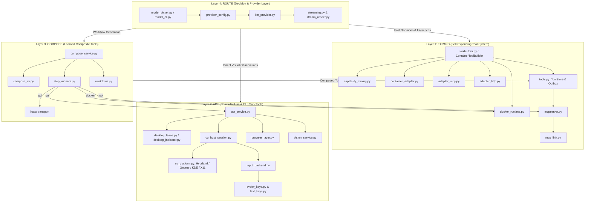
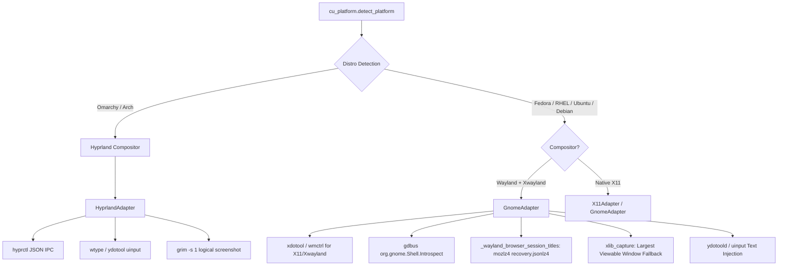
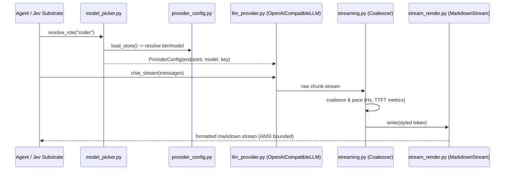
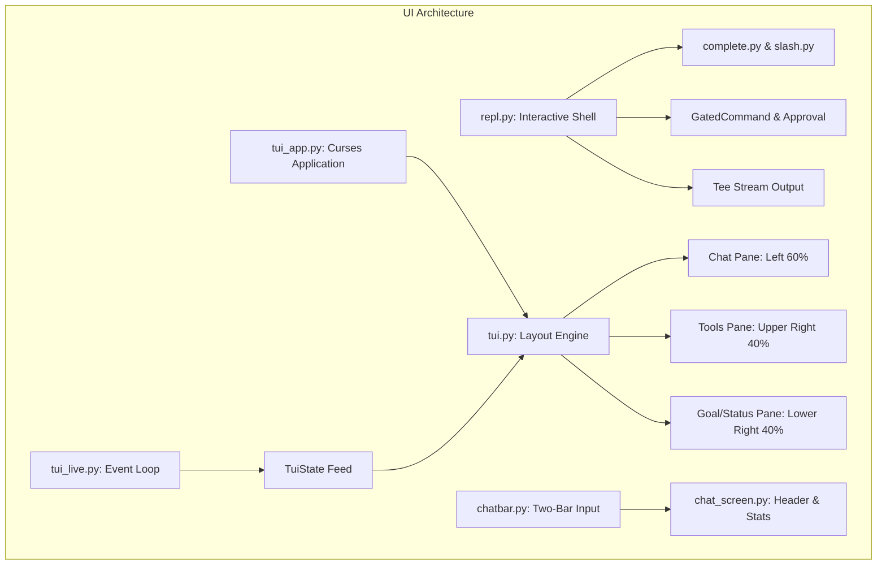
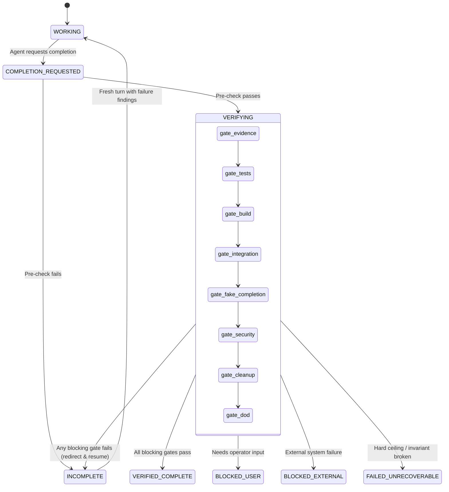
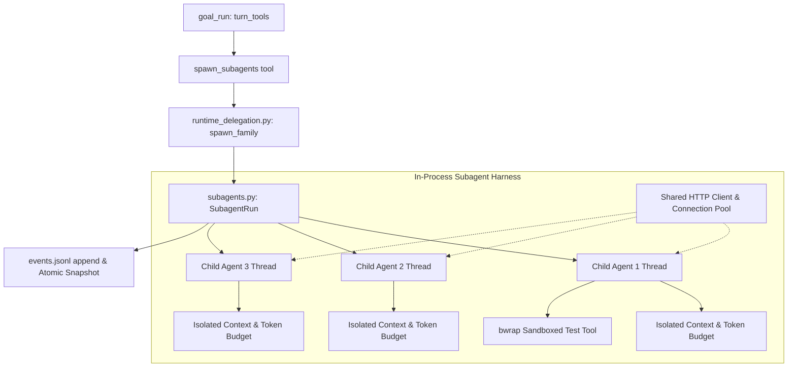
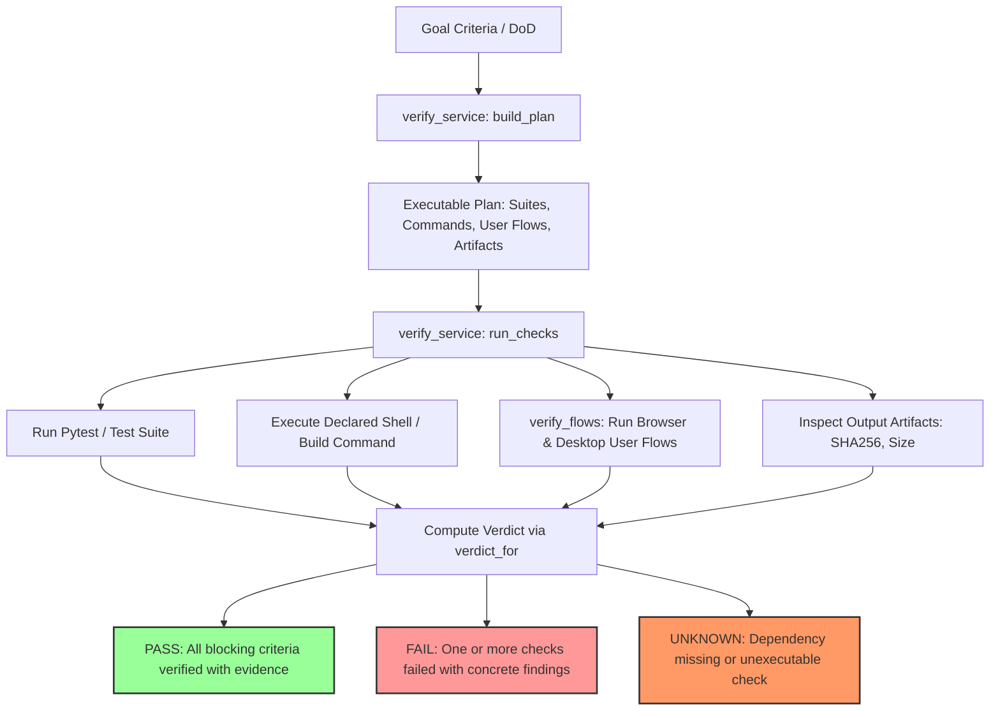
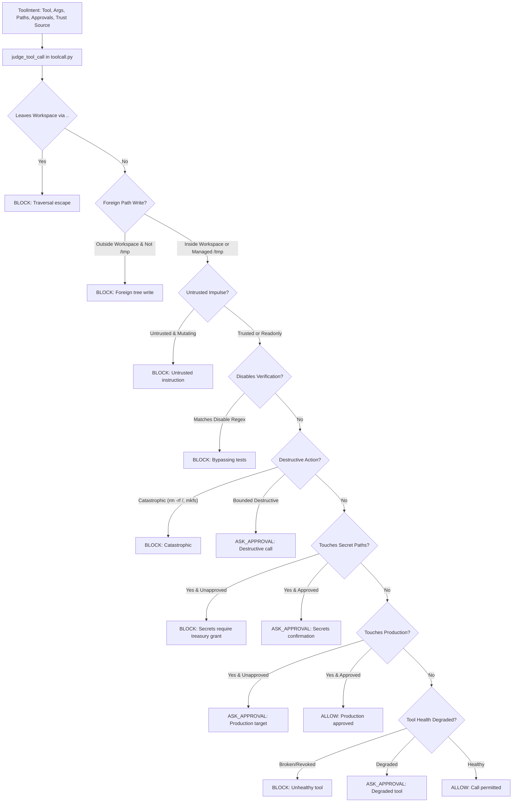

# Skaldir Agent: Comprehensive Codebase & Architecture Handbook

> **Distribution:** `skaldir-agent` · **Executable:** `skaldir` · **Version:** `1.5.0` · **Contract:** `schema_version 1.0`  
> **Source Directory:** `src/skaldir` · **Test Suite:** `tests/` (321 test modules, 288+ unit & golden tests)  
> **Repository:** [https://github.com/bertus37987/skaldir](https://github.com/bertus37987/skaldir)

---

## Executive Summary & System Vision

Skaldir is an autonomous, self-learning agent runtime designed for high-stakes software engineering, systems administration, and end-to-end computer use. Built on strict invariant-driven engineering, Skaldir repudiates "hallucinated completion" and unbounded tool proliferation. It operates under four fundamental operational guarantees:

1. **No Success Without Evidence:** An agent loop, tool execution, or verification routine reporting `ok: true` without an attached cryptographic evidence ledger is downgraded to exit code 7 (internal error).
2. **Deterministic Exit Codes & Structured Envelopes:** All CLI commands output a unified JSON envelope on `stdout` (`schema_version`, `ok`, `command`, `duration_ms`, `exit_code`, `data`, `error`, `evidence`) and partition human logs to `stderr`. The 9 exit codes (0–8) strictly separate usage errors, verification failures, security blocks, credential needs, and internal issues.
3. **Hardware-Isolated Computer Use:** Computer use and desktop driving operate within isolated display bridges (`Xvfb`), bubblewrap namespaces, and rootless containers. Live desktop interactions require explicit, scoped permissions with on-screen visual fencing indicators.
4. **Three-Tier Policy & Voice Guard:** Unsupervised mutations are checked prior to execution against secret path signatures, production markers, and verification disablement patterns. Three operational approval modes (`interactive`, `auto_read`, `autonomous`) govern operator intervention.

---

## Master Architecture: The 8 Operational Layers

```mermaid
graph TD
    subgraph Layer 1: EXPAND [Layer 1: EXPAND - Self-Expanding Tools]
        TB[ToolBuilder & Mining] --> CA[Container & MCP Adapters]
        CA --> TS[SQLite ToolStore & Transactional Outbox]
    end

    subgraph Layer 2: ACT [Layer 2: ACT - Computer Use & Display Bridges]
        CHS[cu_host_session] --> CP[cu_platform: Fedora / Omarchy / Debian]
        CP --> IB[input_backend & evdev/text_keys]
        CHS --> BL[browser_layer: agent-browser CDP]
    end

    subgraph Layer 3: COMPOSE [Layer 3: COMPOSE - Learned Composite Workflows]
        CS[compose_service] --> SR[StepRunners: tool / docker / api / gui]
        SR --> WF[workflows.py]
    end

    subgraph Layer 4: ROUTE [Layer 4: ROUTE - Provider & Stream Coalescence]
        MP[model_picker & roles] --> LP[llm_provider: OpenAICompatibleLLM]
        LP --> STR[streaming & stream_render MarkdownStream]
    end

    subgraph Layer 5: SUPERVISE [Layer 5: SUPERVISE - Agent Loop & Chat UI]
        AL[AgentLoop & ToolSet] --> REPL[repl & chatbar Two-Bar UI]
        AL --> TUI[tui_app 3-Pane Responsive Curses UI]
    end

    subgraph Layer 6: ENFORCE [Layer 6: ENFORCE - Goal Runs & Strict Completion]
        GR[goal_run] --> CR[completion.GateRunner: 4-Stage Gate]
        GR --> SA[subagents: In-Process Threading & Context Fences]
        GR --> JEV[system_one & jev Decision Layer]
    end

    subgraph Layer 7: VERIFY [Layer 7: VERIFY - Real-World Flow Verification]
        VS[verify_service & build_plan] --> VF[verify_flows: Browser & GUI Proofs]
        VS --> GATES[gates.py: Bubblewrap Isolation Gate]
    end

    subgraph Layer 8: PERSIST [Layer 8: PERSIST & SECURITY - Memory & Policy]
        MEM[memory & knowledge: SQLite FTS5] --> CM[context_manager & jevcomp]
        SCHED[scheduler & scheduler_worker: Europe/Berlin Cron]
        VG[Voice Guard: toolcall.py] --> AG[ApprovalGate: interactive/auto/always]
    end

    EXPAND --> ACT
    ACT --> COMPOSE
    COMPOSE --> ROUTE
    ROUTE --> SUPERVISE
    SUPERVISE --> ENFORCE
    ENFORCE --> VERIFY
    VERIFY --> PERSIST
```



---

## Table of Contents

- [Executive Summary & System Vision](#executive-summary--system-vision)
- [Master Architecture: The 8 Operational Layers](#master-architecture-the-8-operational-layers)
- [Part I: Capability Mining, Execution & Routing (Layers 1–4)](#part-i-capability-mining-execution--routing-layers-14)
  - [1. Layer 1: EXPAND (Self-Expanding Tool System)](#1-layer-1-expand-self-expanding-tool-system)
  - [2. Layer 2: ACT (Computer Use, OS Platforms & Browser Automation)](#2-layer-2-act-computer-use-os-platforms--browser-automation)
  - [3. Layer 3: COMPOSE (Learned Composite Tools)](#3-layer-3-compose-learned-composite-tools)
  - [4. Layer 4: ROUTE (Model Routing & Stream Rendering)](#4-layer-4-route-model-routing--stream-rendering)
- [Part II: Supervision, Enforcement, Verification & Security (Layers 5–8)](#part-ii-supervision-enforcement-verification--security-layers-58)
  - [5. Layer 5: SUPERVISE (Agent Loop, Core Toolset, REPL & TUI)](#5-layer-5-supervise-agent-loop-core-toolset-repl--tui)
  - [6. Layer 6: ENFORCE (Goal-Locked Runs, Strict Completion & Subagents)](#6-layer-6-enforce-goal-locked-runs-strict-completion--subagents)
  - [7. Layer 7: VERIFY (Real-World Flow Verification & Gates)](#7-layer-7-verify-real-world-flow-verification--gates)
  - [8. Layer 8: PERSIST & SECURITY (Memory, Compaction, Scheduler, Voice Guard & Approvals)](#8-layer-8-persist--security-memory-compaction-scheduler-voice-guard--approvals)
- [Part III: Cross-Platform Operating System & Display Matrix](#part-iii-cross-platform-operating-system--display-matrix)
- [Part IV: CLI Reference, Slash Verbs & Exit Codes](#part-iv-cli-reference-slash-verbs--exit-codes)
- [Part V: Developer & Contributor Guide](#part-v-developer--contributor-guide)

---

## Part I: Capability Mining, Execution & Routing (Layers 1–4)

## Architecture Flow Overview (Layers 1 – 4)



---

## 1. LAYER 1: EXPAND (Self-Expanding Tool System)

Layer 1 gives Skaldir the autonomous capability to detect tool gaps, inspect container/API/MCP surfaces, generate typed adapters, verify them against real executions under strict sandboxing, and publish them with atomic rollback guarantees.

### 1.1 Architectural Flow & Core Rules
1. **Compose-Before-Create**: Before building a new tool, `toolbuilder.py` queries `tools.py:compose_candidates_scored` and `capability_mining.py:search_before_build`. If existing tools cover the requested functionality (overlap threshold ≥ 3 distinct subject terms), generation is refused in favor of reuse.
2. **Propose-First Lifecycle**: Tools begin as unapproved proposals (`candidate`). They must pass static AST security checks, sandboxed execution gates (`gates.py`), and integration probes before advancing to `scanned` and `approved`.
3. **Transactional Publication (§4d Outbox Pattern)**: Registry state in `tools.db` (`tool_specs`) and the publication event (`publish_outbox`) are committed in the **exact same SQLite transaction**. Crash recovery drains pending outbox events idempotently (`publish_outbox_acks`). Monotonic revisions (`registry_meta: registry_revision`) guarantee client cache coherence.
4. **Digest Pinning (Manifest v2)**: Mutable container tags (e.g., `:latest`) are prohibited. All container tools must specify an immutable digest matching `^sha256:[0-9a-f]{64}$`.

---

### 1.2 Module Breakdown & Key Classes

#### `tools.py` — The Specification, Registry & Outbox Store
- **`ToolSpec`**: Data contract representing tools:
  ```python
  @dataclass
  class ToolSpec:
      name: str
      title: str
      description: str = ""
      tags: list[str] = field(default_factory=list)
      kind: str = KIND_PYTHON  # "python" or "composition"
      module: str = ""
      entrypoint: str = ""
      steps: list[dict] = field(default_factory=list)
      test_command: list[str] = field(default_factory=list)
      sample_input: dict = field(default_factory=dict)
      rationale: str = ""
      provenance: str = "manual"
      status: str = STATUS_CANDIDATE  # candidate | scanned | approved | revoked
      version: str = "0.1.0"
      scan_summary: str = ""
      created: float = 0.0
      updated: float = 0.0
      id: int | None = None
  ```
- **`ToolStore`**: Thread-safe SQLite store configured with `PRAGMA journal_mode=WAL`:
  - `publish(spec, payload, ts)`: Atomically updates `tool_specs`, inserts an event into `publish_outbox` (with `UNIQUE(name, version)` idempotency), and increments `registry_revision`.
  - `drain_outbox(consumer, limit=200, ack=True)`: Retrieves unacknowledged publications and records consumer ACKs in `publish_outbox_acks`.
  - `resolve_tool(store, name, index=None)`: Resolves a tool spec with fail-safe fallback to `tools.db` even when semantic search indices are unavailable.
  - `draft_tool_spec_result(client, registry, need, existing_tools, budget)`: Generates LLM-assisted tool specifications bounded by strict character/token budgets (`BudgetTracker`).

#### `toolbuilder.py` — The Autonomous Build & Mining Pipeline
- **`ToolBuildRequest`**: DTO containing target capability requirements, input/output schemas, test cases, and container images.
- **`ToolBuilder`**: Persistent build state machine operating through `BuildFlowStore` (`buildflow.db`):
  - Stages: `requested` $\rightarrow$ `researching` $\rightarrow$ `generating` $\rightarrow$ `manifest` $\rightarrow$ `dependency_inspection` $\rightarrow$ `gates` $\rightarrow$ `register` $\rightarrow$ `ready`.
  - Idempotent admission: Multiple identical build requests subscribe to an in-flight build rather than duplicating execution.
- **`ContainerToolBuilder(ToolBuilder)`**: Specialization for container image mining:
  - `search_existing_adapter(capability, name)`: Verifies existing catalog capabilities.
  - `mine_container(capability, image, ...)`: Coordinates inspection of CLI/API surface, template matching, live testing, and staging.
- **Manifest v2 Validation**: `validate_manifest_v2(manifest)` enforces:
  - `runtime: "docker"` requires a valid SHA256 image digest.
  - `mounts` require absolute `host_path` and `container_path`.
  - `validate_build_mounts(mounts, workdir)` confines volume mounts strictly to tool build scratch directories.

#### `docker_runtime.py` — Sandboxed Container Execution Engine
- **`DockerRuntimeManager`**: Low-level Docker client driving container execution via fixed CLI arg lists:
  - `resolve_digest(image)`: Queries the local daemon for the pinned repo digest.
  - `pull(image)`: Executes image pull with classified error diagnostics.
  - `run(config)` & `start(config)`: Dispatches one-shot or daemon containers. One-shot invocations automatically inject `--rm` as the first argument after `run`.
- **`RunConfig` Safety Policy**:
  - `privileged=True` raises `PolicyViolation` immediately.
  - Mounting `/var/run/docker.sock` is unconditionally forbidden.
  - System directories (`/`, `/etc`, `/usr`, `/proc`, `/sys`, `/home`, etc.) are blacklisted in `validate_mounts`.
  - Default network isolation is `--network none`. Port binding automatically promotes network to `bridge`.
- **Structured Failure Taxonomy (`RuntimeFailure`, `StartResult`)**:
  - Classifies errors into machine-readable categories: `image_missing`, `arch_mismatch`, `port_conflict`, `quota_limit` (HTTP 429 rate limits), `policy_violation`, `cleanup_partial`.
- **Label-Scoped Teardown**:
  - All spawned containers carry `godsv.owner=skaldir`.
  - `cleanup_by_labels(labels)` generates **individual `--filter` arguments per label**:
    ```python
    def label_filter_args(labels: dict[str, str]) -> list[str]:
        args: list[str] = []
        for key, value in (labels or {}).items():
            args += ["--filter", f"label={key}={value}"]
        return args
    ```
    *(Note: Docker daemon ignores comma-joined `--filter label=a=1,b=2` by treating it as a single invalid key-value pair; Skaldir prevents this via separate CLI flags).*

#### `container_adapter.py` — Staged Adapter Runtime
A zero-dependency, stdlib-only runtime placed directly into `generated_tools/<name>/container_adapter.py`.
- **4-Phase Call Cycle**:
  1. `resolve_inputs(spec, payload)`: Validates primitive types (int, float, bool, str, path, enum), enforces boundaries, sniffs MIME types via `container_media`, checks file presence.
  2. `render(spec, values)`: Converts typed values to CLI argument vectors. Supports conditional flags (`when`, `when_not`, `when_given`), literal templates, and `TRANSFER_ARGV_BASE64` (bounded by kernel `MAX_ARG_STRLEN`).
  3. `parse_stdout(spec, stdout)`: Parses output lines using single-value or keyed markers (`<name>@b64=<payload>` for binary artifacts, `<name>=<value>` for scalar strings).
  4. `write_artefacts(outputs, values)`: Decodes base64 artifacts and atomically persists them to specified host destinations.

#### `adapter_mcp.py` & `adapter_http.py` — External Protocol Mining
- **`adapter_mcp.py`**:
  - `StdioTransport` & `HttpTransport`: Supports child-process stdio MCP servers and HTTP SSE streams.
  - `MCPClient`: Implements JSON-RPC 2.0 handshake (`initialize`, `notifications/initialized`), tool discovery (`tools/list`), and execution (`tools/call`).
  - `map_surface(...)` & `stage_mcp_tool(...)`: Translates MCP JSON schemas into typed Python wrappers. Includes atomic snapshotting and rollback (`snapshot_for_rollback`).
- **`adapter_http.py`**:
  - `inspect_http_surface(spec)`: Parses OpenAPI 3.x and Swagger 2.0 definitions.
  - `generate_http_adapter(...)`: Generates HTTP client wrappers with typed query, path, and header bindings.
  - `resolve_http_oracle(...)`: Validates generated HTTP tools against algorithmic oracle functions (`_oracle_sha256`, `_oracle_base64`, `_oracle_md5`).

#### `mcpserver.py` & `mcp_link.py` — Tool Exposure & Host Wiring
- **`mcpserver.py`**: FastMCP-based server exposing approved Skaldir tools to host LLMs.
  - `approved_python_specs(store)`: Selects all `status="approved"` tools from `tools.db`.
  - `_run_generated_in_sandbox(module, entrypoint, payload)`: Executes tools inside bubblewrap (`bwrap`) isolation before returning tool results.
  - `mcp_input_schema(spec)` & `mcp_output_schema(spec)`: Dynamically generates JSON Schema definitions.
- **`mcp_link.py`**: Manages host configuration integration (`~/.hermes/mcp.json`). `ensure_linked()` writes server definitions pointing to `skaldir mcp-serve`, enabling native tool discovery by the host agent.

---

## 2. LAYER 2: ACT (Computer Use & GUI Sub-Tools)

Layer 2 provides deterministic, sandboxed, and verifiable operating system and application control across diverse Linux desktop environments and display servers.

### 2.1 The Seven Universal Desktop Verbs
Every environment implements `PlatformAdapter` (`cu_platform.py`):
1. `list_windows() -> list[WindowInfo]`
2. `get_active_window() -> WindowInfo | None`
3. `focus_window(wid: str) -> bool`
4. `close_window(wid: str) -> bool`
5. `send_key(key: str, window: str = "") -> bool`
6. `send_text(text: str, window: str = "") -> bool`
7. `mouse_move / mouse_click / mouse_drag / screenshot / launch_app`

---

### 2.2 Deep Dive: Linux Platform & Compositor Support



#### 1. Fedora GNOME / Wayland + Xwayland Support
- **The Wayland / XTEST Isolation Challenge**:
  On Fedora running GNOME on Wayland with an active Xwayland display (`DISPLAY=:0`), synthetic input via `xdotool key` or `XTEST` returns an exit code of `0`, but Mutter drops or intercepts the simulated input events before they reach Xwayland or Wayland clients. Furthermore, taking a root-window screenshot via standard `XGetImage` fails with an X11 `BadMatch` error because the Xwayland root window has no backing pixmap.
- **Skaldir's Multi-Tier Solutions in `GnomeAdapter` & `cu_platform.py`**:
  1. *Dual Window Inspection*: Combines `xdotool search` / `wmctrl -lGpx` (for X11/Xwayland clients) with D-Bus calls via `gdbus` to `org.gnome.Shell.Introspect.GetWindows` (for Wayland-native clients).
  2. *GNOME 45+ Restricted Introspect Fallback (`_wayland_browser_session_titles`)*:
     When GNOME Shell restricts `GetWindows` access, Skaldir bypasses D-Bus and reads open tab titles and URLs directly from disk by locating running Firefox or Zen Browser session recovery files (`sessionstore-backups/recovery.jsonlz4`).
  3. *Pure-Python MozLZ4 Decompressor (`_decompress_mozlz4`)*:
     Implements Mozilla's non-standard `mozLz40\0` raw LZ4 block decompression in pure Python without external dependencies:
     ```python
     def _decompress_mozlz4(data: bytes) -> bytes:
         if len(data) < 12 or data[:8] != b"mozLz40\x00":
             return b""
         expected_len = struct.unpack("<I", data[8:12])[0]
         # Decodes 15-byte literals and LZ4 match copy sequences...
         return bytes(out[:expected_len])
     ```
  4. *Xwayland Root Screenshot Fallback (`_xlib_root_screenshot`)*:
     When capturing root fails with `XlibCaptureError (BadMatch)`, Skaldir queries the X11 window tree (`query_tree().children`), filters for mapped and viewable `InputOutput` windows, and captures the **largest viewable Xwayland window** on the display.
  5. *Binary Alias Resolution (`resolve_app_command`)*:
     Normalizes commands to Fedora package defaults:
     - `gnome-terminal` $\rightarrow$ `ptyxis` (Fedora 40+ default terminal) $\rightarrow$ `foot` $\rightarrow$ `kitty`
     - `gedit` $\rightarrow$ `gnome-text-editor`
     - `calc` $\rightarrow$ `libreoffice --calc`

#### 2. Omarchy Hyprland Support
Omarchy (DHH's Arch Linux + Hyprland + Quickshell stack) is treated as a first-class distribution.
- **Detection**: Checks `/etc/omarchy-release`, `~/.config/omarchy`, or `$HYPRLAND_INSTANCE_SIGNATURE`.
- **`HyprlandAdapter` Architecture**:
  1. *Full Window State via JSON IPC*: Calls `hyprctl clients -j` and `hyprctl activewindow -j`. Unlike `xdotool`, this inspects all Wayland-native clients (Zen Browser, Foot, Ghostty, Alacritty) with exact pixel coordinates (`at: [x, y]`), sizes (`size: [w, h]`), workspaces, and floating status.
  2. *Window Operations*: Dispatches commands directly over Hyprland IPC sockets:
     - Focus: `hyprctl dispatch focuswindow address:<id>`
     - Close: `hyprctl dispatch closewindow address:<id>`
  3. *Input Dispatch Cascade*:
     - Keys: `wtype` $\rightarrow$ `hyprctl dispatch sendshortcut <key> <window>` $\rightarrow$ `ydotool` $\rightarrow$ `xdotool`.
     - Text: `wtype -- <text>` $\rightarrow$ `ydotool type` $\rightarrow$ Clipboard Injection (`wl-copy -- <text>` + `hyprctl dispatch sendshortcut ctrl+v`).
     - Mouse: `hyprctl dispatch movecursor <x> <y>` $\rightarrow$ `wlrctl pointer click <btn>` $\rightarrow$ `ydotool click`.
  4. *Pixel-Perfect Scaling*: Captures screenshots using `grim -s 1 <path>` to enforce 1:1 logical coordinate mapping matching `hyprctl` window geometries.
  5. *Omarchy System Hotkeys (`OMARCHY_HOTKEYS`)*:
     Pre-configures shortcuts from Omarchy specifications: `menu: Super+Space`, `terminal: Super+Return`, `browser: Super+Shift+Return`, `close_window: Super+W`, `capture_menu: Super+Ctrl+C`.

#### 3. Debian / Ubuntu Support
- Supports classic X11 sessions and standard Ubuntu GNOME Wayland.
- Standard toolchain discovery: `wmctrl`, `xdotool`, `xprop`, `scrot`, `maim`, `gnome-screenshot`, `import` (ImageMagick).
- Resolves distribution binaries: maps `browser` $\rightarrow$ `firefox` / `chromium-browser`, `terminal` $\rightarrow$ `gnome-terminal`.

---

### 2.3 Measured Input Verification (`input_backend.py`)
To prevent false-positive reporting where `rc == 0` but no key event was processed, `input_backend.py` defines the **VAL-INPUT-005** contract:
- **The Six Probe States (`ProbeState`)**:
  1. `BACKEND_MISSING`: Executable missing or daemon socket unreachable.
  2. `CONSENT_MISSING`: Wayland RemoteDesktop portal requires user permission.
  3. `PROBE_MISCONFIGURED`: Test harness could not be initialized (treated as `UNKNOWN`, never a host error).
  4. `INPUT_SENT`: Command executed with `exit_code == 0` (*dispatch, not delivery*).
  5. `INPUT_OBSERVED_AT_TARGET`: Ephemeral probe window confirmed marker arrival within time window.
  6. `APP_EFFECT_VERIFIED`: Measurable state change observed in target application (**only this counts as success**).
- **Ephemeral Probe Protocol**: Spawns an internal target window (`ProbeWindow`) with a title containing a cryptographic nonce (`SKALDIR-PROBE-<token>`), sends a sequence via `ydotool`/`xdotool`, and verifies that the window's event queue logged the exact key delivery.

---

### 2.4 Hardware Event Translation (`evdev_keys.py` & `text_keys.py`)
When Wayland isolates XTEST, Skaldir falls back to kernel-level `uinput` event simulation via `ydotoold`:
- `evdev_keys.py`: Parses active X11 keymaps via `xmodmap -pke`, mapping symbolic names (`Return`, `BackSpace`, `Page_Up`) to Linux kernel input codes (`KEY_ENTER`, `KEY_BACKSPACE`, `KEY_PAGEUP`).
- `text_keys.py`: Translates arbitrary UTF-8 characters into shift-state pairings and multi-group XKB keycode events, returning argument vectors for `ydotool key <code:1> <code:0>` (press and release).

---

### 2.5 Desktop Fencing & Lease Protocol (`desktop_lease.py`, `desktop_indicator.py`)
Prevents split-brain control and races between parallel agent runs (DESK-01..DESK-04):
- **`DesktopLeaseStore`**: Uses POSIX `fcntl` file locking on `desktop-lease.json`.
- **Fencing Token (`generation`)**: Every lease acquisition increments a monotonic generation integer. Before executing any hardware action, adapters verify:
  ```python
  lease.fence(action_token)
  ```
  If `action_token < current_generation`, the action is discarded with a `StaleFence` exception.
- **On-Screen Indicator (`desktop_indicator.py`)**: Renders a dedicated corner overlay indicating host state (`CONTROLLING`, `WAITING`, `PAUSED`, `FREE`), active task description, and emergency break sequence (`Esc, Esc`).

---

### 2.6 Host Session Isolation (`cu_host_session.py`)
`HostSessionRunner` provides two strictly separated execution modes:
1. **`owned-display` Mode (`BRIDGE_HOST_SESSION`)**:
   - Spawns a dedicated virtual `Xvfb` display on `:91`+.
   - Completely isolated (`is_isolated = True`); cannot touch user `$DISPLAY`.
   - Process reaper (`reap_orphaned_displays`) inspects `/proc/<pid>/cmdline` and reclaims leaked displays on exit.
2. **`live-session` Mode (`BRIDGE_LIVE_DESKTOP`)**:
   - Gated behind explicit configuration: `computer_use.allow_live_desktop: true` and `computer_use.live_desktop_target: "<window-id>"`.
   - **Structural Command Generation**: Agent plans cannot pass arbitrary shell commands. `HostSessionRunner` generates structural `xdotool` invocations targeting only the bound window ID. Unscoped clicks or desktop-level commands are rejected by construction.

---

### 2.7 Browser Layer (`browser_layer.py`) & Vision (`vision_service.py`)
- **`BrowserLayer`**:
  - Implements `SessionManager` preventing window floods. Employs cross-process mutex `browser-session.lock`.
  - Isolate profile: Launches under `--session skaldir`, completely isolated from the user's default browser profile.
  - Operation set: `browser.discover`, `browser.attach`, `browser.tabs`, `browser.observe`, `browser.act`, `browser.read`, `browser.verify`.
  - DOM references are strictly bound to `(session_id, tab_id, observation_revision)`. Navigating invalidates earlier references.
- **`vision_service.py`**:
  - Multimodal analysis: `describe()`, `ocr()`, `screenshot()`.
  - Path confinement: Enforces `workspace_root` boundaries to prevent unauthorized image reading outside project scopes.

---

## 3. LAYER 3: COMPOSE (Learned Composite Tools)

Layer 3 compiles, validates, and runs multi-step pipelines combining CLI tools, Docker containers, HTTP APIs, and Computer-Use GUI actions into single composite capabilities.

### 3.1 Architectural Structure & Lifecycle
- **Definition Storage**: Stored as standalone JSON files in `<runtime>/composites/<name>.json`.
- **Registry Integration**: Mirrored into `tools.db` with `ToolSpec.kind = "composition"`. A composite tool cannot be executed unless its registry status is `approved`.
- **Drift Detection**: `document_digest(spec)` calculates a SHA256 hash of the definition file and compares it against registry metadata to detect manual tampering.

---

### 3.2 The Check Grammar (Preconditions & End-States)
The composition engine evaluates assertions using an AST parser without executing `eval()`:
- **Literals & Built-ins**: `always`, `never`, `exit_ok` (checks previous step success).
- **Input/Step Bindings**: `$input.<name> present|empty`, `$steps.<id>.<key> present|empty`.
- **Comparisons**: `==`, `!=`, `>`, `<`, `>=`, `<=`, `contains`.
- **Logical Connectives**: Clauses are evaluated conjunctively (`and`).

---

### 3.3 Step Runners Execution Model (`step_runners.py`)
`step_runners.py` resolves execution across four step kinds:

| Step Kind | Execution Engine | Validation Requirements | Output Keys |
| :--- | :--- | :--- | :--- |
| **`tool`** | `mcpserver._wrapper_for` (Bubblewrap sandbox) | Must be an approved tool in `tools.db`. | Tool return payload |
| **`docker`** | `DockerRuntimeManager.run` (one-shot, `--network none`) | Pinned `image_digest` (`sha256:...`). Mount validation. | `ok`, `exit_code`, `stdout`, `stderr` |
| **`api`** | `step_runners.run_api_step` (`httpx` transport) | Declared HTTP method, URL, status code assertions. | `status_code`, `headers`, `json`, `text`, `elapsed_ms` |
| **`gui`** | `step_runners.run_gui_step` (`act_service.py`) | Stored subtool name or `inline` actions. Display bridge. | `success`, `window_title`, `screenshot_path`, `end_state_ok` |

#### Detailed Implementation of `run_api_step`:
Performs real HTTP calls using `httpx`, handles variable interpolation (`$input.param`, `$steps.prev.token`), retries on failure (`ApiRetry`), and tests status/body assertions:
```python
outcome = run_api_step(step, arguments, context=context, runtime=runtime_path)
```

#### Detailed Implementation of `run_gui_step`:
Delegates to `act_service.run_action_list` or `act_service.run_subtool`. Refuses synthetic mock fixtures (`allow_fixture=False`). Binds parameters into action coordinates and keystrokes, executes on the active display bridge, and returns verified visual evidence.

---

### 3.4 Workflows & CLI Interface
- **`workflows.py`**: Coordinates long-running browser and application verification routines. Connects Chrome DevTools Protocol (`cdp_targets`, `cdp_screenshot`, `_cdp_eval`) with OS-level window management.
- **`compose_cli.py`**:
  - `skaldir compose candidates`: Scans tool invocation patterns and mines candidate sequences.
  - `skaldir compose create --file spec.json`: Registers a new composite draft.
  - `skaldir compose validate <name>`: Validates step references, Docker digest pinning, and runner availability.
  - `skaldir compose run <name> --input '{"key": "val"}'`: Executes the verified composite pipeline.
  - `skaldir compose show <name>`: Dumps the active spec and lifecycle status.

---

## 4. LAYER 4: ROUTE (Model Routing & Decision Layer)

Layer 4 abstracts multi-model LLM access, manages token streaming and TUI rendering, routes specialized roles (fast, smart, coder, vision), and handles provider configurations.

### 4.1 Architectural Flow



---

### 4.2 Module Breakdown & Key Components

#### `llm_provider.py` — The Universal Provider Abstraction
- **`OpenAICompatibleLLM`**: Universal client driving OpenAI, Ollama, vLLM, OpenCode, Anthropic (via proxy), and local LLM endpoints.
- **`ProviderConfig`**: Configuration dataclass:
  - Base URLs, credential handles (`secret://`), connection timeouts, context window limits.
  - Tier mappings: `small` (cheap/fast), `mid` (balanced), `large` (heavy reasoning).
- **Reasoning Budget Support**:
  - Extracts and normalizes reasoning tokens (`reasoning_content` or `<think>...</think>`).
  - `reasoning_budget_artifact()`: Creates structured artifacts of model deliberation before tool dispatch.
- **Structured Outputs (`structured_chat`)**:
  - Enforces `json_schema` via `response_format` payload parameters.
  - Provides fallback translation for models lacking native JSON Schema support.
- **Multimodal Vision Integration (`vision_chat`)**:
  - Formats image inputs into base64 data URLs or remote HTTP URLs.
  - `estimate_image_tokens(width, height)`: Calculates tile-based token overhead.

#### `streaming.py` — Stream Metrics & Token Coalescence
- **`StreamMetrics`**: Tracks real-time token generation telemetry:
  - Time to First Token (TTFT).
  - Throughput in Hertz (tokens per second).
  - Total tokens emitted and wall-clock execution duration.
- **`Coalescer`**: Buffering engine preventing terminal stuttering and TUI redraw starvation. Groups micro-chunks arriving within millisecond windows into cohesive text blocks.
- **`LockedStream`**: Thread-safe mutex wrapping output streams, preventing concurrent subagent outputs from interleaving garbled text onto the terminal.
- **`ToolBatch` & `plan_tool_batches`**: Identifies parallel tool calls emitted across streaming chunks, grouping them into atomic execution batches.

#### `stream_render.py` — Flicker-Free Terminal Markdown Rendering
- **`MarkdownStream`**: Incremental parser extending `StreamRenderer`.
- Renders Markdown elements live as tokens stream from the LLM:
  - Code block detection with syntax fence rendering.
  - Dynamic line wrapping bounded by `terminal_columns()`.
  - ANSI sequence sanitization preventing terminal corruption.

#### `model_picker.py` & `model_cli.py` — Role-Based Routing & Interactive Picker
- **Role System**: Decouples prompts from specific model IDs:
  - `fast`: Routing, memory triage, simple classifiers (e.g. `llama-3.2-3b`, `qwen-2.5-7b`).
  - `smart`: Complex reasoning, planning, supervision.
  - `coder`: Code generation and tool synthesis.
  - `vision`: Desktop screenshot interpretation and OCR.
- **Interactive Terminal UI (`select_in_terminal`)**:
  - Curses-style raw mode TUI using standard ANSI codes.
  - Interactive selection of providers, models, and role assignments with keyboard navigation and live search filtering.
- **Slash Command Integration**:
  - `handle_slash(line)`: Intercepts `/model` directives during active chat sessions to switch roles dynamically without restarting the agent loop.

#### `provider_config.py` — Durable Provider Storage
- **`ProviderStore`**: Manages `~/.hermes/skaldir/providers.yaml` (or fallback `~/.hermes/godsv/providers.yaml`):
  - CRUD operations: `add_provider`, `remove_provider`, `set_default`, `set_tiers`.
  - Safe credential management: Sensitive API keys can reference environment variables (`env: OPENAI_API_KEY`) or Treasury handles (`secret://provider/key`). Values are masked in logging output.
  - Health Diagnostics (`doctor` & `probe_provider`): Executes live HTTP pings against configured endpoints, measuring latency, checking authentication, and enumerating available models.

---

## 5. Architectural Invariants Across Layers 1 to 4

1. **Evidence-Locked Progression**: No operation may report success without an attached evidence payload (test execution logs, verified DOM elements, hardware probe event tokens, or HTTP status proofs).
2. **Deterministic Isolation**:
   - Layer 1 isolates tool generation inside Bubblewrap or Docker with `--network none`.
   - Layer 2 isolates desktop control in an owned Xvfb server (`:91`+) unless explicitly opted into a named window on the live desktop.
   - Layer 3 validates all composite steps ahead of execution, refusing mutable container tags and unresolvable variable references.
3. **Fail-Closed Policy Enforcement**: Any policy violation (e.g., attempting to mount `/var/run/docker.sock`, requesting `privileged=True`, or targeting an unscoped live window) returns a structured refusal rather than throwing an unhandled exception or degrading security silently.
4. **Idempotence & Transactional Integrity**: Publication in Layer 1 uses the transactional outbox pattern; Layer 2 uses fencing token generations on desktop leases; Layer 3 tracks composite file digests to prevent configuration drift.

---
*End of Documentation Section for Layers 1 to 4.*

## Part II: Supervision, Enforcement, Verification & Security (Layers 5–8)

## 1. SUPERVISE (Layer 5)

Layer 5 orchestrates model invocation, tool dispatch, runtime observation, and interactive user interfaces. It ensures that the agent acts strictly within bounded operational limits while providing full visibility and control to the operator.

### 1.1 Architectural Overview & Core Loop

```mermaid
sequenceDiagram
    autonumber
    actor Operator as Operator / CLI / TUI
    participant Loop as AgentLoop (agent_loop.py)
    participant Model as LLM Client (OpenAICompatibleLLM)
    participant Jev as Jev TurnDecisions (jev/wiring.py)
    participant Gate as ApprovalGate (approval_gate.py)
    participant Guard as Voice Guard (toolcall.py)
    participant Tools as ToolSet (core_capabilities & agent_toolset)
    participant Tx as Transcript (events.jsonl)

    Operator->>Loop: run(task, run_id)
    Loop->>Loop: Initialize LoopLimits & context
    loop Turn Loop (until completion or limit)
        Loop->>Jev: turn_start(turn, messages, tools)
        Jev-->>Loop: Advisory recorded (never alters toolset directly)
        Loop->>Loop: on_request() hook armed
        Loop->>Model: chat(messages, tools, tool_choice, stream=True)
        Model-->>Loop: Token deltas via on_delta() sink
        Model-->>Loop: ChatResult(content, tool_calls)
        Loop->>Loop: on_answer() hook flushes buffer
        alt No tool calls (pure content)
            Loop->>Tx: event("model.response", text=content)
            Loop-->>Operator: AgentRunResult(completed=True)
        else Tool calls present
            Loop->>Loop: Loop detection (_invalid_signature_counts)
            loop For each ToolCall
                Loop->>Guard: judge_tool_call(ToolIntent)
                Guard-->>Loop: ToolDecision (ALLOW / ASK_APPROVAL / PAUSE / BLOCK)
                Loop->>Gate: decide(tool, text, judge_decision)
                Gate-->>Loop: GateVerdict (ALLOW / PROMPT / FORBID)
            end
            Loop->>Tools: Parallel dispatch (ThreadPoolExecutor, max_workers)
            Tools-->>Loop: on_result(ToolOutcome) streaming per completion
            Loop->>Tx: event("tool.start"), event("tool.end")
            Loop->>Loop: commit_point(tool_executed=True)
        end
    end
```

### 1.2 Key Classes and Functions

#### `AgentLoop` (`agent_loop.py`)
`AgentLoop` is the central operational engine for single-task, multi-turn tool execution.
- **`__init__(self, client, tools, *, state_dir, workspace, limits, goal, system_prompt, tool_choice, tier, policy, approvals, max_result_chars, max_workers, cancel_path, cancel_event, clock, runs_root, progress, on_delta, on_request, on_answer, on_result, stream, decisions, history, archive, retry_gate, approval_mode, approval_gate)`**:
  - Initializes state directories, sets up `LoopLimits`, binds live observational sinks, wires the `ApprovalGate` (from mode or explicit instance), and subscribes the Jev decision layer (`decisions`).
  - `_invalid_signature_counts: dict[str, int]`: Tracks repeated malformed or failing tool calls to break deterministic model hallucination loops (e.g. repeated invalid `run_code` attempts).
- **`run(self, task: str, *, run_id: str = "") -> AgentRunResult`**:
  - Executes the main loop across conversation turns. Evaluates timeout via monotonic clock, maximum turns, and maximum tool errors.
  - Manages token streaming: passes `on_delta` unthrottled to renderers while buffering for final transcript consistency.
  - Handles concurrent tool execution via `concurrent.futures.ThreadPoolExecutor(max_workers=self.max_workers)`, emitting `on_result` as each tool finishes.
- **`commit_point(self, *, tool_executed: bool = False) -> dict[str, Any]`**:
  - Validates cancellation triggers (`cancel_path` file existence or `cancel_event.is_set()`). Writes state checkpoints.

#### Supporting Models (`agent_loop.py`)
- **`ToolSet`**: Represents an immutable, registered collection of callable tools (`of(tools)`). Dispatches by exact wire name and produces standard JSON schemas (`definitions()`).
- **`ToolOutcome`**: Encapsulates tool invocation results: `stdout`, `stderr`, `data`, `exit_code`, and `error`. Enforces bounded string output via `content(limit=max_result_chars)`.
- **`LoopLimits`**: Enforces execution boundaries:
  - `max_turns: int = 40`
  - `max_seconds: float = 900.0`
  - `max_tool_errors: int = 8`
  - `max_consecutive_tool_failures: int = 4`
- **`Transcript`**: Append-only JSONL event journal storing structured trace events (`model.request`, `model.response`, `tool.start`, `tool.end`, `model.tokens`, `tool.error`).

#### Tool Provisioning & Layer Wiring
- **`core_capabilities.py` (`core_capability_tools`)**:
  - Assembles context-bound, workspace-fenced primitives: `run_code`, `terminal`, `read_text`, `write_text`, `search_files`, `list_dir`, `patch`, `web_search`, `browser`, and `process_manager`.
  - Enforces single-identity capability registration (no duplicate alias proliferation) and returns precise refusal reasons if system dependencies (e.g. `podman`, `bwrap`, `python`) are absent.
- **`agent_toolset.py`**:
  - Wraps the entire 8-layer subsystem for loop consumption:
    - Layer 1 (EXPAND): `skill_expand`, `skill_expand_build` (via `ToolBuilder`)
    - Layer 2 (ACT): `act`, `act_check` (via `act_service`)
    - Layer 3 (COMPOSE): `compose_validate` (via `compose_service`)
    - Layer 7 (VERIFY): `verify_workspace`, `verify_flows` (via `verify_service`)
    - Subagents: `subagent_run` (via `runtime_delegation`)
- **`system_prompt.py` (`build_system_prompt`)**:
  - Programmatically constructs the system prompt from the actual, dynamically assembled `ToolSet` rather than hardcoded capability lists.
  - Injects non-negotiable contract markers (`CORE_PROMPT_MARKERS`):
    - *"Call a tool when you need information or an effect; never describe a call you did not make."*
    - *"A failed step is never a success."*
    - *"An UNKNOWN verdict is not a pass."*

### 1.3 Interactive REPL & Terminal UI (TUI)



- **`repl.py` (`Shell`, `Session`, `GatedCommand`)**:
  - Provides a long-lived interactive command shell with history, tab completion, command substitution parsing, non-destructive `Ctrl-C` execution cancellation, and ANSI theme rendering via `Painter`.
- **`chatbar.py` (`ChatBar`, `Turn`, `FrameStream`)**:
  - Implements the framed dual-rule typing interface with live status hints, slash command palette overlays, and cursor erasure arithmetic.
- **`chat_screen.py` (`Screen`, `Reading`)**:
  - Composes the persistent header above the chat bar, detailing model name, context window percentage (`ctx 34%`), throughput (`132 tok/s`), spend (`$0.0042`), and elapsed wall-clock time.
- **`tui.py` (`Screen`, `Geometry`, `TuiState`)**:
  - Confirmed 3-pane responsive terminal layout:
    - **Chat (Left)**: Primary conversational view with streaming token deltas.
    - **Tools (Upper Right)**: Real-time active tool execution list, arguments, and outcomes.
    - **Goal (Lower Right)**: Active goal criteria, verification checkpoints, and budget metrics.
- **`tui_app.py` & `tui_live.py`**:
  - Manages the curses alternate screen buffer, raw input handling, SIGWINCH terminal resizing, and asynchronous event subscription bridging `RunProgress` directly to UI redraws.

---

## 2. ENFORCE (Layer 6)

Layer 6 enforces execution contracts, goal verification, completion invariants, safe delegation, and fast advisory routing. It guarantees that an agent cannot self-certify task completion without external, verifiable proof.

### 2.1 Goal-Locked Execution (`goal_run.py`)

`goal_run.py` drives the multi-turn goal execution loop (`skaldir run "<goal>"`).
1. **Contract Initialization**: Reads criteria from workspace or `--criteria` arguments, builds the initial persistent record in `runs_store.py`, and records baseline facts.
2. **Planning & Baseline Verification**: Derives executable checks for each criterion via `verify_service.build_plan` and executes them once (`--no-baseline` overrides) to determine the starting state.
3. **Turn Execution**: Spins up successive `AgentLoop` instances. Injects atomic transaction tools (`edit_apply` via `edit_tx.py`) and subagent tools (`spawn_subagents`).
4. **Completion Invariant**: When the model signals that work is complete, control passes unconditionally to `completion.GateRunner`. The model is never permitted to mark its own goal complete.

### 2.2 Strict Completion Supervisor (`completion.py`)



#### State Machine & Verification Gates
The completion supervisor enforces strict transitions across well-defined lifecycle states:
- `GateRunner` evaluates candidate completion against real repository facts, execution evidence, and pact requirements:
  - **`gate_evidence` (§17)**: Requires that every claimed item has an executed check with passing status.
  - **`gate_tests` (§19)**: Verifies that tests added or modified in the workspace diff were actually executed by the test runner.
  - **`gate_build`**: Requires that workspace compilation or packaging passes.
  - **`gate_integration`**: Ensures multi-step flows succeed.
  - **`gate_fake_completion`**: Detects empty assertions, dummy mocks, or skipped tests.
  - **`gate_security`**: Audits for lingering secrets, permissions violations, or disabled verification flags.
  - **`gate_cleanup`**: Enforces absence of orphaned temporary files and uncommitted dirty states.
  - **`gate_dod`**: Validates each explicit Definition of Done item.

#### Self-Certification Shortcut Detection (`detect_shortcuts`)
`completion.py` includes a deterministic engine to identify deceptive completion patterns:
```python
# Shortcuts detected by detect_shortcuts():
SHORTCUT_OWN_SUCCESS_MARKER       # Claim matches own completion marker without test execution
SHORTCUT_SELF_CERTIFICATION       # Claim text identical to completion text with no runner proof
SHORTCUT_FILE_EXISTS_UNCHECKED    # Existence of file assumed to imply correct functionality
SHORTCUT_MOCK_AS_LIVE             # Unit test mock offered as proof of live external integration
SHORTCUT_UNIT_TEST_AS_LIVE        # Pure unit test offered where live verification is required
SHORTCUT_OLD_GREEN_RUN            # Evidence produced under an older goal revision
SHORTCUT_FOREIGN_WORKSPACE        # Evidence produced in a different directory or machine
SHORTCUT_PASS_WITHOUT_CONTRACT    # Event passed but did not fulfill outcome contract
```

### 2.3 Subagent Execution & Runtime Delegation



- **`subagents.py` (`SubagentRun`, `ChildBrief`, `ChildResult`)**:
  - High-performance, in-process multi-threading subagent harness. Replaces separate OS process spawns, eliminating interpreter startup overhead and redundant package imports.
  - **Shared Provider Client**: A single `OpenAICompatibleLLM` instance and underlying HTTP connection pool is shared across all concurrent children.
  - **Context Isolation**: Each child operates within an isolated context window with its own prompt ID (`subagent.<run>.<child>.t<turn>`), scoped token budget (`budget_tokens`), and independent transcript.
  - **Streaming Observability**: All state transitions are appended to `events.jsonl` and persisted to the run snapshot file in real time.
- **`runtime_delegation.py` (`child_handlers`, `spawn_family`)**:
  - Bridges the agent loop to subagent execution. Implements role ceilings:
    - `analyst`: Read-only file tools and search.
    - `explorer`: Read-only tools, directory traversal, and non-mutating probes.
    - `executor`: Fenced file writes and atomic patch application (`edit_tx.py`).
    - `verifier`: Sandboxed test execution via Bubblewrap (`bwrap`).

### 2.4 Jev Decision Layer & System One (`system_one.py`, `jev/`)

```mermaid
graph LR
    subgraph Business Modules
        Voice[voice.py]
        Completion[completion.py]
        Compaction[context_manager.py]
    end

    subgraph The Facade Invariant
        JevDecide[jev/decide.py: decide()]
        SystemOneService[system_one_service.py: SystemOneService]
    end

    subgraph Advisory Provider Substrate
        SystemOneGate[system_one_policy.py: SystemOneGate]
        Evaluator[SystemOneEvaluator / TypeSafe / LLM Adapter]
    end

    Voice --> SystemOneService
    Completion --> SystemOneService
    Compaction --> JevDecide
    JevDecide --> SystemOneService
    SystemOneService --> SystemOneGate
    SystemOneGate --> Evaluator
```

- **The Façade Rule**: Business modules never communicate with external decision providers directly. `SystemOneService` is the single permitted gateway. Within `skaldir.jev`, only `jev/decide.py` is allowed to import `SystemOneService`.
- **Contracts (`jev/contracts.py`)**: All request and answer structures are immutable Pydantic models with `frozen=True` and `extra="forbid"`. Seven discrete decision types are supported:
  1. `JevMemoryInjectionRequest` / `MemoryInjectionAnswer`
  2. `JevToolRoutingRequest` / `ToolRoutingAnswer`
  3. `JevCapabilityRankingRequest` / `CapabilityRankingAnswer`
  4. `JevCompactionRequest` / `CompactionAnswer`
  5. `JevVoiceTriageRequest` / `VoiceTriageAnswer`
  6. `JevAdversarialPlanRequest` / `AdversarialPlanAnswer`
  7. `JevSemanticVerificationRequest` / `SemanticVerificationAnswer`
- **Strict Contracts (`system_one.py`)**:
  - `NoulAnswer`: Single probability float `[0.0, 1.0]` without confidence fields.
  - `ChoiceAnswer`: Categorical distribution summing to `1.0 +/- 1e-4`.
  - `ScoreAnswer`: Bounded numerical score with confidence rating.
- **Policy Enforcement (`system_one_policy.py`)**:
  - **`SystemOneGate`**: Manages timeouts and retries (401 unretried; 422 contract error; 429/529 retried with exponential backoff within absolute deadline).
  - **Staleness Refusal (§92)**: Late provider responses generated against older workspace states, revisions, or question packs are marked stale and discarded.
  - **Risk Classes R0–R4 (§44)**: Actions in class R4 can never be authorized by System One alone; operator confirmation is strictly required.
  - **Shadow Mode (§45)**: Records advisory predictions in parallel without mutating the live execution trajectory (`mutations=0`, `route=None`).

---

## 3. VERIFY (Layer 7)

Layer 7 embodies real-world verification. It rejects the assumption that code existence or exit code 0 equals correctness. It proves whether an end-user can successfully use the software by planning, executing, and recording verifiable checks against the workspace.

### 3.1 Verification Architecture & Tri-State Verdicts



- **Tri-State Invariant**: Verification produces only `PASS`, `FAIL`, or `UNKNOWN`:
  - `PASS`: Every blocking criterion has an executed check that passed with verified evidence.
  - `FAIL`: An executed check failed, or an expected anchor was not found.
  - `UNKNOWN`: A declared check could not be executed (e.g. missing browser engine, network partition, unresolvable command).
  - **Invariant**: `UNKNOWN` exits with status code 3 and is **never** promoted to `PASS`.

### 3.2 Service Implementation (`verify_service.py`, `verify_cli.py`)

- **`build_plan(criteria, repo_root) -> Plan`**:
  - Inspects the repository and maps criteria to concrete verification mechanisms:
    - Test runners (`pytest`, `npm test`, `cargo test`)
    - Build systems (`make`, `cargo build`, `python -m build`)
    - Declared interactive flows (`.flows.json`, `.flows.yaml`)
    - File artifact assertions (`path`, `min_bytes`, `sha256`)
- **`run_checks(plan, ...) -> tuple[str, list[Criterion]]`**:
  - Executes plan items in isolated subprocesses, captures stdout/stderr, measures duration, and calculates post-execution artifact hashes.
- **`workspace_digest(repo_root) -> str`**:
  - Computes a deterministic SHA-256 digest of workspace files (ignoring `.git`, caches, and runtime directories) to bind verification evidence to an exact file tree state.
- **`VerifyStore`**:
  - Persists verification runs, criteria evaluations, and structured evidence records in SQLite/JSONL under `<runtime>/verify/`.

### 3.3 Real User Flows (`verify_flows.py`)

`verify_flows.py` verifies interactive UI behaviors rather than backend assertions:
- **`FlowDeclaration` & `Flow`**:
  - **`Anchor`**: Pre-state and post-state UI assertions (e.g. URL paths, visible text, CSS selectors, window titles).
  - **`Step`**: Interactive events (`goto`, `click`, `fill`, `press`, `select`, `wait_for`).
- **Execution Drivers**:
  - **Web Browsers**: Uses Playwright to drive Chromium, Firefox, or WebKit. Manages session lifecycles, handles cookie/consent dialogs, and captures DOM snapshots.
  - **Isolated Desktops**: Drives containerized Xvfb desktops via `computer_use.py`, ensuring live displays are never hijacked.
- **Failure Forensics**: Automatically captures full-page screenshots and DOM dumps upon step failure, storing them as cryptographic evidence.

### 3.4 Tool Candidate Gating (`gates.py`)

Before newly synthesized tools (from Layer 1 EXPAND) are admitted to the runtime registry, `gates.py` subjects them to a strict offline pipeline:
1. **`scan`**: Static analysis checking for forbidden imports, system modifications, or hardcoded secrets.
2. **`import`**: Verifies clean module importability in an isolated Python interpreter.
3. **`test`**: Runs tool self-tests against generated edge cases.
4. **`determinism`**: Executes the tool multiple times with identical inputs to guarantee deterministic output.
- **Bubblewrap (`bwrap`) Sandboxing**: The evaluation runs in an unshared network namespace, read-only root mount, and isolated temporary directory. If `bwrap` fails to start, the gate fails closed.

### 3.5 Evidence Binding Mechanics

Evidence in Skaldir is cryptographically and contextually bound:
```python
@dataclass
class RunEvidence:
    name: str                       # e.g., "pytest", "verify_flows"
    check_id: str                   # Unique check identifier
    source: str                     # "runner" | "events" | "artifact"
    status: str                     # "passed" | "failed" | "error"
    ok: bool                        # Boolean pass status
    cmd: str                        # Exact executed command line
    revision: int                   # Goal revision number (monotonically increasing)
    workspace: str                  # SHA-256 digest of workspace state
    session: str                    # Unique session identifier
    outcome_contract: str = ""      # Expected contract signature
```
- **Contextual Invalidation**:
  - If `RunEvidence.revision != current_goal.revision`, evidence is stale and rejected (`SHORTCUT_OLD_GREEN_RUN`).
  - If `RunEvidence.workspace != current_workspace_fingerprint`, evidence is rejected (`SHORTCUT_FOREIGN_WORKSPACE`).
  - If `RunEvidence.session != current_session_id`, evidence from foreign runs is rejected.

---

## 4. PERSIST & SECURITY (Layer 8 & Core Subsystems)

Layer 8 manages durable memory, transaction journals, context compaction, autonomous task scheduling, sandboxing, and policy enforcement.

### 4.1 Memory & Knowledge Subsystems

```mermaid
graph TD
    Query[Memory Search / Task Context] --> Step1[Step 1: Retrieve Candidates]
    Step1 --> FTS[FTS5 Exact & Lexical Matching]
    Step1 --> Vec[Vector Cosine Similarity]
    
    FTS --> Step2[Step 2: Semantic Applicability Gate]
    Vec --> Step2
    
    subgraph Applicability Gate (memory.py)
        Step2 --> CheckScope[Scope & Path Intersect Check]
        Step2 --> CheckFresh[Freshness & valid_until Check]
        Step2 --> CheckComp[Component & Failure Class Match]
        Step2 --> CheckAntonym[Antonym & Contradiction Detection]
    end
    
    CheckScope --> Step3[Step 3: Verdict Categorization]
    CheckFresh --> Step3
    CheckComp --> Step3
    CheckAntonym --> Step3
    
    Step3 --> Strong[strong: Triggers Supervisor Intervention]
    Step3 --> Info[informational: Injected as Advisory Context]
    Step3 --> Reject[reject: Discarded completely]
```

- **The Three-Step Retrieval Gate (`memory.py`)**:
  1. **Retrieve**: Queries candidates via FTS5 full-text search and vector embeddings.
  2. **Check Applicability**: Strictly deterministic semantic gate (no LLM required). Evaluates freshness (`valid_until`), scope intersection, component class matching, and contradiction detection.
  3. **Use or Reject**: Only `strong` matches may trigger execution interventions; `informational` matches appear as reference context; `reject` entries are pruned.
- **Typed Memory Store (`memory_store.py`)**:
  - Dedicated SQLite store (`typed_memory.db`) housing typed facts.
  - Implements polarity and antonym contradiction detection (`antonym_conflict`), preventing conflicting memories from corrupting the prompt.
- **Knowledge Store (`knowledge.py`)**:
  - Stores human-curated operational knowledge in Markdown files with YAML frontmatter. Indexes documents in SQLite FTS5 and detects stale references via body SHA-256 revisions.
- **Retrieval & Evidence Spotlight (`retrieval.py`, `spotlight.py`)**:
  - Retrieves evidence items from memory. Any memory derived from untrusted external sources is marked `untrusted=True` and rendered inside `<spotlight>` XML tags to prevent prompt injection.

### 4.2 Context Compaction (`context_manager.py`, `jevcomp/`)

To preserve long-running task execution without losing critical state, Skaldir uses an embedded Python port of `fast-jev-compaction`:
- **Token Accounting**: Accurately tracks character lengths and calibrated token estimates (`estimate_tokens`).
- **Compaction Triggers**: Triggers automatically when conversation history crosses configured token thresholds.
- **Preserved State**:
  - System prompt and active goal contracts are strictly pinned.
  - Active DoD criteria and recent error traces are preserved verbatim.
  - Older tool calls are abridged: tool call metadata is retained while oversized outputs are summarized or trimmed.

### 4.3 Autonomous Scheduler (`scheduler.py`, `scheduler_worker.py`)

- **`ScheduleStore`**:
  - Manages cron-style and recurring calendar schedules.
  - Handles Daylight Saving Time (DST) edge cases (skipped or doubled local hours) explicitly.
  - Serializes workflows to prevent overlapping executions of identical jobs.
  - Catch-up policy: Missed runs trigger at most **one** catch-up execution, preventing cascading thundering herds.
- **`SchedulerWorker`**:
  - Autonomous headless background worker.
  - Polls `ScheduleStore.due` and claims tasks via atomic SQLite transactions (`ExecutionClaim`), preventing split-brain execution across multiple workers.
  - Automatically recovers and cleans up abandoned claims from terminated workers.

---

### 4.4 Voice Guard Mechanics (`toolcall.py`)

The Voice Guard intercepts every planned tool call **prior** to execution. It enforces deterministic security policy without LLM involvement.



#### Classifications
- `ALLOW`: Permitted to execute immediately.
- `ASK_APPROVAL`: Legitimate action requiring explicit operator authorization.
- `PAUSE_AND_INVESTIGATE`: Ambiguous, anomalous, or schema-deviant action requiring runtime investigation.
- `BLOCK`: Unconditionally refused; fail-closed.

#### Evaluation Dimensions & Ordering
`toolcall._judge(intent: ToolIntent)` executes the following checks in strict order:
1. **Workspace & Traversal Boundary**:
   - Detects `..` directory traversal escaping the project root.
   - Blocks write attempts to foreign filesystem trees.
   - **Safe Paths**: Whitelists managed scratch roots (`in_managed_tmp`) and virtual streams (`/dev/null`, `/dev/stdout`).
   - Detects symlink escapes resolving outside the project boundary.
2. **Untrusted Impulse Protection**:
   - Checks `intent.trust_source`. If input originates from external web pages, emails, or user data, mutating tools (`WRITE_TOOLS`) are blocked.
   - Detects prompt injection patterns via `_INJECTION_ECHO`.
3. **Verification Integrity Protection**:
   - Blocks commands matching `_VERIFICATION_DISABLE` (e.g. `--no-verify`, `--skip-tests`, `SKIP_CHECKS=1`).
4. **Destructive Operations**:
   - Catastrophic operations (`rm -rf /`, `mkfs`, raw block device writes, dropping database tables) are unconditionally `BLOCK`ed.
   - Bounded destructive actions return `ASK_APPROVAL`.
5. **Secret Protection**:
   - Scans command line and target paths against `_SECRET_PATHS`:
     ```python
     _SECRET_PATHS = re.compile(
         r"(?i)(?:/\.ssh|id_rsa|id_ed25519|\.aws/credentials|\.netrc|\.pem|"
         r"\.env(?:\.(?!example|sample|template|dist|test)\w+)?|\.git-credentials|"
         r"/\.gnupg/|keychain|credentials\.json|secrets?\.(?:ya?ml|json|toml|env))"
     )
     ```
   - **Template Whitelist**: Whitelists benign template files (e.g. `.env.example`, `.env.template`). Unapproved secret touches are `BLOCK`ed; approved touches require `ASK_APPROVAL`.
6. **Production Protection**:
   - Scans command lines against `_PRODUCTION_MARKERS` (e.g. `live system`, `api.prod`, `kubectl ... prod`, `helm ... prod`).
   - **Local File Isolation**: Excludes normal workspace file writes (`WRITE_TOOLS` without raw shell commands) from triggering production blocks.
   - If unapproved, returns `ASK_APPROVAL`; if approved, resolves to `ALLOW`.
7. **Monetary Spend Markers**:
   - Matches `_SPEND_MARKERS` (e.g. `stripe charges`, `aws create`, `purchase`), routing to `ASK_APPROVAL`.
8. **Tool Health**:
   - Tools marked `broken`, `unavailable`, or `revoked` are `BLOCK`ed. Degraded tools require `ASK_APPROVAL`.
9. **Evidence Contradiction**:
   - If an action contradicts verified facts recorded in the evidence ledger, triggers `PAUSE_AND_INVESTIGATE`.
10. **Schema & Parameter Plausibility**:
    - Malformed or schema-deviant arguments trigger `PAUSE_AND_INVESTIGATE`.

---

### 4.5 Approval Mode Mechanics (`approval.py`, `approval_gate.py`, `approval_modes.py`)

The approval subsystem translates operator intent into fine-grained execution policies.

```mermaid
graph TD
    subgraph Approval Gate Evaluation (approval_gate.py)
        Call[Tool Call Proposal] --> JudgeVerdict[toolcall.py Verdict]
        JudgeVerdict -- FORBID / BLOCK --> DeniedFinal[GateVerdict: FORBID - Final, cannot override]
        
        JudgeVerdict -- PROMPT / ALLOW --> CheckAPR02{APR-02: Spending or Irreversible?}
        CheckAPR02 -- Yes --> PromptAPR02[GateVerdict: PROMPT - Mandatory explicit approval]
        
        CheckAPR02 -- No --> CheckJudgePrompt{Did Judge request PROMPT?}
        CheckJudgePrompt -- Yes --> PromptJudge[GateVerdict: PROMPT - Preserves judge requirement]
        
        CheckJudgePrompt -- No --> ModeSwitch{Active ApprovalMode}
        ModeSwitch -- ASK_EVERYTHING --> ModePrompt[GateVerdict: PROMPT - Ask Everything active]
        ModeSwitch -- APPROVE_FOR_ME --> CheckReadonly{Is tool in ReadonlyTools?}
        CheckReadonly -- Yes --> AutoAllow[GateVerdict: ALLOW - Harmless read-only tool]
        CheckReadonly -- No --> ModePromptMutate[GateVerdict: PROMPT - Mutating action]
        ModeSwitch -- APPROVE_EVERYTHING --> FullAllow[GateVerdict: ALLOW - Approved by assignment policy]
    end
```

#### User-Facing Approval Modes (`ApprovalMode`)
1. **`ASK_EVERYTHING` ("ask", "approve nichts")**:
   - Prompts the operator before every executable tool invocation.
2. **`APPROVE_FOR_ME` ("auto")**:
   - Automatically executes verified read-only operations (`ReadonlyTools`: `read_file`, `search_files`, `list_dir`, `web_search`, `tools_list`, etc.).
   - Prompts for any mutating, state-changing, or network-publishing action.
3. **`APPROVE_EVERYTHING` ("always")**:
   - Automatically executes tool operations within the scope of the assignment.

#### Invariant Overrides (APR-02)
- **Spending Operations**: Tools in `SpendingTools` (`purchase`, `buy`, `order`, `pay`, `checkout`, `subscribe`) **always prompt** in every mode.
- **Irreversible Operations**: Operations containing `IrreversibleMarkers` (`delete`, `rm -rf`, `drop table`, `format`, `publish`, `overwrite`) **always prompt** in every mode.
- **Judge Refusals Are Final**: If `toolcall.py` yields `BLOCK` / `FORBID`, no approval mode can override the refusal.
- **Judge Prompts Are Preserved**: If `toolcall.py` requests `ASK_APPROVAL`, no approval mode can downgrade it to `ALLOW`.

#### Batch Decision Logic (`ApprovalGate.decide_batch`)
- When tools are executed in parallel batches, `batch_decision` enforces the **strictest member wins** principle:
  - If any member is `FORBID`, the entire batch is rejected.
  - If any member is `PROMPT`, the entire batch prompts the operator.
  - Only if all members are `ALLOW` does the batch run automatically.

#### Shell Command Approval Ladder (`approval.py`)
For shell commands (`terminal`, `bash`), `approval.py` applies a specialized authorization ladder:
1. **Command Decomposition**: Commands containing shell substitutions, pipes, redirections, or unquoted variables cannot be decomposed into plain tokens and **must prompt**.
2. **Banned Prefixes**: Raw interpreters (`python3 -`, `perl -e`), raw network tools (`curl`, `nc`), destructive binaries (`dd`, `mkfs`), and privilege escalation (`sudo`) can **never** be auto-approved under any rule or grant.
3. **Evaluation Order**:
   - `FORBID` rule match -> Refused.
   - Banned prefix present -> Prompts operator.
   - Profile command allowlist missing binary -> Refused.
   - `ALLOW` rule match -> Allowed.
   - Valid `Grant` in scope (`TURN` or `SESSION`) -> Allowed.
   - `PROMPT` rule match -> Prompts operator.
   - Unmatched command -> Prompts operator (fail-closed; silence is not consent).
4. **Headless Honesty**: In non-interactive contexts (pipes, CI/CD, `--json`), a `PROMPT` verdict immediately exits with code 3 (`blocked`) and records the exact required rule, preventing indefinite blocking.
5. **Evidence Ledger**: Every approval event (allow, prompt, forbid) is recorded in append-only JSONL format at `<runtime>/approval/events.jsonl`.

### 4.6 Sandboxing & Security Audit

- **Permission Profiles (`permission_profile.py`)**:
  - `PermissionProfile` encapsulates sandbox restrictions (writable paths, readable paths, network access, environment variables, resource limits).
  - **Non-Drift Guarantee**: `to_dict()` produces canonical JSON, yielding a SHA-256 `identity_sha256`. The identical hash is embedded in the sandbox argv (`bwrap`/`podman`) and the LLM system prompt block. Any change to the profile updates both simultaneously.
- **Static Security Audit (`security_audit.py`)**:
  - AST analysis engine checking for:
    - `command_injection`: Shell invocations, unsafe `sh -c` interpolations, `os.system`.
    - `path_traversal`: Unfenced `os.path.join` or path concatenations.
    - `secrets`: Hardcoded credential literals or unprotected environment inheritance.
    - `unsafe_deserialisation`: Insecure `yaml.load`, `pickle`, or `eval`.

---

## Part III: Cross-Platform Operating System & Display Matrix

Skaldir's Computer Use (ACT) layer abstracts disparate Linux display architectures into a unified behavioral protocol. The table below outlines platform-specific driver choices, input mechanisms, and fallbacks:

| Feature / Subsystem | Fedora Linux (GNOME / Mutter) | Omarchy Linux (Hyprland / wlroots) | Debian / Ubuntu (X11 / GNOME) |
| :--- | :--- | :--- | :--- |
| **Compositor / Display** | Wayland with active Xwayland (`DISPLAY=:0`, `WAYLAND_DISPLAY=wayland-0`) | Hyprland Wayland compositor (`HYPRLAND_INSTANCE_SIGNATURE`) | Native X11 (`DISPLAY=:0`) or Mutter Wayland |
| **Window Enumeration** | `xdotool search` + `gdbus org.gnome.Shell.Introspect` + Firefox/Zen MozLZ4 recovery | Native `hyprctl clients -j` and `hyprctl activewindow -j` (full Wayland inspection) | `wmctrl -lGpx` and `xdotool search` |
| **Window Activation** | `xdotool windowactivate` (Xwayland) or D-Bus ActivateWindow | `hyprctl dispatch focuswindow address:<id>` | `wmctrl -ia <wid>` |
| **Window Dismissal** | `xdotool windowclose` | `hyprctl dispatch closewindow address:<id>` | `wmctrl -ic <wid>` |
| **Keystroke Dispatch** | `ydotool` (uinput / `ydotoold`) with fallback to XTEST | `wtype` -> `hyprctl dispatch sendshortcut` -> `ydotool` | `xdotool key` via standard X11 XTEST |
| **Text Typing & Layout** | `text_keys.py`: XKB multi-group mapping + `ydotool key` scancodes | `wtype -- <text>` or clipboard injection (`wl-copy` + `ctrl+v`) | `xdotool type --delay 12` |
| **Screen Capture** | `xlib_capture.py`: Root window with Largest Viewable Xwayland fallback | `grim -s 1 <path>` (1:1 logical scale capture) | `scrot -z`, `maim`, or ImageMagick `import` |
| **Browser CDP Driver** | Isolated `--session skaldir` via CDP port & Playwright | Isolated `--session skaldir` via CDP port & Playwright | Isolated `--session skaldir` via CDP port & Playwright |
| **Safety Lease Overlay** | `desktop_indicator.py` (corner HUD + `Esc, Esc` breaker) | `desktop_indicator.py` or Quickshell notification | `desktop_indicator.py` |

---

## Part IV: CLI Reference, Slash Verbs & Exit Codes

### The Five Taught Entrypoints
`skaldir --help` prints exclusively the 5 fundamental commands. The rest of the surface is reachable via `/` palette in the chat or direct CLI flags:
```bash
skaldir                  # Interactive chat: status band, two bars, slash palette
skaldir setup            # Interactive credential & provider setup (OpenAI, Ollama, etc.)
skaldir run "<goal>"     # Autonomous goal-locked execution to verified pass
skaldir serve            # API surface for IDEs, editors, and external agents (--http)
skaldir --help           # Global help, --version, and --all-commands overview
```

### The 9 Deterministic Exit Codes
Every command in Skaldir terminates with an invariant-governed integer code:
- **`0` (OK):** Command completed successfully with verified evidence.
- **`1` (USAGE):** Command-line arguments invalid or required parameter missing.
- **`2` (VERIFICATION_FAILED):** Tests, criteria, or real-world assertions failed.
- **`3` (BLOCKED):** Operation blocked by policy, missing authorization, or unexecutable unknown check.
- **`4` (NEEDS_CREDENTIALS):** Required credential missing or unconfigured in vault.
- **`5` (NOT_FOUND):** Tool, session, checkpoint, or target entity does not exist.
- **`6` (CONFLICT):** Race condition, lease acquisition collision, or state conflict.
- **`7` (INTERNAL):** Unexpected runtime error or success reported without evidence.
- **`8` (UNKNOWN):** Unclassified system exception.

---

## Part V: Developer & Contributor Guide

### Environment Setup
Skaldir uses `uv` for high-speed package management:
```bash
# Clone the repository
git clone https://github.com/bertus37987/skaldir.git
cd skaldir

# Create and activate virtual environment
uv venv
source .venv/bin/activate

# Install in editable mode with development & MCP extras
uv pip install -e ".[dev,mcp]"

# Verify installation
skaldir --version
pytest tests/test_selftest.py -q
```

### Running Test Suites
```bash
# Run unit tests across toolcall and approval gates
pytest tests/test_toolcall*.py tests/test_approval*.py -v

# Run golden set verification tests
pytest tests/test_golden_set.py -q

# Run agent loop and lifecycle tests
pytest tests/test_agent_loop*.py -q
```

### Contributing Guidelines
1. **Preserve Documentation Integrity:** Do not delete docstrings or existing architectural notes unless correcting a documented bug.
2. **Strict Evidence Ledger:** Any new tool or CLI subcommand must return structured evidence in its outcome dictionary.
3. **No Privileged Containers:** All container extensions must run with unprivileged user permissions, `--network none` by default, and immutable SHA-256 digests.
