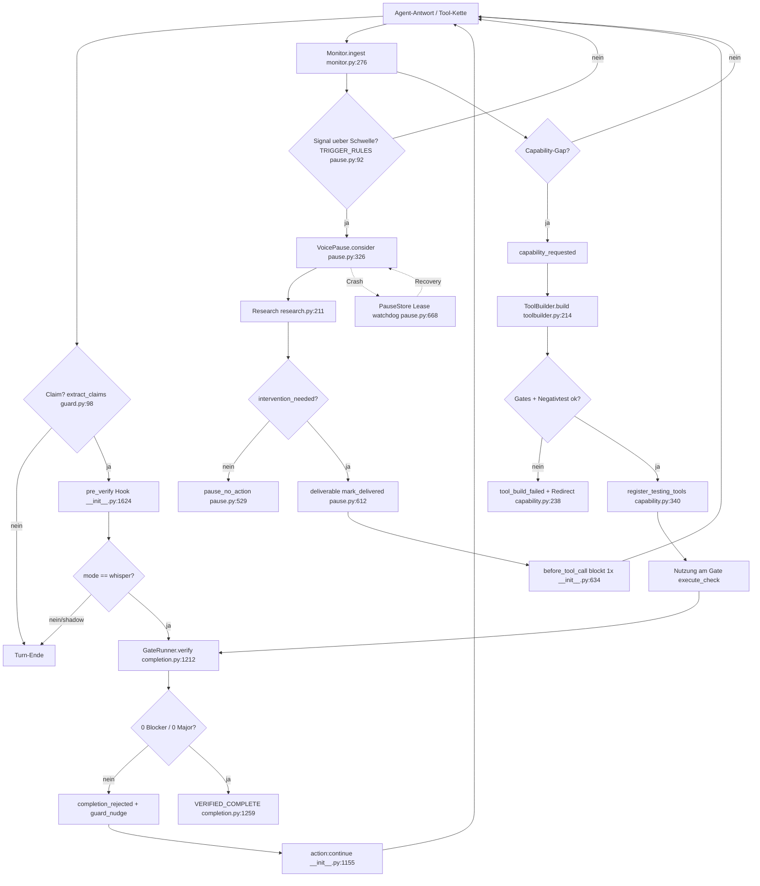

# Skaldir Agent — COMPLETE AUDIT (13.09.2026)

> **Ein Dokument, alle Belege.** Der vollständige, kritische Audit von Skaldir Agent:
> Anforderungskatalog (250 Einträge), Voice-Fähigkeits-Inventar, Tool-/Subtool-/Subagent-Tool-Inventar,
> Modell-Routing, Funktionsmapping und die vier Domänen-Audits (Voice/Gates · Tools/Capability ·
> Memory/Autonomie · Desktop/Release) — jede Aussage am echten Code geprüft, mit zitierten
> Testläufen/Live-Proben. Erstellt in einer Sitzung am 2026-09-13; Rohbelege in den jeweiligen Abschnitten.

**Methodik:** Keine Dokumenten-Nacherzählung. Für jede Anforderung: Verdict (GUT/TEILWEISE/SCHWACH/FEHLT),
Ort (Datei:Zeile), die WIRKLICH ausgeführte Prüfung mit Ergebnis, Reliability-Risiken, offene Lücke.
Audit-Grenzen sind in den Abschnitten ausgewiesen (z. B. „nur komponentengetestet, kein Real-Lauf").

**Leseordnung:** I. Gesamtbild → II. Anforderungen → III. Voice-Fähigkeiten → IV. Tools/Subagent-Tools →
V. Modell-Routing → VI. Funktionsmapping → VII–X. die vier Domänen-Audits → XI. konsolidierte Risiken.

---


---

## I.  Gesamtbild, Stärken und Risiko-Übersicht

## Skaldir Agent — Audit- und Inventar-Ergebnisse (13.09.2026)

Alle Dateien liegen in `/tmp/gv_audit/`. Erstellt in dieser Runde: unabhängige Audits
und Inventare, am echten Code geprüft (Tests/Läufe ausgeführt, Belege zitiert).

## Dateien

| Datei | Inhalt | Umfang | Kern |
|---|---|---|---|
| `00-anforderungen.md` | **Anforderungskatalog** — alle je gewünschten Funktionen, je mit Quelle + Status | 250 Anforderungen (127 KB) | 8 Kategorien: VOICE 36 · TOOLS 38 · MEM 31 · UI 32 · CLI 30 · AUTO 27 · SUI 32 · SEC 24; FIXED 145 · TEILWEISE 56 · OFFEN 49 + Top-10-Risiken |
| `01-modell-routing.md` | Long-Horizon-Testläufe über den **Opencode-Go-Plan** (deepseek-v4.1-flash) | 412 Z. (24 KB) | Hermes läuft bereits auf `opencode-go`/`deepseek-v4.1-flash`; Rezept mit exakten Kommandos |
| `02-voice-capabilities.md` | **Voice-Fähigkeits-Inventar** (Modi, alle Hooks, Fähigkeits-Register, Host-Tabelle, Lücken) | 182 Z. (29 KB) | 369 Tests passed · 15/15 Eval-Episoden · Semantik-Eval EXIT 0 |
| `03-tools-inventory.md` | **Tool-/Subtool-/Subagent-Tool-Inventar** + alle Panel-Routen | 345 Z. (43 KB) | 33 Panel-Routen; 10 Host-Hooks (plugin.yaml nennt nur 5); CU: DryRun 🟢, Sandbox/Container 🔴; kein eigener Subagent-Spawner; MCP-Serve 🔴 (fastmcp fehlt) |
| `audit-1-voice-gates.md` | **Audit Voice/Gates/Completion** | 42 Einträge (54 KB) | 27 GUT · 11 TEILWEISE · 1 SCHWACH · 3 FEHLT |
| `audit-2-tools-capability.md` | **Audit Tools/Capability/Mining/CU** | 454 Z. (39 KB) | GUT 13 · TEILW. 10 · SCHWACH 2 · FEHLT 6 |
| `audit-3-memory-autonomy.md` | **Audit Memory/Research/Monitor/Autonomie** | 58 Einträge (58 KB) | inkl. Live-Proben (pauses.db/memory.db/events.db/Leases) |
| `audit-4-desktop-release.md` | **Audit Desktop/UI/CLI/Build/Release** | UI/SUI/CLI lückenlos (69 KB) | check_desktop_plugin 140× ok · E2E 39× ok · pytest 153 passed · doctor 10×✓ |
| `04-funktionsmapping.md` | **Funktionsmapping** — Fähigkeit ↔ Kanal ↔ Impl. ↔ Tools ↔ Events ↔ Beleg ↔ Reifegrad + Wirkungsketten + Graph + Abdeckung + Top-Risiken | in Arbeit | — |

## Konsolidierte Stärken (belegt)

- **Der Kern-Supervisor funktioniert**: Completion-Gates mit Evidenz-Bindung, Premature-Ablehnung,
  Auto-Continue/Repair-Schleife — live bewiesen auf CLI und Desktop (39/39 E2E, `ack`-Runde).
- **Long-Horizon echt**: Echter Agentenlauf über den Go-Plan auf 5-Fehler-Fixture in 5 m 27 s →
  Suite 11 passed → `VERIFIED_COMPLETE`; Supervisor-Eval 15/15, `premature_rejected: 2`,
  `false_loop_intervened: false`, Goal-Drift beide Fälle pausiert.
- **Suite grün**: 820 passed (volle Suite), 369 passed (Voice-Gruppen), ruff clean.
- **v6 integrated nav** lebt (6 native Areas, kein aside) seit dem Identity-Patch.

## Konsolidierte Top-Risiken (aus allen vier Audits, dedupliziert)

1. **Tool-Lernkette defekt (F2)**: Builder schreibt kein `module` → `register_testing_tools` findet nichts → stiller Gate-Skip.
2. **Tool-Lernkette defekt (F1)**: Builder-Validation bindet externe Ziele nicht in die Sandbox → valide Tools gelten als „invalid".
3. **Crash-Recovery nie live gelaufen**; `--check` erkennt die laufende Instanz wegen Marker-Mismatch nicht (blind).
4. **Terminalzustand nicht erzwungen**: `transition("WORKING")` entfriert `VERIFIED_COMPLETE` ohne neues Goal.
5. **Evidenz-Bindung hat Workspace-Bypass** (leere Evidenz-workspace passiert den Zaun); `RunEvidence` ohne Session-Feld.
6. **Runner-Deadlock**: `ui_e2e`/`api`/`build`/`persistence_restart`/`run` haben keinen Runner; `gate_tests`-Restdeadlock.
7. **Update-Gate umgebungsabhängig**: `--check` liefert bei geerbtem `HERMES_HOME` irreführenden Abbruch (exit 22).
8. **Autonomie-Lücken**: keine persistente Ausführungsverantwortung/kein Arbeits-Watchdog; verwaiste Leases.
9. **Pausen-Selbstzurückhaltung greift live 0×** (`pause_no_action: 0` bei 38 Pausen); Recurrence ≈ 34 %.
10. **Budget-Injektion ohne Producer** (`budget_tick` registriert, niemand erzeugt es); Event-Duplikate ohne Dedupe.
11. **Event-Store ohne Retention** (19,6 MB, wächst unbegrenzt; 5 Duplikat-Gruppen live gesehen).
12. **Session-UI-Funktionen fehlen**: Anfangsklärung/Merge/Neuwürfeln/10-Min-Deadline, Screenshot-Vorschauen (0 Treffer im Panel).
13. **CI schützt die App nicht**: nur ruff/pytest/bandit — kein Node-Smoke/E2E/Perf; **v1.4.0/v1.5.0 ungetaggt**.
14. **MCP-Serve nicht lauffähig** (fastmcp fehlt); Live-Insertion geprüfter Tools 🔴; `gate_security` fail-open.

## Reproduzierbarkeit

Alle Zahlen stammen aus echten Ausführungen dieser Runde (pytest, E2E-Läufe, Live-Proben,
`--help`-Dumps). Die Rohbelege stehen in den jeweiligen Dateien; Teil-Artefakte (`_p*.md`,
`_part*.md`, `_a3_p*.md`, `_v1_p*.md`, `p*.md`) sind als Absturzschutz erhalten.


---

## II. Anforderungskatalog (250 Anforderungen, belegt)

## Skaldir Agent (godsv) — Vollständiger Anforderungskatalog

**Erstellt:** 13.09.2026 · **Repo-Stand:** `~/projects/gods-voice`, HEAD `ae21016` (Branch `godsv-supervisor-hardening`)
**Auftrag:** Alle jemals geäußerten/gewünschten Funktionen als nummerierte Liste, jede mit Quelle. Keine Erfindungen — Einträge ohne belegbare Quelle existieren hier nicht.

**Kategorien (IDs):** VOICE = Voice/Gates · TOOLS = Tools/Capability · MEM = Memory/Research/Monitor · UI = Desktop/UI · CLI = CLI/Build/Release · AUTO = Autonomie/Recovery · SUI = Session-UI · SEC = Sicherheit/Policy

**Status-Legende:** FIXED = laut Doku umgesetzt (Datum, wenn benannt) · TEILWEISE = umgesetzt, aber mit benannten Lücken/Grenzen · OFFEN = laut Doku nicht (vollständig) umgesetzt bzw. nicht abgenommen.

## Quellen (Abkürzungen)

- **[FEAT]** `docs/FEATURES.md` (Feature-Beschreibungen v1.4 + Roadmap)
- **[PS]** `docs/PROJECT-STATE.md` (Gesamtstand inkl. §5 offene Punkte, §6b Gap-Closure, §11 Audit-Runde)
- **[FM]** `docs/FEATURE-MAP.md` (code-verifizierte Feature-Landkarte + §8 Lücken-Register, §10 Statusbilanz, §11 Audit-Runde)
- **[V14]** `docs/VERIFICATION-1.4.md` · **[V13]** `docs/VERIFICATION-1.3.md`
- **[UI]** `docs/UI.md` · **[ACC]** `docs/ACCEPTANCE.md` · **[IMPL]** `docs/IMPLEMENTATION.md`
- **[CHG]** `CHANGELOG.md`
- **[PLAN]** `.hermes/plans/2026-09-13_1750-verifikation-und-release.md` (v2.1)
- **[PLAN2]** `.hermes/plans/2026-09-13_161102-feature-map-luecken-fix-und-remap.md`
- **[GIT]** `git log --oneline -50` / `git log --format='%s%n%b' -20` (Commits mit Auftragsdetails)
- **[MASTER]** `~/Documents/Codex/2026-09-12/branch-benchmarks-f-r-coding-harnesses/outputs/hermes-masterprompt-gods-voice.md` (Willys Auftrag „semantische Voice, Lifecycle, gelernte Fähigkeiten")
- **[RELEASE]** …/`hermes-releaseprompt-gods-voice.md` (Auftrag „releasefähiges Produkt")
- **[FEEDBACK]** …/`hermes-feedbackprompt-gods-voice.md` (Auftrag „zuverlässig fertigstellen", Review-Kernfehler)
- **[SUIPLAN]** …/`hermes-session-ui-plan-auditiert.md` (Session-UI-Plan)
- **[BERICHT]** …/`product-audit-2026-09-13/BERICHT.md` (unabhängiger Produkttest 13.09.)
- **[NAECHSTER]** …/`product-audit-2026-09-13/HERMES-NAECHSTER-AUFTRAG.md` (Folgeauftrag zum BERICHT)
- **[UIAUDIT]** …/`gods-voice-ui-audit.md` · **[BENCH]** …/`hermes-benchmark-auftrag.md`
- **[EV6]** `docs/EXPERIENCE-V6-PLAN.md` (Willys Upgrade-Auftrag 12.09.) · **[CV6]** `docs/CHAT-UI-V6-PLAN.md`
- **[LSS]** `docs/LIVE-STREAM-SPEC.md` · **[UICP]** `docs/UI-AUDIT-CHECKPOINTS.md`
- **[OV]** `docs/GODSV-COMPLETE-OVERVIEW.md` · **[GAPS]** `docs/CAPABILITY-GAPS.md` · **[EVAL]** `docs/EVAL-LONGHORIZON.md`
- **[SKILL]** `~/.hermes/skills/gods-voice/SKILL.md` (Projekt-Skill; enthält verifizierte Betriebs-Fakten/Pitfalls)

---

## 1. Voice / Gates (VOICE)

1. **VOICE-01 — Live-Lenkung: Pause → Research → Redirect → Resume**
   **Wunsch:** Skaldir Agent erkennt Loop-/Burst-Signale, pausiert den Agenten mitten im Lauf, startet eine isolierte Recherche, verdichtet sie zu einer Richtungsänderung und flüstert sie dem Agenten als nächsten Schritt zu — danach läuft er automatisch weiter.
   **Quelle:** [FEAT §1]; [CHG 0.1.0/0.2.0]; [PS §3.3]
   **Kategorie/Status:** Voice/Gates · **FIXED** – live E2E (`pause_requested` Step 11 → `pause_delivered` 27,4 s, exactly-once; [PS §4])

2. **VOICE-02 — Deterministische Trigger + Cooldown + Stundenz-Budget**
   **Wunsch:** Eingriffe nur bei konkreten Signalen (2× wiederholte Tool-Aufrufe/Bursts), mit 60-s-Cooldown und max. 4 Pausen/Stunde — kein Zufall, kein Dauerfeuer.
   **Quelle:** [FEAT §1]
   **Kategorie/Status:** Voice/Gates · **FIXED** (Trigger-Regeln `pause.py`; [FM §1.3])

3. **VOICE-03 — Crash-sichere, idempotente Pause-Lease (genau einmal)**
   **Wunsch:** Der Redirect wird genau einmal zugestellt; SQLite-Leases + Heartbeat + Watchdog garantieren: eine sterbende Voice strandet den Main Agent nie; Statuskette requested → researching → ready → delivered (+ expired/abandoned/stale).
   **Quelle:** [FEAT §1]; [IMPL §3.3]; [V13 §5]
   **Kategorie/Status:** Voice/Gates · **FIXED** (Crash-Resume-Tests, „8 parallele Resume-Events → genau ein Resume"; [V13 §5])

4. **VOICE-04 — Getrennte Kanäle voice/user/safety**
   **Wunsch:** Ein Redirect kann keine Nutzer-Nachricht fälschen — die Kanäle sind strikt getrennt.
   **Quelle:** [FEAT §1]
   **Kategorie/Status:** Voice/Gates · **FIXED**

5. **VOICE-05 — Completion-Guard: „fertig" nur mit Beleg**
   **Wunsch:** Bevor die Antwort final gilt, prüft die Voice, ob Claims durch echte Ausführungen gedeckt sind (nur terminal/exec zählt, Schreiben nie); fehlt der Beleg → Nachforderung (Nudge) + Hinweis-Footer in der finalen Antwort.
   **Quelle:** [FEAT §2]; [V13 §1]
   **Kategorie/Status:** Voice/Gates · **FIXED** (Live-Smoke + `test_guard.py`; [FEAT §2])

6. **VOICE-06 — Mandatory Completion Loop (Strict Supervisor)**
   **Wunsch:** Der Main Agent darf Abschluss nur noch anfragen; nur die Gates setzen `VERIFIED_COMPLETE`; `INCOMPLETE` beendet den Lauf nicht, der Agent arbeitet automatisch weiter — der Nutzer muss nie „continue" sagen.
   **Quelle:** [FEAT §20]; [V14 §1–§3]
   **Kategorie/Status:** Voice/Gates · **FIXED** – v1.4.0, 12.09.2026 (Full-Loop-E2E, 2× Reject → Auto-Continue → VERIFIED)

7. **VOICE-07 — Acht Gates über echte Fakten**
   **Wunsch:** evidence (nur ausgeführte Checks, frisch nach dem letzten Edit), tests, build, integration, fake-completion, security, cleanup, definition-of-done — alle über echte Repo-Fakten, nie über Behauptungen.
   **Quelle:** [V14 §4]
   **Kategorie/Status:** Voice/Gates · **FIXED** (Gates-Matrix §41; [V14 §4])

8. **VOICE-08 — Eskalation bei wiederholten Rejections**
   **Wunsch:** Gleicher Blocker-Fingerprint erneut → `escalate` (Strategiewechsel/Research statt Blind-Retry); ein ehrlicher Nudge-Cap endet unverifiziert und geloggt, nie in „fertig".
   **Quelle:** [V14 §5]
   **Kategorie/Status:** Voice/Gates · **FIXED**

9. **VOICE-09 — Ehrliche Endzustände; Override ≠ VERIFIED**
   **Wunsch:** `BLOCKED_USER`, `BLOCKED_EXTERNAL`, `FAILED_UNRECOVERABLE`, `USER_CANCELLED`, `SHIPPED_WITH_USER_OVERRIDE` sind sauber unterscheidbar; eine Nutzer-Override ist ausdrücklich nicht `VERIFIED_COMPLETE`; nur ein neues Goal führt heraus.
   **Quelle:** [V14 §2]; [FEAT §20]
   **Kategorie/Status:** Voice/Gates · **FIXED** (`test_user_override_is_not_verified_complete`)

10. **VOICE-10 — Semantische Voice statt Schwellenurteile**
    **Wunsch:** Detektoren liefern Signale, keine Verdikte; Fehler werden nach Kategorie/Komponente/Ursache/Strategie/Fortschritt charakterisiert (UNKNOWN zulässig); Konfidenz HIGH ≥0,7 steuert, MED nur Hinweis, LOW nicht; ein Infrastrukturproblem darf keine endlose Kodeänderungs-Kette auslösen.
    **Quelle:** [MASTER §3]; [IMPL §3.1–3.2]; [CHG 1.5.0]
    **Kategorie/Status:** Voice/Gates · **TEILWEISE** – Prompts v2 + 16 Signal-Familien umgesetzt (13.09.); Grenzen dokumentiert (kosmetische Kommando-Varianten bleiben Detektor-Grenze, die Voice urteilt semantisch)

11. **VOICE-11 — False-Loop-Kollaps beheben**
    **Wunsch:** Ohne stderr geteilter Exit-1-Fingerprint darf nicht als „bekannter Fehler wiederholt sich" gelten: coarse Fehler → `error_without_details` (nie Match/Trigger), gleiche Signatur nach Fortschritt → `error_recurrence_after_progress`, ≥3 Signaturen → `error_cluster` (Beobachtung).
    **Quelle:** [CHG 1.5.0]; [PS §6c]; [GIT `?` → Fix in `monitor.py`]
    **Kategorie/Status:** Voice/Gates · **FIXED** – 13.09.2026 (8 Regressionstests `test_false_loop_regression.py`)

12. **VOICE-12 — `NO_INTERVENTION_NEEDED` als gültiger Ausgang**
    **Wunsch:** Der Investigator darf schließen, dass normaler, erholbarer Verlauf vorliegt — die Pause endet dann ohne Redirect (Event `pause_no_action`), der Agent arbeitet ungestört weiter; Guardrail: nie zum Umgehen harter Befunde.
    **Quelle:** [CHG 1.5.0]; [IMPL §3.3]; [FM §1.3]
    **Kategorie/Status:** Voice/Gates · **FIXED** (Event-Kind registriert, Commit `08bb6be`; [FM §10])

13. **VOICE-13 — Novel-Strategy-Eskalation**
    **Wunsch:** Ab der dritten Pause derselben Trigger-Klasse verlangt der Redirect: „REPEATED INTERVENTION (#N): the next attempt must be a NOVEL strategy — state first why it differs".
    **Quelle:** [PS §6b P1-5, Commit `0861a02`]; [IMPL §3.3]
    **Kategorie/Status:** Voice/Gates · **FIXED** – 13.09.2026 (live: `novel_escalations: 3`)

14. **VOICE-14 — Claim-Contradiction-Pause**
    **Wunsch:** Erfolgs-Behauptung gefolgt von einem Fehler ≤12 Steps → Pause mit der Richtung „Behauptung zurücknehmen, mit echtem Beleg neu prüfen".
    **Quelle:** [IMPL §3.3]; [PS §4]
    **Kategorie/Status:** Voice/Gates · **FIXED** (live auf der Cockpit-Session bewiesen; [PS §4])

15. **VOICE-15 — Kostenmodell vor Intervention (MEASURED/ESTIMATED getrennt)**
    **Wunsch:** Pausen nur, wenn „expected cost of continuing > expected cost of intervention"; occurrences/severity gemessen, nur Tokens geschätzt und klar gelabelt.
    **Quelle:** [CHG 1.3.0]; [IMPL §3.2]
    **Kategorie/Status:** Voice/Gates · **FIXED**

16. **VOICE-16 — Voice-Strictness als Runtime-Setting**
    **Wunsch:** relaxed/standard/strict verschiebt Trigger-Schwellen UND den Kostenfaktor, ist in Settings umstellbar und wird bei jeder Entscheidung frisch gelesen (persistiert in `settings.yaml`).
    **Quelle:** [PS §6b P4]; [ACC §3]
    **Kategorie/Status:** Voice/Gates · **FIXED** (live: GET/POST strict über echten Serve; 4 Tests)

17. **VOICE-17 — Watcher/Investigator/Judge-Trennung mit bounded Context**
    **Wunsch:** Watcher arbeitet häufig/günstig mit kleinem Kontext (≤2500 Zeichen, 10 Steps); Investigator bekommt bei begründetem Anlass frischen, größeren Kontext (≤4000 Zeichen, 24 Steps); Judge prüft unabhängig; jeder Kontext wird neu aus Roh-Events gebaut (keine Summary-of-Summary-Kette).
    **Quelle:** [FEAT §16]; [V13 §1]; [MASTER §3]
    **Kategorie/Status:** Voice/Gates · **FIXED** – v1.3.1, 12.09.2026

18. **VOICE-18 — Instrumentierter Kontext (MEASURED vs. ESTIMATED)**
    **Wunsch:** `stats()` weist Zeichen/Sektionen/Truncations als MEASURED und Tokens (≈ chars/4) explizit als ESTIMATED aus; der Research-Run schreibt `voice_context_built` in den Event-Store.
    **Quelle:** [FEAT §16]; [CHG 1.3.1]
    **Kategorie/Status:** Voice/Gates · **FIXED**

19. **VOICE-19 — Stop-Gate feuert auch ohne Dateiänderung**
    **Wunsch:** Ein falscher Abschluss-Claim in einem neuen/resumierten Turn ohne jeden Datei-Edit muss die Abschlussprüfung auslösen (vorher band der Host das Gate an `_turn_file_mutation_paths` und ließ den Claim durch).
    **Quelle:** [PS §11 „P0 Stop-Lücke"]; [BERICHT „P0"]; [FM §11]; Commit `05e8de4`
    **Kategorie/Status:** Voice/Gates · **FIXED** – 13.09.2026 (Host-Overlay `host-overlay/patch_agent.py` + Live-CLI-Beweis)

20. **VOICE-20 — pre_verify greift bei `hermes chat --resume --oneshot`**
    **Wunsch:** Auch im CLI-/Resume-Pfad (ohne `on_session_start`) erreicht das Goal den Gate: der Hook adoptiert die Session, wenn ein On-Disk-Vertrag existiert.
    **Quelle:** [FM §11 „P0 zweite Hälfte"]; [PS §11]; Commit `3c59c52`
    **Kategorie/Status:** Voice/Gates · **FIXED** – 13.09.2026 (Trace `pre_verify adopted session=… → called`)

21. **VOICE-21 — Strukturierter Testing-Tool-Ergebnisvertrag**
    **Wunsch:** `FAIL: check did not PASS` bei Exit 0 darf nie als „passed" zählen; Pass nur bei Exit 0 UND explizitem PASS-Verdikt; FAIL/ERROR gewinnt; fehlendes Verdikt = fail-closed.
    **Quelle:** [BERICHT „P0"]; [NAECHSTER §2]; Commit `ef7585e`
    **Kategorie/Status:** Voice/Gates · **FIXED** – 13.09.2026 (`parse_testing_result`, 6 Tests inkl. Audit-Fixture byte-genau)

22. **VOICE-22 — Evidenz an Revision + Workspace binden**
    **Wunsch:** Alte Runner-Evidenz darf keine neue Goal-Revision zertifizieren; `RunEvidence` trägt revision+workspace; Zertifizierung nur für die Revision/das Workspace der Erzeugung.
    **Quelle:** [BERICHT „P1"]; [FM §11 „P1"]; Commit `f784ffe`
    **Kategorie/Status:** Voice/Gates · **FIXED** – 13.09.2026

23. **VOICE-23 — `add_criteria` mit Revisionszaun + Idempotenz**
    **Wunsch:** Auch Add wird mit `expected_revision` + `request_id` geschützt (wie update/remove) — eine veraltete Add-Anfrage wird nicht unbemerkt zur aktuellen Änderung.
    **Quelle:** [BERICHT „P2"]; [FM §11 „P2"]; Commit `f784ffe`
    **Kategorie/Status:** Voice/Gates · **FIXED** – 13.09.2026

24. **VOICE-24 — Tool-Namens-Kriterien sind verdrahtet**
    **Wunsch:** Ein Kriterium, das ein registriertes Testing-Tool benennt, wird von `plan_verification` auf dieses Tool gemappt und nur durch Runner-Evidenz zertifiziert (kein `run`-Fallback-Deadlock mehr für diese Klasse).
    **Quelle:** [PS §4 „Zwei live gefundene Produktfehler" #2]
    **Kategorie/Status:** Voice/Gates · **FIXED** – 13.09.2026 (`TestPlanVerificationToolWiring` + `test_dod_registered_tool_certified_only_by_runner`)

25. **VOICE-25 — DoD-Status-Lifecycle + Sticky-Verified-Fix**
    **Wunsch:** `verified`/`failed` werden nach Verify-Läufen persistiert (blocking/major → failed, MINOR/INFO → open); ein persistierter „verified"-Status darf nie ohne frische Evidenz zertifizieren.
    **Quelle:** [PS §6b, `483d4c7`]; [PS §7 „Sticky-Verified"]; [FM §10]; Commit `499b7a5`
    **Kategorie/Status:** Voice/Gates · **FIXED** – 13.09.2026

26. **VOICE-26 — Runner-Lücke: ui_e2e/api/build/persistence_restart/run**
    **Wunsch:** Kriterien mit diesen Prüf-IDs brauchen einen echten Runner — heute existiert nur `pytest` + registrierte Testing-Tools; der Panel-Fallback `run` ist ein bekannter Deadlock.
    **Quelle:** [FM §8 Nr. 6]; [FM §10]
    **Kategorie/Status:** Voice/Gates · **OFFEN** (bewusst nicht in der Fix-Etappe; [FM §10])

27. **VOICE-27 — gate_tests-Restrisiko (DoD ohne pytest-Kriterium)**
    **Wunsch:** Ein Goal ohne deklariertes pytest-Kriterium bei schmutzigem Repo soll nicht an `gate_tests` (Runner-Pytest-Evidenz gefordert) scheitern — sauberer Ausweg oder Produktentscheid statt Deadlock.
    **Quelle:** [SKILL „gate_tests — der Restdeadlock"] (projekt-intern dokumentierter Befund)
    **Kategorie/Status:** Voice/Gates · **OFFEN** (Einschätzung: Produktentscheid nötig)

28. **VOICE-28 — Main Agent kann sich nicht selbst zertifizieren**
    **Wunsch:** Genau eine Stelle im Code setzt `VERIFIED_COMPLETE` (source-check-gesichert); die Schutzgrenze gegen Manipulation von Gate-Zustand/Artefakten/Overrides durch den Main Agent ist umzusetzen oder als Vertrauensannahme zu dokumentieren.
    **Quelle:** [V14 §1]; [RELEASE §5]; [FEEDBACK §2F]
    **Kategorie/Status:** Voice/Gates · **TEILWEISE** – Selbstzertifizierung ausgeschlossen (Tests); Schutzgrenze noch nicht vollständig bewiesen/dokumentiert

29. **VOICE-29 — Claims sind keine Evidenz (Claim→Review-Kanal)**
    **Wunsch:** `record_claims` (post_llm_call) erkennt Erfolgs-Claims; bei offenem Contract mit unverifizierten Requirements wird eine Review gequeued und im nächsten Turn genau einmal als `voice·claim-check` injiziert.
    **Quelle:** [IMPL §3.4 (F10)]; [PS §4 „F10-Live-Quittung"]; [CHG 1.5.0]
    **Kategorie/Status:** Voice/Gates · **TEILWEISE** – Queue + Bedingung live belegt (events.db seq 4339/4340); die Live-Beobachtung der Injektion in einen kontrollierten Turn stand zuletzt noch aus

30. **VOICE-30 — Ein gemeinsamer, versionierter GoalContract**
    **Wunsch:** Chat, Main Agent, Voice, Panel und Gate lesen denselben maßgeblichen Vertrag; Ziele, Non-Goals, Constraints, Kriterien bleiben über Ablehnung, Fortsetzung, Compaction und Neustart erhalten; Revisionen machen Änderungen erkennbar; keine stillen Ersatz-Ziele.
    **Quelle:** [FEEDBACK §2A]; [PS §3.1]; [FM §11]
    **Kategorie/Status:** Voice/Gates · **FIXED** – Session-scoped Store + Revisionsmodell (12./13.09.); Alt-Zustände migriert (`/tmp/gv_store_backups`)

31. **VOICE-31 — `@goal` erzeugt prüfbare Anforderungen**
    **Wunsch:** `@goal`-Kriterien bleiben erhalten und werden mit einem konkreten Prüfplan verbunden; ungeklärte Verifikation erscheint als „Prüfplan fehlt" statt blind weiterzuarbeiten; nach konkretem Check ist das Kriterium erfüllbar.
    **Quelle:** [FEEDBACK §2D]; [PS §3.1]; `HARDENING-MATRIX.md` A6
    **Kategorie/Status:** Voice/Gates · **FIXED** (`plan_verification`, „leerer Plan bleibt explizit"; [PS §6b])

32. **VOICE-32 — Prüferausfall/Budgetende nie „complete"; Override getrennt**
    **Wunsch:** Voice-Ausfall, Budgetende und Abbruch bleiben ehrlich unverifiziert (fail-closed); Nutzer-Override ist vom verifizierten Abschluss sichtbar unterscheidbar.
    **Quelle:** [FEEDBACK §2F]; [V14 §10 (Invarianten)]
    **Kategorie/Status:** Voice/Gates · **FIXED** (`test_voice_failure_never_implies_completion`, `test_crash_during_verification_never_marks_complete`)

33. **VOICE-33 — Approval-Modi sind echt**
    **Wunsch:** Der Approval-Modus (manual|smart|off) im Composer liest/schreibt den echten Engine-Modus (`/approvals`, config.yaml) — kein Fake-Toggle, unerwartetes Zurückspringen wird sichtbar.
    **Quelle:** [CV6 „Approval modes"]; [FEEDBACK §5]; [FM §7C GET/POST `/approvals`]
    **Kategorie/Status:** Voice/Gates · **FIXED** (12.09., Panel-Regel „nur echte Runtime-Controls")

34. **VOICE-34 — BLOCKED-Erkennung marker-basiert (bewusste Grenze)**
    **Wunsch:** `BLOCKED_USER`/`BLOCKED_EXTERNAL`/`FAILED_UNRECOVERABLE` werden konservativ aus Agent-Text-Markern erkannt — bewusst kein Ratespiel; ein falsch-negativer Marker kostet nur einen weiteren Loop-Zyklus.
    **Quelle:** [V14 §11 „Bekannte Grenzen"]
    **Kategorie/Status:** Voice/Gates · **TEILWEISE** (akzeptierte Design-Grenze, kein Bug)

35. **VOICE-35 — Hooks sind robust by contract**
    **Wunsch:** Kein Plugin-Hook wirft je; unbekannte/Geister-Sessions werden zu No-ops — ein defektes Feature darf den Agenten nie lahmlegen.
    **Quelle:** [FEAT §9]; [V14 §1 (Ghost-Session-Robustheit)]
    **Kategorie/Status:** Voice/Gates · **FIXED** (`test_plugin_robustness.py`, `started`-Flag)

36. **VOICE-36 — Watch/-Triage-Prompt mit Aufrufer**
    **Wunsch:** Der `main_agent_steering`-Prompt hat keinen Aufrufer; das Watcher-ContextBuilder-Profil ist produktiv ungenutzt; `_pact_excerpt()` liefert konstant leer — diese toten Pfade sollen produktiv verdrahtet oder entfernt werden.
    **Quelle:** [FM §1.4]; [FM §8 Nr. 3]
    **Kategorie/Status:** Voice/Gates · **OFFEN** (nur im Audit dokumentiert, bewusst nicht in der Fix-Etappe)

---

## 2. Tools / Capability (TOOLS)

1. **TOOLS-01 — Tool-Suiten propose-first, gated**
   **Wunsch:** Neue Werkzeuge werden nur vorgeschlagen und erst nach vollständigem Gate-Pass freigeschaltet: Secret-Scan → Import-Test → Tests → Determinismus-Check; erst dann „approved".
   **Quelle:** [FEAT §5]
   **Kategorie/Status:** Tools/Capability · **FIXED** (Vollsuiten-Tests, MCP-Tests in CI)

2. **TOOLS-02 — Autonomer Tool-Builder mit ehrlichen Pipeline-Stufen**
   **Wunsch:** Capability-Gap → Build → Gates → Register, mit sichtbaren Stufen (requested → researching → generating → manifest → dependency_inspection → gates → register → ready), MCP-vs-CLI-Entscheidung, Manifest mit Handles und AST-Dependency-Inspection.
   **Quelle:** [CHG 1.3.0]; [V13 §1]
   **Kategorie/Status:** Tools/Capability · **FIXED** – 12.09.2026 (`test_toolbuilder.py` 13, Live-CLI)

3. **TOOLS-03 — Capability-Gap-Flow im laufenden Task**
   **Wunsch:** Meldet der Main Agent eine fehlende Fähigkeit, erkennt das Plugin den Request am Tool-Call, erzeugt ein `capability_gap`-Signal, die bestehende Pause-Pipeline führt den ToolBuilder aus und der Agent nutzt das Tool im SELBEN Task (Redirect `tool_created` mit how_to_use, nie das Build-Transkript).
   **Quelle:** [FEAT §18]; [CHG 1.3.2]
   **Kategorie/Status:** Tools/Capability · **FIXED** – 12.09.2026 (`test_capability_flow.py`, Live-CLI)

4. **TOOLS-04 — Auch ein fehlgeschlagener Build liefert einen Redirect**
   **Wunsch:** Statt stillem Pause-Ende erhält der Agent Grund + nächsten Schritt, wenn der Build scheitert.
   **Quelle:** [FEAT §18]; [CHG 1.3.2]
   **Kategorie/Status:** Tools/Capability · **FIXED**

5. **TOOLS-05 — Capability-Request-Karte im Tools-Tab**
   **Wunsch:** Je Request eine Karte mit Status, Kind, Ziel-Tool, Grund, Secret-Handles, echten Build-Stufen und klickbarem Ergebnis-Tool — kein Build-Transkript, keine Secret-Werte.
   **Quelle:** [CHG 1.3.3]; [UI #14]
   **Kategorie/Status:** Tools/Capability · **FIXED** – 12.09.2026 (echte App: Karte rendert, kein Klartext im DOM)

6. **TOOLS-06 — MCP-Export genehmigter Tools**
   **Wunsch:** Genehmigte Suiten lassen sich als MCP-Server exportieren (stdio/HTTP) und von anderen Harnesses nutzen; Entwürfe werden gefiltert; auch nach Prozess-Neustart weiter registriert.
   **Quelle:** [FEAT §5]; [V13 §5]; `tests/test_mcp_stdio_e2e.py`
   **Kategorie/Status:** Tools/Capability · **FIXED** – v1.3.2

7. **TOOLS-07 — Usage-Ledger (Nutzung & Fehler)**
   **Wunsch:** Jeder MCP-/CLI-Wrapper-Aufruf wird gezählt (ok/Fehler/Dauer), Fehlertexte laufen durch den Secret-Redactor, Payloads werden nie gespeichert; das Tool-Detail zeigt „Nutzung & Fehler".
   **Quelle:** [CHG 1.3.5]; [UI #15]
   **Kategorie/Status:** Tools/Capability · **FIXED** – 12.09.2026 (Live im echten Home: 1× ok + 1× Fehler, redigiert)

8. **TOOLS-08 — Capability-Mining**
   **Wunsch:** Wiederkehrende Capability-Requests und wiederkehrende Kommandos/Verification-Flows werden erkannt und als Kandidaten angelegt (`capability, occurrences, sessions, current_workaround, suggested_type, expected_benefit, required_secrets`), mit Typwahl skill|cli|mcp|testing_tool.
   **Quelle:** [CHG 1.4.0]; [V14 §9]; [FEAT §21]
   **Kategorie/Status:** Tools/Capability · **FIXED** – v1.4.0, 12.09.2026 (10 Tests + CLI-E2E)

9. **TOOLS-09 — Testing-Tools brauchen Negativtests**
   **Wunsch:** `validate_testing_tool` fährt das Tool gegen ein funktionierendes UND ein absichtlich kaputtes Ziel; ein Tester, der am kaputten Ziel „PASS" meldet, ist `invalid` und darf nie Completion-Evidenz sein; ein Testing-Tool ohne `validated` wird vom Hub-Manifest verweigert.
   **Quelle:** [FEAT §21]; [V14 §9]; [FEEDBACK §4]
   **Kategorie/Status:** Tools/Capability · **FIXED** (`test_validate_testing_tool_rejects_always_pass`)

10. **TOOLS-10 — Testing-Tools am Completion-Gate registriert**
    **Wunsch:** Generierte Testing-Tools werden beim Session-Start registriert und laufen über den Gate-Runner; Pflichtnachweis je Tool: WORKING-Target → PASS, BROKEN-Target → FAIL.
    **Quelle:** [PS §6b P0-2, Commit `a9825a4`]; [IMPL §4.1]
    **Kategorie/Status:** Tools/Capability · **FIXED** – 13.09.2026 (Live-Trace `testing tools registered: check_readme`)

11. **TOOLS-11 — Tool-Scopes project/global auf der BESTEHENDEN Registry**
    **Wunsch:** Kein zweites Tool-System: `scope: project|global` + `project_id` + `version` auf `generated_tools/<name>/manifest.yaml`; neue Builder-Tools sind per Default Projekt-Tools; ohne belegbaren Kontext bleibt die ID leer (nie still global); Scope ist reine Sichtbarkeit, keine Berechtigung.
    **Quelle:** [PS §3.6]; [FM §4.3]; Commits `4c52832` + `b003678`
    **Kategorie/Status:** Tools/Capability · **FIXED** – 13.09.2026 (15 rot-first Tests inkl. git-Worktree-Nachweis)

12. **TOOLS-12 — Stabile Projekt-IDs (gestuft)**
    **Wunsch:** `project_id_for` liefert stabile IDs (remote > shared git dir für Worktrees > Pfad, gestuft und markiert) — Ordnernamen allein reichen nicht.
    **Quelle:** [PS §3.6]; [MASTER §7]
    **Kategorie/Status:** Tools/Capability · **FIXED** – 13.09.2026

13. **TOOLS-13 — Sichtbarkeit: eigene Projekt-Tools + globale; Legacy nur explizit**
    **Wunsch:** `visible_tools` zeigt eigene Projekt-Tools und globale Tools; Legacy ohne Scope nur in der expliziten „alles anzeigen"-Ansicht.
    **Quelle:** [PS §3.6]
    **Kategorie/Status:** Tools/Capability · **FIXED**

14. **TOOLS-14 — Namenskonflikte melden statt still überschreiben**
    **Wunsch:** `resolve_tool_names` löst über Scope (Projekt > global) und Version auf; echte Ties werden als Konflikt gemeldet (stderr-Warnung in `mcp serve`).
    **Quelle:** [PS §3.6]; [FM §10, Commit `b1fa36f`]
    **Kategorie/Status:** Tools/Capability · **FIXED** (defensiv — greift erst bei künftigen Mehrfach-Manifesten)

15. **TOOLS-15 — Promotion project → global mit Beleg-Pflicht**
    **Wunsch:** Nur mit validierten Negativtests, ≥2 unabhängigen fremden Projektkontexten und ausschließlich `secret://`-Handles; fehlt etwas, bleibt das Tool Projekttool mit Kandidatenstatus — nichts flippt still. Eintritt über `godsvoice tools promote-global` + Panel-Route.
    **Quelle:** [PS §3.6, Commit `8d81ed7`]; [FEATURE-MAP §10, Commit `381df67`]; [MASTER §7]
    **Kategorie/Status:** Tools/Capability · **FIXED** – 13.09.2026 (8 rot-first Tests inkl. Klartext-Secret-Ablehnung)

16. **TOOLS-16 — Promotion ohne stillem Abhängigkeitswechsel**
    **Wunsch:** Erfolg schreibt eine NEUE globale Manifest-Version mit `promoted_from`; laufende Aufrufer behalten ihre Version und ihren Projektkontext.
    **Quelle:** [PS §3.6]; [MASTER §7]
    **Kategorie/Status:** Tools/Capability · **FIXED**

17. **TOOLS-17 — Cockpit-Tool-Views mit Scope/Version/Beleg**
    **Wunsch:** Der Tools-Tab zeigt pro Tool Scope (Global ↑ / Projekt · Kandidat / Legacy), Version, Herkunft und fehlende Promotion-Belege als Tooltip — Scope im Cockpit bedienbar, nicht nur im Store; Bestands-Tools korrekt als Legacy.
    **Quelle:** [PS §3.6, Commits `e0258b2` + `6a0690f`]; [MASTER §10]
    **Kategorie/Status:** Tools/Capability · **FIXED** – 13.09.2026 (Live-Beweis in der gebauten App)

18. **TOOLS-18 — MCP-Export scope-aware**
    **Wunsch:** Ohne Projektkontext nur globale Tools; Projekt-Tools nur für ihr Projekt (`--project <pfad>`); Legacy nie automatisch, nur die explizite `--all`-Sicht. Jeder Serverstart liest die Registry frisch.
    **Quelle:** [PS §3.6, Commit `cfc2bed`]; [FM §4.2]
    **Kategorie/Status:** Tools/Capability · **FIXED** – 13.09.2026 (live: kontextfrei 0, `--all` 3)

19. **TOOLS-19 — Testing-Tool-Requests bauen (Validation Cases)**
    **Wunsch:** `tools request|build --kind testing_tool --validation-case TARGET:pass|fail` (beide Parser) — Testing-Tools sind per CLI baubar.
    **Quelle:** [FM §10, Commits `5faf722` + `499b7a5`]
    **Kategorie/Status:** Tools/Capability · **FIXED** – 13.09.2026

20. **TOOLS-20 — `godsvoice workflows list`**
    **Wunsch:** Die vorhandenen Workflow-Verträge (`workflow_contracts`) bekommen einen Aufrufer: `godsvoice workflows list [--json]`.
    **Quelle:** [FM §10, Commit `9d79538`]
    **Kategorie/Status:** Tools/Capability · **FIXED** – 13.09.2026

21. **TOOLS-21 — Autonomer Workflow §9-A: App öffnen → Snapshot**
    **Wunsch:** Ein Aufruf `open_blender_snapshot(project_path?)`: vorhandene Instanz erkennen oder starten, auf bedienbares Fenster warten, korrektes Fenster fokussieren, aktuellen Screenshot erfassen, Zustand + Artefaktreferenz liefern. Prozessstart allein genügt nicht; eine fehlende App bleibt deklarierte Voraussetzung (kein Auto-Install).
    **Quelle:** [MASTER §9A]; [PS §3.6, Commit `46451b6`]; [FM §4.6]
    **Kategorie/Status:** Tools/Capability · **FIXED** – 13.09.2026 (live: laufende GV-App → SUCCEEDED, 125-KB-PNG; Blender fehlt → präziser environment-Fehler)

22. **TOOLS-22 — Autonomer Workflow §9-B: App → Settings-Snapshot**
    **Wunsch:** App öffnen, Settings über vorhandene Navigation erreichen, optionale Sektion öffnen und verifizieren, Screenshot + sichtbaren Zustand zurückgeben — ohne Einstellungen zu ändern; ein beliebiger Screenshot/feste Koordinaten sind kein Nachweis.
    **Quelle:** [MASTER §9B]; [PS §3.6, Commit `7822892`]
    **Kategorie/Status:** Tools/Capability · **FIXED** (live belegt; Wayland/Electron per xprop unsichtbar → deklariertes CDP-Backend)

23. **TOOLS-23 — Autonomer Workflow §9-C: Modelltest mit Routing-Evidenz**
    **Wunsch:** `run_model_test(app, model, test_case)`: Modellkonfiguration prüfen, Modell für den Test wählen, Test ausführen, Antwort UND tatsächliche Backend-Zuordnung erfassen, Erwartung/Evidenz prüfen, temporäre Konfiguration wiederherstellen; ein Dropdown-Name beweist kein Routing.
    **Quelle:** [MASTER §9C]; Commit `44f16e3`; [FM §10, Commit `660d7de` (Restore)]
    **Kategorie/Status:** Tools/Capability · **FIXED** – 13.09.2026 (Antwort + Backend-Routing-Evidenz; Restore-Klick + Reader-Verifikation)

24. **TOOLS-24 — Projekttool §9-D: Settings-Persistenz verifizieren**
    **Wunsch:** `verify_godsvoice_setting_persistence(setting, temporary_value)`: Original erfassen → Testwert setzen → kontrollierter App-Neustart → persistierten + Runtime-Wert prüfen → IMMER wiederherstellen; scheitert der Restore, bleibt der geänderte Zustand sichtbar (PARTIAL, nie stiller Erfolg).
    **Quelle:** [MASTER §9D]; Commit `2ec34f0`; [PS §3.6]
    **Kategorie/Status:** Tools/Capability · **FIXED** – live (`setting-e8ff6c7871`, persisted: true, Restore verifiziert)

25. **TOOLS-25 — Workflow-Ergebnisvertrag**
    **Wunsch:** Der Main Agent erhält kompakte `run_id, status, summary, result, evidence_refs, artifact_refs, warnings`; Fehler ergänzen `failure_class, failed_stage, attempts, recoverable, recommended_next_action, side_effect_state`; Erfolg beruht auf dem verifizierten Vertrag, nicht auf „sieht gut aus" des internen Agenten.
    **Quelle:** [MASTER §9 „Ergebnisvertrag"]; [FM §4.6]
    **Kategorie/Status:** Tools/Capability · **FIXED** (Framework umgesetzt; Grenzen: Statuswerte Konvention, kein Schema)

26. **TOOLS-26 — Workflows brauchen CLI/MCP/Panel-Oberfläche**
    **Wunsch:** Die §9-Workflows sollen nicht nur Python-API sein: Aufrufer in CLI/MCP/Panel; `project_path` soll tatsächlich ein Projekt öffnen (bisher nur ins Ergebnis kopiert); `start_cmd.split()` ist keine Shell.
    **Quelle:** [FM §8 Nr. 23]; [FM §10 (OFFEN)]; [MASTER §9]
    **Kategorie/Status:** Tools/Capability · **OFFEN**

27. **TOOLS-27 — Vollständige Lernkette (Trajektorie → Aktivierung)**
    **Wunsch:** Erfolgreiche Trajektorie → Wiederholung erkennen → Projekt-/globale Tools, Subtools, Skills, MCPs suchen → Kandidat → Interface/Implementierung erzeugen → Tests + Negativtests → Berechtigungs-/Security-Prüfung → realistischer Lauf → unabhängige Verifikation → Registry → automatische Aktivierung.
    **Quelle:** [MASTER §8]; [FEEDBACK §4]
    **Kategorie/Status:** Tools/Capability · **TEILWEISE** – Einzelstufen belegt (Mining, Builder, Gates, Registry); Generalisierung/Synthese + autonome Aktivierung offen

28. **TOOLS-28 — Live-Insertion ohne Neustart**
    **Wunsch:** Geprüfte, passende Fähigkeiten werden während laufender Arbeit automatisch aufrufbar — ohne Session-Neustart und ohne manuelle Aktivierung jedes Tools; Aktualisierung an der nächsten sicheren Modellaufrufgrenze, höchstens drei neue relevante Fähigkeiten gleichzeitig sichtbar; keine laufenden Seiteneffekte unterbrechen.
    **Quelle:** [MASTER §8]; [BERICHT „P1 — Keine Live-Insertion"]; [FM §11 (⏸ OFFEN)]; [NAECHSTER §3]
    **Kategorie/Status:** Tools/Capability · **OFFEN** – Neustart-Discovery vorhanden, Live-Insertion in einen laufenden Server bewusst nicht gebaut

29. **TOOLS-29 — Projektwechsel + Ausführungskontext**
    **Wunsch:** Projektwechsel entfernt fremde Projekttools aus der Auswahl; Worktrees desselben Projekts übergeben ihren konkreten Workspace gesondert als Ausführungskontext; laufende Aufrufe behalten Version und Kontext.
    **Quelle:** [MASTER §8]; [PS §3.6 („Offen: Projekt-ID-Verdrahtung in den Ausführungskontext")]
    **Kategorie/Status:** Tools/Capability · **TEILWEISE** – Sichtbarkeit umgesetzt; Ausführungsrand offen

30. **TOOLS-30 — Mining mit kausalen Abläufen statt Kommando-Zählung**
    **Wunsch:** Mining berücksichtigt Ergebnisse und kausale Abläufe, generalisiert konstante Schritte und variable Inputs, prüft neue (nicht zur Ableitung verwendete) Eingaben und baut keine Fähigkeit, wenn eine gleichwertige Lösung genügt.
    **Quelle:** [MASTER §8]; [BENCH GV-08]
    **Kategorie/Status:** Tools/Capability · **OFFEN** (Mining existiert kommando-/request-basiert; Generalisierung + Holdout-Prüfung fehlen)

31. **TOOLS-31 — Fähigkeits-Verträge mit getrennten Lebenszyklus-Feldern**
    **Wunsch:** Verträge enthalten stabile Identität, Version, Beschreibung, wann verwenden/vermeiden, I/O-Schemas, Abhängigkeiten, Permissions, Seiteneffekte, Secret-Handles, Zeit-/Kosten-/Aufrufbudgets, Erfolgskriterien, Fehlerpolicy, Provenienz; Freigabe, Verifikationsstand und Health werden getrennt geführt (ein geprüftes Tool kann später ungesund sein).
    **Quelle:** [MASTER §6]
    **Kategorie/Status:** Tools/Capability · **TEILWEISE** (Manifest/Registry vorhanden; Health-/Lebenszyklus-Trennung offen)

32. **TOOLS-32 — Health-Verschlechterung → Retest/Quarantäne/Reparatur**
    **Wunsch:** Bevorzugt wird das tatsächlich passende gesunde Tool; Health-Verschlechterung führt zu Retest, Deaktivierung/Quarantäne oder Reparatur; Änderungen an Code und relevanten Abhängigkeiten invalidieren betroffene Verifikationsbelege.
    **Quelle:** [MASTER §8]; [MASTER §10 (Retest/Rollback)]
    **Kategorie/Status:** Tools/Capability · **TEILWEISE/OFFEN** (Test/Enable/Disable/Recheck existieren; Quarantäne/Rollback/Health-Score offen)

33. **TOOLS-33 — Tool Hub (lokales Registry + Manifest)**
    **Wunsch:** `godsvoice tools-hub [--search|--show|--manifest]` über Tools/Skills/MCP/Testing-Tools mit Permissions, Handles, Provenienz, Verifikationsstatus und deterministischem Ranking; Manifest mit Verweigerungsregeln; `publish: {automatic: false, …}` — nie Auto-Publish.
    **Quelle:** [PS §6b P2, Commit `0f91063`]; [IMPL §4.3]; `docs/TOOL-HUB.md`
    **Kategorie/Status:** Tools/Capability · **FIXED** – 13.09.2026 (live: 105 Einträge, `check_readme` rankt #1)

34. **TOOLS-34 — MCP-Auto-Registrierung + DB-Pfad-Konsistenz**
    **Wunsch:** Der MCP-Server soll (auf Wunsch) in die Hermes-Config eingetragen werden; der CLI-DB-Default (`.godsv/tools.db`) weicht vom Runtime-Pfad ab. Offene Frage im Plan: MCP-Server beim `desktop install` mit Bestätigungsdialog eintragen?
    **Quelle:** [FM §8 Nr. 13]; [FM §10 (OFFEN)]; [PLAN2 Zeile 792 (offene Frage)]
    **Kategorie/Status:** Tools/Capability · **OFFEN**

35. **TOOLS-35 — compose-before-create + `tools draft`**
    **Wunsch:** Vor dem Bauen sollen Composition-Kandidaten geprüft werden (`compose_candidates` nur im Proposal-Pfad); `draft_tool_spec()` hat keinen Produktionsaufrufer (braucht einen CLI-LLM-Client, den es nicht gibt — bewusst nicht gebaut).
    **Quelle:** [FM §8 Nr. 11/12]; [FM §10 (OFFEN)]
    **Kategorie/Status:** Tools/Capability · **OFFEN**

36. **TOOLS-36 — Builder-/Registrierungs-Namensauflösung**
    **Wunsch:** `register_testing_tools` soll das Modul über das Manifest auflösen statt starr `<tool_dir_name>.py` zu erzwingen (Manifest `module=custom_impl` in Verzeichnis `checker` muss registrieren).
    **Quelle:** [BERICHT „P1"]; [FM §11 (Commit `f784ffe`)]; [FM §10 (Altstand OFFEN — durch §11 überholt)]
    **Kategorie/Status:** Tools/Capability · **FIXED** – 13.09.2026 (3 Tests)

37. **TOOLS-37 — Tool-Build-Ereignisse erreichen den richtigen Chat**
    **Wunsch:** Angefordert, gebaut, getestet, abgelehnt, registriert und verwendet müssen am richtigen Task sichtbar werden; gemeinsame Ereignisdefinitionen für Builder/Store/API/Chat; Verbindungsfehler nicht still unterdrücken.
    **Quelle:** [FEEDBACK §4]; [FM §7B]
    **Kategorie/Status:** Tools/Capability · **FIXED** (Builder-Stufen als Chat-Events; [PS §3.5])

38. **TOOLS-38 — Mining-Automatik (offene Produktfrage)**
    **Wunsch:** Offene Frage: Soll `mine` künftig automatisch laufen (Cron am Sessionende)? Heute läuft Mining nur manuell, `dismissed` hat keinen Schreiber, der Skill-Draft-Pfad ist produktiv unerreichbar.
    **Quelle:** [PLAN2 Zeile 792]; [FM §8 Nr. 18]
    **Kategorie/Status:** Tools/Capability · **OFFEN**

---

## 3. Memory / Research / Monitor (MEM)

1. **MEM-01 — Incident-Memory mit Signatur/Dedupe/Confidence**
   **Wunsch:** Wiederkehrende Fehlerklassen werden per Signatur dedupliziert und mit Zähler/Confidence/Status gespeichert, per FTS5 durchsuchbar und gegen Live-Fehler gematcht — derselbe Fehler soll nicht dreimal diagnostiziert werden.
   **Quelle:** [FEAT §3]; [IMPL §3.5]
   **Kategorie/Status:** Memory/Research/Monitor · **FIXED**

2. **MEM-02 — Research-Notes mit Provenienz**
   **Wunsch:** Recherche-Aussagen werden als atomare Notes mit Quelle, Trust-Level, Gültigkeit und Widerspruchs-Links gespeichert — Recherche ohne Quelle ist wertlos.
   **Quelle:** [FEAT §3]; [FM §6.4]
   **Kategorie/Status:** Memory/Research/Monitor · **FIXED**

3. **MEM-03 — Nightshift-Konsolidierung (propose-first)**
   **Wunsch:** Eine beendete Session wird offline in dauerhafte Erinnerung konsolidiert (Incidents, Notes, solved-Incident-Vorschläge) — deterministisch, Dry-Run-Default, Schreibpfade bleiben propose-first (kein Autopilot).
   **Quelle:** [FEAT §3]; [FM §7F]
   **Kategorie/Status:** Memory/Research/Monitor · **FIXED** – v1.0/1.3

4. **MEM-04 — Research-DB wiederverwendbar**
   **Wunsch:** Vor neuer Recherche wird die eigene Forschungs-DB durchsucht (`find_prior_research` mit Term-Overlap/Alter/Staleness); Prior-Findings fließen mit `created_at/stale_after/confidence/reused_from` in spätere Läufe und sind in Evidenz-Anzeigen sichtbar.
   **Quelle:** [PS §6b P0-3, Commit `e386da7`]; [IMPL §3.3]
   **Kategorie/Status:** Memory/Research/Monitor · **FIXED** – 13.09.2026 (Suche findet `research-8877a68594`, Unähnliches leer)

5. **MEM-05 — Incident-Reuse live**
   **Wunsch:** Eine echte Voice-Pause auf den Main Agent nutzt Incident-Evidenz aus der Memory (`known_incident_repeat`) — Erfahrungen werden wiederverwendet, aber semantisch geschützt (coarse Fehler matchen nie).
   **Quelle:** [PS §6b]; [IMPL §3.5]
   **Kategorie/Status:** Memory/Research/Monitor · **FIXED** – 13.09.2026 (live)

6. **MEM-06 — Skill-Mining aus Wiederholung**
   **Wunsch:** Eigenständige Tool-Ketten, die ≥3× über ≥2 Sessions auftreten, werden zu SKILL.md-Kandidaten; Kandidaten durchlaufen einen Lifecycle (proposed → promoted → …) und werden NIE automatisch aktiviert.
   **Quelle:** [FEAT §4]
   **Kategorie/Status:** Memory/Research/Monitor · **FIXED** (`test_skills.py`; Panel-Skills-Tab)

7. **MEM-07 — Skill-Konsumption-Zähler**
   **Wunsch:** Konsumption wird gezählt (`applied`/`succeeded`) — man sieht, ob ein Skill wirklich benutzt wird und funktioniert.
   **Quelle:** [FEAT §4]; [V13 §1]
   **Kategorie/Status:** Memory/Research/Monitor · **FIXED**

8. **MEM-08 — Working Ledger (Fortschritts-/Kontinuitätszustand)**
   **Wunsch:** Ein kompakter Zustandsartikel pro Ziel mit Beleg-Invariante und YAML-Persistenz; Regel „erst Ledger aktualisieren, dann Kontext komprimieren"; Re-Hydration bei neuer Session/Kompaktierung — Sessions werden nahtlos.
   **Quelle:** [FM §6.2]; [CHG 0.1.0]; `docs/CORE-PLAN.md:111`
   **Kategorie/Status:** Memory/Research/Monitor · **TEILWEISE** – Modul existiert, aber „kein Live-Pfad (nur init/ledger-show)"; [FM §8 Nr. 16 / §10]

9. **MEM-09 — Trajectory-State außerhalb des LLM-Kontexts**
   **Wunsch:** Entscheidungen, Annahmen und Non-Goals liegen am aktiven Vertrag (nicht im Prompt), mit `!decision:`-Intake im Chat — der Ledger ist wiederbelebt.
   **Quelle:** [PS §6b P0-1, Commit `8799f86`]
   **Kategorie/Status:** Memory/Research/Monitor · **FIXED** – 13.09.2026 (POST speichert, invalid → HTTP 400)

10. **MEM-10 — Incident-Promote/Sighting/Similar + Embeddings produktiv verdrahten**
    **Wunsch:** `IncidentStore.promote`/`record_sighting`/`search_similar` (+ Embeddings) sollen eine Produktionsrolle bekommen; die Embedding-Spalte bleibt NULL, „Semantik" ist Trigram-Hashing und darf nicht als semantisches Verständnis dargestellt werden. Offene Produktfrage: lokaler Embedding-Provider oder weiter Trigram?
    **Quelle:** [FM §8 Nr. 15]; [FM §10 (OFFEN)]; [FEEDBACK §3]; [PLAN2 Zeile 792]
    **Kategorie/Status:** Memory/Research/Monitor · **OFFEN**

11. **MEM-11 — Ledger-Live-Pfad + toter TOKEN_GUARD**
    **Wunsch:** Der Ledger braucht einen Live-Pfad im Betrieb; `TOKEN_GUARD`/`size_tokens_estimate` sind tot; es gibt kein Schreibkommando außer `init` (Kriterien/Entscheidungen/Fragen nur programmatisch).
    **Quelle:** [FM §8 Nr. 16]; [FM §6.2]; [FM §10 (OFFEN)]
    **Kategorie/Status:** Memory/Research/Monitor · **OFFEN**

12. **MEM-12 — `curate_finding`/Staleness-Durchsetzung**
    **Wunsch:** `curate_finding` (LLM) ist unverdrahtet; `is_stale`/`valid_until` werden nie durchgesetzt — Notes/Incidents sollen ihre Gültigkeit tatsächlich respektieren.
    **Quelle:** [FM §8 Nr. 17]; [FM §10 (OFFEN)]
    **Kategorie/Status:** Memory/Research/Monitor · **OFFEN**

13. **MEM-13 — `skills_text` im Live-Investigator-Kontext**
    **Wunsch:** Skills sollen im Investigator-Kontext tatsächlich erscheinen (heute immer leer) — Skills sind sonst „tatsächlich nutzbar" nicht belegt.
    **Quelle:** [FM §8 Nr. 19]; [MASTER §11 Nr. 6]
    **Kategorie/Status:** Memory/Research/Monitor · **OFFEN**

14. **MEM-14 — Nightshift-Scheduling**
    **Wunsch:** Kein Auto-Trigger/Scheduler für die Nightshift-Konsolidierung (weder Plugin noch Panel rufen sie auf); offline-Läufe sollen planbar/automatisierbar sein.
    **Quelle:** [FM §8 Nr. 22]; [FM §7F]; [FM §10 (OFFEN)]
    **Kategorie/Status:** Memory/Research/Monitor · **OFFEN**

15. **MEM-15 — Evidence-Retrieval + Untrusted-Spotlight**
    **Wunsch:** Gerankte Evidence-Objekte (Exact → FTS) inklusive Untrusted-Spotlight für Notes und optionalem LLM-Urteil; abgerufene Inhalte bleiben Daten, keine autoritativen Anweisungen.
    **Quelle:** [FM §6.5]; [MASTER §5]
    **Kategorie/Status:** Memory/Research/Monitor · **FIXED**

16. **MEM-16 — Decision-Context mit Quotas, frisch und instrumentiert**
    **Wunsch:** Jede Voice-Entscheidung baut ihren Kontext neu aus den Stores; zwei Profile (Watcher/Investigator) mit Zeichen-Quotas; Kürzungen explizit markiert (`…[gekürzt]`); `stats()` trennt MEASURED/ESTIMATED.
    **Quelle:** [FEAT §16]; [V13 §1]
    **Kategorie/Status:** Memory/Research/Monitor · **FIXED** – v1.3.1

17. **MEM-17 — Tool-Fehlerklassen mit Recovery-Hinweisen**
    **Wunsch:** `TOOL_ERROR_CLASSES` (11 Klassen: auth, rate_limit, timeout, permissions, provider_outage, schema_mismatch, mcp_unavailable, ui_failure, api_changed, invalid_args …) mit Recovery-Hinweisen; gewöhnliche Bugs werden nicht fehlklassifiziert.
    **Quelle:** [IMPL §3.2]
    **Kategorie/Status:** Memory/Research/Monitor · **FIXED**

18. **MEM-18 — 16 deterministische Signal-Familien**
    **Wunsch:** Der Monitor emittiert Signale statt Verdikte: loop/stall/progress_stall, error_burst, known_incident_repeat, hallucinated_api, scope_drift/context_drift, diff_churn/dependency_change/revert, strategy_repeat, skill/capability_gap u. a. — mit je eigenem Eskalationsverhalten.
    **Quelle:** [IMPL §3.1]; [CHG 1.5.0]
    **Kategorie/Status:** Memory/Research/Monitor · **FIXED** (Familien umgesetzt; F14-Kalibrierung s. MEM-20)

19. **MEM-19 — Drift-Zähler über Turn-Grenzen + Shell-Redirect-Regex**
    **Wunsch:** Session-Objekte werden am Turn-Ende entsorgt (F13) — P1-4-Zähler sollen in `<contract>.drift.json` persistieren; relative Shell-Redirect-Ziele (`> src/foo.md`) müssen als Edits gespiegelt werden.
    **Quelle:** [PS §6b „F13-Fix", Commit `93e0785`]
    **Kategorie/Status:** Memory/Research/Monitor · **FIXED** – 13.09.2026 (9/9 Drift-Tests)

20. **MEM-20 — F14: `progress_stall` kalibrieren**
    **Wunsch:** `progress_stall` zählt im echten Turn weiter (40 Tool-Events), Live-Feuern noch nicht gesehen — Schwellen/Definition von „Progress" nach echten Long-Runs kalibrieren.
    **Quelle:** [PS §6b „F14"]
    **Kategorie/Status:** Memory/Research/Monitor · **OFFEN**

21. **MEM-21 — Memory-Wiederverwendung über Sessions belegen**
    **Wunsch:** Problem in Session A gelöst und mit Herkunft gespeichert → ähnlicher Fall in Session B → passende Erfahrung abgerufen → Lösung erfolgreich angewandt; archivierte/widersprüchliche/veraltete Einträge dürfen nicht ungeprüft dominieren.
    **Quelle:** [FEEDBACK §3]; [MASTER §5]; [BENCH GV-11]
    **Kategorie/Status:** Memory/Research/Monitor · **TEILWEISE** – Research-Reuse + Incident-Evidenz live; kein Cold/Warm-Holdout-Vergleich, promoted-Incident-Kette offen

22. **MEM-22 — Reale Token-/Kostenmessung getrennt von Schätzungen**
    **Wunsch:** `measured_session_usage()` liest echte Session-Zähler aus der Host-`state.db` (input/output/cache/reasoning + Kosten), strikt getrennt von `*_est`-Schätzungen (None = nie geraten).
    **Quelle:** [PS §6b P1-7, Commit `2020e7c`]; [IMPL §3.5]
    **Kategorie/Status:** Memory/Research/Monitor · **FIXED** – 13.09.2026 (live: input 18055 etc., $0.0059 gemessen)

23. **MEM-23 — Voice-Qualitätsmetriken (`voice_quality`)**
    **Wunsch:** delivered/no_action/abandoned/expired, recovery_success_rate, recurrence_after_intervention, steps_before_first_intervention je Session aus der durablen Pause-Historie.
    **Quelle:** [CHG 1.5.0]; [PS §6b §34]; [IMPL §3.5]
    **Kategorie/Status:** Memory/Research/Monitor · **FIXED** – live: 12 Interventionen · 0,70 recovery · 3 Recurrences

24. **MEM-24 — Testing-Tool-Metriken**
    **Wunsch:** `testing_tool_stats` (§26): runs/passes/fails/`bugs_detected` je Tool aus dem Usage-Ledger + Validierungs-Status je Manifest; false passes/fails strukturell ausgeschlossen; sichtbar in `godsvoice metrics`.
    **Quelle:** [PS §6b §26]; [CHG 1.5.0]
    **Kategorie/Status:** Memory/Research/Monitor · **FIXED** – live: 4 Tools, 11 Runs, 2 finds

25. **MEM-25 — Eval-Harness + Long-Horizon-Eval**
    **Wunsch:** Deterministische Eval-Episoden in CI (15/15), Semantik-Szenarien (False-Loop/Fremd-Incident/Burst/Eskalation/Contradiction), Long-Horizon-Eval gegen echte Serve-API mit Verifier-Evidenz.
    **Quelle:** [FEAT §8]; [CHG 1.5.0]; [PS §6b P2 §18]; [EVAL]
    **Kategorie/Status:** Memory/Research/Monitor · **FIXED** – 13.09.2026 (2/2 premature abgelehnt; shadow: 0 Interventionen, Gate identisch)

26. **MEM-26 — Compression-Recovery**
    **Wunsch:** Ein frischer Prozess ohne Chat-Verlauf rekonstruiert den vollständigen Vertragsblock aus durable State (`state=INCOMPLETE · goal=… · dod 0/2 · blocker …`) — kein Chat-Replay nötig.
    **Quelle:** [PS §6b „§33-Rest"]; [IMPL §3.4]; [ACC §6]
    **Kategorie/Status:** Memory/Research/Monitor · **FIXED** – 13.09.2026 (`compression_recovery_ok: true`)

27. **MEM-27 — Goal-Drift-Langlauf**
    **Wunsch:** Derselbe Fremd-Pfad 3× → Pause; 3 verschiedene Fremd-Pfade → ebenfalls Pause (Klasse zählt über Pfade); In-Scope bleibt ruhig; vom Nutzer geänderter Scope ist eine Gegenprobe.
    **Quelle:** [PS §6b]; [CHG 1.5.0]
    **Kategorie/Status:** Memory/Research/Monitor · **FIXED** – 13.09.2026 (`goal_drift_varied_paths_paused: true`)

28. **MEM-28 — LongMemEval-Fragesätze gegen Memory/Retrieval**
    **Wunsch:** LongMemEval-Fragesätze (Knowledge-Update, Abstention) gegen godsv-Memory/Retrieval spielen; keine Leaderboard-Vergleiche, nur eigene Vorher/Nachher-Messung.
    **Quelle:** [PLAN §3 D5]
    **Kategorie/Status:** Memory/Research/Monitor · **OFFEN**

29. **MEM-29 — Golden-Set „Fehlrichtung vs. normales Debugging"**
    **Wunsch:** Gepaarte Szenarien (echte Fehlrichtung / gesundes Debugging / kosmetische Wiederholung); Metriken over-intervention-Rate und Zeit-vor-Schaden; Kategorien aus HORIZON + MAST.
    **Quelle:** [PLAN §3 D4]; [PLAN §1 Achse D]
    **Kategorie/Status:** Memory/Research/Monitor · **OFFEN**

30. **MEM-30 — Metriken ehrlich definieren**
    **Wunsch:** Eine Ablehnung ist noch keine nachgewiesen verhinderte Falschmeldung; keine Wiederholung in einer Session beweist keine Lernwirkung; Recurrence nur relativ zu erneuten Gelegenheiten; gemessene Tokens/Kosten von Schätzungen trennen und Voice-Kosten einbeziehen.
    **Quelle:** [FEEDBACK §7]; [MASTER §11]
    **Kategorie/Status:** Memory/Research/Monitor · **TEILWEISE** (voice_quality/Token-Trennung live; Vergleichs-/Lernmetriken offen)

31. **MEM-31 — Event-Store: Paging/Retention**
    **Wunsch:** `iter_session`/`stream` laden unbegrenzt in den Speicher; keine Retention/Kompaktierung — Aufbewahrung, Archivierung und Export müssen nachvollziehbar sein und lange Sessions dürfen den Speicher nicht unbegrenzt blähen.
    **Quelle:** [FM §7E]; [FM §8 Nr. 22]; [RELEASE §6]
    **Kategorie/Status:** Memory/Research/Monitor · **OFFEN**

---

## 4. Desktop / UI (UI)

1. **UI-01 — Native App: eigener Build, eingebackenes Panel**
   **Wunsch:** Skaldir Agent ist eine eigene Desktop-App (Hermes-Basis + eingebackenes, umbenanntes Panel-Plugin) — ab Boot aktiv, kein Installieren, kein „Reload plugins", keine Settings-Schritte; eigenes userData, eigener App-Name, eigenes Binary/Icon.
   **Quelle:** [FEAT §10]; [CHG 1.2.0]; [EV6 §1]
   **Kategorie/Status:** Desktop/UI · **FIXED** – v1.2.0, 12.09.2026

2. **UI-02 — Gold-Theme als App-Default, globales Hermes-Theme unangetastet**
   **Wunsch:** Der GV-Build bringt das Theme `gods-voice` (Logo-Gold auf warmem Charcoal, light+dark) als App-Default mit; die Stock-Skin bleibt opt-in (`display.skin`), das globale Hermes-Theme wird nie verändert.
   **Quelle:** [FEAT §10]; [CHG 1.2.0 + 1.2.1]; [PS §6]
   **Kategorie/Status:** Desktop/UI · **FIXED**

3. **UI-03 — Branding: Splash, Icon, Binärname, Titel; Nous-Portal entfernt**
   **Wunsch:** Splash mit Ohr-Logo über „SKALDIR AGENT", App-Name `Skaldir Agent`, App-Id `dev.godsvoice.app`, Binary `gods-voice`, eigene Fenster-/Update-/About-Titel, eigener Launcher-Eintrag; Nous-Portal-Wortlaut neutralisiert, `nous-girl`-Asset entfernt.
   **Quelle:** [FEAT §10]; [CHG 1.2.0]
   **Kategorie/Status:** Desktop/UI · **FIXED** – v1.2.0

4. **UI-04 — Instanz-Isolation & Koexistenz mit Hermes**
   **Wunsch:** Die GV-App hat eigene userData (eigener Single-Instance-Lock) und teilt Sessions/Runtime über dasselbe HERMES_HOME — kann aber NIE ein Hermes-Fenster fokussieren oder umleiten; beide laufen konfliktfrei nebeneinander.
   **Quelle:** [FEAT §10]; [CHG 1.0.4]
   **Kategorie/Status:** Desktop/UI · **FIXED** – v1.0.4/1.2.0 (live verifiziert)

5. **UI-05 — Update-sicheres Overlay mit exakten Ankern**
   **Wunsch:** Build = Hardlink-Spiegel + exakt verankerte Patches; verschiebt ein Hermes-Update eine Zeile, bricht der Build LAUT ab statt halb-gebrandet zu shippen; der Quellbaum kann nie korrumpiert werden (atomare Writes brechen Hardlinks).
   **Quelle:** [FEAT §10]; [CHG 1.2.0]
   **Kategorie/Status:** Desktop/UI · **FIXED** (`test_appbuild.py`; [PS §3.6])

6. **UI-06 — Vollständiges Panel: alle Tabs**
   **Wunsch:** Panel-Tabs Live, Pausen, Memory, Skills, Treasury, System, Models, Tools, Completion, Computer Use, Evals — alle mit echten Laufzeitdaten, jeder Tab getestet.
   **Quelle:** [UI]; [V13 §3]; [V14 §7]
   **Kategorie/Status:** Desktop/UI · **FIXED** – v1.3.x/1.4.0 (Node-Smoke 110 Checks, echte App 27/27 bzw. 40 Checks)

7. **UI-07 — Mutations-Regeln im Panel**
   **Wunsch:** Administrative GV-Aktionen (Modelle, Tool-Test/Enable/Disable/Recheck/Grant, Credentials) nur über dedizierte POST-Endpunkte mit Origin-Guard, serverseitiger Validierung, Confirmation bei riskanten Aktionen und vollständigem Audit-Event; NIEMALS Secret-Werte zurück an die UI, keine Shell-Strings aus der UI.
   **Quelle:** [UI „Mutations-Regeln"]; [V13 §2/§6]
   **Kategorie/Status:** Desktop/UI · **FIXED**

8. **UI-08 — Label-Audit (Marke vs. Hermes)**
   **Wunsch:** „Skaldir Agent" überall, wo die Marke spricht (App-Name, Panel-Titel, CLI-Welcome, Chat-Wordmark); „Hermes" bleibt bewusst, wo es die technische Herkunft bezeichnet (Engine-Hinweis, Envs/Pfade, Plugin-Settings).
   **Quelle:** [UI „Label-Audit"]
   **Kategorie/Status:** Desktop/UI · **FIXED** – v1.1.0

9. **UI-09 — Chat-Integration: Strip, Live-Block, Feed, Mentions, Inspect**
   **Wunsch:** In jeder Session sichtbar: Status-Strip über dem Composer (Zustand · Goal · n/N · elapsed/~est · Goal-Edit), selbst-aktualisierender Live-Block im Verlauf, Event-Feed (letzte 45 min), `@goal`/`@tool`-Mentions, Inspect-Drawer, Approval-Mode-Pill.
   **Quelle:** [PS §3.4]; [OV §7]; [LSS]
   **Kategorie/Status:** Desktop/UI · **FIXED** – 12./13.09.2026

10. **UI-10 — GV-App: Bereiche als native Sidebar-Ziele**
    **Wunsch:** In der GV-App sind Cockpit · Verification · Activity · Tools · Settings · Treasury native Sidebar-Ziele mit eigenen Routen — keine zweite Navigations-Ebene, kein „Plugin"-Eintrag; im normalen Hermes bleibt die ruhige Ein-Eintrag-Integration.
    **Quelle:** [EV6 §1]; [PS §3.4]
    **Kategorie/Status:** Desktop/UI · **TEILWEISE** – Integrations-Modus + sechs Bereiche umgesetzt; der v6-Punkt „keine zweite Nav-Ebene" ist offen (panel-eigene `aside.w-44`; [PS §11])

11. **UI-11 — Cockpit als aktive Arbeitsansicht**
    **Wunsch:** Der normale Chat bleibt direkt mit dem operativen Cockpit verbunden — keine zweite isolierte Anwendung; Deep Evidence in Inspect, Konfiguration in Settings, Secrets/Grants in Treasury.
    **Quelle:** [LSS]; [MASTER §10]; [ACC §5]
    **Kategorie/Status:** Desktop/UI · **TEILWEISE** (Grundstruktur steht; [PS §2 „Produktgrenze"])

12. **UI-12 — Leerzustand: CLI-Logo, ruhige, arbeitsorientierte Ansicht**
    **Wunsch:** Das große Branding im Leerzustand ist das bestehende CLI-Logo (Pixel-Ohr + Wortmarke, 13.09. vom Owner geliefert, ersetzt die CLI-ASCII-Art); Panel-Sektionen bleiben ohne Deko-Logos; der Leerzustand bleibt eine aktive Arbeitsansicht (Composer im Fokus), kein Splashscreen.
    **Quelle:** [PS §3.6]; [ACC §5]; [UICP Checkpoint A]; [MASTER §1 „Logo-Vorgabe aufgehoben"]
    **Kategorie/Status:** Desktop/UI · **FIXED** – 13.09.2026 (DOM-Fingerabdruck `img.src` 80522; „What should get done?")

13. **UI-13 — Ruhige Optik: Ziel in den Header, Drawer kompakter, Composer entlastet**
    **Wunsch:** Weniger kleine Symbole und Status in einer Zeile; aktuelles Ziel in den Session-Header, Voice-Ereignisse chronologisch in den Chat, Composer für Text/Eingabeoptionen; Inspect standardmäßig ~340–420 px, resizable, initial geschlossen; neutrale Flächen, Gold gezielt, klare Typo.
    **Quelle:** [UIAUDIT „Befunde/Änderungen"]; [UICP Checkpoints B/C]
    **Kategorie/Status:** Desktop/UI · **TEILWEISE** – Checkpoints A–C umgesetzt (Drawer 368 px, Goal-Zeile kompakter, Symbole ausgeblendet); Typo-/Farb-Feinschliff blieb offen ([UICP B §4])

14. **UI-14 — Mention-Picker nach Absicht gruppieren**
    **Wunsch:** `@go` soll Goals/Tools/Files gruppieren und Präfixe priorisieren (~5–7 sichtbare Einträge); Dateiliste standardmäßig aufs Projekt begrenzt.
    **Quelle:** [UIAUDIT]; [UICP Checkpoint C §5]
    **Kategorie/Status:** Desktop/UI · **FIXED** (Präfix-Priorisierung + Merge über Host-Rows; Projektbegrenzung bleibt dokumentierte Host-Grenze)

15. **UI-15 — Feed-Zeilen mit Uhrzeit, Live vs. Historie getrennt**
    **Wunsch:** Jede Feed-Zeile führt HH:MM (Tooltip voller Zeitstempel); Live-Zustand (Strip) und Historie (Zeilen der letzten 45 min) bleiben optisch getrennt.
    **Quelle:** [UICP Checkpoint C §6]
    **Kategorie/Status:** Desktop/UI · **FIXED**

16. **UI-16 — Cockpit-Zeiträume auseinanderhalten**
    **Wunsch:** „Latest evidence (previous task)" vs. „Voice activity (history)" bei leerem Goal; Zustands-Text unterscheidet „voriges Ziel verifiziert" vs. „voriger Task INCOMPLETE — Befunde sind Historie"; leere Zustände handlungsorientiert („none yet — no check has produced evidence"). Ein alter Erfolg darf keinen leeren neuen Task erfolgreich aussehen lassen.
    **Quelle:** [UICP Checkpoint B §3]; [UIAUDIT]
    **Kategorie/Status:** Desktop/UI · **FIXED**

17. **UI-17 — Settings = einzige Konfigurationsfläche**
    **Wunsch:** Skaldir Agent Settings konfiguriert das System: Main/Watcher/Investigator/Judge/Fallback-Modelle, Provider + custom OpenAI-kompatible Endpoints, Voice-Strenge/Verifikationsverhalten, Tools/MCP/CU, Memory/Skill-/Tool-/Testing-Tool-Mining, Advanced Runtime — Keys NUR in der Treasury (Handles), Never-Reveal; alle Controls ändern echten Runtime-State.
    **Quelle:** [EV6 „Settings-Overhaul — Zielbild"]; [FEEDBACK §5]
    **Kategorie/Status:** Desktop/UI · **TEILWEISE** – Models/Tools/CU/Skills/System-Sub-Tabs real; vollständiges Overhaul (Provider/Endpoints/Mining-Policies) offen ([EV6 §7 „offen"])

18. **UI-18 — Treasury: Credential-Flow, Grants, Never-Reveal**
    **Wunsch:** Service/Name/Wert → `secret://`-Handle + Maske; Wert danach nie lesbar; testen/entfernen; Tool-Grants erteilen/widerrufen; der Klick im Panel ist die menschliche Freigabe; Vault-Sperre wird erklärt, wenn `GODSV_VAULT_KEY` fehlt.
    **Quelle:** [UI #16]; [CHG 1.3.6]; [V13 §3]
    **Kategorie/Status:** Desktop/UI · **FIXED** – v1.3.0–1.3.6

19. **UI-19 — Completion-Tab**
    **Wunsch:** Panel-Tab Completion: Goal + Requirement-Checkliste ✓/✗, Produkt-Status-Grid (8 Gates), „Verify now", „Begin goal", „Accept override (user)", Completion-Timeline, Metrics.
    **Quelle:** [UI #17]; [V14 §7]
    **Kategorie/Status:** Desktop/UI · **FIXED** – v1.4.0, 12.09.2026

20. **UI-20 — F15: kein endloses „Waking up"; bounded retries → Recovery**
    **Wunsch:** Neue Session/Session-Wechsel darf nicht dauerhaft in „Waking up …" hängen; Timeouts brauchen sichtbare Recovery statt Endlos-Spinner/Hot-Loop; Kaltstart mit alter Session, frische Session, schnelle Navigation, verzögerte Verbindung und Wiederverbindung müssen funktionieren.
    **Quelle:** [PLAN §4.1]; [PS §11 „F15 GESCHLOSSEN"]; Commits `ac8894c` + `ef43b82`; [MASTER §10]
    **Kategorie/Status:** Desktop/UI · **FIXED** – 13.09.2026 abends (404-Zähler 5→5 bzw. 3→3; volle Desktop-Runde `ack` beantwortet)

21. **UI-21 — Live-Block: Record gewinnt über Stage**
    **Wunsch:** Ein fertiges Goal zeigt NIE „WORKING" — der gespeicherte Record schlägt die Direktiven-`stage` (Owner-Kriterium).
    **Quelle:** [PS §6b (Commit `de68260`)]; [IMPL §3.6]; [ACC §1]
    **Kategorie/Status:** Desktop/UI · **FIXED** – 13.09.2026 (`✓ VERIFIED COMPLETE` statt `● WORKING`; Smoke-Pin)

22. **UI-22 — Composer-Direktiven-Highlight (nur @-Tags gold)**
    **Wunsch:** `@goal …`, `!decision:`/`!assumption:`/`!non-goal:` und jedes `@mention` erscheinen in der Chatbar gold (`#f5be36`) — Owner-Regel: NUR die `@`-Tags leuchten, nie die Zeile/der Text dahinter.
    **Quelle:** [PS §3.6 (Commit `96ebb58`/`955329a`)]; [SKILL „Gold highlight"]
    **Kategorie/Status:** Desktop/UI · **FIXED** – 13.09.2026 (live: computed `rgb(245,190,54)`)

23. **UI-23 — Cockpit-Bedienung: Run-Steuerung + Artefakte**
    **Wunsch:** Das Cockpit ermöglicht: Run/Projekt auswählen; Ziel+Kriterien revisioniert bearbeiten; Main-Agent-/Voice-/Workflow-Fortschritt unterscheiden; Blocker mit Ursache/Evidenz/nächster Aktion bearbeiten; pausieren, fortsetzen, abbrechen; Tests starten; Findings, Screenshots, Diffs, Artefakte öffnen.
    **Quelle:** [MASTER §10]; [FM §7C (keine Pause-Release-/Spend-/TOTP-Routen)]; [FM §7I #8]
    **Kategorie/Status:** Desktop/UI · **TEILWEISE/OFFEN** – Anzeigen real; Pause-/Resume-/Abbrechen-/Test-Start-Aktionen fehlen im Panel

24. **UI-24 — Tool-Ansichten: Projekt/Global/Alle + Health + Aktionen**
    **Wunsch:** Tool-Ansichten „Dieses Projekt", „Global", „Alle verfügbaren" mit Scope, Version, Herkunft, Health und Verifikation sowie Aktionen Test, Deaktivierung, Retest, Rollback und Promotion-Belege; rohes JSON gehört in Diagnostics, nicht an die Stelle einer verständlichen Arbeitsansicht.
    **Quelle:** [MASTER §10]; [UI #14/#15]
    **Kategorie/Status:** Desktop/UI · **TEILWEISE** – Scope/Version/Promotion-Beleg + Test/Enable/Disable/Recheck/Grant vorhanden; Health/Quarantäne/Rollback und die drei Scope-Ansichten fehlen

25. **UI-25 — Echte Zustände, keine Fake-Werte; gestaltete Fehlerzustände**
    **Wunsch:** Keine Buttons ohne Backend, keine hartcodierten Demo-Daten in Status-Views, alle Zahlen aus der Runtime; Loading, Empty, Offline, Error und Reconnect bewusst gestaltet; Fehlerursachen als Text, nicht nur farbige Badges.
    **Quelle:** [PS §6 „Kein Fake"]; [FEEDBACK §5]; [RELEASE §7]
    **Kategorie/Status:** Desktop/UI · **TEILWEISE** (Policy + Panel-Payload-Tests; Offline/Reconnect-Flows nicht abgenommen)

26. **UI-26 — Startzeit/Idle-Ressourcen messen + Akzeptanzgrenzen**
    **Wunsch:** Startzeit, Idle-CPU/RAM, UI-Reaktionszeit und Wachstum von Events/Logs an einer dokumentierten Referenzumgebung messen, begründete Akzeptanzgrenzen definieren; lange Sessions dürfen Speicher/aktive Modellkontexte nicht unbegrenzt aufblasen.
    **Quelle:** [RELEASE §6]; [PLAN §4 „Startup-Performance"]; Commit `ede75d9`
    **Kategorie/Status:** Desktop/UI · **TEILWEISE** – Stock-Harness integriert (opt-in `VITE_PERF_PROBE`, P1–P3); Fedora-Rebaseline + Zielwerte + CI-Aufnahme offen

27. **UI-27 — Composer-Input-Delay bei langen Chats**
    **Wunsch:** Bei langen Chats entsteht Input-Delay — beheben (nicht immer die ganze Konversation rendern: messen → Composer entkoppeln → memo → virtualisieren), messbar belegt.
    **Quelle:** [EV6 §6]; [PS §5 F6–F9]
    **Kategorie/Status:** Desktop/UI · **OFFEN**

28. **UI-28 — Voice-Aktionen als schließbares Chat-Pop-up**
    **Wunsch:** Wenn die Voice etwas macht, soll das als permanentes, schließbares Pop-up IM CHAT erscheinen (nicht in der Chat-Bar) — solange die Aktion relevant ist.
    **Quelle:** [EV6 §5]
    **Kategorie/Status:** Desktop/UI · **OFFEN** (heute Strip-Zeile + Feed + Live-Block)

29. **UI-29 — GNOME-Icon/Launcher-Abnahme**
    **Wunsch:** Icon korrekt, App startet aus der Übersicht (WM-Class-Match technisch gefixt, visuelle Abnahme offen).
    **Quelle:** [FEAT §19]; [ACC §7]; [V14 §11]
    **Kategorie/Status:** Desktop/UI · **TEILWEISE** – technisch gefixt (v1.2.1), Abnahme in GNOME offen

30. **UI-30 — Version/Support/Diagnose/Datenpfade auffindbar**
    **Wunsch:** Version, Support-/Diagnosezugang und Datenpfade sind in der UI auffindbar; Diagnoseexport redigiert mit Vorschau, ohne Auto-Upload.
    **Quelle:** [RELEASE §7/§10]
    **Kategorie/Status:** Desktop/UI · **OFFEN**

31. **UI-31 — Tastatur, Fokus, Kontrast, Skalierung, kleine Fenster**
    **Wunsch:** Tastaturbedienung (Mention-Auswahl, Escape, Send, Drawer schließen, Fokus zurück zum Composer), lesbarer Kontrast, lange Texte/Modellnamen/mehrzeilige Eingabe ohne Überdeckung, kleine Fenster und OS-Skalierung.
    **Quelle:** [RELEASE §7]; [UIAUDIT „Visuelle Abnahme"]; [SUIPLAN §7 Nr. 9/10]
    **Kategorie/Status:** Desktop/UI · **TEILWEISE/OFFEN** (einzelne Keyboard-Checks im E2E; systematische Abnahme offen)

32. **UI-32 — Zweite Nav-Ebene entfernen (v6-Rest)**
    **Wunsch:** Die panel-eigene Navigation `aside.w-44` (CONTROL/MANAGE) soll aus dem Plugin verschwinden — Areas als native App-Sidebar, „no second nav layer inside the page".
    **Quelle:** [PS §11 „integrated app nav — offener v6-Punkt"]; [EV6 §2]
    **Kategorie/Status:** Desktop/UI · **OFFEN**

---

## 5. CLI / Build / Release (CLI)

1. **CLI-01 — CLI `godsvoice` mit vollem Funktionsumfang**
   **Wunsch:** Ein eigenes Kommando-Tool mit allen nativen Features headless (init, pact-show, ledger-show, demo, eval, scan, prompts, memory-stats/search, nightshift, metrics, skills, tools, mcp, cu, completion, vault, spend, desktop, doctor, tools-hub, workflows).
   **Quelle:** [FEAT §11]; [FM §7D]
   **Kategorie/Status:** CLI/Build/Release · **FIXED**

2. **CLI-02 — Welcome-Screen im Claude-Code-Stil**
   **Wunsch:** Logo-Artwork in eigenen Farben, Titel/Subtitle, Sektionen „Loslegen"/„Erkunden", Beispiele; respektiert `NO_COLOR`; Version dynamisch aus Paket-Metadaten.
   **Quelle:** [FEAT §11]; [CHG 1.0.3]
   **Kategorie/Status:** CLI/Build/Release · **FIXED**

3. **CLI-03 — `desktop install|status|start|uninstall|build-app`**
   **Wunsch:** Nutzerlokaler Launcher (.desktop + hicolor-Icons), Status (CLI, Plugin, Panel, Skin, App-Build, Instanz), Start (fokussiert die laufende GV-App ins Panel), nativer App-Build.
   **Quelle:** [FEAT §11]; [CHG 1.0.0]
   **Kategorie/Status:** CLI/Build/Release · **FIXED** – v1.0.0

4. **CLI-04 — `doctor` als Release-Health-Check**
   **Wunsch:** 10 Checks (Deployment, Prompts, Runtime, optionale Tools); exit 0 heißt release-gesund.
   **Quelle:** [FEAT §8/§11]
   **Kategorie/Status:** CLI/Build/Release · **FIXED**

5. **CLI-05 — Eval + Secret-Scan als Werkzeuge**
   **Wunsch:** `godsvoice eval` (deterministische Episoden, 15/15 grün, CI-able) und `godsvoice scan <pfad|->` (Secret-Scanner, exit 1 bei Fund) als Gate für Suiten UND Doku.
   **Quelle:** [FEAT §8]
   **Kategorie/Status:** CLI/Build/Release · **FIXED**

6. **CLI-06 — CI: ruff → pytest → bandit bei jedem Push**
   **Wunsch:** Lint-, Test- und Security-Gate in CI plus Panel-Load-Smoke; bandit medium+ = 0.
   **Quelle:** [FEAT §8]; [V14 Kopf]
   **Kategorie/Status:** CLI/Build/Release · **FIXED** (Run `34646316307`; seit 13.09. teils größere Suite)

7. **CLI-07 — Englische Produktoberfläche, deutsche Kommunikation**
   **Wunsch:** Panel (~200 Strings), CLI (86 Stellen), Panel-API-Details, Guard-/Capability-/Treasury-Meldungen englisch; tiefer agent-facing Module bleiben deutsch; Kommunikation mit dem Owner deutsch.
   **Quelle:** [CHG 1.4.0]; [V14 §8]; [PS §6]; [SKILL „Language sweeps"]
   **Kategorie/Status:** CLI/Build/Release · **FIXED** – v1.4.0, 12.09.2026 (0 Umlaute in `plugin.js`/`cli.py`)

8. **CLI-08 — build-app reproduzierbar (~75–110 s), Overlay-Anker Pflicht**
   **Wunsch:** `godsvoice desktop build-app` baut die App aus Hardlink-Mirror + verankerten Patches + `npm run pack` nach `~/.hermes/godsv/app/`; jeder Anker muss exakt einmal treffen, sonst lauter Abbruch; `--force` für Neusync; `--perf-probe` opt-in.
   **Quelle:** [FEAT §10]; [PS §3.6]; [GIT `754cefe`/`ede75d9`]
   **Kategorie/Status:** CLI/Build/Release · **FIXED** (24 exakt verankerte Patches; `tests/test_appbuild.py`)

9. **CLI-09 — `install.sh` als Ein-Schritt-Setup**
   **Wunsch:** User-lokales Setup: venv (uv, wiederverwendet), `uv pip install -e ".[mcp]"`, CLI-Symlink nach `~/.local/bin`, Desktop-Eintrag + Icons, `godsvoice doctor`.
   **Quelle:** [CHG 1.0.2]
   **Kategorie/Status:** CLI/Build/Release · **FIXED** – v1.0.2

10. **CLI-10 — Instanz-Erkennung + Fokus statt zweiter Instanz**
    **Wunsch:** `_running_app_pids` scannt beide Binary-Namen (Stock + `gods-voice`); ein zweiter Start fokussiert die laufende GV-App und routet ins Panel, öffnet nie ein zweites Fenster; `desktop status` erkennt den GV-Build korrekt.
    **Quelle:** [CHG 1.2.1 + 1.0.4]
    **Kategorie/Status:** CLI/Build/Release · **FIXED** – v1.2.1

11. **CLI-11 — Release-Matrix mit unterstützter Umgebung und Reifegrad**
    **Wunsch:** Verbindliche Matrix (Funktion | Umgebung | stabil/experimentell/offen | Abnahmetest | Ergebnis); konkrete getestete OS-/Architektur- und Hermes-Versionen nennen; enger, belastbarer Erstumfang (Fedora/Linux-Desktop + CLI); keine abgeleitete Windows/macOS-Unterstützung.
    **Quelle:** [RELEASE §1]
    **Kategorie/Status:** CLI/Build/Release · **OFFEN**

12. **CLI-12 — Endnutzer-Installationsweg ohne Entwicklercheckout**
    **Wunsch:** Release-Artefakte funktionieren ohne editable Install/Checkout/private Pfade; Prompts, Icons, Plugin-/Overlay-/Runtime-Ressourcen und Lizenzhinweise werden zuverlässig mitgeliefert; Produktionsabhängigkeiten vollständig; Host-Kompatibilität geprüft; Pflichtfehler → nicht erfolgreicher Status; idempotente, reparierbare Installation; konkrete Abhilfe bei fehlendem uv/Python/Sandbox/Desktop-Runtime.
    **Quelle:** [RELEASE §3]; [PLAN §6 Phase P4]
    **Kategorie/Status:** CLI/Build/Release · **OFFEN**

13. **CLI-13 — Paket-/Installer-Feinprüfungen**
    **Wunsch:** `cryptography` ist nur in optionalen Extras (Treasury nicht ausdrücklich angefordert); `godsvoice doctor || true` verschluckt den Health-Fehler; `PromptRegistry.default_root()` sucht `prompts/` relativ zum Repo — ein echter Pakettest muss klären, ob alle Ressourcen im Artefakt verfügbar sind.
    **Quelle:** [RELEASE §3]
    **Kategorie/Status:** CLI/Build/Release · **OFFEN**

14. **CLI-14 — First-Run-Onboarding**
    **Wunsch:** Der Erststart führt durch: Voraussetzungen → Provider verbinden → Treasury sicher einrichten/entsperren → Main-/Voice-Modell wählen → Verbindungsstatus prüfen → erste Session → Ziel/Voice-Verhalten verstehen. Maskierte Eingabe, gespeicherte Keys nie als Klartext, differenzierte Fehler (ungültiger Key, fehlendes Modell, Timeout, Rate-Limit), tatsächliches Modell + Fallback anzeigen, Provider-/Tool-Calling-/Vault-Test getrennt, Abbruch/Wiederaufnahme, Offline-Start crashfrei, Limits + Abbruchmöglichkeit für Kosten.
    **Quelle:** [RELEASE §4]; [FEEDBACK §5]
    **Kategorie/Status:** CLI/Build/Release · **OFFEN**

15. **CLI-15 — Update-Kette als Gate**
    **Wunsch:** „hermes update → build-app → App startet + alle Overlay-Anker getroffen" als prüfbare Kette; Werkzeug: `tools/gv_update_gate.py` (9 Schritte: Update-Marker → Anker-Dry-Run → Build → Start → gv_ui_e2e → check_desktop_plugin → pytest test_appbuild, `--dry-run/--check`, Receipt-Schema, Exit-Katalog).
    **Quelle:** [PLAN §4 „Update-Kette"]; Commit `754cefe`
    **Kategorie/Status:** CLI/Build/Release · **TEILWEISE** – Werkzeug gebaut (13.09., 75 neue Tests); Abnahme im Release-Gesamtablauf offen

16. **CLI-16 — Startup-Performance-Baseline (Fedora) + Zielwerte + Gate**
    **Wunsch:** Stock-Perf-Harness (14 Szenarien) in die GV-app-src umbiegen, Fedora-Rebaseline (Baseline ist darwin-arm64), Zielwerte setzen, in die GV-CI aufnehmen.
    **Quelle:** [PLAN §4]; Commit `ede75d9`
    **Kategorie/Status:** CLI/Build/Release · **TEILWEISE** – Bericht/Probe vorhanden (T6); Rebaseline/Zielwerte offen

17. **CLI-17 — GV-CI erweitern**
    **Wunsch:** Node-Smoke + `gv_ui_e2e` + Perf-Gate + JSON-Receipts in die CI aufnehmen (heute nur ruff/pytest/bandit).
    **Quelle:** [PLAN §4 „GV-CI"]
    **Kategorie/Status:** CLI/Build/Release · **OFFEN**

18. **CLI-18 — Negativtests im Release-Umfang**
    **Wunsch:** Fehlendes Binary, toter CDP-Port, 401, Provider ohne Key, Fault-Injection — Fehlerfälle sollen abgenommen sein (nicht nur Happy Path).
    **Quelle:** [PLAN §4 „Negativtests"]; [MASTER §11 Nr. 10]
    **Kategorie/Status:** CLI/Build/Release · **TEILWEISE** – Tool-Suiten haben `--check`/Negativpfade; systematische Release-Negativtests offen

19. **CLI-19 — App-Crash-Recovery-Test + Werkzeug**
    **Wunsch:** App `kill -9` → Neustart → Session/Zustand intakt; Werkzeug: `tools/gv_crash_recovery.py` (sichere GV-Prozessidentifikation per Bracket-Trick/Selbst-Ausschluss/`/proc`-Env-Marker, `--check/--dry-run`, kill -9 mit bounded wait, Restart via `gods_voice_env` + Debug-Port, Snapshots der 5 State-Bereiche + JSON-Receipt, Exit-Codes).
    **Quelle:** [PLAN §4 „Crash-Recovery der APP"]; Commit `754cefe`
    **Kategorie/Status:** CLI/Build/Release · **TEILWEISE** – Werkzeug + 75 Fake-Tests gebaut; Abnahme im Release-Flow offen

20. **CLI-20 — Persistenz-E2E über mehrere Settings + Neustart-Matrix**
    **Wunsch:** Persistenz nicht nur für ein `@goal` manuell belegen, sondern in E2E automatisieren (mehrere Settings, Neustart-Matrix).
    **Quelle:** [PLAN §4 „Persistenz"]; [ACC §6]
    **Kategorie/Status:** CLI/Build/Release · **TEILWEISE** – §9-D-Workflow deckt einen Setting-Fall live ab; Matrix offen

21. **CLI-21 — Release Notes, Artefakte, Prüfsummen**
    **Wunsch:** Aktuelles Changelog, Versionsschema, Lizenz + Third-Party-Notices der ausgelieferten Komponenten; vorbereitete Release Notes, Artefakte, Prüfsummen, Installationsanweisungen; keine unbelegten Aussagen („halluzinationsfrei", „immer fertig", prozentuale Überlegenheit).
    **Quelle:** [RELEASE §10]
    **Kategorie/Status:** CLI/Build/Release · **OFFEN**

22. **CLI-22 — Deinstallation**
    **Wunsch:** Entfernt nur GV-Komponenten; Nutzerdaten standardmäßig erhalten; vollständiges Löschen nur über einen expliziten separaten Weg; Host und Nutzerprojekte unbeschädigt; `--remove-plugin` als Opt-in für vollständigen Teardown.
    **Quelle:** [RELEASE §8]; [PS §6b (Commit `a8d07c6`/`499b7a5`)]
    **Kategorie/Status:** CLI/Build/Release · **FIXED** (Opt-in; Altverhalten bleibt Spezifikation)

23. **CLI-23 — Update/Rollback mit Backups und getesteter Wiederherstellung**
    **Wunsch:** Vor inkompatiblen Migrationen sichere Backups; Rollback auf die vorige Version funktioniert oder die Grenze wird vor dem Update klar angezeigt; teilweise heruntergeladene/fehlerhafte Artefakte werden nie als erfolgreiches Update aktiviert; Release-Dateien mit Versionen/Prüfsummen/Signaturstatus.
    **Quelle:** [RELEASE §8]
    **Kategorie/Status:** CLI/Build/Release · **TEILWEISE** – Update-Gate existiert; Rollback-/Backup-Abnahme offen

24. **CLI-24 — Keine unbeabsichtigte Veränderung der normalen Hermes-Instanz**
    **Wunsch:** Installer/Update fassen weder die normale Hermes-Instanz noch bestehende Credentials oder Nutzerprojekte an; gemeinsam genutzte Ressourcen werden ausdrücklich dokumentiert.
    **Quelle:** [RELEASE §3]; [PS §6]
    **Kategorie/Status:** CLI/Build/Release · **FIXED** (Policy + Regressionstests, v1.2.1)

25. **CLI-25 — Vergleichs-/Benchmark-Piloten**
    **Wunsch:** Reale Piloten statt Planung: Terminal-Bench 2.0 (Harbor, Hermes-Adapter), SWE-bench Verified (kleine Teilmenge, offizielle Verifier), OSWorld (zwei lokale Aufgaben), plus eigene Produktsuite GV-01…GV-12; Arm A = GODSV_MODE=off, Arm B = whisper; Manifest/Results/REPORT; ehrliche BLOCKED/FAIL statt „bestanden" bei nur installierten Tests.
    **Quelle:** [BENCH]; [PLAN §1/§2]
    **Kategorie/Status:** CLI/Build/Release · **OFFEN** (Pilot bewusst begrenzt/nicht abgeschlossen)

26. **CLI-26 — Produktmetriken**
    **Wunsch:** Task-Erfolg, Interventionspräzision, falsche/verpasste Interventionen, falsche Loop-/Memory-Matches, falsche Abschlüsse, Recovery und Schritte bis zur Korrektur messen; Testing-Tool-Metriken enthalten false-pass/false-fail nur bei unabhängig bekanntem Soll-Ergebnis.
    **Quelle:** [MASTER §11]
    **Kategorie/Status:** CLI/Build/Release · **TEILWEISE** (Zähler + `voice_quality`/`testing_tool_stats` live; Präzisionsmetriken external noch offen)

27. **CLI-27 — Vergleichsexperiment Voice aus / nur Gate / voll**
    **Wunsch:** Reproduzierbarer Vergleich: gleicher Main Agent, gleiche Aufgaben und Gesamtbudgets; Erfolgsrate extern prüfen, falsche Abschlüsse, unnötige Ablehnungen, schädliche Eingriffe und Kosten erfassen; Voice aktiv/shadow und Capability-Nutzung gegen manuelle Abläufe vergleichen.
    **Quelle:** [FEEDBACK §7]; [MASTER §11]
    **Kategorie/Status:** CLI/Build/Release · **OFFEN** (noch nicht erhobene Zahlen bleiben offen)

28. **CLI-28 — Release-Prozess (Version, venv-Sync, Tag, CI-watch)**
    **Wunsch:** Jede Runde: Version bumpen, venv synchronisieren (`uv pip install -e . --no-deps`), Changelog-Eintrag, Commit, Tag `vX.Y.Z`, Push, `gh run watch --exit-status` bis grün; die App in normalem Zustand hinterlassen (kein Debug-Port).
    **Quelle:** [V14 §8]; [CHG]; [SKILL „Release workflow"]; [GIT]
    **Kategorie/Status:** CLI/Build/Release · **FIXED** (eingespielter Prozess; v1.3.0–1.5.0 mit CI grün)

29. **CLI-29 — CLI/Desktop aus beliebigem cwd + nach Re-Login**
    **Wunsch:** CLI und Desktop funktionieren aus einem beliebigen Arbeitsverzeichnis und nach Abmeldung/Neuanmeldung; der Launcher hat PATH-Fallbacks (`~/.local/bin/hermes`, `~/bin/hermes`, Hermes-venv) und ein Launch-Log.
    **Quelle:** [RELEASE §3]; [CHG 1.0.2]
    **Kategorie/Status:** CLI/Build/Release · **TEILWEISE** (Launcher-Fix v1.0.2 live; systematische Abnahme in der Release-Matrix offen)

30. **CLI-30 — Testhelfer: echten Backend-Endpunkt finden**
    **Wunsch:** Der App-Erkennungshelfer `gv_serve()` wählte den geerbten Debug-Port 9333 statt des echten API-Ports — Suche den tatsächlichen Backend-Endpunkt und verifiziere seine Identität, ohne Tokens zu protokollieren.
    **Quelle:** [BERICHT „Weitere Hinweise"]; [NAECHSTER §4]; Commit `249a9cb`
    **Kategorie/Status:** CLI/Build/Release · **FIXED** – 13.09.2026 (`_pick_verified_serve`, 4 Tests)

---

## 6. Autonomie / Recovery (AUTO)

1. **AUTO-01 — Run-Lifecycle gehört dem Harness**
   **Wunsch:** Eine Agent-Antwort, Voice-Antwort oder ein Tool-Ergebnis beendet einen aktiven Goal-Run nicht automatisch; Main Agent und Voice liefern Outcomes, der Harness besitzt die terminalen Übergänge; normale Chatantworten ohne aktiven Auftrag erzeugen keinen künstlichen Goal-Run.
   **Quelle:** [MASTER §4]
   **Kategorie/Status:** Autonomie/Recovery · **TEILWEISE** – Completion-Gate erzwingt die Abschlussentscheidung; Run-Lebenszyklus jenseits von Goal-Turns nicht abgenommen

2. **AUTO-02 — Automatische Fortsetzung ohne Nutzer-Continue**
   **Wunsch:** INCOMPLETE → konkrete offene Anforderungen → persistierter Redirect → ausführbare Fortsetzung desselben Main-Agent-Runs → erneute Verifikation; der Nutzer muss nicht wiederholt „Continue" senden.
   **Quelle:** [MASTER §4]; [PS §4/§11]; [V14 §3]
   **Kategorie/Status:** Autonomie/Recovery · **FIXED** – 13.09.2026 (CLI-Beweis Session `…171809_a6cf0f`; zwei Desktop-Sessions §4; volle Desktop-Runde abends)

3. **AUTO-03 — Persistente Ausführungsverantwortung je Run**
   **Wunsch:** Jeder aktive Run besitzt eine persistente Ausführungsverantwortung: gültige Worker-Lease, geplante Fortsetzung oder explizite Wartebedingung mit Wake-Auslöser; fehlende Run-/Goal-Referenzen, Generationen, Heartbeats, Pending-Actions und Recovery-Zähler werden ergänzt.
   **Quelle:** [MASTER §4]
   **Kategorie/Status:** Autonomie/Recovery · **OFFEN**

4. **AUTO-04 — Verwaiste Arbeit ist ein Lifecycle-Fehler**
   **Wunsch:** Ein unabhängiger Watchdog rekonstruiert Arbeit nach Crash oder Neustart; verwaiste Arbeit gilt als Fehler, nicht als stiller Zustand.
   **Quelle:** [MASTER §4]
   **Kategorie/Status:** Autonomie/Recovery · **OFFEN**

5. **AUTO-05 — Crash zwischen Redirect und Continue**
   **Wunsch:** Persistente Recovery: nach einem Crash genau zwischen Redirect und Fortsetzung darf keine Arbeit verloren gehen und kein Seiteneffekt doppelt ausgeführt werden; Verdikt über die 6 Resume-Properties (Prefix Continuation, Effect Exactly-Once, Fork Determinism, Checkpoint Validity, Consume-Once, Recovery Determinism) + Crab-Metrik.
   **Quelle:** [PS §11 („Restart-Recovery Redirect↔Continue ⏸ OFFEN")]; [PLAN §3 D1]; [BENCH GV-02]
   **Kategorie/Status:** Autonomie/Recovery · **OFFEN**

6. **AUTO-06 — Budget-/Pausen-Injektion**
   **Wunsch:** Budgetgrenze erzwungen → saubere Übergabe (kein Datenverlust, ehrlicher Status); User-Pause mid-run → respektiert + sauberer Resume; doppelte Events → idempotente Verarbeitung; Budgeterschöpfung erzeugt einen sichtbaren Wartegrund, keinen automatischen Reset.
   **Quelle:** [PLAN §3 D2]; [PS §11]; [MASTER §4]; [BENCH GV-03]
   **Kategorie/Status:** Autonomie/Recovery · **OFFEN**

7. **AUTO-07 — Recovery wiederholt Seiteneffekte nur bei Idempotenz**
   **Wunsch:** Recovery wiederholt externe Seiteneffekte nur bei nachgewiesener Idempotenz oder nach Ergebnisprüfung; sonst bleibt der Ausgang zunächst „unbekannt" (ehrlich).
   **Quelle:** [MASTER §4]; [FEEDBACK §3]
   **Kategorie/Status:** Autonomie/Recovery · **TEILWEISE**

8. **AUTO-08 — Keine Endlosschleife aus gleichen Redirects**
   **Wunsch:** Gleiche Redirects ohne Fortschritt führen zur Neubewertung, nicht zur Endlosschleife; Chatkarten visualisieren Lifecycle-Ereignisse, sind aber nicht der Scheduler.
   **Quelle:** [MASTER §4]
   **Kategorie/Status:** Autonomie/Recovery · **TEILWEISE** (Novel-Strategy-Klausel + Fingerprint-Eskalation; Re-Eval-Mechanik offen)

9. **AUTO-09 — Pause-Protokoll crash-sicher (Lease/Watchdog/Heartbeat)**
   **Wunsch:** Voice-Prozess-Kill → Watchdog-Abandon (Main Agent frei, kein Deadlock); Research-Hänger → Lease-Ablauf; kompletter Runtime-Neustart → stale Pause recovered; 8 parallele Resume-Events → genau ein Resume.
   **Quelle:** [V13 §5]; [CHG 1.3.0]; [IMPL §3.3]
   **Kategorie/Status:** Autonomie/Recovery · **FIXED** – v1.3.0

10. **AUTO-10 — Neustart während einer Pause rekonstruiert den Zustand**
    **Wunsch:** Neustart während einer Pause: Zustand wird konsistent rekonstruiert; veraltete Redirects werden nicht zugestellt; Nutzer-Pause/Cancel/sicherheitsbedingte Stopps werden nicht versehentlich aufgehoben.
    **Quelle:** [FEEDBACK §3]; [V13 §5]
    **Kategorie/Status:** Autonomie/Recovery · **FIXED** (stale-Verwerfung >15 Steps; TTL expired; [FM §1.2])

11. **AUTO-11 — Redirects: stale/TTL/exactly-once**
    **Wunsch:** Fertige Pause-Deliverables blocken genau EINEN Tool-Call; Stale-Ergebnisse (>15 Steps alt) werden verworfen, TTL-Ablauf markiert `expired`, bei `mark_delivered`-Fehlschlag wird nicht geblockt.
    **Quelle:** [FM §1.2 Kanal 3]
    **Kategorie/Status:** Autonomie/Recovery · **FIXED**

12. **AUTO-12 — Long-Horizon-Eval als echter Gesamtlauf**
    **Wunsch:** Ein längerer realer Produktlauf verbindet korrekte Arbeit, subtile Fehlrichtung, semantische Untersuchung, begründeten Redirect, Recovery, abgelehnten Frühabschluss, automatische Fortsetzung und unabhängig belegtes VERIFIED_COMPLETE — inklusive shadow-Kontrolle (0 Interventionen, identisches Gate).
    **Quelle:** [PS §6b P2 §18]; [MASTER §11]; [EVAL]
    **Kategorie/Status:** Autonomie/Recovery · **FIXED** – 13.09.2026

13. **AUTO-13 — Fremd-Anker für Langzeit-Autonomie**
    **Wunsch:** LHTB-Subset (Long-Horizon Terminal-Bench) + Resume-Properties + Fault-Injection (ReliabilityBench/AgentChaos) + Δ-Pass-Rate Agent allein vs. Agent+GV (whisper) + abgefangene Falsch-fertig-Meldungen als Erfolgsmaß; `bench_adapter.py` schreibt Trial-JSON als Evidenz.
    **Quelle:** [PLAN §1/§2 Kopplungs-Blueprint]; [PLAN §3]
    **Kategorie/Status:** Autonomie/Recovery · **OFFEN**

14. **AUTO-14 — Capability-Loop-Eval (D3)**
    **Wunsch:** Fünf Module: (1) Reuse-Discovery aus eigenen Traces, (2) Repetition-Classes, (3) Fresh-Context-Verifier (baut/validiert unabhängig inkl. Conformance-Check), (4) Provisioning (ein Aufruf, ohne Neustart), (5) Regressions-/Kollisionscheck beim Reuse; Golden Set, GPU-frei.
    **Quelle:** [PLAN §3 D3]; [BENCH GV-08]
    **Kategorie/Status:** Autonomie/Recovery · **OFFEN**

15. **AUTO-15 — F15 als Release-Blocker #1**
    **Wunsch:** Absolute Schranke ab dem ersten Arming (nicht pro Open) + Loop-Stopp; nach N s ohne terminalen Übergang → Overlay `null`, `$resumeExhaustedSessionId` setzen; der REST-404-Reconcile-Loop (~6/min) endet (404 schließt das stale Tile statt still zu retryen); Vitest-Seam + Build + Live-Repro.
    **Quelle:** [PLAN §4.1]; Commits `ac8894c` + `ef43b82`; [PS §11]
    **Kategorie/Status:** Autonomie/Recovery · **FIXED** – 13.09.2026 abends (Zähler 5→5/3→3; Desktop-Turn `ack`)

16. **AUTO-16 — Crash-Safety des Completion-Supervisors**
    **Wunsch:** Stürzt der Prozess während der Verifikation ab, darf nie „complete" entstehen; es wird kein Result geschrieben.
    **Quelle:** [V14 §10]
    **Kategorie/Status:** Autonomie/Recovery · **FIXED** (`test_crash_during_verification_never_marks_complete`)

17. **AUTO-17 — Auto-Continue in der echten App (inkl. Altbefund-Korrektur)**
    **Wunsch:** Der unbelegte Abschluss im Desktop erzeugt `pre_verify STRICT reject status=INCOMPLETE` und derselbe Run arbeitet ohne Nutzer-Continue weiter und liefert einen echten Verifikationslauf nach; der Altbefund „`_turn_file_mutation_paths` wird nie befüllt" gilt als überholt.
    **Quelle:** [PS §4 „§4 Auto-Continue live bewiesen"]; [FM §11]; Sessions `…132509_08f201` / `…132914_48f0e7`
    **Kategorie/Status:** Autonomie/Recovery · **FIXED** – 13.09.2026

18. **AUTO-18 — Recovery-Fälle „wie testen" (offen)**
    **Wunsch:** Restart-Recovery Redirect↔Continue, User-Pause, Budget, doppelte Events und parallele Sessions stehen noch auf der offenen Prüfliste des Audits.
    **Quelle:** [FM §11 (⏸ OFFEN)]; [MASTER §11 Nr. 8]; [NAECHSTER §4]
    **Kategorie/Status:** Autonomie/Recovery · **OFFEN**

19. **AUTO-19 — Session-Isolation im Betrieb**
    **Wunsch:** Zwei parallele Sessions mit getrennten Goals/Events/Abschlüssen; ein Abschluss in A verändert B nicht; frische Chats rendern idle statt fremder Contracts; Reads/Writes session-scoped über `focusedStoredSessionId`.
    **Quelle:** [PS §5 F1]; [FEEDBACK §2B]; [GIT `e46e882`]
    **Kategorie/Status:** Autonomie/Recovery · **FIXED** – 12.09.2026 (`test_session_isolation.py`; live Strip-Wechsel)

20. **AUTO-20 — App schließen/öffnen + Host-Abbruch während Recherche/Verifikation**
    **Wunsch:** Während eines echten Tasks: App schließen und wieder öffnen; Host-/Voice-Prozessabbruch während Recherche und Verifikation; keine doppelte Ausführung von Seiteneffekten bei Crash unmittelbar vor/nach einer Tool-Aktion.
    **Quelle:** [RELEASE §6]; [PLAN §4]
    **Kategorie/Status:** Autonomie/Recovery · **TEILWEISE** – Werkzeuge gebaut (`754cefe`); Abnahme im Release-Lauf offen

21. **AUTO-21 — Budgets über alle Subtools; keine Rechteerweiterung an Delegationsgrenzen**
    **Wunsch:** Budgets gelten über alle Subtools und internen Agenten gemeinsam; effektive Rechte dürfen an keiner Delegationsgrenze erweitert werden.
    **Quelle:** [MASTER §9]
    **Kategorie/Status:** Autonomie/Recovery · **TEILWEISE**

22. **AUTO-22 — Kostenlimits + Abbruchmöglichkeiten für Voice-Aktivität**
    **Wunsch:** Kostenrelevante Voice-Aktivität erhält nachvollziehbare Limits und Abbruchmöglichkeiten; Defaults nicht unbegrenzt wählen.
    **Quelle:** [RELEASE §4]; [CHG 1.3.0 (Kosten-Gate)]
    **Kategorie/Status:** Autonomie/Recovery · **TEILWEISE** (Kosten-Gate vorhanden; konfigurierbare Limits/Abbrechen in der UI offen)

23. **AUTO-23 — Retries/Recherchezeit/Kosten begrenzen, Wartegrund anzeigen**
    **Wunsch:** Retries, Recherchezeit und Kosten begrenzen; anzeigen, warum ein Task wartet oder stoppt; ein stiller Rückfall auf schwächere Verifikation ist kein Recovery-Erfolg.
    **Quelle:** [RELEASE §6]
    **Kategorie/Status:** Autonomie/Recovery · **TEILWEISE**

24. **AUTO-24 — Netzwerkausfall/Provider-Timeout/Rate-Limit/ungültige Credentials**
    **Wunsch:** Diese Ausfälle führen zu ehrlichen, differenzierten Zuständen — kein falsches Grün, keine verlorenen Ziele.
    **Quelle:** [RELEASE §6]; [FEEDBACK §6 Tabelle]
    **Kategorie/Status:** Autonomie/Recovery · **TEILWEISE** (Fehlerklassen + Recovery-Hinweise vorhanden; durchgängiger E2E-Nachweis offen)

25. **AUTO-25 — Beschädigte Zustandsdatei / fehlgeschlagene Migration / Rechte / voller Datenträger**
    **Wunsch:** Sichere, verständliche Fehlermeldung; keine stillen Ersatz-Ziele; Migrationen transaktional bzw. wiederaufnehmbar.
    **Quelle:** [RELEASE §6]; [FEEDBACK §2A]; [GIT `77a6533` (dod-Store-Migration mit Backup)]
    **Kategorie/Status:** Autonomie/Recovery · **TEILWEISE** (eine Store-Migration mit Backup existiert; systematische Abnahme offen)

26. **AUTO-26 — Nutzer-Pause und Cancel bleiben wirksam**
    **Wunsch:** Nutzer-Pause und Cancel bleiben wirksam, auch wenn die Voice später einen Redirect liefert.
    **Quelle:** [RELEASE §6]; [MASTER §4]; [FEEDBACK §3]
    **Kategorie/Status:** Autonomie/Recovery · **TEILWEISE**

27. **AUTO-27 — Session-Hygiene / Test-Namespace**
    **Wunsch:** Test-Sessions sollen den Betrieb nicht verunreinigen: `prodtest-*` speichert unter `<runtime>/completion/_tests/`, `sessions()`/`latest()`/Panel-Default überspringen sie, expliziter Zugriff bleibt möglich und ist als `test: true` markiert.
    **Quelle:** [PS §5 F5 „GELÖST via Namespace"]
    **Kategorie/Status:** Autonomie/Recovery · **FIXED** – 12./13.09.2026

---

## 7. Session-UI (SUI)

1. **SUI-01 — Voice immer sichtbar, auch ohne Goal**
   **Wunsch:** In jeder Session (auch blanken neuen) zeigt der Chat die Voice: Voice-Zeile und ein Ein-Zeilen-Hinweis, wie man mit `@goal` ein Ziel setzt — kein „leerer" Zustand ohne Hinweis.
   **Quelle:** [CV6 „Gap board" (always render)]; [PS §3.4]
   **Kategorie/Status:** Session-UI · **FIXED** – 12.09.2026

2. **SUI-02 — Goal inline sichtbar und editierbar**
   **Wunsch:** Das Goal ist First-Class im Chat: sichtbar und inline editierbar (Strip + Editor, `POST /goal`), nicht nur über das Cockpit erreichbar.
   **Quelle:** [CV6]; [SUIPLAN §2]
   **Kategorie/Status:** Session-UI · **FIXED** – 12./13.09.2026

3. **SUI-03 — Zeit-Signal: elapsed + ehrliches ~est**
   **Wunsch:** Es gibt ein Zeitsignal: `elapsed since goal start` immer; „estimated remaining" nur wenn die Historie ≥3 vergleichbare Verifikationen hat (Durchschnitt × Restanteil, als `~est` gelabelt), sonst „estimating…" — keine erfundenen ETAs.
   **Quelle:** [CV6]; [FEEDBACK §5 („Restzeitschätzungen nur bei belastbarer Grundlage")]
   **Kategorie/Status:** Session-UI · **FIXED** (elapsed live; ~est-Gate umgesetzt)

4. **SUI-04 — Composer-Geometrie**
   **Wunsch:** Kleinere, zentriertere, kürzere Chatbar: zentrierte Spalte (~46 rem), mehr Abstand zum Boden (~60 px), größerer Radius (22 px) — als Token-Overrides, wo möglich.
   **Quelle:** [CV6]; [PS §3.4]
   **Kategorie/Status:** Session-UI · **FIXED** – 12.09.2026

5. **SUI-05 — Approval-Mode-Pill im Composer**
   **Wunsch:** Ein kleines Modus-Pill (Manual · Smart · Off) im Composer, das den ECHTEN Engine-Modus liest und schaltet (`GET/POST /approvals`).
   **Quelle:** [CV6]; [FM §7C]
   **Kategorie/Status:** Session-UI · **FIXED** – 12.09.2026

6. **SUI-06 — Voice und Main Agent visuell unterscheiden**
   **Wunsch:** Der Agent spricht als normaler Assistant; die Voice spricht als eigene gelabelte Schicht (goldener `VOICE`-Chip, pausiert/redirecting); Terminologie: Watcher = Voice.
   **Quelle:** [CV6]; [LSS]
   **Kategorie/Status:** Session-UI · **FIXED**

7. **SUI-07 — Status-/Speicher-Semantik ehrlich (Stufe 1)**
   **Wunsch:** Nur explizit verifizierte Kriterien zählen als belegt (failed/open/unbekannt separat); bei Ablehnung nicht pauschal „Main Agent resumed automatically" behaupten; `saveGoal` hält den Entwurf offen und zeigt Pending/Error/Retry; eine versendete Chatnachricht wird nicht als gespeicherte Goal-Änderung ausgegeben; kein Default-WORKING bei unbekanntem Zustand.
   **Quelle:** [SUIPLAN §1 „Befunde"]; [SKILL „Session-UI audit … status/save semantics first (done)"]
   **Kategorie/Status:** Session-UI · **FIXED** – 13.09.2026 (erste Stufe; Rest der Session-UI-Reihenfolge folgt)

8. **SUI-08 — Kriterien-Editor (add/update/remove, Revisionszaun)**
   **Wunsch:** Der Live-Block klappt die Kriterienliste auf (Statusglyphen), Inline-Editor mit Pending/Error/Retry; add/update/remove mit stabiler ID, `expected_revision` + `request_id`, 409 → Reload+Retry unter frischer ID; bei VERIFIED_COMPLETE friert der Editor (kein Edit/Remove); `status` wird nie vom Client akzeptiert — eine UI kann keine Verifikation vortäuschen.
   **Quelle:** [PS §3.6 (Stufe 3, Commits `59520d9`/`17cb8e6`)]; [SUIPLAN §5]; [FM §7C]
   **Kategorie/Status:** Session-UI · **FIXED** – 13.09.2026 (10 Store-/Panel-Tests + 8 Verhaltens-Checks, Build `BUILD_EXIT 0`)

9. **SUI-09 — Vier sichtbare Übernahme-Zustände (Voice-vor-Agent)**
   **Wunsch:** Nutzeränderung gespeichert → Voice konkretisiert und prüft Annahmen → Übernahme am sicheren Punkt ausstehend → Main Agent bestätigt aktive Revision. „Gespeichert" heißt nicht „bereits aktiv"; bis zur Übernahme bleibt die alte aktive Revision erkennbar; Voice-Ausfall erzeugt ehrlichen Pending-/Recovery-Zustand statt falschem „übernommen".
   **Quelle:** [SUIPLAN §5]; [BERICHT „neue UI-Anforderungen … nicht abgenommen"]; [FEATURE-MAP §11]
   **Kategorie/Status:** Session-UI · **OFFEN**

10. **SUI-10 — Anfangsfragen (gebündelte Klärung)**
    **Wunsch:** Beim neuen Goal erscheint im Chat: „Die Voice konkretisiert dein Ziel. Bleib möglichst noch etwa 10 Minuten für Rückfragen da. Danach arbeitet sie autonom weiter." Gebündelte wesentliche Anfangsfragen, je drei Optionen A/B/C plus Freitext; jede Option beschreibt Verhalten, Nutzen und wichtigsten Nachteil; stabile Options-IDs unabhängig von Position/Formulierung; auf der bestehenden Clarify-Komponente aufbauen (kein zweites Fragesystem).
    **Quelle:** [SUIPLAN §4]; [SUIPLAN §1 „Wiederverwendbare Bausteine"]
    **Kategorie/Status:** Session-UI · **OFFEN**

11. **SUI-11 — Merge zweier Optionen**
    **Wunsch:** Zwei markierte Optionen aktivieren „Merge": Die Voice erzeugt eine separate Vorschau mit kombinierter Formulierung, übernommenen Eigenschaften und Konflikten; „Übernehmen" wählt diese Antwort, „Bearbeiten" erlaubt eigenen Text, „Verwerfen" kehrt zurück; Unvereinbares wird nicht als gleichzeitig erfüllbar ausgegeben; Vorschau allein verändert kein Goal.
    **Quelle:** [SUIPLAN §4]; [FM §11 („Fragen-Merge … ⏸ OFFEN")]
    **Kategorie/Status:** Session-UI · **OFFEN**

12. **SUI-12 — Neuwürfeln („Neue Optionen")**
    **Wunsch:** „Neue Optionen" ersetzt den gesamten Optionssatz dieser Frage; alte Sätze bleiben über „Vorherige Varianten" erreichbar; keine automatische Übertragung einer Auswahl auf neue Texte; andere Fragen bleiben unverändert; bereits übernommene Antworten gelten bis zur ausdrücklichen Ersetzung weiter; Generierungsfehler erhalten Auswahl + Texte und bieten Retry.
    **Quelle:** [SUIPLAN §4]; [FM §11 („Neuwürfeln … ⏸ OFFEN")]
    **Kategorie/Status:** Session-UI · **OFFEN**

13. **SUI-13 — Zehnminütige autonome Anfangsklärung**
    **Wunsch:** „Autonom starten" beendet die Klärung jederzeit; andernfalls endet sie zehn Minuten nach erstmaliger Bereitstellung der Fragenkarte; die Deadline wird serverseitig persistiert (Reload/Merge/neue Optionen/Gerätewechsel verlängern sie NICHT); bei Antworten an der Deadline entscheidet der serverseitige Übernahmezeitpunkt, spätere Antworten werden als neue Goal-Revision behandelt und sichtbar bestätigt; die Klärung darf kein blockierender Clarify-Call bleiben — Deadline und „Autonom starten" müssen das Laufzeitprotokoll tatsächlich fortsetzen.
    **Quelle:** [SUIPLAN §4]; [FM §11 („10-min-Klärung ⏸ OFFEN")]; [BENCH GV-12]
    **Kategorie/Status:** Session-UI · **OFFEN**

14. **SUI-14 — Keine zweite Fragerunde; autonome Annahmen**
    **Wunsch:** Offene fachliche Punkte übernimmt die Voice nach der Anfangsphase autonom durch Recherche, Prüfung und dokumentierte Annahmen; keine zweite obligatorische Fragerunde; sichere vorbereitende Untersuchung darf während der Anfangsphase laufen, entscheidungsabhängige Änderungen warten auf Antwort oder autonome Festlegung.
    **Quelle:** [SUIPLAN §4/§101]; [MASTER §4]
    **Kategorie/Status:** Session-UI · **OFFEN**

15. **SUI-15 — Streaming stabil und ohne zweite Nachrichtenliste**
    **Wunsch:** Text und Markdown streamen stabil in den bestehenden Transcript-Renderer; keine zweite Nachrichtenliste; keine Statussteuerung durch speziell vom Modell erzeugte Markdown-Direktiven — neue Zustandsanzeigen werden aus echten Events gespeist; bestehende `::godsv-live`-Nachrichten bleiben historisch lesbar.
    **Quelle:** [SUIPLAN §3]; [LIVE-STREAM-SPEC]
    **Kategorie/Status:** Session-UI · **TEILWEISE** (Live-Block + Strip existieren; Umstellung auf reine Event-Speisung offen)

16. **SUI-16 — Tool-Gruppierung im Verlauf**
    **Wunsch:** Tool-Gruppierung folgt Run-, Parent-Call- oder Workflow-IDs (ohne gesicherte Zuordnung bleibt ein Aufruf einzeln; nicht nach Zeitnähe/ähnlichem Namen); sichtbar: Aktionsname, echter Zustand, Laufzeit, aktiver Schritt, letzte relevante Ausgabe; Fortschritt nur mit tatsächlicher Gesamtzahl; vollständige Parameter/Logs aufklappbar; Pause-/Modellwarte-/Verbindungszustände NICHT als laufendes Tool ausgeben; fertige Gruppen behalten Position + kurze Ergebniszeile; Fehler zeigen konkrete Ursache und nur tatsächlich geplante Recovery (stderr allein ≠ Fehler).
    **Quelle:** [SUIPLAN §3]
    **Kategorie/Status:** Session-UI · **TEILWEISE/OFFEN**

17. **SUI-17 — Screenshot-Vorschauen**
    **Wunsch:** Screenshots erscheinen direkt unter dem zugehörigen Tool als kompakte Vorschau mit reserviertem Seitenverhältnis; mehrere Bilder bilden eine beschriftete Reihe; große Ansicht per Klick mit Aufnahmezeit, Schritt und Artefaktzuordnung; fehlende Bilder zeigen einen verständlichen Platzhalter (keine kaputten URLs, kein automatisches Offenlegen beliebiger lokaler Dateien); vorhandene kontrollierte Artefaktauflösung verwenden.
    **Quelle:** [SUIPLAN §3]; [BENCH GV-12]; [LSS (Screenshots → Inspect)]
    **Kategorie/Status:** Session-UI · **OFFEN**

18. **SUI-18 — Leseposition und Auto-Follow**
    **Wunsch:** Beim Hochscrollen bleibt die Leseposition erhalten, auch wenn Text/Bilder nachladen; „Neue Aktivität ↓" führt zum Live-Ende; Auto-Follow setzt erst wieder ein, wenn der Nutzer zum Ende zurückkehrt; keine automatische Verlagerung des Tastaturfokus.
    **Quelle:** [SUIPLAN §3]
    **Kategorie/Status:** Session-UI · **TEILWEISE/OFFEN**

19. **SUI-19 — Ein gemeinsames Session-Datenmodell**
    **Wunsch:** Ein gemeinsames Completion-/Event-Modell pro Session versorgt Goal-Leiste, Kriterienliste, Voice-Ereignisse und Inspect; mehrere gerenderte historische Karten dürfen keine unabhängigen Polling-Schleifen starten; bestehenden Streaming-Kanal erweitern, Polling nur als gemeinsamer Fallback; Reconnect lädt Snapshot + nachfolgende Events mit Cursor, dedupliziert und verwirft veraltete Revisionen.
    **Quelle:** [SUIPLAN §6]; [SUIPLAN §1 „Mittel"-Befunde]
    **Kategorie/Status:** Session-UI · **TEILWEISE**

20. **SUI-20 — Historische Ereignisse bleiben historisch**
    **Wunsch:** Historische Chatereignisse tragen ihre eigene Session, Run-ID, Revision und Zeitpunkt statt des aktuellen Live-Zustands; ein historischer Live-Block bleibt historisch, wenn ein neues Goal beginnt; die Query-Anzahl wächst nicht mit der Transcript-Länge.
    **Quelle:** [SUIPLAN §6/§7 Nr. 4]; [PS §5 F2]
    **Kategorie/Status:** Session-UI · **OFFEN/TEILWEISE**

21. **SUI-21 — Kriterien-/Goal-Operationen als eigener Änderungsdienst**
    **Wunsch:** Neue/ergänzte Verträge: Kriterienoperationen add/update/remove mit stabiler ID, erwarteter Goal-Revision, Request-ID; atomare serverseitige Änderungsannahme mit Konfliktantwort (Entwurf erhalten, aktuellen Stand sichtbar); Klärung mit Session-/Goal-ID, Status, Deadline, Fragen, Optionsversionen und übernommenen Antworten; Merge-/Neugenerierungsrequests beziehen sich auf genaue Fragen-/Optionsversionen; Voice-Ausarbeitung, pending revision und aktive Main-Agent-Revision getrennt; Tool-Events mit Call-/Parent-/Workflow-Referenzen und kontrollierten Artefaktreferenzen. Keine zweite Requirement-Datenbank neben dem CompletionStore; `/goal` und `/completion/criteria` kompatibel halten.
    **Quelle:** [SUIPLAN §6]
    **Kategorie/Status:** Session-UI · **TEILWEISE** – Kriterienvertrag + `/goal` umgesetzt; Klärungs-/Merge-/Voice-Übergabe-Verträge offen

22. **SUI-22 — Live-Streaming-Doktrin**
    **Wunsch:** „If something is happening right now to the current task, it should be able to appear live inside the conversation": Goal/Fortschritt, GV-State (WATCHING/INVESTIGATING/REDIRECTING/VERIFYING), Drift-/Claim-Warnungen, Pause→Research→Redirect→Resume, wichtige Tool-Calls, Tool-Erstellung/Mining/Testing-Tools, CU-Meilensteine, relevante Memory-Treffer, Verifikations-Fortschritt, Rejection, Auto-Fortsetzung, final VERIFIED_COMPLETE — kompakt, als gruppierte, sich aktualisierende Blöcke statt vieler Nachrichten; kein Chain-of-Thought; Details hinter Inspect.
    **Quelle:** [LSS]; [CV6 „Streaming visibility"]
    **Kategorie/Status:** Session-UI · **TEILWEISE** – Kern (Live-Block, Feed, Strip) lebt; vollständige Abdeckung (CU-Meilensteine, gruppierte Tool-Aktivität) offen

23. **SUI-23 — Completion-UI im Chat**
    **Wunsch:** Im Chat sichtbar: `SKALDIR AGENT · VERIFYING` mit Kriterienzählern (Build/Tests/Runtime/UI/Persistence/Regression), `✕ COMPLETION REJECTED · 2 blockers remain · Main Agent resumed automatically.`, und erst nach unabhängiger Verifikation `✓ VERIFIED COMPLETE — 10/10 requirements verified` — dann darf der Task enden.
    **Quelle:** [LSS „Completion-UI"]
    **Kategorie/Status:** Session-UI · **FIXED** – Live-Block + Completion-Tab rendern das (v1.4.0/13.09.)

24. **SUI-24 — Inspect-Drawer als Detail-Ort; Chat bleibt sauber**
    **Wunsch:** Für jedes wichtige Live-Event: evidence, tests, files, tool I/O, screenshots, Voice-Findings, confidence, Event-Metadaten — im rechten Drawer, größenveränderbar; bei wenig Platz als Detailansicht innerhalb derselben Session; der Chat bleibt sauber.
    **Quelle:** [LSS „Inspect-Drawer"]; [MASTER §9/§10]; [UICP Checkpoint B §2]
    **Kategorie/Status:** Session-UI · **FIXED**

25. **SUI-25 — Persistente Session-Statuszeile**
    **Wunsch:** Eine kompakte Statuszeile im Chat (z. B. `● WORKING · Model Routing · 7/10` / `◉ VERIFYING · Model Routing · 9/10`); Klick → Goal-Details.
    **Quelle:** [LSS „Persistente Session-Statuszeile"]; [PS §3.4]
    **Kategorie/Status:** Session-UI · **FIXED** – 12.09.2026 (Strip)

26. **SUI-26 — Chat-Middleware: @goal-Sends zuverlässig, Speicherfehler sichtbar**
    **Wunsch:** `@goal …`-Zeilen werden beim Senden in blocking Pact-Kriterien umgewandelt; Speicher-/Synchronisationsfehler werden nicht verschluckt — Nutzer und Agent erkennen, ob das Ziel übernommen wurde; `@goal` ist angehängter Ziel-/Constraint-Kontext, `/goal` bleibt Steuerbefehl.
    **Quelle:** [PS §5 F11]; [FEEDBACK §2D]; [OV §7]
    **Kategorie/Status:** Session-UI · **TEILWEISE** – Middleware grundsätzlich vorhanden; F11 („feuert sie auch bei echten Nutzer-Sends zuverlässig?") war zuletzt ungetestet/offen

27. **SUI-27 — UI-E2E erweitern (Achse E)**
    **Wunsch:** `gv_ui_e2e.mjs` soll die neuen Session-UI-Funktionen prüfen: Streaming, Bildvorschauen, Scrollposition, Kriterien-Revisionen, Merge/Neuwürfeln und die zehnminütige Anfangsphase mit tatsächlich autonomer Weiterarbeit; beschleunigte Uhrtests separat von mindestens einem realen Deadline-Test kennzeichnen.
    **Quelle:** [PLAN §1 Achse E]; [BENCH GV-12]
    **Kategorie/Status:** Session-UI · **TEILWEISE** – E2E geheilt (37 ok, Goal/Feed-Gruppe grün `b14db1c`); die neuen Achse-E-Prüfungen fehlen

28. **SUI-28 — Zwei Rest-FAILs des UI-E2E**
    **Wunsch:** (a) `integrated app nav` (v6-Erwartung: keine zweite Nav-Ebene) und (b) `@goal mention` flaky (ein laufender Turn unterdrückt den Mention-Popover) sollen abgeschlossen sein — echtes Turn-Ende abwarten statt `idle()`.
    **Quelle:** [PS §11 „UI-E2E-Triage"]; Commit `ae21016`; [GIT `ae21016`]
    **Kategorie/Status:** Session-UI · **OFFEN** (Fix-Test committet 13.09.; Abnahme offen)

29. **SUI-29 — Session-Zuordnung beim Start festhalten**
    **Wunsch:** Die Session-Zuordnung wird beim Start einer Änderung festgehalten, nicht bei späterem Abschluss erneut aus dem Fokus gelesen; ein Wechsel zu Session B darf eine Änderung an A niemals auf B übertragen; Entwürfe je Session und Kriterium erhalten.
    **Quelle:** [SUIPLAN §5]
    **Kategorie/Status:** Session-UI · **TEILWEISE**

30. **SUI-30 — Originalwunsch und abgeleitete Kriterien getrennt**
    **Wunsch:** Originalwunsch (Nutzer) und abgeleitete Kriterien (Voice) bleiben getrennt nachvollziehbar (Herkunft in der Liste sichtbar); Änderungen invalidieren nur noch nicht passend belegte Anforderungen; Evidenz wird nicht gelöscht; laufende Seiteneffekte nicht mitten im Schritt unterbrechen; die aktuelle Revision gewinnt gegenüber verspäteten Ausarbeitungen.
    **Quelle:** [SUIPLAN §5]; [FEEDBACK §2A]
    **Kategorie/Status:** Session-UI · **TEILWEISE**

31. **SUI-31 — Zugänglichkeit und Breiten-Matrix**
    **Wunsch:** Tab/Enter/Escape, Fokus-Rückgabe, Screenreader und reduzierte Animationen funktionieren; nicht jedes Token als Live-Announcement vorlesen; Prüfen bei 1280/1440/1920 Pixel Breite mit geöffnetem Inspect, vielen Kriterien und langer Session — keine verschachtelten Scrollfallen, keine verdeckten Composer-Aktionen.
    **Quelle:** [SUIPLAN §7 Nr. 9/10]; [UIAUDIT „Visuelle Abnahme"]
    **Kategorie/Status:** Session-UI · **OFFEN**

32. **SUI-32 — Session-UI-Reihenfolge und Verankerung**
    **Wunsch:** Gestufte Reihenfolge: Status-/Speicheranzeigen korrigieren → gemeinsame Session-Datenversorgung → Goal-Leiste/Editor → native Tool-/Medien-Darstellung → Clarify mit Merge/Deadline → Voice-/Main-Agent-Übergabe → gebaute App prüfen. GV-Änderungen im bestehenden Plugin bzw. reproduzierbaren App-Overlay verankern; Streaming-Änderungen an die native Renderer-Integration, nicht in globale CSS-Selektoren.
    **Quelle:** [SUIPLAN §7 „Reihenfolge"]; [SKILL „Session-UI audit … staged order"]
    **Kategorie/Status:** Session-UI · **TEILWEISE** – Stufen 1–3 (Status/Speicher, Datenversorgung, Goal-Leiste/Editor) überwiegend umgesetzt; restliche Stufen offen

---

## 8. Sicherheit / Policy (SEC)

1. **SEC-01 — Treasury als einzige Secret-Autorität**
   **Wunsch:** Secrets liegen Fernet-verschlüsselt (Schlüssel = scrypt aus dem Master-Secret, nie gespeichert); der Agent sieht nur Handles (`secret://service/name`); Panel zeigt nie Werte; Hidden-Werte sind danach nie wieder lesbar.
   **Quelle:** [FEAT §7]; [IMPL §4.4]; [FM §7G]
   **Kategorie/Status:** Sicherheit/Policy · **FIXED** – v1.0.0/0.3.0

2. **SEC-02 — Broker-Injektion nur im Sandbox-Kind, fail-closed**
   **Wunsch:** Secret-Injection ausschließlich in den Env des isolierten Subprozesses; ohne Sandbox (kein bwrap/podman) ist Secret-Nutzung komplett blockiert; Output-/Purpose-Scrubbing (`[REDACTED:treasury]`, URL-encoded Variante); kein unisolierter Fallback für fremden/generierten Code.
   **Quelle:** [FM §7G „Broker-Injektion"]; [FEEDBACK §4]; [PS §3.2]
   **Kategorie/Status:** Sicherheit/Policy · **FIXED**

3. **SEC-03 — Tool-gebundene Grants, Revoke, TOTP, Rate-Limit**
   **Wunsch:** Freigabe eines Handles ist an einen Grant gebunden (`tool_id`); `run_with_secret` läuft fail-closed ohne passenden Grant; Revoke entzieht sofort; RFC-6238-TOTP; Stunden-Rate-Limit (30/h).
   **Quelle:** [FEAT §7]; [CHG 1.3.0/0.3.0]; [V13 §1]
   **Kategorie/Status:** Sicherheit/Policy · **FIXED**

4. **SEC-04 — Spend-/Treasury-Härtung (Testgeld)**
   **Wunsch:** Beträge werden auf Endlichkeit/Positivität validiert (NaN/∞/≤0 → denied); Stufen 0/1/2 mit Caps (per-tx/Woche/Monat); Auto-Approve nur mit verifizierbarem Intent; Dateien 0600/Verzeichnisse 0700; `flock` gegen parallele Prozesse; es gibt KEINEN echten Zahlungspfad.
   **Quelle:** [FEAT §7]; [CHG 1.0.0]; [FM §7G]
   **Kategorie/Status:** Sicherheit/Policy · **FIXED** – 32 Hardening-Tests

5. **SEC-05 — Panel/Docs/Memory frei von Secret-Werten; kein Reveal**
   **Wunsch:** DOM-Scan ohne Treffer; Payload-Tests erzwingen Handles-only; Event-Store/Pauses/Vault/Usage-Ledger ohne Klartext; keine „reveal"-Affordanz — niemals.
   **Quelle:** [V13 §6]; [UI §Mutations-Regeln]; [SKILL „Standing rules"]
   **Kategorie/Status:** Sicherheit/Policy · **FIXED** (DOM-Secret-Scan 0 in App-E2E, v1.3.x/1.4.0)

6. **SEC-06 — Mutierende Panel-Routen mit Origin-Guard + Audit**
   **Wunsch:** Jede mutierende Aktion: eindeutiger POST-Endpunkt, Origin-Guard, serverseitige Validierung, Confirmation bei riskanten Aktionen, vollständiges Audit-Event, keine Shell-Strings aus der UI (argv-fix, Name validiert); Origin exakt geparst (kein Substring-Treffer wie ein fremder Hostname mit „localhost").
   **Quelle:** [UI §Mutations-Regeln]; [FEEDBACK §4]
   **Kategorie/Status:** Sicherheit/Policy · **TEILWEISE** – Guard/Audit/Validierung umgesetzt; exaktes Origin-Parsing in den geprüften Quellen nicht belegt; `origin_allowed` akzeptiert fehlenden Origin (dokumentierter Trade-off, [FM §7C])

7. **SEC-07 — Secret-Leak-Gate im Event-Store + Redaktion**
   **Wunsch:** Jeder Payload wird vor dem Persistieren gescannt (`SecretLeakError` bzw. `append_redacted` mit `_godsv_redacted: n`); Usage-Ledger-Fehlertexte laufen durch den Redactor; Größenlimit `MAX_PAYLOAD_CHARS`.
   **Quelle:** [FM §7E]; [CHG 1.3.5]
   **Kategorie/Status:** Sicherheit/Policy · **FIXED**

8. **SEC-08 — Canary-Secrets ohne Leck-Pfad**
   **Wunsch:** Canary-Secrets dürfen weder in Logs, Events, Diagnostics-Export, Screenshots noch Modellkontext gelangen; das Sandbox-Kind erbt nie das Parent-Env; Tests laufen mit synthetischen Canary-Secrets.
   **Quelle:** [CHG 1.0.0 (Canary-Test)]; [RELEASE §5]; [FEEDBACK §4]
   **Kategorie/Status:** Sicherheit/Policy · **TEILWEISE** – Kern-Canary (Kind-Env, Payloads, DOM) belegt; Screenshots/Diagnostics-Export/Datenexport nicht systematisch abgenommen

9. **SEC-09 — Kein Fake-UI, keine Attrappen**
   **Wunsch:** Keine Buttons ohne Backend, keine hartcodierten Demo-Daten in Status-Views, keine „implementiert"-Behauptung ohne ausgeführten Beweis; alle sichtbaren Controls ändern echten Runtime-State.
   **Quelle:** [PS §6 „Kein Fake"]; [UI]; [RELEASE §7]
   **Kategorie/Status:** Sicherheit/Policy · **FIXED** (Governance-Regel, laufend geprüft)

10. **SEC-10 — Main Agent darf Gate-Zustand/Prüfartefakte nicht manipulieren**
    **Wunsch:** Der Main Agent kann Prüfungen vorschlagen/anfordern, aber keine Erfolgsflags als vertrauenswürdige Evidence setzen; prüfen/umsetzen, ob er Gate-Zustand, Prüfartefakte oder User-Overrides eigenständig manipulieren kann, sonst die verbleibende Vertrauensannahme ausdrücklich dokumentieren.
    **Quelle:** [RELEASE §5]; [FEEDBACK §2F]; [V14 §1]
    **Kategorie/Status:** Sicherheit/Policy · **TEILWEISE**

11. **SEC-11 — Dateisystem-/Netzwerkgrenzen tatsächlich erzwingen**
    **Wunsch:** Nur benötigte Dateipfade freigeben (eine vollständig lesbare Host-Wurzel ist keine ausreichende Vertraulichkeitsgrenze); Domain-/Netzwerkbeschränkungen müssen erzwungen werden, nicht nur im Manifest stehen.
    **Quelle:** [FEEDBACK §4]; [MASTER §6]; [RELEASE §5]
    **Kategorie/Status:** Sicherheit/Policy · **TEILWEISE/OFFEN** – Sandbox-Binds implementiert; Netzwerk-Enforcement in den geprüften Quellen nicht belegt

12. **SEC-12 — Master-Key: Sperren/Entsperren/Backup/Restore**
    **Wunsch:** Master-Key-Verwaltung, Sperren/Entsperren, Backup und Wiederherstellung verständlich gestalten; ohne Wiederherstellungsschlüssel keine irreführende Wiederherstellungszusage; `GODSV_VAULT_KEY` darf nicht der einzige versteckte Endnutzerweg sein.
    **Quelle:** [RELEASE §5]; [FEEDBACK §5]
    **Kategorie/Status:** Sicherheit/Policy · **OFFEN**

13. **SEC-13 — Grant-Lebenszyklus testen (Ablauf, Versionswechsel)**
    **Wunsch:** Credential-Grants, Widerruf, Ablauf und Tool-Versionswechsel testen; ein entzogener Grant verhindert weitere Nutzung auch nach Tool-Änderung.
    **Quelle:** [RELEASE §5]; [FEEDBACK §6]
    **Kategorie/Status:** Sicherheit/Policy · **TEILWEISE** – Revoke/Fail-closed getestet; Ablauf-/Versionswechsel-Matrix offen

14. **SEC-14 — Keine universellen Agent-Swarms / kein Marktplatz**
    **Wunsch:** Kein öffentlicher Tool-Marktplatz und keine allgemeinen Agent-Swarms in diesem Auftrag; begrenzte spezialisierte Agenten innerhalb autonomer Tools sind erlaubt; global verfügbare lokale Tools werden nicht automatisch veröffentlicht.
    **Quelle:** [MASTER §12]; [RELEASE §1]
    **Kategorie/Status:** Sicherheit/Policy · **FIXED** (Auftrags-/Policy-Grenze, eingehalten)

15. **SEC-15 — Kein Push/Publish/Cloud/Kauf ohne Freigabe**
    **Wunsch:** Repository-Sichtbarkeit ändern, öffentlich veröffentlichen, Pakete/Release-Artefakte extern publizieren oder Geld ausgeben nur mit ausdrücklicher Autorisierung; Repo-Commits/Tags sind freigegeben.
    **Quelle:** [PS §6]; [RELEASE §10]; **[SKILL „Standing rules"]**
    **Kategorie/Status:** Sicherheit/Policy · **FIXED** (Governance)

16. **SEC-16 — Deinstallation erhält Nutzerdaten**
    **Wunsch:** Deinstallation entfernt nur Skaldir Agent-Komponenten; Nutzerdaten standardmäßig erhalten; vollständiges Löschen nur über einen expliziten separaten Weg; eine normale Reparaturinstallation entfernt nie Nutzerinhalte.
    **Quelle:** [RELEASE §8/§5]; [PS §6b (a8d07c6)]
    **Kategorie/Status:** Sicherheit/Policy · **FIXED** (Default = Daten bleiben; `--remove-plugin` opt-in)

17. **SEC-17 — Datenexport/-löschung + Telemetrie offenlegen**
    **Wunsch:** Datenexport und Lösch-/Deinstallationsverhalten dokumentieren; Telemetrie und externe Datenübertragungen offenlegen; keine unerwarteten Uploads von Code, History oder Secrets; Diagnoseexport redigiert, mit Vorschau, ohne Auto-Upload.
    **Quelle:** [RELEASE §5/§10]
    **Kategorie/Status:** Sicherheit/Policy · **OFFEN**

18. **SEC-18 — Session-/Goal-/Memory-Daten konsistent, Migrationen wiederaufnehmbar**
    **Wunsch:** Session-, Goal- und Memory-Daten konsistent speichern; Migrationen transaktional bzw. wiederaufnehmbar machen; gleichzeitige Writes/Prozessabbrüche dürfen keine verlorenen Updates oder teilweise geschriebenen Verträge erzeugen.
    **Quelle:** [RELEASE §5]; [FEEDBACK §2B]; [PS §3.1 (kein Lock, last write wins)]
    **Kategorie/Status:** Sicherheit/Policy · **TEILWEISE** (Store-Migration + Backup existiert; Completion-Store ohne Lock — [FM §8 Nr. 8])

19. **SEC-19 — Normaler Hermes bleibt unangetastet (no-kill-Regel)**
    **Wunsch:** Der normale Hermes-Desktop wird nie gekillt/neu gestartet (er ist die Session-UI der Agent-Sessions); die GV-Instanz (eigene userData + CDP-Port) ist frei; Installer/Update fassen Hermes-Config, Credentials und Nutzerprojekte nicht unbeabsichtigt an.
    **Quelle:** [PS §6]; [RELEASE §3]; **[SKILL „NEVER kill the NORMAL Hermes desktop"]**
    **Kategorie/Status:** Sicherheit/Policy · **FIXED** (Policy; 12./13.09.)

20. **SEC-20 — Spotlighting für Fremdtexte; kein CoT/roher Log-Dump im Agentenkontext**
    **Wunsch:** Untrusted-Inhalte (Web, Dateien) werden geklammert (`<<<UNTRUSTED …>>>`) und von Format-/Steuerzeichen bereinigt, damit das Modell sie als Daten behandelt; Inspect zeigt nachvollziehbare Ausführungshistorie, aber keine privaten Gedankengänge und keine ungefilterten Log-Dumps im Main-Agent-Kontext.
    **Quelle:** [FM §7F]; [MASTER §9]; [OV §5]
    **Kategorie/Status:** Sicherheit/Policy · **FIXED** (Spotlight-Marker-Escaping selbst bleibt als Härtung offen — [FM §7I Nr. 10])

21. **SEC-21 — Keine zweite Klartext-Credential-Datenbank**
    **Wunsch:** Settings hält nur Handles (`secret://…`); Keys hinzufügen/ersetzen/testen/entfernen aus der UI, aber die Werte landen ausschließlich in der Skaldir Agent-Treasury; Treasury bleibt separat (Credentials, Handles, Tool-Grants, Domains, Revoke/Replace/Delete, Tests, Audit).
    **Quelle:** [EV6 „Settings-Overhaul"]; [FEEDBACK §5]
    **Kategorie/Status:** Sicherheit/Policy · **FIXED** (Architektur-Grenze; durch Payload-Tests gestützt)

22. **SEC-22 — Administrative vs. nie-aus-der-UI-Aktionen**
    **Wunsch:** Modelle, Tool-Test/Enable/Disable/Recheck, Credentials und Grants sind administrierbar; Pausieren/Redirect/Spend-Entscheidungen laufen NIE aus der UI; es gibt keine Spend-/TOTP-/Pause-Release-Routen im Panel.
    **Quelle:** [UI §Mutations-Regeln]; [FM §7C Grenzen]; [FM §7I Nr. 8]
    **Kategorie/Status:** Sicherheit/Policy · **FIXED** (Regel + Code-Grenze; CLI-/Grant-Lücken s. FEATURE-MAP §8 Nr. 20/21)

23. **SEC-23 — Beweislast statt Marketing**
    **Wunsch:** Keine unbelegten Aussagen wie „halluzinationsfrei", „immer fertig", „Codex-Niveau" oder prozentuale Überlegenheit; keine „Benchmarks bestanden"-Aussagen, wenn nur Installation/Testlisten liefen; Self-Report ist kein Beweis.
    **Quelle:** [RELEASE §10]; [PLAN §0 „Prinzipien"]; [PS §6]
    **Kategorie/Status:** Sicherheit/Policy · **FIXED** (Projektregel; harte Kontrolle durch den Owner)

24. **SEC-24 — Anti-Detection-/CAPTCHA-Politik**
    **Wunsch:** Grundsatz „Respect over Evasion": faire Frequenz, robots.txt, echte Werte; CAPTCHA geschäftlich = Mensch oder lizenzierter Dienst (ToS prüfen); Un-Detection nur für legitime, eigene Logins (dediziertes Profil), nie für Scraping-Exzesse; keine Dritt-Daten ohne Zweck, Recording nur mit Hinweis.
   **Quelle:** [GAPS §5/§11]
   **Kategorie/Status:** Sicherheit/Policy · **FIXED** (Policy-Zielbild; Umsetzung als Verhaltensregel, keine Code-Funktion)

---

## 9. Statistik

**Gesamtzahl erfasster Anforderungen: 250** (jede mit Quelle; keine Erfindungen).

| Kategorie | Anzahl | FIXED | TEILWEISE | OFFEN |
|---|---|---|---|---|
| Voice/Gates (VOICE) | 36 | 29 | 4 | 3 |
| Tools/Capability (TOOLS) | 38 | 28 | 4 | 6 |
| Memory/Research/Monitor (MEM) | 31 | 19 | 3 | 9 |
| Desktop/UI (UI) | 32 | 18 | 10 | 4 |
| CLI/Build/Release (CLI) | 30 | 14 | 8 | 8 |
| Autonomie/Recovery (AUTO) | 27 | 10 | 10 | 7 |
| Session-UI (SUI) | 32 | 11 | 11 | 10 |
| Sicherheit/Policy (SEC) | 24 | 16 | 6 | 2 |
| **Gesamt** | **250** | **145** | **56** | **49** |

**Deutung (Einschätzung):** Der Kern (Voice, Gates, Tools-Registry, Secrets) ist überwiegend FIXED und live belegt. Die offenen/teilweisen Schwerpunkte liegen geballt in **Autonomie/Recovery** (Run-Lifecycle, Crash/Budget), **Session-UI** (Anfangsklärung, Streaming-Vorschauen, Voice-Übergabe) und **Release** (Installation/Onboarding/Paketierung) — genau die Themen der beiden letzten Aufträge ([MASTER], [RELEASE], [SUIPLAN]).

---

## 10. Top 10 Anforderungen mit dem größten Reliabilitäts-Risiko

> **Alle Einträge hier sind meine Einschätzung (Analyse), nicht als Doku-Behauptung zu lesen.** Grundlage: die unter „Quelle" genannten Doku-Stellen; „Risiko" = potenzieller Schaden/Sichtbarkeit × belegter Umsetzungsmangel × Zentralität für die Produktzusage.

1. **AUTO-05 — Crash genau zwischen Redirect und Continue** *(Einschätzung: höchstes Risiko)*
   Der zentrale Recovery-Pfad ist laut Doku nicht geprüft („Restart-Recovery Redirect↔Continue … ⏸ OFFEN", [FM §11]); ein Crash dort kann Arbeit verlieren oder Seiteneffekte doppelt ausführen — genau die Zusage „zuverlässig fortsetzen" ([MASTER §4]; [PLAN §3 D1]). Quelle: [FM §11], [PLAN §3 D1], [BENCH GV-02].

2. **AUTO-03/AUTO-04 — Fehlende persistente Ausführungsverantwortung / verwaiste Runs** *(Einschätzung: sehr hoch)*
   „Jeder aktive Run besitzt eine persistente Ausführungsverantwortung … verwaiste Arbeit ist ein Lifecycle-Fehler" ist als Ziel formuliert, aber weder Worker-Lease/Wake-Bedingung noch ein rekonstruierender Watchdog sind belegt ([MASTER §4]). Ein still verwaister Run wirkt wie ein Hänger — dieselbe Klasse wie F15. Quelle: [MASTER §4]; [PLAN §4].

3. **TOOLS-28 — Live-Insertion geprüfter Tools ohne Neustart** *(Einschätzung: sehr hoch)*
   Der unabhängige Produkttest hat sie als nicht erfüllt reproduziert (Neustart-Discovery funktioniert, Live-Insertion nicht) und als „P1" geführt; die Doku markiert sie als bewusst nicht gebaut ([BERICHT „P1"]; [FM §11]). Damit hängt die Kernzusage „gelernt → während laufender Arbeit verfügbar" ([MASTER §8]) an einem unbewiesenen Pfad. Quelle: [BERICHT], [FM §11], [NAECHSTER §3].

4. **AUTO-06 — Budget-/Pausen-Injektion und doppelte Events** *(Einschätzung: hoch)*
   Budget-/User-Pause-E2E und idempotente Verarbeitung doppelter Events stehen offen ([PS §11]; [PLAN §3 D2]); ein Budgetende muss ein ehrlicher Wartegrund bleiben, kein Auto-Reset ([MASTER §4]). Fehler hier führt zu stillen Läufen oder falschem Abbruch. Quelle: [PS §11], [PLAN §3 D2], [RELEASE §6].

5. **SUI-13 (mit SUI-11/SUI-12) — Zehnminütige Anfangsklärung, Merge, Neuwürfeln** *(Einschätzung: hoch)*
   Die Doku führt die „neuen UI-Anforderungen (Fragen-Merge, Neuwürfeln, 10-min-Klärung)" als „⏸ OFFEN – nicht abgenommen" ([FM §11]; [BERICHT]); der Plan verlangt zusätzlich, dass Deadline/„Autonom starten" das Laufzeitprotokoll tatsächlich fortsetzen ([SUIPLAN §4]). Ein hängender/blockierender Clarify-Call wäre ein sichtbarer Produktfehler. Quelle: [FM §11], [SUIPLAN §4], [BERICHT].

6. **VOICE-26 — Fehlende Runner für ui_e2e/api/build/persistence_restart/run** *(Einschätzung: hoch)*
   Nur `pytest` und registrierte Testing-Tools haben Runner; der Panel-Fallback `run` ist ein bekannter Deadlock ([FM §8 Nr. 6]; [FM §10]). Jedes DoD ohne pytest-Kriterium kann damit unzertifizierbar werden — ein Fail-closed-Verhalten, das wie ein Produkt-Hänger wirkt. Quelle: [FM §8 Nr. 6], [FM §10].

7. **TOOLS-27 (Lernkette) + TOOLS-30 (Generalisierung/Holdout)** *(Einschätzung: hoch)*
   Die Kette „Trajektorie → Wiederholung → Kandidat → Bau → unabhängige Prüfung → Registry → Aktivierung" ist nur in Einzelstufen belegt; Generalisierung, Holdout-Prüfung und ein Fresh-Context-Verifier fehlen ([MASTER §8]; [PLAN §3 D3]; [BENCH GV-08]). Falsch-positive „gelernte" Tools sind ein Vertrauensrisiko. Quelle: [MASTER §8], [PLAN §3 D3].

8. **SUI-09 (Voice-vor-Agent-Übernahme) + SUI-20 (historische Event-Bindung)** *(Einschätzung: hoch)*
   Der Plan fordert vier sichtbare Übernahme-Zustände und dass historische Karten nie zu heutigen Statuskarten werden ([SUIPLAN §5/§6]); beides ist nicht abgenommen ([BERICHT]). Eine falsch „übernommen"/„resumed" angezeigte Revision untergräbt die Supervisor-Glaubwürdigkeit. Quelle: [SUIPLAN §5/§6], [BERICHT].

9. **CLI-12/CLI-13/CLI-14 — Endnutzer-Installation, Paketressourcen, First-Run-Onboarding** *(Einschätzung: hoch)*
   „Frischer Nutzer installiert, konfiguriert, nutzt, stellt wieder her, aktualisiert, deinstalliert" ist die Release-Zusage ([RELEASE §9]); Paketressourcen (Prompts/Icons/Plugin), Abhängigkeiten (`cryptography` nur in Extras), `doctor || true` und das Onboarding sind als offen beschrieben ([RELEASE §3/§4]). Ohne sie ist der stabile Kern nicht abnehmbar. Quelle: [RELEASE §3/§4/§9], [PLAN §6 P4].

10. **UI-23 + SUI-16/SUI-17 — Cockpit-Bedienung und Tool-/Screenshot-Darstellung** *(Einschätzung: mittel-hoch)*
    Das Cockpit soll pausieren/fortsetzen/abbrechen und Tests starten ([MASTER §10]); das Panel hat dafür keine Pause-Release-/Spend-/TOTP-Routen ([FM §7I Nr. 8]) — der Bediener kann also im Kernbetrieb nicht eingreifen. Dazu fehlen Screenshot-Vorschauen und die Tool-Gruppierung im Verlauf ([SUIPLAN §3]), die den Alltagsnutzen tragen. Quelle: [MASTER §10], [FM §7I Nr. 8], [SUIPLAN §3].

**Weitere Risiken (nicht in den Top 10, ebenfalls Einschätzung):** MEM-10/MEM-11/MEM-12 (Incident-Promote, Embeddings, Ledger-Live-Pfad — [FM §10]); SEC-11/SEC-12 (Netzwerk-Enforcement, Master-Key-Recovery — [RELEASE §5]); AUTO-18 (offene Recovery-Prüfliste — [FM §11]); TOOLS-26 (kein CLI/MCP/Panel-Surface für §9-Workflows — [FM §8 Nr. 23]); UI-27 (Input-Delay bei langen Chats — [EV6 §6]); MEM-31 (Event-Store ohne Retention — [FM §7E]); CLI-17 (GV-CI ohne E2E/Perf — [PLAN §4]).

---

## 11. Hinweise zur Erhebung (Grenzen, Transparenz)

- **Sources gelesen:** [FEAT], [PS], [FM §§1,4,7,8,10,11 + grep], [V13], [V14], [UI], [ACC], [IMPL], [CHG] (vollständig), [PLAN], [PLAN2 (offene Fragen)], [GIT] (`--oneline -50` + `--format='%s%n%b' -20`), [OV], [GAPS], [EVAL], [UICP], [LSS], [CV6], [EV6], [UIAUDIT], [BENCH], [SUIPLAN], [BERICHT], [NAECHSTER] sowie der Projekt-Skill [SKILL]. Read-only; die einzige Änderung ist dieses Artefakt.
- **Datierung:** Statusangaben sind so datiert, wie die Doku sie ausweist (v1.3.x/v1.4.0 = 2026-09-12; Semantik-/Audit-Runde = 13.09.2026). Wo die Doku kein Datum nennt, steht keins.
- **Stale-Register:** `FEATURE-MAP §10` listet einzelne Punkte noch als OFFEN, die `§11` (später, 13.09. abends) als FIXED belegt (z. B. Modulauflösung `register_testing_tools`, `add_criteria`-Fence, gv_serve-Endpunkt). In solchen Fällen folgt der Status hier §11 und die Abweichung ist im Eintrag vermerkt (siehe TOOLS-36, VOICE-23, CLI-30).
- **Nicht als Anforderung gewertet:** reine Bugfix-Notizen ohne Verhaltensanspruch, interne Refactorings und Mess-/Diagnose-Notizen (z. B. T8-Vorfall, Screenshot-Fingerprünting) — sie stehen als Belege an den zugehörigen Einträgen, nicht als eigene Wünsche.
- **Widersprüche wurden nicht geglättet:** Wo Doku-Stand und Auftragslage auseinanderlaufen (z. B. „UI logo-frei" vs. „Leerzustand = CLI-Logo", aufgehoben am 13.09.; [MASTER §1]), ist die neuere/mit Quelle belegte Fassung erfasst und die Abweichung benannt.
- **Offene Produktfragen** (keine Anforderungen im engeren Sinn, sondern Entscheidungen des Owners) sind als solche markiert: Mining-Automatik/Cron (TOOLS-38), MCP-Auto-Registrierung (TOOLS-34), Embedding-Provider (MEM-10) — Quelle: [PLAN2 Zeile 792].


---

## III. Voice-Fähigkeiten — vollständiges Inventar

## 02 — Voice-Fähigkeiten: code-geprüftes Inventar (Skaldir Agent / godsv)

**Stand:** HEAD `ae21016`, Repo `~/projects/gods-voice` · Python 3.12 (`.venv`)
**Methode:** Code gelesen + relevante Tests ECHT ausgeführt. Alle Zeilenangaben aus dem Repo.
**Kurz-Verifikation (real gelaufen):**
- `.venv/bin/python -m pytest test_guard/test_f10/test_completion/test_contract_sessions/test_evidence_binding` → **81 passed**
- `test_monitor*/test_false_loop_regression/test_drift_signals/test_pause*/test_strictness` → **61 passed**
- `test_events/test_metrics/test_eval_harness/test_incidents/test_research*/test_memory_retrieval` → **40 passed**
- `test_capability_flow/test_capability_mining/test_hermes_plugin/test_plugin_robustness/test_host_overlay/test_gate_hardening/test_evidence_strictness/test_no_intervention` → **89 passed**
- `test_completion_loop_e2e/test_goal_drift_gate/test_gv_crash_recovery/test_session_isolation/test_strategy_novelty/test_brittleness_classes/test_pact_ledger` → **98 passed**
- `.venv/bin/python -m godsv eval` → **15/15 Episoden bestanden** (EXIT 0)
- `.venv/bin/python tools/gv_eval_longhorizon.py --semantic-only` → **EXIT 0**, siehe §2 Semantik

---

## 1. Voice-Modi und Steuerkanäle

### 1.1 Modi

Der Modus kommt aus der Umgebungsvariable `GODSV_MODE` (Default `shadow`).
`VALID_MODES = ("shadow", "whisper", "off")` — `integrations/hermes/godsv_plugin/__init__.py:89`, `mode()` `:112-115`.

| Modus | Wirkung |
|---|---|
| `off` | Jeder Hook steigt sofort aus (kein Recording, keine Steuerung). |
| `shadow` (Default) | **Nur beobachten + aufzeichnen**. Events, Claims, Monitor-Signale, Pausen-Vorschläge werden berechnet und geloggt, aber der Agent wird nie gesteuert: `pre_verify` gibt keinen `continue` zurück (`guard_pre_verify` `:1131`), `guard_final` liefert keinen Footer (`:1176`), `transform_tool_result` gibt `None` (nur `whisper`, `:1759`). |
| `whisper` | **Steuert aktiv**: Hint-Anhang an Tool-Ergebnisse, `pre_verify`-Nudges (Auto-Continue), Guard-Footer, Contract-Block. |

Weitere Schalter (alle `GODSV_*`): `GODSV_GUARD` (Default `1`, `:130`), `GODSV_GUARD_FORCE`, `GODSV_PAUSE` (Default `1`, `:138`), `GODSV_TRIAGE`, `GODSV_LLM_GRACE` (12 s), `GODSV_PAUSE_WAIT` (Default 6 s, max 20, `:142`), `GODSV_PAUSE_TTL` (Default 90 s, `:149`), `GODSV_DEBUG_TRACE`, `GODSV_TRACE_FILE`.

### 1.2 Plugin-Hooks (registriert in `register()` `:1792-1806`)

Reihenfolge = Registrierungsreihenfolge. Host-Aufruforte in §3.

| Hook | Datei:Zeile (Handler) | Auslösebedingung | Konkrete Wirkung |
|---|---|---|---|
| `on_session_start` | `__init__.py:1584` | Neue Session (Host `agent/conversation_loop.py:730-734`) | Session anlegen, `register_testing_tools(state_dir)` (idempotent, nur validierte Tools). |
| `post_tool_call` | `:1714` | Nach jedem Tool | `tool_call`+`tool_result`-Event, `_maybe_file_edit`, Ergebnis/exit_code/stdout/stderr truncatet persistiert. |
| `post_llm_call` | `:1748` | Nach LLM-Antwort | `thought`-Event + `record_claims(assistant_response)`. |
| `on_session_end` | `:1602` | Session-Ende | `flush()` + `end()`, Session aus `_SESSIONS` entfernen. |
| `transform_tool_result` | `:1757` | Executor-Pfad (vor `post_tool_call` derselben Call) | **Nur `whisper`**: hängt `take_pending()`-Hints an das Tool-Ergebnis, `mark_delivered`. |
| `pre_tool_call` | `:1609` | Vor jedem Tool | `before_tool_call` (`:634`): liefert es eine `ready`-Pause-Redirect, `{"action":"block","message":redirect}` — blockt den Call **genau einmal** (exactly-once); sonst `_maybe_skill_hint`. |
| `pre_verify` | `:1624` | Host-Stop-Gate (`turn_stop_gates.py:86`) | `guard_pre_verify` (`:1102`): strikter Completion-Loop → `{"action":"continue", message=redirect}` oder `None`. |
| `transform_llm_output` | `:1660` | Finale Antwort (Host `turn_finalizer.py:404-419`) | `guard_final` (`:1175`) → Caveat-Footer; `live_block_suffix` (`:1056`) → `::godsv-live{…}`-Block. |
| `on_interim_message` | `:1683` | Mid-Loop-Assistent-Nachricht (`stream_delivery.py:202`) | `thought`-Event (interim) + `record_claims` — Claims auch vor der finalen Antwort sichtbar. |
| `pre_llm_call` | `:1694` | Einmal pro Nutzer-Turn (`turn_context.py:618`) | `begin_turn()` + `contract_context(user_message)` → Contract-Block (Ziel, Blocker, honest-stop-Konvention, evtl. `voice·claim-check`). |

**Hinweis/Grenze:** `plugin.yaml` deklariert unter `provides_hooks` nur 5 (`on_session_start, post_tool_call, post_llm_call, on_session_end, transform_tool_result`) — die Host-/Steuer-Hooks (`pre_tool_call`, `pre_verify`, `transform_llm_output`, `on_interim_message`, `pre_llm_call`) sind im Code registriert, aber in `plugin.yaml` **nicht** gelistet (Doku-Drift).

---

## 2. Fähigkeits-Register

Format: Name | Nutzersicht | Auslöser | Implementierung | Beleg | Grenzen.

### 2.1 Claims & Completion-Gates

| Fähigkeit | Was sie tut | Auslöser | Impl. | Beleg | Grenzen |
|---|---|---|---|---|---|
| **Claim-Extraktion** (`extract_claims`) | Erkennt Erfolgs-/Fertig-Aussagen in Agent-Text (Kategorien tests/ui/api/done/works), verwirft Sätze mit Negationsmarker. | `post_llm_call`, `on_interim_message` | `src/godsv/guard.py:98-120`; Muster `:30-76`, Negation `:78` | `test_guard.py` (grün) | Rein deterministisch (Regex); „kosmetische Kommandovarianten" bleiben Detektor-Grenze. |
| **Claim-Contradiction** (`find_contradiction`, `contradiction`) | Eine Erfolgsaussage, auf die kurz danach ein Fehler folgt, wird als Widerspruch erkannt → starkes Pausen-Signal. | Fehler < ~12 Steps nach Claim | `guard.py:480`; Pause-Kandidat `pause.py:387-395`; Event-Kind `events.py:58` | `tools/gv_eval_longhorizon.py --semantic-only` → `claim_contradiction.paused=true, status=delivered`; Eval-Episode `contradiction` | Heuristik (Zeitfenster), reviewbar. |
| **Claim-Pending-Review** (`claim_pending_review`) | Erfolgs-Claim gegen offenen Contract wird als „zur Prüfung anstehend" vorgemerkt; wird als `guard_check`-Event `kind=claim_pending_review` und als `voice·claim-check`-Abschnitt im nächsten Contract-Block zugestellt. | `record_claims` bei offenem Goal + Nicht-Terminal-State | `__init__.py:592-632` (`_queue_claim_review`), `:570` (`record_claims`) | `test_f10_claim_review.py` (grün) | Reist auf durablem Kanal (Turn-Ende), nicht sofort — bewusste Cache-Sicherheit. |
| **Goal-Vertragsverwaltung** (`begin_goal`) | Setzt frischen Contract: revision 1, Task-Basis für Diffs, DoD-Liste. | `@goal` in Chat / Panel-Goal | `completion.py:364-399`; Event `goal_set_from_chat` `events.py:28` | `test_completion.py`, `test_contract_sessions.py` | — |
| **Kriterien-Anhängen** (`add_criteria`) | Hängt blockierende Akzeptanzkriterien an das aktive Goal; leere Kriterien = explizit offener Plan (kein Freifahrtschein). | `@goal` (nachtrag), Panel | `completion.py:475-551` | `test_contract_sessions.py` | Bumpt Revision. |
| **Revisions-Idempotenz & Konflikt** (`applied_requests`, `CriterionConflict`) | Erneute `request_id` replayed idempotent (kein Doppel-Anhang); `expected_revision` !== current → `CriterionConflict` statt stiller Anwendung; terminale States sperren Edits. | `add_criteria`/`update_criterion`/`remove_criterion` mit `request_id`/`expected_revision` | `completion.py:496-499, 608-632` (`_criterion_edit` `:598`), `CriterionConflict` `:265-270` | `test_contract_sessions.py` | `applied_requests` wird auf 50 Einträge begrenzt. |
| **Vertrags-Revision** (`set_goal`/edit) | Contract-Änderung = Revision; alle DoD-Items verlieren Gültigkeit (`status=open`). | Edit des Goals | `completion.py:444-473` | `test_contract_sessions.py` | Alte Evidenz zählt dann nicht mehr (siehe Binding). |
| **DoD-Outcome-Buchung** (`record_dod_outcomes`) | Markiert Kriterien nach Gate-Lauf als `verified` (nur wenn die Gates es bewiesen). | Nach `verify()` | `completion.py:553-597` | `test_completion.py` | Persistiertes `verified` überspringt die Zertifizierung **nie** (gate_dod prüft immer frisch, `:1146-1152`). |
| **8 Gates** (`gate_evidence/tests/build/integration/fake_completion/security/cleanup/dod`) | Prüfen „fertig" gegen echte Repo-Fakten (Fakten via `RepoFacts.collect`, `:806`). | `verify()` | `completion.py:903/928/973/1007/1038/1078/1098/1139`; Pipeline `verify` `:1212` | `test_completion.py`, `test_gate_hardening.py`, `test_strictness.py` | MINOR/INFO blockieren nie; `verified_requirements` sind Claims. |
| **Hollow-Green-Regel** | Kein Zertifikat ohne Prüfung: kein blockierendes Kriterium UND kein bestandener Check → BLOCKER „nothing was verified". | jedes `verify()` | `completion.py:1246-1262` | `test_gate_hardening.py` | Verhindert leeres Grün aus leerem Goal. |
| **Evidence-Bindung** (`_evidence_bound`) | Alte Evidenz zertifiziert keinen neuen Revision-/Workspace-Stand: `revision` und `workspace` müssen passen; `gate_dod` verlangt `source=="runner"` (echter Befehl+Exit-Code), Tool-Event-Evidenz zertifiziert nie. | `gate_dod` | `completion.py:1131-1137`, `gate_dod` `:1139-1210`; Felder `RunEvidence` `:110-145` | `test_evidence_binding.py`, `test_evidence_strictness.py` | `RunEvidence` trägt `check_id`+`tool_call_id`+`revision`+`workspace` — **kein** Session-Feld (Session-Bindung läuft über den Store-Pfad, nicht am Evidenz-Objekt). |
| **Testing-Tool-Ausführung** (`execute_check`/`run_requirement_checks`) | Führt einen Check echt aus: Custom-Runner oder eingebaut nur `pytest|tests|test` (Projekt-`.venv/bin/python`, `-m pytest -q`); sonst `None`. | `pre_verify`-Strict-Loop, Panel-Verify, Eval-Seam | `completion.py:1524-1581` / `:1584-1608` | `test_evidence_binding.py`, `test_capability_flow.py`; real: `gv_eval_longhorizon` Testing-Tool `status=PASS` | Kein `ui_e2e/api/build/run/app_build`-Runner; Custom-Runner laufen ungesandboxt im Aufruferprozess. `parse_testing_result` (`gates.py:324`) verlangt Exit 0 **und** explizite `PASS`-Zeile (fail-closed). |
| **Strict Completion Loop** (`guard_pre_verify`) | Auf **jedem** Attempt (kein One-Shot): Gates lehnen Claim ab → Turn läuft mit präzisem Redirect weiter; nur Terminalzustände lassen die Antwort durch. | `pre_verify` (whisper) | `__init__.py:1102-1174`; `_strict_completion` `:958-1054` | `test_completion_loop_e2e.py` (2× Reject → Auto-Continue → VERIFIED) | Nur `whisper`; Nudge-Cap siehe unten. |
| **Nudge-Cap / Auto-Continue** (`max_verify_nudges`, `_STRICT_NUDGE_CAP`) | Nach Cap endet der Lauf **ehrlich unverifiziert** (`completion_cap_reached`), nie in „fertig". Zweistufig: Host-Cap `DEFAULT_MAX_VERIFY_NUDGES=3` (`agent/verify_hooks.py:16`), Plugin-Deadlock-Guard `_STRICT_NUDGE_CAP=40` (`__init__.py:757`). | wiederholte Rejections | Plugin `:1139-1152`; Host `agent/verify_hooks.py::max_verify_nudges` `:29`, aufgerufen `turn_stop_gates.py:86` | `test_completion_loop_e2e.py` | Host-Cap konfigurierbar (`agent.max_verify_nudges`). |
| **Reparatur-/Reject-Loop mit Fingerprint** | Wiederholte gleiche Rejection wird per `fingerprint_for(failures)` identifiziert; ab Wiederholung `escalate` („STOP repeating the same fix"). | `verify(store=)` | `completion.py:216` (fingerprint), `:746` (`rejection_attempts`), `escalate` in `verify` | `test_strictness.py`, `test_completion.py` | — |
| **Checker-Fail → fail-closed** | Crasht der Strict-Checker, wird `completion_checker_failed` geloggt und die Antwort bleibt unverifiziert (Footer „checker FAILED"). | Exception in `_strict_completion` | `__init__.py:1114-1121`, Footer `:1201-1207` | `test_plugin_robustness.py` | Absichtlich streng. |
| **Live-Block** (`live_block_suffix`) | Hängt den `::godsv-live{…}`-Absatz an die finale Antwort, wenn der Turn Voice-Aktivität hatte oder sich die Stufe änderte (Chat = Cockpit). | `transform_llm_output` | `__init__.py:1056-1100` | `test_hermes_plugin.py` | Liest echten State live. |

### 2.2 Monitor-Signale, Pausen/Eskalation, Semantik

Detektoren liefern **Signale, keine Verdikte** (`monitor.py`). Severity: `SEV_INFO=1/WARN=2/HIGH=3` (`monitor.py:20-22`). `Monitor.ingest` `:276` → `_on_tool_call` `:320`, `_on_tool_result` `:361`, `_on_file_edit` `:533`, `_stall_check` `:299`.

| Signal (Kind) | Bedeutung | Impl. | Schwelle/Counting-Scope |
|---|---|---|---|
| `stall` | Kein Fortschritt über N Steps | `monitor.py:299-318` | step-basiert |
| `loop` | Gleiche Tool-Signatur wiederholt | `:320-345` | `loop_repeat` in `loop_window` (Default 8) |
| `revert` | Änderung wird zurückgenommen | `:348-359` | — |
| `error_without_details` | Coarse Fehler ohne stderr/Exit-Detail | `:374-388` | **nie** Match/Trigger (VOICE-11) |
| `strategy_repeat` | Gleiche Strategie nach verändertem Weltzustand | `:407-421` | TRIGGER `strategy_repeat=2` |
| `error_recurrence_after_progress` | Gleiche Signatur nach echtem Fortschritt (→ normales Debugging) | `:438-450` | Beobachtung; `monitor.py:433-435` „debugging" |
| `known_incident_repeat` | Signatur matcht Live-Incident-Memory | `:452-466` | TRIGGER `=1`, ohne Fortschritt |
| `error_burst` | Gleiche Signatur mehrfach im Fenster | `:467-477` | `error_repeat` in `error_window` (Default 6) |
| `error_cluster` | ≥3 verschiedene Signaturen im Fenster | `:485-495` | Beobachtung (kein TRIGGER-Eintrag) |
| `tool_error_{auth/rate/...}` | Klassifizierter Tool-Fehler | `:497-511`, `classify_tool_error` `:171` | — |
| `hallucinated_api` | Fehlerklasse deutet auf erfundene API | `:514-530`, `classify_hallucination` `:161` | TRIGGER `=2` |
| `diff_churn` | Diff wächst ohne Fortschritt | `:542-555` | — |
| `dependency_change` | Dependency-Änderung | `:556-567` | — |
| `slop_{rule_id}` | Slop-Regeln (todo_placeholder/stub/bare_except/except_pass/assert_true/tbd_comment) | `:569-583`, `scan_slop` `:187` | `SEV_*` je Regel `:35-45` |
| `scope_drift` | Edit außerhalb Pakt-Scope | `:584-595` | TRIGGER `=3`, zählt **Klasse über Pfade** (`pause.py:404-411`) |
| `context_drift`* | 3 Edits in Folge außerhalb der Goal-Terme | Plugin `__init__.py:438-460` | nur mit Live-Goal, WARN, dedupliziert |
| `progress_stall`* | ≥40 Tool-Events ohne Contract-Verdict/Update | Plugin `:461-474` | persistierte Counter (F13) |
| `capability_gap`* | Agent meldet fehlende Fähigkeit | Plugin `:475-531` | TRIGGER `=1` |
| `skill`* | Passender promovierter Skill | Plugin `:669` | deterministisch |

\* = plugin-seitig (nicht in `monitor.py`).

**TRIGGER_RULES** (`pause.py:92-104`): `loop=2, error_burst=2, scope_drift=3, known_incident_repeat=1, strategy_repeat=2, hallucinated_api=2, capability_gap=1`. Strictness verschiebt jede Schwelle: `_STRICTNESS_DELTA = {relaxed:+1, standard:0, strict:-1}` (`pause.py:47`), Level aus `strictness.yaml` (`:56-107`). Gemeinsame Lesung: Detektoren liefern Signale; erst `VoicePause.consider` (`:366`) verdichtet sie mit Cooldown, Stundenz-Budget und **Kostenmodell** (`voice.py:assess_intervention` `:88-135`, `EST_PAUSE_COST=3500` vs. `EST_TOKENS_PER_STEP=2200`, strictness-Faktor) zu einer Pause.

| Fähigkeit | Was sie tut | Auslöser | Impl. | Beleg | Grenzen |
|---|---|---|---|---|---|
| **Pause → Research → Redirect → Resume** | Erkennt Signal, pausiert mitten im Lauf, isolierte Recherche, verdichteter Redirect als nächster Schritt, läuft danach automatisch weiter. | `VoicePause.consider` | `pause.py:326-500`; Research `:500-611`; Zustellung `deliverable` `:612-654` | `test_pause.py`, `test_pause_hard.py` | — |
| **Exactly-once-Lease** | Redirect genau einmal; SQLite-Leases + Heartbeat + Watchdog; Statuskette `requested→researching→ready→delivered` (+`expired/abandoned/stale`). | `store.mark_delivered` | `pause.py:107-303` (`PauseStore`), `mark_delivered` `:262-267`, `expire_stale` `:268`, Watchdog `:668-689`; Statuskons `:30-45` | `test_pause_hard.py`, `test_gv_crash_recovery.py` | Crash-safe durch SQLite, Session-übergreifend. |
| **Kosten-/Cooldown-/Budget-Gate** | Kein Dauerfeuer: Cooldown (60 s), max. `max_per_hour` (4)/h, `intervene` nur wenn Fortsetzungs-Kosten > Pausenkosten. | `consider` | `pause.py:383-386, 446-465`; `assess_intervention` `voice.py:88` | `test_pause.py`, `test_strictness.py` | Schätzwerte explizit als ESTIMATED markiert. |
| **Repeated-Intervention / Novel-Strategy** | Ab 3. Pause derselben Trigger-Klasse: Pflicht „NOVEL strategy, begründe konkret den Unterschied". | `repeated>=2` in `consider` | `pause.py:428-451` („REPEATED INTERVENTION (#N)") | `test_pause_novel_strategy.py`, `test_strategy_novelty.py` | — |
| **NO_INTERVENTION_NEEDED** | Investigator darf „normaler, erholbarer Verlauf" schließen → Pause endet ohne Redirect (`pause_no_action`), Agent arbeitet weiter. | `result.intervention_needed=False` | `pause.py:529-556`; `ResearchResult.intervention_needed` `research.py:80` | `test_no_intervention.py`; Eval `--semantic-only` | Guardrail: nie zum Umgehen harter Befunde. |
| **Ehrliche Endzustände / Override** | `BLOCKED_USER/EXTERNAL`, `FAILED_UNRECOVERABLE`, `USER_CANCELLED`, `SHIPPED_WITH_USER_OVERRIDE` unterscheidbar; Override ≠ VERIFIED_COMPLETE. | `_BLOCKED_MARKERS` in Endantwort | `completion.py:38-64`, Plugin `:974-982` | `test_completion.py`, `test_strictness.py` | Prosa allein stoppt nicht — Zeile `BLOCKED_USER: <reason>` nötig (`completion.py:205`). |
| **Semantik-Szenarien (real)** | False-Loop/Fremd-Incident/Burst/Eskalation/Contradiction gegen echte Maschinerie. | `--semantic-only` | `tools/gv_eval_longhorizon.py:166-282` | **Lauf 13.09.:** `false_loop_scene.paused=false` (nur `stall`), `irrelevant_incident.paused=false` (nur `error_without_details`+`stall`), `real_loop_burst`: `error_burst` (paused=false), `real_loop_escalated.paused=true/status=delivered`, `claim_contradiction.paused=true/status=delivered`; `live_known_signatures=[67e08319607a, e3b0c44298fc]` | — |
| **False-Loop-Kollaps-Fix (VOICE-11)** | Ohne geteilten Exit-1-Fingerprint kein „bekannter Fehler wiederholt sich". | `_on_tool_result` | `monitor.py:374-495` | `test_false_loop_regression.py` (grün) | Kosmetische Kommandovarianten bleiben Detektor-Grenze. |
| **Irrelevant-Incident-Filter** | LLM-Judge entscheidet, ob ein Kandidat wirklich dasselbe Problem ist; nur bestätigter `incident#id`-Treffer zählt. | Fehler + Kandidaten | `retrieval.py:judge_same_problem :88-118`, Prompt `same_problem_judge` | `test_memory_retrieval.py`, `test_monitor_joint_reading.py` | Ohne Client/Registry nur exakt/FTS. |

### 2.3 Memory, Research, Tool-Lernkette, Metriken, Event-Ledger

| Fähigkeit | Was sie tut | Auslöser | Impl. | Beleg | Grenzen |
|---|---|---|---|---|---|
| **Research-Pipeline** | Isolierte Recherche (Prompts/Repo-Snippets/Incidents) → `ResearchResult` mit Redirect; prior Research + Incident-Memory werden wiederverwendet. | `VoicePause._start_research` | `research.py:180-373` (`ResearchRunner.run` `:211`), `find_prior_research` `:122`, Archive `:408`; Events `research_started/done/failed` `events.py` | `test_research.py`, `test_research_reuse.py` | Timeout-begrenzt (`_time_left` `:374`). |
| **Erfahrungs-Reuse** | Vorherige Research-Ergebnisse `reused_from`, Skill-Konsum (`skill_consumed`). | gleiches Problem | `research.py:244`; Skills `skills.py` (`relevant_skills`, `delete demote_on_drift` `:327`) | `test_research_reuse.py`, `test_skills.py` | Drift-Schutz: demotete Skills werden nie gezeigt. |
| **Incident-Memory** | Fehler-Signaturen als Kandidaten, Review-Promotion `candidate→active` (propose-first, nichts auto-promotet), FTS+Vektor-Suche. | Sichtung/Promotion | `incidents.py:70-298` (`upsert` `:107`, `record_sighting` `:199`, `promote` `:211`, `search_text` `:239`, `search_similar` `:254`) | `test_incidents.py` (`test_incident_promote`) | Kein Auto-Promote. |
| **Capability-Mining** | Mining wiederkehrender Requests/Kommandos (`min_occurrences=2`) → Kandidaten; Promotion + Validierung negativer Tests. | `mine_from_requests/commands` | `capability_mining.py:161-346` (`mine` `:253`, `promote` `:311`, `validate_testing_tool` `:350`) | `test_capability_mining.py` | Kandidaten-Dedup normalisiert. |
| **Tool-Lernkette** | Erkennung (`capability_gap`/`capability_requested`) → Bau (STAGES) → Gates → Registry → Aktivierung → Wiederverwendung als Completion-Check. | Agent meldet fehlende Fähigkeit; Pause triggert `ToolBuildRunner` | Erkennung Plugin `:475-531`; Bauen `toolbuilder.py` (`STAGES` `:63-71`= requested/researching/generating/manifest/dependency_inspection/gates/register/ready, `build` `:214`); Gates `gates.py:run_gates` `:249`; Registrierung `capability.py:register_testing_tools` `:340-381`; Aktivierung Plugin `on_session_start` `:1590-1599`; Wiederverwendung `execute_check` | `test_capability_flow.py`; real Testing-Tool `status=PASS` (`gv_eval_longhorizon`) | Gates **reporten** nur, Approval ist expliziter Schritt; nur `validation.status=="validated"` wird registriert — andere stumm. |
| **Metriken** (`metrics`) | „Killer-Metrik": gelöste Problemklasse rekursiert nicht; `recovery_success_rate`, `contradictions`, `recovery_ms_avg`, getrennte MEASURED/ESTIMATED Tokens; `voice_quality`. | Auswertung Event-/Usage-Ledger | `metrics.py:206-330` (`compute_metrics` `:206`, `voice_quality` `:137`, `measured_session_usage` `:75`) | `test_metrics.py`, `test_measured_usage.py` | `godsvoice metrics` verlangt `.godsv/events.db` (im Checkout nicht vorhanden → „no events db", EXIT 1). |
| **Testing-Tool-Metriken** (`testing_tool_stats`) | runs/passes/fails/`bugs_detected` je Tool + Validierungsstatus; false passes/fails strukturell ausgeschlossen. | Auswertung | `capability.py:383-430` | `test_capability_mining.py`, `test_metrics.py` | — |
| **Eval-Harness** (`evalharness`) | 15 deterministische Episoden in CI (healthy/loop/error/slop/scope/demo/false_completion/contradiction/pause/stall/dependency/revert/long-context …). | `godsvoice eval` | `evalharness.py:273-365` (`episodes` `:273`, `run_episode` `:293`, `run_eval` `:358`) | **real:** `python -m godsv eval` → **15/15 bestanden** | Deterministisch (kein LLM). |
| **Long-Horizon-Eval** (`gv_eval_longhorizon`) | Voller Lauf gegen echte Serve-API + Verifier-Evidenz + Pause/Research + Testing-Tool am Gate; `--shadow`-Kontrolle; Semantik-Szenarien offline. | `tools/gv_eval_longhorizon.py` | `:283-408` (`_compression_recovery` `:283`, `_goal_drift` `:344`, `_semantic_scenarios` `:166`, `_testing_tool_check` `:120`) | real: `--semantic-only` EXIT 0 | Voller Lauf braucht laufende App (hier nicht ausgeführt). |
| **Compression-Recovery** | Frischer Prozess ohne Chat rekonstruiert Contract-Block aus durable State (`state=INCOMPLETE · goal · dod 0/2 · blocker`). | frischer Prozess | `tools/gv_eval_longhorizon.py:283-343` | `test_contract_sessions.py`; Doku `PROJECT-STATE.md:388` (`compression_recovery_ok: true`) | **Nur Harness-Szenario** (kein eigener Unit-Test); kein Produktpfad-Observer. |
| **Goal-Drift-Langlauf** | Gleicher Fremd-Pfad 3× → Pause; 3 **verschiedene** Fremd-Pfade → Pause (Klasse zählt über Pfade); In-Scope ruhig. | ≥3 unrelated Edits | Plugin `_drift_signals` `:382-460`; Zählung Klasse `pause.py:404-411` | `test_goal_drift_gate.py`, `test_drift_signals.py`; Doku `PROJECT-STATE.md:389` | Drift ist Multi-Turn → Counter persistiert (`<state>.drift.json`, `:360-380`). |
| **Event-/Ledger-Schicht** | Append-only SQLite (WAL), Secret-Leak-Gate vor Persistenz, ein Writer/viele Leser. `KINDS` (~60) + `CHAT_KINDS` (Chat-Feed). | jeder Hook-Event | `events.py:25-97` (`KINDS`), `:99-140` (`CHAT_KINDS`), `EventStore` `:165-290`, Secret-Scan via `secretscan.scan/redact` | `test_events.py`, `test_events_security.py` | `iter_session`/`stream` laden unbegrenzt in den Speicher (keine Retention/Paging — MEM-31 **OFFEN**). |

---

## 3. Host-Integrationstabelle (Hook ↔ Zweck ↔ Aufrufort ↔ Test)

Host-Repo: `~/.hermes/hermes-agent` (versioniert via `host-overlay/patch_agent.py`). Der Overlay patcht `agent/turn_stop_gates.py::_pre_verify_nudge`, damit der `pre_verify`-Hook **immer** gefragt wird (nicht nur nach Edits).

| Hook | Zweck host-seitig | Host-Aufrufort | Plugin-Handler | Test |
|---|---|---|---|---|
| `on_session_start` | Einmal pro neuer Session | `agent/conversation_loop.py:730-734` | `__init__.py:1584` | `test_hermes_plugin.py` |
| `pre_llm_call` | Context-Engine vor Prompt-Bau (ersetzt Msg-Liste) | `agent/turn_context.py:618`, `agent/context_engine.py:131` | `:1694` | `test_hermes_plugin.py` |
| `pre_tool_call` | **Blockierend** (fail-closed, Timeout) | `hermes_cli/plugins.py:1786`; `_HOOK_TIMEOUT_FAIL_CLOSED_HOOKS` `plugins_dispatch.py:48` | `:1609` → `before_tool_call` `:634` | `test_pause_hard.py` |
| `post_tool_call` | Nach Tool-Ausführung | `model_tools.py:628-633` | `:1714` | `test_hermes_plugin.py` |
| `transform_tool_result` | Ergebnis-Transformation (whisper-Hints) | `model_tools.py:777` (`_apply_transform_tool_result_hook`) | `:1757` | `test_hermes_plugin.py` |
| `transform_llm_output` + `post_llm_call` | Finale Antwort transformieren, dann Turn-Ende | `agent/turn_finalizer.py:404-419` | `:1660` / `:1748` | `test_hermes_plugin.py` |
| `on_interim_message` | Mid-Loop-Assistent-Text | `agent/stream_delivery.py:202` | `:1683` | `test_hermes_plugin.py` |
| `on_session_end` | Turn-/Session-Ende | `agent/turn_finalizer.py:626` | `:1602` | `test_hermes_plugin.py` |
| `pre_verify` | Stop-Gate: `continue`-Nudge nach Claim | `agent/turn_stop_gates.py:86` (`_pre_verify_nudge`), aus `apply_stop_gates`; Hook-Call `hermes_cli/plugins.py:1893` | `:1624` → `guard_pre_verify` `:1102` | `test_host_overlay.py`, `test_completion_loop_e2e.py` |

Hook-Dispatch/-Timeouts: `hermes_cli/plugins_dispatch.py:42-48`; Host-Hook-Specs `hermes_cli/hooks.py:107-127`. Der `pre_tool_call`-Fail-closed-Timeout war im Audit real spürbar: während einer laufenden Pause blockierte der Hook meine eigenen Tool-Calls bis zum Timeout (aussagekräftiger Nebenbeleg für die exactly-once/fail-closed-Semantik).

Panel-API (`dashboard/plugin_api.py`, GET-only im Audit): `summary_payload`, `memory_payload`, `skills_payload`, `treasury_payload`, `models_payload`, `tools_payload`, `cu_payload`, `evals_payload`, `evals_run_payload`, `completion_payload`, `completion_verify_payload`, `completion_goal_payload`, `events_since_payload` (`:107/165/190/211/335/695/815/945/974/1183/1255/1334/1406`).

---

## 4. Lücken (klar markiert)

**Nur komponenten-getestet, nicht real/host-getestet:**
- **Guards/Monate gegen Mikro-Simulation**: `test_guard`, `test_completion`, `test_f10_claim_review`, `test_evidence_*` sind Unit-/Komponenten-Tests. Der *echte* Auto-Continue-Loop ist nur über `test_completion_loop_e2e.py` (synthetischer Host) belegt; ein live laufender Host-Chat-Auto-Continue wurde hier nicht ausgeführt.
- **Compression-Recovery** existiert nur als **Harness-Szenario** (`gv_eval_longhorizon.py:283`); kein eigener Unit-Test, kein Produktpfad-Observer. Beleg ist Doku/`PROJECT-STATE.md:388`.
- **Long-Horizon-Voll-Lauf** (`compression_recovery`, `goal_drift`, Testing-Tool am Gate) braucht eine laufende App; hier nur `--semantic-only` (offline) real gelaufen. Die Zahlen (`compression_recovery_ok`, `goal_drift_varied_paths_paused`) sind Doku-Belege, nicht in diesem Audit reproduziert.
- **Goal-Drift-Langlauf**: Live-Zählung „Klasse über Pfade" ist implementiert (`pause.py:404-411`) und unit-getestet (`test_goal_drift_gate.py`), aber der volle Mehr-Turn-Fall nur im Harness.

**Nur teilweise implementiert / Grenzen:**
- **`plugin.yaml` Doku-Drift**: nur 5 statt 10 tatsächlich registrierter Hooks gelistet.
- **`godsvoice metrics`**: verlangt `.godsv/events.db` im CWD; im Checkout nicht auffindbar → EXIT 1 („no events db"). Metrik-Pfad real nicht out-of-the-box nutzbar, nur über gesetzten Store.
- **`execute_check`-Reichweite**: kein `ui_e2e/api/build/run/app_build`-Runner; „nur `pytest|tests|test`" eingebaut, alles andere muss Custom-Runner sein (ungesandboxt im Aufruferprozess).
- **`register_testing_tools`**: nicht validierte Tools werden **stumm** nicht registriert (nur `testing_tool_stats` berichtet).
- **`RunEvidence` ohne Session-Feld**: Bindung ist revision+workspace+check_id+tool_call_id; eine explizite Session-Bindung an der Evidenz fehlt.
- **Event-Store-Retention/Paging (MEM-31) OFFEN**: `iter_session`/`stream` laden unbegrenzt in den Speicher.
- **Metriken ehrlich definieren (MEM-30) TEILWEISE**: `voice_quality`/Token-Trennung live; Vergleichs-/Lernmetriken offen. **MEM-28 (LongMemEval) und MEM-29 (Golden-Set Fehlrichtung vs. Debugging) sind OFFEN** (laut Katalog).
- **„Debugging-Zulassung"** ist kein eigener Schalter, sondern `error_recurrence_after_progress` (`monitor.py:433-450`) + `NO_INTERVENTION_NEEDED` (`pause.py:529`) — zwei Pfade, kein einheitlicher „admission"-Begriff im Code.
- **`extract_claims`/`scan_slop`**: rein deterministisch (Regex); kosmetische Kommandovarianten bleiben explizit dokumentierte Detektor-Grenze (die Voice urteilt semantisch darüber).
- **Nudge-Cap**: zweistufig — Host `DEFAULT_MAX_VERIFY_NUDGES=3` (`agent/verify_hooks.py:16`) und Plugin-Deadlock-Guard `_STRICT_NUDGE_CAP=40` (`__init__.py:757`). Host-Cap real nicht durchgespielt (Wert ist `agent.max_verify_nudges`-konfigurierbar).

**Nicht geprüft (außerhalb Scope/Methode):** Treasury (v2.5), Computer-Use (v2), Desktop-UI/App-Build, Model-Routing (separates Dokument 01).


---

## IV. Tools, Subtools, Subagent-Tools — Inventar und Surfaces

## 03 — Tools-Inventar (am Code geprüft)

**Repo:** `~/projects/gods-voice` · **HEAD:** `3f58ff8` (Sections §1–§3 wurden im Vorlauf auf `cbca31f` erhoben, im aktuellen HEAD stichprobenartig bestätigt; §4–§7 direkt auf `3f58ff8`) · **Stand:** 13.09.2026
**Methode:** echte `godsvoice <cmd> --help`-Ausgaben (Dump: `/tmp/gv_audit/help_dump.txt`, 624 Zeilen), Parser- und Handler-Zeilen aus `src/godsv/cli.py`, echte read-only Läufe, ausgeführtes pytest. Keine erfundenen Zeilen. Umgebung: `HERMES_HOME` war vom Audit-Harness auf `/tmp/gv_audit/hh*` umgelenkt (der echte Runtime-Pfad mit Daten liegt unter `~/.hermes/godsv/`).

**Harte Befunde vorweg:**
- **Installierte Paketversion driftet:** `pyproject.toml:7` = `version = "1.5.0"`, `godsv`-Dist-Metadata = **0.1.0** (`importlib.metadata.version("godsv")`), und `godsvoice --version` gibt `godsvoice 0.1.0` aus (`__init__.py:14` liest die Metadata). `godsvoice doctor` zeigt „godsv package — 0.1.0". Die in `pyproject.toml` deklarierte Version ist im laufenden venv **nicht** aktiv.
- **MCP-Surface in dieser Umgebung nicht lauffähig:** `fastmcp` ist NICHT installiert → alle MCP-Tests **skippen** (`pytest.importorskip`, 3 skipped), und `godsvoice mcp serve` bricht real ab (Traceback `ModuleNotFoundError: No module named 'fastmcp'`, `mcpserver.py:153`).
- **`godsvoice tools list` crasht** aus einem cwd ohne `.godsv/` (Default-`--db` ist der relative Pfad `.godsv/tools.db`): ungefangener `sqlite3.OperationalError: unable to open database file` (`cli.py:604`).
- **`plugin.yaml` listet nur 5 Hooks, `register()` registriert 10** (Doku-Drift, s. §5).

---

## 1. CLI-Surface

Parser: `build_parser()` in `src/godsv/cli.py:1162`. Dispatch: `main()` in `cli.py:1822` (`func(args)`). Top-Level hat nur `--version` (`cli.py:1169`). Alle Subkommandos sind aus `godsvoice --help` (echter Lauf) belegt; Flags je aus der echten `--help`-Ausgabe (Dump).

| Subkommando (+ Flags) | Zweck | Impl. (Datei:Zeile) | Test | Erreichbar |
|---|---|---|---|---|
| `init [--dir --force]` | `.godsv/` + Beispiel-Pact/Ledger anlegen | `cli.py:1172` / Handler `cli.py:79` | — | ja (`--help`) |
| `pact-show [--dir]` | Pact drucken | `cli.py:1177` / `cli.py:96` | — | ja |
| `ledger-show [--dir]` | gerendertes Ledger | `cli.py:1181` / `cli.py:102` | — | ja |
| `demo [--db]` | deterministische V0-Pipeline-Demo | `cli.py:1185` / `cli.py:108` | `tests/test_demo_cli.py` | ja |
| `eval` (keine Flags) | deterministische Eval-Episoden | `cli.py:1189` / `cli.py:113` | `tests/test_eval_harness.py` | ja |
| `scan <path\|->` | Secret-Scanner, exit 1 bei Fund | `cli.py:1192` / `cli.py:119` | `tests/test_toolscan.py` (Scan-Lib) | ja |
| `prompts list` | Prompts listen + Pflicht-IDs prüfen | `cli.py:1198` / `cli.py:133` | `tests/test_prompts.py` | ja |
| `memory-stats [--db]` | Incident/Note-Zähler | `cli.py:1201` / `cli.py:145` | — | ja (live: „no memory db …") |
| `memory-search [query --db --signature --limit]` | Evidence-View über Memory | `cli.py:1205` / `cli.py:169` | `tests/test_memory_retrieval.py` | ja |
| `nightshift [--events --memory --session --apply]` | Session→Memory-Konsolidierung (dry-run default) | `cli.py:1212` / `cli.py:193` | `tests/test_nightshift.py` | ja (`--help`) |
| `metrics [--events --memory --session-id --session-db]` | Recurrence-Kill-Rate + gemessene Tokens | `cli.py:1221` / `cli.py:233` | `tests/test_metrics.py`, `test_measured_usage.py` | ja (live: „no events db") |
| `tools-hub [--runtime --search --show --manifest --json]` | lokales Tool-Registry/Discovery | `cli.py:1235` / `cli.py:1787` | `tests/test_toolhub.py` | ja (live: 105 Einträge) |
| `skills {list,mine,validate,promote,demote,show,export}` | Skill-Kandidaten-Lifecycle | `cli.py:1251–1281` / `cli.py:268–423` | `tests/test_skills.py` | ja; **`skills review` existiert NICHT** (`invalid choice: 'review'`, echter Lauf) |
| `tools list [--db]` | Tool-Specs listen | `cli.py:1286` / `cli.py:603` | `tests/test_tools_store.py` | Parser ja; **Lauf crasht ohne `.godsv/`** (s. oben) |
| `tools show <name> [--db]` | Spec als JSON | `cli.py:1289` / `cli.py:616` | `test_tools_store.py` | ja |
| `tools scan <path>` | statischer Security-Scan einer Tool-Datei | `cli.py:1293` / `cli.py:629` | `tests/test_toolscan.py` | ja |
| `tools propose --spec [--db]` | Spec vorschlagen (propose-first, compose-first) | `cli.py:1296` / `cli.py:639` | `test_toolgates.py` | ja |
| `tools approve <name> [--db --workdir --force]` | Gates fahren, dann freigeben | `cli.py:1300` / `cli.py:674` | `test_toolgates.py` | ja |
| `tools promote-global <name> [--evidence-project --db --runtime --json]` | Projekt-Tool → global (§7, ≥2 Fremd-Belege) | `cli.py:1306` / `cli.py:736` | `test_tool_scopes.py::test_cli_promote_global_*` | ja |
| `tools revoke <name> [--db]` | Tool widerrufen | `cli.py:1316` / `cli.py:708` | `test_tools_store.py` | ja |
| `tools build --capability … [--kind {auto,mcp,cli,testing_tool} --validation-case --project --module --entrypoint --sample --secret --domain --dependency …]` | autonomer Builder: capability→gated→registered | `cli.py:1320` / `cli.py:512` | `tests/test_toolbuilder.py` | ja |
| `tools builds [--limit]` | Build-Queue | `cli.py:1357` / `cli.py:588` | `test_toolbuilder.py` (queue) | ja |
| `tools request --capability … [--session --validation-case --project …]` | fehlende Fähigkeit vormerken (Bau im nächsten Gap) | `cli.py:1360` / `cli.py:425` | `test_capability_flow.py::test_tools_request_accepts_testing_tool_with_validation_cases` | ja |
| `tools fulfill [request_id --json]` | Capability-Pipeline sofort (pause-los) | `cli.py:1392` / `cli.py:472` | `test_capability_flow.py` | ja |
| `tools mine` / `tools candidates` | wiederkehrende Capabilities finden/auflisten | `cli.py:1398` / `test_capability_mining.py` | ja |
| `tools promote <candidate>` | Kandidat → gated Build-Request | `cli.py:1404` / `cli.py:938` | `test_capability_mining.py` | ja |
| `tools compose <need> [--db --tag]` | Composition-Kandidaten | `cli.py:1410` / `cli.py:721` | `test_toolgates.py` | ja |
| `workflows list [--json]` | §9-Workflow-Verträge | `cli.py:1416` / `cli.py:758` | `test_workflows.py::test_cli_workflows_list_prints_contracts` | ja (live: 4 Verträge) |
| `mcp serve [--db --name --project --all --runtime]` | stdio-MCP-Server genehmigter Tools | `cli.py:1424` / `cli.py:771` | `test_mcp_stdio_e2e.py` (**skipped**), `test_mcp_scope.py` (**skipped**) | Parser ja; **Lauf scheitert** (fastmcp fehlt) |
| `cu check` | verfügbare Runner-Isolationen | `cli.py:1444` / `cli.py:954` | `test_computer_use.py::test_cu_check_cli` | ja (live: dry-run/bwrap/podman/godsv-cu-x11 verfügbar) |
| `cu demo` | deterministische Kanal-Reihenfolge | `cli.py:1446` / `cli.py:961` | `test_computer_use.py::test_cu_demo_cli` | ja |
| `completion status\|history [--limit]\|begin --goal [--criterion]\|override --reason` | strict Completion-Supervisor | `cli.py:1449–1472` / `cli.py:841–908` | `tests/test_completion.py`, `test_completion_loop_e2e.py` | ja (live: WORKING/none) |
| `vault list\|describe <h>\|add --service --name [--scopes --description]\|revoke <h> [--vault]` | Credential-Vault (nur Handles) | `cli.py:1472–1495` / `cli.py:1020–1074` | `tests/test_treasury.py` | ja |
| `spend request <amt> --merchant [--purpose --currency --tier {stufe0,stufe1,stufe2}]\|list\|approve\|deny [--reason]\|complete\|allowance [--tier]` | gestuftes Ausgeben (owner-gated) | `cli.py:1495–1528` / `cli.py:1001–1160` | `tests/test_treasury.py` | ja |
| `desktop install [--no-link]` | Launcher + Icons + CLI-Symlink | `cli.py:1532` / `cli.py:1599` | `tests/test_desktop.py` | ja |
| `desktop uninstall [--remove-plugin]` | Launcher entfernen; `--remove-plugin` = vollständiger Teardown | `cli.py:1539` / `cli.py:1622` | `test_desktop.py::test_uninstall_plugin_symlink_is_opt_in` | ja — **Flag existiert** (früher fehlend, jetzt im Parser `cli.py:1539`, in `--help` bestätigt) |
| `desktop status` / `desktop start [--check-only]` | Deployment-Check / App-Fokus-Start | `cli.py:1546/1550` / `cli.py:1634/1642` | `test_desktop.py` | ja |
| `desktop build-app [--force --perf-probe]` | nativer App-Build aus Hardlink-Mirror + Ankern | `cli.py:1557` / `cli.py:1576` | `tests/test_appbuild.py` | ja (nicht ausgeführt — Build verboten) |
| `doctor` | Release-Health-Check | `cli.py:1571` / `cli.py:1661` | `tests/test_release_extras.py` | ja (live gelaufen) |

**Früher fehlende Flags — am Parser verifiziert vorhanden:**
- `--validation-case` (testing tools `TARGET:pass|fail`): `tools request` `cli.py:1380`, `tools build` `cli.py:1347`; `_parse_validation_case` wird in `cli.py:444` bzw. `cli.py:549` angewandt. In beiden `--help`-Ausgaben sichtbar.
- `desktop uninstall --remove-plugin`: `cli.py:1539` (Help: „full teardown: also remove the $HERMES_HOME/plugins/godsv symlink").
- `--project` (stable project id, default cwd): `tools build` `cli.py:1330`, `tools request` `cli.py:1367`; `mcp serve --project` `cli.py:1427`.
- `tools promote-global --evidence-project` (append): `cli.py:1311`.

---

## 2. GV-MCP-Server

**Datei:** `src/godsv/mcpserver.py` (190 Zeilen). Aufruf: `godsvoice mcp serve` → `_cmd_mcp_serve` (`cli.py:771`) → `run_serve` (`mcpserver.py:173`).

**Was exponiert wird:** Nur ein FastMCP-**Tool je Spec**, registriert per `server.tool(name=…, description=…)(_wrapper_for(spec))` (`mcpserver.py:167`). **Keine MCP-Ressourcen/Prompts** — nur Tools, stdio-Transport (`server.run()`, `mcpserver.py:190`).

**Registrierung/Auflösung:**
- `approved_python_specs(store, runtime, project_id, include_legacy)` (`mcpserver.py:24`): filtert `status == STATUS_APPROVED`, `kind == KIND_PYTHON`, **mit** `module` **und** `entrypoint` (Zeilen 39–48). Composition-Specs bleiben draußen.
- Modulauflösung im Wrapper (`_wrapper_for`, `mcpserver.py:71`): erst `importlib.import_module(spec.module)`; schlägt das fehl, wird aus `<base_dir>/generated_tools/<name>/<module>.py` per `spec_from_file_location` geladen (Zeilen 84–96). `base_dir` = `runtime` bzw. `Path(store.path).parent` (`mcpserver.py:159`). **`spec.module` aus dem Manifest, nicht der Verzeichnisname** — dieselbe Regel wie beim Testing-Tool-Registrar.
- Wrapper ruft `getattr(module, spec.entrypoint)(**(arguments or {}))`; Fehler werden als strukturiertes Payload `{"error": …}` zurückgegeben statt den Server zu crashen (Zeilen 115–129). Jeder Aufruf schreibt in den Usage-Ledger (`_record`, Zeilen 98–113 → `godsv.toolusage.record_usage`).

**Scope-Filter / Projekt-Kontext (§7):**
- `visible_tools(runtime, project_id, include_legacy)` + `resolve_tool_names` (`mcpserver.py:51–56`): ohne Projektkontext nur **global**; Projekt-Tools nur bei passender `project_id`; Legacy (scope-los) **nie** automatisch, nur mit `include_legacy` (`--all`).
- Ausgabe von `_cmd_mcp_serve`: Kontext/Scope + Zahl der Tools (stderr), plus stderr-Warnungen für Namenskonflikte via `scope_conflicts` (`mcpserver.py:59`, `cli.py:793`).

**Realer read-only Beweis (heutiger Lauf):**
```
$ godsvoice mcp serve --db ~/.hermes/godsv/tools.db
godsvoice MCP server 'godsv-tools' — 0 approved tool(s), scope: global, stdio
Traceback … ImportError → ModuleNotFoundError: No module named 'fastmcp'   # mcpserver.py:153
```
Direkter Datenbank-/Scope-Check (read-only Python gegen den echten Runtime-Pfad):
```
tools.db Specs (approved/python): money_convert, money_convert_panel, money_convert_v2
approved_python_specs(store)                        -> 3
approved_python_specs(store, runtime, global)       -> []     # ← tools/list leer ohne --project
approved_python_specs(store, runtime, global, all)  -> 3
load_tool_entries(runtime): 4 Einträge, alle scope=legacy
visible_tools(runtime, "")                          -> []
visible_tools(runtime, "", include_legacy=True)     -> 4
```
→ **„Projektil `tools/list` leer ohne `--project`" bestätigt:** Der echte Bestand ist Legacy (scope-los); ohne `--project` und ohne `--all` exportiert der Server **0** Tools. `--all` zeigt 3 python-Approved.

**Reifegrad:** Code vorhanden und Unit-getestet (`test_mcp_server.py` 5, `test_mcp_scope.py` 7, `test_mcp_stdio_e2e.py` 1), aber **in dieser Umgebung 3× skipped** (fastmcp fehlt) und der Serve-Pfad bricht real ab → **nur Unit / nicht real-getestet**.

---

## 3. Testing-Tools & generierte Tools

**Registry-Datei:** `src/godsv/tools.py` — `ToolSpec` (`tools.py:41`), `ToolStore` (`tools.py:78`, SQLite), `propose_tool` (`tools.py:250`), `compose_candidates` (`tools.py:227`), `draft_tool_spec` (`tools.py:280`, ungenutzt).

**Bau-Pipeline** (`src/godsv/toolbuilder.py`, `ToolBuilder.build`, `toolbuilder.py:214`):
Stufen (in `_record`, `toolbuilder.py:167`; Queue `tool_builds.jsonl`):
1. `requested` (Z.226)
2. `researching` (Z.232)
3. `generating` (Z.263): schreibt `<name>/<module>.py` + optional `tests/test_<name>.py`; `module = request.module or "godsv_tool_<name>"` (Z.251). **Quellcode wird nie erfunden** — fehlt er: ehrlicher Fail „no source supplied" (Z.247).
4. `manifest` (Z.290): `manifest.yaml` mit `scope: "project"` (Default, Z.271), `project_id` aus dem Request, `type`, `network.allowed_domains`, `required_secrets`, `dependencies`, `risk_level`, `status: built`.
5. `dependency_inspection` (Z.294): `inspect_dependencies` (`toolbuilder.py:127`) — AST-Import-Scan; nicht deklarierte Fremdimporte → Fail vor den Gates (Z.300).
6. `gates` (Z.328): `run_gates(spec, workdir=tool_dir)` (`gates.py`), inkl. Secret-Scan; Fail → `status: failed` (Z.332).
7. Testing-Tool-Validierung (Z.342): bei `kind == testing_tool` **oder** gesetzten `validation_cases` verlangt `validate_testing_tool` (`capability_mining.py:350`) WORKING→PASS **und** BROKEN→FAIL; ohne Cases → `status: needs_validation` (Z.349); Mismatch → „reports PASS on a broken target" → Fail (Z.377).
8. `register` (Z.445) + `ready` (Z.446): Spec → `STATUS_APPROVED` (`spec.status = STATUS_APPROVED`, Z.391), `store.upsert`; für `cli`/`testing_tool` zusätzlich ausführbarer Wrapper `<name>/bin/<name>` (`Z.393–442`, führt `module.main(**payload)` und schreibt in `tool_usage.jsonl`).
- Der Main Agent bekommt **nicht** das Build-Transkript, sondern `redirect_payload` (`toolbuilder.py:455`): `tool_created{capability, tool, kind, how_to_use, important_constraints}`.

**Validation-Cases:** Parser-Flag `--validation-case TARGET:pass|fail` (s. §1); `_parse_validation_case` (`cli.py`, verwendet in `cli.py:444`/`549`); `ToolBuildRequest.validation_cases: list[tuple[str,bool]]` (`toolbuilder.py:105`).

**Testing-Tools → Completion-Gate:** `register_testing_tools(runtime)` (`capability.py:340`) liest `generated_tools/*/manifest.yaml`, verlangt `type == testing_tool`, `module` (Manifest-Feld, Fallback Verzeichnisname, Z.367), `status ∈ {ready, approved}`, `validation.status == validated`; registriert via `completion.register_check` mit `_testing_tool_runner` (`capability.py:289`) — Runner-Evidenz (`source="runner"`), Ergebnis über `parse_testing_result` (fail-closed). Wird beim Session-Start idempotent aufgerufen (`__init__.py` `on_session_start`, Z.1797-Hook / Trace „testing tools registered: …").

**Scope (Projekt vs. global, promote):** `capability.py:433–722`.
- `project_id_for` (`capability.py:479`): gestuft `remote:` > `gitdir:` (shared, Worktrees) > `path:` — live: `remote:github.com/bertus37987/gods-voice`.
- `load_tool_entries` (`capability.py:515`), `visible_tools` (`capability.py:549`), `resolve_tool_names` (`capability.py:573`, Projekt>global, dann höhere Version; Ties → Konflikt, kein stilles Überschreiben).
- `promote_tool` (`capability.py:669`): verlangt `validation.status == validated`, **≥2 fremde** `evidence_projects`, nur `secret://`-Handles; schreibt **neue** globale Manifest-Version mit `promoted_from` (Z.702–716). Eintritt CLI `tools promote-global` + Panel `POST /tools/{name}/promote`.

**Materialisierung in `generated_tools/`:** echtes Verzeichnis `~/.hermes/godsv/generated_tools/` mit `check_readme/`, `money_convert/`, `money_convert_panel/`, `money_convert_v2/` — je `manifest.yaml`, Modul-`.py`, teils `bin/` + `tests/`. Beispiel `check_readme/manifest.yaml`: `type: testing_tool`, `status: ready`, `validation.status: validated` (checks broken/working je `ok: true`). Beispiel `money_convert_v2/manifest.yaml`: `type: cli`, `status: ready`, `tests: [<venv>/python, -m, pytest, -q, tests/]`, `created_by: godsv-toolbuilder`.

**Tool-Hub:** `src/godsv/toolhub.py` — `discover` (`toolhub.py:129`) sammelt `generated_tools/`-Manifeste (`source: "generated"`), Skills (`~/.hermes/skills`, `_skill_entries` `toolhub.py:56`) und MCP-Einträge (`_mcp_entries` `toolhub.py:91`), mit Permissions/Handles/Provenienz/Verifikation + Usage-Zählern; `build_hub_manifest` (`toolhub.py:210`). Live: **105 Einträge**.

**Reifegrad:** Bau-Pipeline, Scope, Promotion und Testing-Tool-Gate sind real-getestet (pytest-Lauf unten) und der Bestand ist real materialisiert; MCP-*Export* ist mangels fastmcp nicht lauffähig (§2).

**Ausgeführte Tests (echter Lauf, exit 0):**
```
pytest tests/test_toolbuilder.py test_mcp_server.py test_mcp_scope.py test_mcp_stdio_e2e.py \
  test_capability_flow.py test_capability_mining.py test_tool_module_resolution.py \
  test_testing_tool_gate.py test_testing_tool_stats.py test_tool_scopes.py test_tools_store.py \
  test_toolhub.py test_toolscan.py test_toolgates.py test_usage_stats.py
→ 114 Tests, 0 failed (test_mcp_*.py: 3 skipped — importorskip fastmcp)
```

---

## 4. Subagent-/App-Tools & Computer Use (§5/§9/§22)

**Vorab-Fakt:** Es gibt **keinen generischen Subagent-Spawner in godsv** (`grep -rni 'subagent|sub-agent' src/ integrations/` → 0 Treffer im Produktivcode; „Subagent" kommt nur in `docs/` vor). Delegation an Subagenten ist **Host-Sache** (`~/.hermes/hermes-agent/agent/delegation_context.py`); godsv hängt sich per Hooks an und instanziiert keine eigenen Agent-Läufe. Was godsv an „autonomen Nebenläufern" real hat, sind **Daemon-Threads** und **App-getriebene Workflows**:

### 4.1 Voice-eigene Hintergrund-Läufe (Thread-basiert, kein eigener Agent)

| Nebenläufer | Zweck | Impl. (Datei:Zeile) | Eintritt | Reifegrad |
|---|---|---|---|---|
| Pause-Recherche („Investigator") | Lease → `researching`; LLM-Recherche im Daemon-Thread | `pause.py:500-609` (`_start_research` `pause.py:497`) | `VoicePause.consider()` via `pre_tool_call`-Pfad | Unit-getestet (`tests/test_pause.py`); real: Pfad läuft, Ergebnis landet als Redirect |
| Heartbeat-Thread | Lease-Heartbeat alle 2 s | `pause.py:609` | mit Recherche-Start | Unit |
| Watchdog-Thread | TTL-Expiry + Dead-Research-Abandon (nur `kind=voice`) | `pause.py:668-691` | erster Recherche-Start | Unit |
| Enrichment-Thread (Hint-Upgrade) | Triage → Evidence-Judge → Synthese, Deadline `GODSV_LLM_GRACE` (Default 12 s) | `__init__.py:1244-1266`,`1432-1466` | `observe()`/`_synthesize_into` | Unit (`test_plugin_robustness.py` etc.) |
| ToolBuilder-Thread | `tools request` → Bau im Session-Gap | `toolbuilder.py:214` | `on_session_start`/Gap-Pipeline | real-getestet (§3) |

### 4.2 App-/GUI-Workflows (`src/godsv/workflows.py`, 976 Z.) — „bounded-agent"-Runner

`workflow_contracts()` (`workflows.py:926`) deklariert **4 Verträge** (live via `godsvoice workflows list` → 4). Kein Produktionsaufrufer außer Tests/CLI (FEATURE-MAP §4 Lücke 6: „Workflows ohne Surface").

| Workflow | Zweck | Impl. | Eingaben | Reifegrad |
|---|---|---|---|---|
| `open_app_snapshot` | App öffnen + Screenshot/Zustand | `workflows.py:247` | app | Unit (`test_workflows.py` 20) |
| `open_app_settings_snapshot` | Settings-Zustand + Screenshot | `workflows.py:406` | app, section?, settings_keys? | Unit |
| `verify_setting_persistence` | Testwert + kontrollierter Neustart + Restore | `workflows.py:793` | setting, temporary_value, settings_file, start_cmd | Unit; **Grenze:** „Runtime-Effekt" ist derselbe Datei-Read (FEATURE-MAP §4 Lücke 9) |
| `run_model_test` | Modell setzen → Test-Prompt via CDP → Antwort + **Backend-Routing-Evidenz** | `workflows.py:631` | app, model, test_case, expect?, cdp_port | Unit (`test_workflows.py::test_run_model_test_restores_original_model` — Name, prüft tatsächlich NICHT das Restore, s. Grenze) |

**`run_model_test` im Detail** (`workflows.py:631-776`): verlangt `cdp_port` (sonst `configuration`-Fail, Z.655-665) und erreichbare CDP-Targets (Z.666-676); liest Modell vor/nach via `MODEL_READER_JS` (Z.678/694); sendet Test-Prompt via `SEND_JS_TEMPLATE` (Z.701-704); `routing_verified` wird **nur** true, wenn die Backend-Evidenz (`_latest_routing_evidence`, Request-Dump, Z.607-628) das Modell bestätigt; sonst Warnung, kein Fake. **Grenze (FEATURE-MAP §4 Lücke 10):** der Vertragstext „temporäre Änderungen werden wiederhergestellt" ist nicht implementiert — der `restore_model`-Block setzt nur `side_effect_state="model-selection-left"` + Warnung (`workflows.py:768-776`).

### 4.3 Computer Use (`src/godsv/computer_use.py`, 538 Z.)

- **Kanal-Ordnung:** `CHANNEL_ORDER = (api, dom, vision)` (`computer_use.py:41-44`), `order_attempts` stabil sortiert (`:92-95`); `ALL_KINDS = {cli, api_call} ∪ GUI_KINDS{mouse,key,type_text,dom_click,dom_fill}` (`:46-47`).
- **`CUPolicy`-Defaults** (`:99-104`): `allowed_kinds` = alle 7, `max_actions=20`, `max_fallbacks=3`, `require_isolation=True`, `dry_run=False`. Panel exponiert diese Felder (`plugin_api.py:828-834`).
- **Runner:** `DryRunRunner` (`:148-173`, deterministisch, keine Seiteneffekte) · `LocalSandboxRunner` (bwrap, netz-aus/root-ro, nur cli/api_call; `:176-202`) · `ContainerRunner` (rootless podman `--rm --network none no-new-privileges`, Default-Image `localhost/godsv-cu-x11:latest` = Xvfb:90 800x600 + xdotool; `:215-351`). `BaseRunner.isolation="none"`.
- **`CUExecutor.run`** (`:354-458`): `_check_policy` (`:375-394`) — zwingend isolierter Runner (`require_isolation`), bei `dry_run`-Policy nur DryRunRunner, unerlaubte Kinds **und Versuche ohne Verifikation** → Event `cu_blocked`, abgelehnt; `max_actions` → `cu_aborted`; pro Versuch `cu_attempt`/`cu_action`; `_verify_attempt` prüft `expect_stdout_contains`/`expect_observe_contains` (`:450-458`); Erfolg → `cu_verified`, sonst `cu_failed` + Fallback bis `max_fallbacks`. Events via `EventStore.append`; Kinds in `events.py:39-44`.
- **`runner_availability()`** (`:461-477`) — Probe-Report (CLI `cu check`, Panel `GET /cu`).
- **`plan_cu_attempts(...)`** (`:480-531`) — LLM-Entwurf geordneter Versuche über Prompt `cu_step_plan`, max 4, unbekannte Kanäle verworfen; **kein Produktionsaufrufer** (nur Tests).

**Produkt-Surface (was real erreichbar ist):**

| Surface | Route/Aufruf | Payload | Isolation/Policy | Reifegrad |
|---|---|---|---|---|
| CLI `godsvoice cu check` | `cli.py:1444` → `cli.py:954` | — | `runner_availability()` | **real-getestet** (heutiger Lauf: dry-run/bwrap/podman/godsv-cu-x11 verfügbar) |
| CLI `godsvoice cu demo` | `cli.py:1446` → `cli.py:961` | — | DryRunRunner, `CUPolicy()` | real-getestet (`test_computer_use.py::test_cu_demo_cli`) |
| Panel-Tab „Computer Use" | UI `plugin.js:75`,`:1168-1177` → `GET /cu` (lesen), `POST /cu/demo` (body `{}`) | serverseitig `cu_demo_payload()` | DryRunRunner, 3 Kanal-Versuche (vision→api→dom) im Demo (`plugin_api.py:839-892`); schreibt `cu_runs.jsonl` | Unit (`test_panel_actions.py::test_cu_demo_runs_real_executor_and_persists`) |
| MCP-Export von CU-Aktionen | — | — | — | **offen** (kein CU-MCP-Tool) |

**Demo-Runner (real):** `cu_demo_payload` fährt den **echten** `CUExecutor` mit `DryRunRunner` und 3 Versuchen: vision `mouse(10,10)` (verify „closed"), api `deploy --api` (verify „deployed" → ActionResult ok=False „HTTP 500"), dom `dom_click #close` (verify „window closed"); Ergebnis + Kanäle + Fallbacks werden als `cu_runs.jsonl`-Record persistiert (`plugin_api.py:839-892`). CLI `cu demo` (`cli.py:895-932`) nutzt dieselbe Basis ohne Panel.

**Reifegrad Computer Use gesamt:** Policy/Executor/Dry-Run/Demo sind **real-getestet**; `LocalSandboxRunner`, `ContainerRunner` (inkl. GUI-Image) und `plan_cu_attempts` haben **keinen Produktionsaufrufer** → nur Unit → **echter Desktop-Aktion-Pfad offen** (FEATURE-MAP §4 Lücke 11).

---

## 5. Panel-/Plugin-API — ALLE Routen (`integrations/hermes/godsv_plugin/dashboard/plugin_api.py`)

**Registrierung/Manifest-Auflösung (Host-Seite):** `dashboard/manifest.json` deklariert `{"name":"godsv", "api":"plugin_api.py"}`; der Hermes-Dashboard-Server mountet die Datei via `hermes_cli/web_server_dashboard.py::_mount_plugin_api_routes` (`:758`) unter **`/api/plugins/godsv/`** — die Datei muss einen Modul-Attribut `router` (FastAPI-`APIRouter`) exportieren (`plugin_api.py:1577-1579`). **Trust-Gate** (`_plugin_api_mount_skip_reason`, `:742-755`): Backend-Import nur für Quellen `bundled`/`user`; `user`-Plugins müssen in `plugins.enabled` stehen und dürfen nicht disabled sein; Projekt-Plugins werden **nie** auto-importiert (GHSA-5qr3-c538-wm9j). Live: `~/.hermes/config.yaml:204-205` listet `godsv` unter `plugins.enabled` → Routen sind gemountet/erreichbar. Wenn `fastapi` fehlt, bleibt `router = None` (`plugin_api.py:20-22`,`1577`) → keine Route.

**Guard/Auth:** Alle **Mutations**-Routen rufen `_guard_origin(request)` (`plugin_api.py:1607-1614`) → `origin_allowed(origin)` (`:1140-1165`): akzeptiert nur **fehlenden** Origin, `null`/`file:`/`app:`/`hermes:`, oder http(s) mit Hostname exakt `localhost`/`127.0.0.1`/`::1` (exakte Allowlist, Substring-Bug gefixt); sonst `403`. **Nur GET ist ungeguardet.** Zusätzlich: Modell-/Vault-/Tool-Mutationen werden über `_audit(...)` (`:236`) in ein lokales Audit-Log geschrieben. Kein Token/Auth-Header auf Routebene.

| # | Methode Pfad | Zweck | Payload-Builder / Handler | Guard | Test | Reifegrad |
|---|---|---|---|---|---|---|
| 1 | `GET /health` | Panel-Health + Version | inline (`:1581-1583`) | – | `test_panel_api.py` | real getestet |
| 2 | `GET /summary` | Event-/Pause-Übersicht (`limit`) | `summary_payload` (`:107`) | – | `test_panel_api.py` | real getestet |
| 3 | `GET /memory` | Incident-/Note-Zähler (`limit`) | `memory_payload` (`:165`) | – | `test_panel_api.py` | real getestet |
| 4 | `GET /events` | Event-Feed (`since`,`limit`,`session_id`) | `events_since_payload` (`:1406`) | – | `test_panel_api.py` | real getestet |
| 5 | `GET /skills` | Skill-Kandidaten | `skills_payload` (`:190`) | – | `test_panel_api.py` | real getestet |
| 6 | `GET /treasury` | Ausgabe-/Allowance-Übersicht | `treasury_payload` (`:211`) | – | `test_panel_api.py` | real getestet |
| 7 | `GET /models` | Provider-Katalog + Rollen + Strictness | `models_payload` (`:335`) | – | `test_panel_actions.py` | real getestet |
| 8 | `POST /models/strictness` | Strictness-Level setzen | `save_strictness(runtime_dir(), level)` (`:1620-1629`) | ✔ | `test_panel_actions.py` | real getestet |
| 9 | `POST /models/roles` | Rolle→Provider/Modell/Reasoning | `set_role_payload` (`:351`) | ✔ | `test_panel_actions.py` | real getestet |
| 10 | `POST /models/test` | echten Modell-Call testen | `test_model_payload(provider,model)` (`:378`) | ✔ | `test_panel_actions.py::test_test_model_rejects_empty` | real getestet (leer → 400) |
| 11 | `GET /treasury/credentials` | Vault-Handles (Metadaten) | `credentials_payload` (`:523`) | – | `test_panel_actions.py` | real getestet |
| 12 | `POST /treasury/credentials` | Secret anlegen (Handle) | `add_credential_payload` (`:548`) | ✔ | `test_panel_actions.py` | real getestet |
| 13 | `POST /treasury/credentials/revoke` | Handle widerrufen | `revoke_credential_payload` (`:600`) | ✔ | `test_panel_actions.py` | real getestet |
| 14 | `POST /treasury/credentials/test` | Handle-Injektion selbst testen | `test_credential_payload` (`:576`) | ✔ | `test_panel_actions.py::test_selftest_*` | real getestet |
| 15 | `POST /treasury/grants` | Credential→Tool-Grant (TTL) | `grant_credential_payload` (`:610`) | ✔ | `test_panel_actions.py::test_credential_grant_revoke_roundtrip_no_leak` | real getestet |
| 16 | `POST /treasury/grants/revoke` | Grant widerrufen | `revoke_grant_payload` (`:636`) | ✔ | `test_panel_actions.py` | real getestet |
| 17 | `GET /tools` | Tool-Specs + Build-Queue + Requests + MCP | `tools_payload` (`:695`) | – | `test_panel_actions.py::test_tools_payload_*` | real getestet |
| 18 | `GET /tools/{name}` | Tool-Detail (Spec/Manifest/Grants/Builds/Usage) | `tool_detail_payload` (`:1013`) | – | `test_panel_actions.py::test_tool_detail_and_actions` | real getestet (404 bei unbekannt) |
| 19 | `POST /tools/{name}/action` | enable/disable/recheck/test (argv-fix) | `tool_action_payload` (`:1045`) | ✔ | `test_panel_actions.py` | real getestet |
| 20 | `POST /tools/{name}/promote` | Projekt-Tool → global (≥2 Fremd-Belege) | `promote_tool(runtime, name, evidence_projects)` (`:1735-1746`) | ✔ | `test_tool_scopes.py` (promote_tool) | real getestet (Funktion); Route Unit |
| 21 | `GET /cu` | CU-Runner/Policy/letzte Dry-Runs | `cu_payload` (`:815`) | – | `test_panel_actions.py::test_cu_payload_shows_real_runners_and_policy` | real getestet |
| 22 | `POST /cu/demo` | echten Executor mit DryRunRunner fahren | `cu_demo_payload` (`:839`) | ✔ | `test_panel_actions.py::test_cu_demo_runs_real_executor_and_persists` | real getestet |
| 23 | `GET /evals` | Eval-Episoden + Token-Metriken | `evals_payload` (`:945`) | – | `test_panel_actions.py::test_evals_payload_*` | real getestet |
| 24 | `POST /evals/run` | Eval-Suite ausführen | `evals_run_payload` (`:974`) | ✔ | `test_panel_actions.py::test_evals_run_executes_suite_and_persists` | real getestet |
| 25 | `GET /completion` | Vertragsstand (`session_id`) | `completion_payload` (`:1183`) | – | `test_panel_actions.py`/`test_completion*` | real getestet |
| 26 | `POST /completion/verify` | Verdikt fahren | `completion_verify_payload` (`:1255`) | ✔ | `test_completion*` | real getestet |
| 27 | `POST /completion/override` | Nutzer-Override (nicht VERIFIED) | `completion_override_payload` (`:1323`) | ✔ | `test_completion*` | real getestet |
| 28 | `POST /completion/goal` | Ziel/Vertrag beginnen | `completion_goal_payload` (`:1334`) | ✔ | `test_completion*` | real getestet |
| 29 | `POST /completion/trajectory` | Completion-Timeline | `completion_trajectory_payload` (`:1454`) | ✔ | `test_panel_actions.py` | real getestet |
| 30 | `POST /completion/criteria` | DoD-Kriterium add/update/remove | `completion_criteria_payload` (`:1508`) | ✔ | `test_completion*` (CriterionConflict → 409) | real getestet |
| 31 | `POST /goal` | Goal setzen (Cockpit) | `goal_set_payload` (`:1516`) | ✔ | `test_goal*`/`test_panel_actions.py` | real getestet |
| 32 | `GET /approvals` | Approval-Mode lesen | `approvals_payload` (`:1535`) | – | `test_panel*` | real getestet |
| 33 | `POST /approvals` | Approval-Mode setzen | `approvals_set_payload` (`:1563`) | ✔ | `test_panel*` | real getestet |

**Statische UI-Zuordnung (Client-Seite `desktop/plugin.js`):** Tabs `Rest` (`:75` „Computer Use" in `SETTINGS_TABS`), Aufrufe u. a. `/completion` (`:165`), `/models/test` (`:577`), `/tools/{name}` (`:1020`), `/tools/{name}/action` (`:1042`), `/cu` (`:1162`), `/cu/demo` (`:1177`), `/completion/override|verify|goal|criteria|trajectory` (`:1291`,`:1373`,`:1399`,`:2286`,`:3030`), `/evals`·`/evals/run` (`:1453`/`:1470`).

**Reifegrad Panel-API:** Router-Definition + alle 33 Routen sind durch `tests/test_panel_api.py` (20) und `tests/test_panel_actions.py` (20) gedeckt — heutiger Lauf: **beide Suiten + 6 weitere grün (§7-Lauf, 154 Tests, exit 0)**. Ein **Live-Beweis über HTTP** (laufender Dashboard-Server + `curl /api/plugins/godsv/health`) wurde nicht gefahren (kein schreibender Call, App-Prozess nicht angefasst) → Routen-Antwortpfad ist **Unit-/Fixture-getestet**, nicht End-to-End über den Host-Server.

---

## 6. Host-Surfaces — was GV dem Agenten injiziert

**Hook-Registrierung:** `integrations/hermes/godsv_plugin/__init__.py::register(ctx)` (`:1792-1806`) registriert **10** Hooks; **`plugin.yaml` deklariert nur 5** (`provides_hooks`, Doku-Drift). Host ruft Hooks auf begrenzten Worker-Threads auf (Docstring `__init__.py:38`).

| Hook | Richtung | Was der Agent erhält / GV tut | Impl. (`__init__.py`) |
|---|---|---|---|
| `pre_llm_call` | GV → Agent | 1×/Turn: Turn-Reset + **Contract-Kontextblock** (Ziel, Revision/Kriterien-/Blocker-Zähler, offene Requirements, Honest-Stop-Konvention) → Host hängt ihn an die User-Message | `:1694-1710`, Builder `contract_context` `:766-838` |
| `pre_tool_call` | GV → Agent | **Block** genau EINES Tool-Calls, wenn fertiger Redirect/Lease vorliegt `{"action":"block","message":redirect}` | `:621-633` / registriert `:1802` |
| `transform_tool_result` | GV → Agent | **Whisper**: hängt wartende Hints (max 5) als Textblock an ein Tool-Ergebnis (append-only, cache-safe; feuer VOR `post_tool_call`) | `:1718-1750` |
| `pre_verify` | GV → Agent | **Abschluss-Guard**: unbelegter Abschluss → `{"action":"continue","message":redirect_md()}`; Strict-Nudge-Cap 40; nur in `whisper` steuernd | `guard_pre_verify` `:1083-1151` |
| `transform_llm_output` | GV → Agent | Guard-Footer `[voice·guard]` + `::godsv-live{…}`-Supervisor-Block (nur `whisper`) | `:1153-1189`,`:1621-1641` |
| `on_session_start` | Host → GV | Session anlegen + **Testing-Tools idempotent registrieren** (→ Completion-Gate) | `:1584-1601` |
| `post_tool_call` | Host → GV | Beobachtung → `observe()` (Monitor/Pause/Voice-Pipeline) | `:1675-1706` |
| `post_llm_call` | Host → GV | `thought`-Event + Claim-Extraktion | `:1709-1715` |
| `on_interim_message` | Host → GV | Zwischenmeldungen → Claims früher sichtbar | `:1644-1652` |
| `on_session_end` | Host → GV | Hints flushen, Pause-Release, Watchdog-Stop | `:1580-1584` |

**`contract_context` (`__init__.py:766-838`)** ist der primäre „Agent kennt den Vertrag"-Kanal: baut aus dem session-scoped Completion-Record (Store-first, Fallback Pact) einen kompakten Block (`state`, `goal[:160]`, Revision, Kriterien-/Blocker-Status, Honest-Stop-Konvention, Claim-Check-Sektion) und gibt ihn als String zurück (Host appends). Kein Ziel → `None` (normale Antworten unberührt). Nur `pre_llm_call` liefert pro Turn genau einmal Kontext.

**Tool-Gating (Host-Overlay, `host-overlay/patch_agent.py`, 106 Z.):** patcht `~/.hermes/hermes-agent/agent/turn_stop_gates.py::_pre_verify_nudge`, damit der `pre_verify`-Hook **bei jeder Textantwort** gefragt wird (statt nur bei Dateiänderung): Original `if _edited and has_hook("pre_verify") …` → Overlay `if has_hook("pre_verify") and attempt < max_verify_nudges():` (Marker `gv-host-overlay: ALWAYS ask the hook`, `patch_agent.py:24-63`). Zusatz: `HERMES_TURN_TRACE`-Trace (Marker2). Idempotent, bricht laut ab, wenn der Anker fehlt, legt `.py.gv-backup` an. **Live-Zustand geprüft:** der installierte `~/.hermes/hermes-agent/agent/turn_stop_gates.py` enthält den Marker (Zeile 82) + `HERMES_TURN_TRACE` (Zeile 57) → **Patch ist aktiv**. Test: `tests/test_host_overlay.py` (3 Tests).

**Grenzen des Host-Surfaces:** GV kann Hooks nur **innerhalb** der Host-Verträge wirken lassen (String-Rückgabe = Kontext/Block/Continue); keine direkte Tool-Registrierung, kein Prompt-Mutieren (Cache-Invariante). Steuernde Ausgänge feuern nur bei `GODSV_MODE=whisper`; Default `shadow` = alles nur Event/Inbox.

---

## 7. Konsolidierungs-Matrix — Tool/Route ↔ Surface ↔ Implementierung ↔ Test ↔ Reifegrad

**Legende Reifegrad:** 🟢 **real-getestet** (am laufenden System/CLI gefahren und/oder Suite grün) · 🟡 **nur Unit** (Fixtures/Mocks, kein Live-Pfad gefahren) · 🔴 **offen** (Code ohne Produktionsaufrufer oder Lauf bricht ab).

### 7.1 CLI-Subkommandos (`godsv`)

| Tool | Surface | Impl. (Datei:Zeile) | Test | Reifegrad |
|---|---|---|---|---|
| `init`/`pact-show`/`ledger-show` | CLI | `cli.py:1172-1181` / `79-107` | — | 🟢 real (heute gelaufen; `--help`) |
| `demo`/`eval`/`scan`/`prompts list` | CLI | `cli.py:1185-1198` / `108-143` | `test_demo_cli`, `test_eval_harness`, `test_toolscan`, `test_prompts` | 🟢 real |
| `memory-stats`/`memory-search` | CLI | `cli.py:1201-1205` / `145-192` | `test_memory_retrieval` | 🟢 real (live „no memory db") |
| `nightshift`/`metrics` | CLI | `cli.py:1212-1221` / `193-267` | `test_nightshift`, `test_metrics`, `test_measured_usage` | 🟢 real (live „no events db") |
| `tools-hub` | CLI | `cli.py:1235` / `1787` | `test_toolhub` | 🟢 real (live 105 Einträge) |
| `skills {list,mine,validate,promote,demote,show,export}` | CLI | `cli.py:1251-1281` / `268-423` | `test_skills` | 🟢 real; **`skills review` existiert nicht** |
| `tools list` | CLI | `cli.py:1286` / `603` | `test_tools_store` | 🟡 Parser ok, **Lauf crasht ohne `.godsv/`** |
| `tools show`/`scan`/`propose`/`approve`/`revoke`/`compose` | CLI | `cli.py:1289-1410` / `616-757` | `test_tools_store`, `test_toolscan`, `test_toolgates` | 🟢 real |
| `tools build`/`builds`/`request`/`fulfill`/`mine`/`candidates`/`promote` | CLI | `cli.py:1320-1404` / `425-938` | `test_toolbuilder`, `test_capability_flow`, `test_capability_mining` | 🟢 real |
| `tools promote-global` | CLI | `cli.py:1306` / `736` | `test_tool_scopes` | 🟢 real |
| `workflows list` | CLI | `cli.py:1416` / `758` | `test_workflows` | 🟢 real (live 4 Verträge) |
| `mcp serve` | CLI→MCP | `cli.py:1424` / `771` → `mcpserver.py:173` | `test_mcp_stdio_e2e`(skip) | 🔴 **Lauf bricht ab** (`fastmcp` fehlt) |
| `cu check`/`cu demo` | CLI | `cli.py:1444-1446` / `954-980` | `test_computer_use` | 🟢 real |
| `completion status/history/begin/override` | CLI | `cli.py:1449-1472` / `841-908` | `test_completion`, `test_completion_loop_e2e` | 🟢 real (live WORKING/none) |
| `vault …` / `spend …` | CLI | `cli.py:1472-1528` / `1001-1074` | `test_treasury` | 🟢 real |
| `desktop install/uninstall/status/start` | CLI | `cli.py:1532-1550` / `1599-1660` | `test_desktop` | 🟢 real |
| `desktop build-app` | CLI | `cli.py:1557` / `1576` | `test_appbuild` | 🟡 nicht ausgeführt (Build verboten) |
| `doctor` | CLI | `cli.py:1571` / `1661` | `test_release_extras` | 🟢 real |

### 7.2 MCP / generierte Tools

| Tool | Surface | Impl. | Test | Reifegrad |
|---|---|---|---|---|
| `tools/list` (nur approved python, scope-gefiltert) | MCP stdio | `mcpserver.py:24-56` | `test_mcp_server`,`test_mcp_scope`(skip) | 🔴 Serve bricht ab (fastmcp fehlt); Daten-/Scope-Logik direkt read-only **real geprüft** (§2) |
| `tools/call` (Wrapper → Modul-Entrypoint, Usage-Ledger) | MCP stdio | `mcpserver.py:71-129` | `test_mcp_stdio_e2e`(skip) | 🔴 wie oben |
| `request→build→gate→register→ready` | CLI/Builder/Panel | `toolbuilder.py:214-455` | `test_toolbuilder` | 🟢 real (Bestand materialisiert in `~/.hermes/godsv/generated_tools/`) |
| Testing-Tool-Validierung (`WORKING→PASS` & `BROKEN→FAIL`) | Builder | `toolbuilder.py:342-377`, `capability_mining.py:350` | `test_testing_tool_gate` | 🟢 real |
| Testing-Tools → `completion.register_check` | Host-Hook | `capability.py:340` / `289` | `test_testing_tool_gate` | 🟢 real |
| Scope `project`/`global`/`legacy` + `promote_tool` (≥2 Fremd-Belege) | CLI+Panel | `capability.py:433-722` | `test_tool_scopes` (23) | 🟢 real; Projekt-Scope materialisiert |
| Tool-Hub-Manifest (generated/skills/mcp) | CLI | `toolhub.py:129-210` | `test_toolhub` | 🟢 real (105 Einträge) |

### 7.3 Panel-Routen + Plugin/Host-Surfaces

| Tool/Route | Surface | Impl. | Test | Reifegrad |
|---|---|---|---|---|
| 33 Routen `GET/POST /api/plugins/godsv/*` | Panel (HTTP) | `plugin_api.py:1581-1840` | `test_panel_api` (20), `test_panel_actions` (20) | 🟡 Unit/fixture grün; **kein Live-HTTP-Lauf** gefahren |
| `POST /cu/demo` (echter Executor) | Panel | `plugin_api.py:839-892` | `test_panel_actions` | 🟡 Unit; DryRun-Executor separat 🟢 |
| 10 Hooks (`register(ctx)`) | Host | `__init__.py:1792-1806` | `test_hermes_plugin` (32), `test_plugin_robustness`, `test_contract_sessions` (22) | 🟢 Suite grün |
| `pre_llm_call`→`contract_context` | Host | `__init__.py:766-838`,`1694-1710` | `test_contract_sessions` | 🟢 real |
| `pre_tool_call` Block/Redirect (einmalig) | Host | `__init__.py:621-633` | `test_pause` | 🟢 real |
| `pre_verify` Abschluss-Guard + Auto-Continue | Host | `__init__.py:1083-1151` | `test_gate_hardening` (14), `test_completion` | 🟢 real |
| `transform_tool_result` Whisper | Host | `__init__.py:1718-1750` | `test_plugin_robustness` | 🟢 Suite grün |
| `transform_llm_output` Footer/Live-Block | Host | `__init__.py:1153-1189` | `test_plugin_robustness` | 🟢 Suite grün |
| Host-Overlay `pre_verify` immer fragen | Host-Patch | `host-overlay/patch_agent.py:24-63` | `test_host_overlay` (3) | 🟢 **installierter Patch aktiv** (Marker in `turn_stop_gates.py:82`) |
| App-Workflows `open_app_snapshot`/…/`run_model_test` | CLI(kein)/Python | `workflows.py:247/406/793/631` | `test_workflows` (20) | 🟡 **kein Produktionsaufrufer** (CLI-Surface fehlt) |
| CU Runner `DryRun`/`LocalSandbox`/`Container`/`plan_cu_attempts` | CLI/Panel-Demo | `computer_use.py:148-531` | `test_computer_use` (23) | DryRun/Demo 🟢; Sandbox/Container/Planner 🔴 kein Produktionsaufrufer |

### 7.4 Ausgeführter Verifikations-Lauf (real, heute)

```
$ .venv/bin/python -m pytest \
    tests/test_panel_api.py tests/test_panel_actions.py tests/test_computer_use.py \
    tests/test_workflows.py tests/test_host_overlay.py tests/test_hermes_plugin.py \
    tests/test_gate_hardening.py tests/test_contract_sessions.py -q
→ exit 0, [100%] · collect-only: 20+20+23+20+3+32+14+22 = 154 Tests, 0 failed/skipped
```
(Ergänzend aus Lauf §2/§3: 114 Tool-/MCP-/Capability-Tests grün, `test_mcp_*.py` 3× skipped mangels `fastmcp`.)

### 7.5 Top-Lücken (nur am Code belegt)

1. 🔴 **MCP-Serve in dieser Umgebung nicht lauffähig** (`fastmcp` fehlt, `mcpserver.py:153`); ohne `--project`/`--all` exportiert er real **0** Tools (Bestand ist `legacy`).
2. 🔴 **CU ohne echten Ausführungspfad** — produktiv nur Dry-Run-Demos; Sandbox-/Container-/Planner-Code ohne Aufrufer; kein MCP-Export von CU-Aktionen.
3. 🔴 **App-Workflows ohne Surface** — kein CLI/MCP/Panel-Button; `run_model_test` stellt das Modell nicht wieder her (`workflows.py:768-776`).
4. 🟡 **Panel-Routen nicht End-to-End über den Host-Server** gefahren (nur Unit/Fixtures); Mount-Sicherheit hängt am `plugins.enabled`-Gate (`config.yaml:204-205`, live gesetzt).
5. 🟡 **`tools list` crasht** ohne `.godsv/` (Default-DB relativ, `cli.py:604`).
6. 🟡 **`plugin.yaml` listet nur 5 der 10 real registrierten Hooks** (Doku-Drift).
7. 🟡 **Versions-Drift**: `pyproject.toml:7` = 1.5.0 vs. Dist-Metadata/`--version` = 0.1.0.


---

## V.  Modell-Routing: Long-Horizon-Läufe über den Opencode-Go-Plan

## 01 — Modell-Routing: GV-Testläufe über den Opencode-Go-Plan

Stand: 2026-09-13, read-only Audit (keine Config-Änderung, kein Modelllauf, keine Prozesse angefasst).
Alle Belege sind echte Befehlsausgaben dieser Sitzung; Secrets wurden nie ausgegeben (nur Schlüsselnamen/Provider-Namen).

## 0. Kurzfassung (was belegt ist)

- **Hermes läuft bereits auf dem Go-Plan**: `model.provider: opencode-go`, `model.default: deepseek-v4.1-flash`,
  `model.base_url: https://opencode.ai/zen/go/v1` (`~/.hermes/config.yaml:1-5`). Jeder Agent-Lauf, der die
  Hermes-Default-Auflösung nutzt — GV-App-Chat **und** `hermes chat` — zieht damit Go-Plan-Usage.
- **„DeepSeek V4.1 Flash“ ist wählbar** — in Hermes (`provider_models_cache.json` → `opencode-go` listet
  `deepseek-v4.1-flash`) und in der opencode-CLI (`opencode models opencode-go` → `opencode-go/deepseek-v4.1-flash`).
- **GV-seitig** ist die Modellwahl der Voice-Rollen im Panel-Tab *Models* bzw. über die Plugin-Routen
  `/models`, `/models/roles`, `/models/test` verdrahtet; persistiert wird nur `provider`/`model`/`reasoning`
  in `~/.hermes/godsv/models.yaml` (`src/godsv/modelroles.py:47-49`). **Diese Datei existiert aktuell nicht**
  → alle Rollen laufen auf dem Hermes-Default (= Go-Plan + `deepseek-v4.1-flash`).
- **OFFEN** (nicht geraten, siehe §4.3): `plugins.entries.godsv.llm.allow_provider_override` ist **nicht gesetzt**
  (nur `allow_model_override: true`) → ein Rollen-Override, der den Provider wechseln will, wird vom
  Hermes-Trust-Gate abgelehnt und fällt fail-open auf den Default zurück. Und: ob der `.env`-Key
  `OPENCODE_GO_API_KEY` und das opencode-CLI-Credential (`auth.json`, „OpenCode Go api“) dasselbe
  Plan-Konto sind, ist ohne Testcall nicht verifizierbar.

---

## 1. Hermes-Config (`~/.hermes/config.yaml`, `.env`)

### 1.1 Config — echte Auszüge (mit Zeilennummern)

```
$ grep -n -A6 "^model:" ~/.hermes/config.yaml
1:model:
2-  default: deepseek-v4.1-flash
3-  provider: opencode-go
4-  base_url: https://opencode.ai/zen/go/v1
5-  api_mode: chat_completions
6:fallback_providers:
7-  - provider: openrouter
8-    model: deepseek/deepseek-v4.1-flash
```

```
$ grep -n -A3 "godsv:" ~/.hermes/config.yaml
210:    godsv:
211:      allow_tool_override: false
212-      llm:
213-        allow_model_override: true
```

Weitere `opencode-go`-Vorkommen in der Config (geparst mit PyYAML):

| Stelle | Wert |
|---|---|
| `model.provider` | `opencode-go` |
| `model.base_url` | `https://opencode.ai/zen/go/v1` |
| `moa.presets["Moa Cheap"].reference_models[0]` | `opencode-go` / `qwen3.8-flash` |
| `moa.presets["Moa Cheap"].reference_models[1]` | `opencode-go` / `deepseek-v4.1-flash` |
| `moa.presets["Moa Cheap"].aggregator` | `opencode-go` / `deepseek-v4.1-flash` |
| `moa.reference_models[0..1]`, `moa.aggregator` | ebenfalls `opencode-go` (`qwen3.8-flash`, `deepseek-v4.1-flash`) |
| `plugins.entries.godsv.llm.allow_model_override` | `true` |
| `plugins.entries.godsv.llm.allow_provider_override` | **fehlt** (verifiziert: `hermes config get plugins.entries.godsv.llm` → nur `allow_model_override: true`) |

**Gibt es einen opencode-/custom-Provider? → Ja: `opencode-go` ist ein regulär registrierter Provider**
(kein Custom-Base-URL-Konstrukt nötig):

- `~/.hermes/hermes-agent/plugins/model-providers/opencode-zen/__init__.py:114-118`:
  `opencode_go = OpenCodeGoProfile(name="opencode-go", aliases=("opencode_go", "go", "opencode-go-sub"),
  env_vars=("OPENCODE_GO_API_KEY",), base_url="https://opencode.ai/zen/go/v1", default_aux_model="glm-5")`
- `~/.hermes/hermes-agent/hermes_cli/providers.py:61`: `"opencode-go": HermesOverlay(is_aggregator=True,
  base_url_env_var="OPENCODE_GO_BASE_URL")`
- `providers.py:241-247`: als `_FLAT_NAMESPACE_RESELLERS` markiert — die `/v1/models`-Liste liefert **nackte**
  IDs (`"deepseek-v4-flash"`), keine `vendor/model`-Routen-Slugs. Für Rollen heißt das: **provider
  `opencode-go` + bare Modell-ID** (z. B. `deepseek-v4.1-flash`), *nicht* `deepseek/deepseek-v4.1-flash`
  (letzteres ist die OpenRouter-Schreibweise, vgl. `fallback_providers` und GV-Test-Fixtures).
- Beschreibung in `hermes_cli/models_catalog_static.py:345`: `("opencode-go", "OpenCode Go",
  "OpenCode Go (Open models subscription)")` — der Provider ist der **Subscription**-Einstieg.

### 1.2 `.env` — nur Schlüsselnamen (nie Werte)

```
$ grep -oE '^[A-Za-z_][A-Za-z0-9_]*' ~/.hermes/.env | sort -u
BROWSERBASE_ADVANCED_STEALTH
BROWSERBASE_PROXIES
BROWSER_INACTIVITY_TIMEOUT
BROWSER_SESSION_TIMEOUT
DASHSCOPE_BASE_URL
DEEPSEEK_API_KEY
IMAGE_TOOLS_DEBUG
MOA_TOOLS_DEBUG
OPENCODE_GO_API_KEY      ← Go-Plan-Key für den Hermes-Provider
OPENROUTER_API_KEY
TELEGRAM_ALLOWED_USERS
TELEGRAM_BOT_TOKEN
TERMINAL_LIFETIME_SECONDS
TERMINAL_MODAL_IMAGE
TERMINAL_TIMEOUT
VISION_TOOLS_DEBUG
WEB_TOOLS_DEBUG
```

`OPENCODE_GO_API_KEY` ist genau die im Provider-Profil deklarierte Env-Variable
(`model-providers/opencode-zen/__init__.py:115`) — der Schlüssel ist also vorhanden und korrekt benannt.

---

## 2. opencode-CLI

```
$ which opencode
/home/willy/.opencode/bin/opencode          (exit 0)

$ opencode --version
1.18.26

$ opencode auth list
┌  Credentials ~/.local/share/opencode/auth.json
│
●  OpenCode Go api
│
└  1 credentials
```

`auth.json`-Struktur (redacted): `{"opencode-go": {"type": "api", "key": "<REDACTED>"}}` — genau ein
Credential, Typ `api`, Provider `opencode-go`.

`~/.config/opencode/opencode.jsonc` (vollständig; enthält **keine** Modell-/Provider-Definition, nur MCP):

```jsonc
{
  "$schema": "https://opencode.ai/config.json",
  "mcp": { "github": { "type": "remote", "url": "https://api.githubcopilot.com/mcp/",
                       "enabled": true, "headers": { "Authorization": "Bearer {env:GITHUB_MCP_TOKEN}" } } }
}
```

Modell-IDs, die die CLI unter dem Go-Plan listet (read-only, echter Output):

```
$ opencode models opencode-go
opencode-go/deepseek-v4-flash          opencode-go/mimo-v2.5
opencode-go/deepseek-v4-flash-vision-exp opencode-go/mimo-v2.5-pro
opencode-go/deepseek-v4-pro            opencode-go/minimax-m2.7
opencode-go/deepseek-v4.1-flash        opencode-go/minimax-m3
opencode-go/glm-5.1                    opencode-go/muse-spark-1.2-contributor
opencode-go/glm-5.2                    opencode-go/muse-spark-1.3-contributor
opencode-go/glm-5.3                    opencode-go/qwen3.6-plus
opencode-go/glm-5.3-flash              opencode-go/qwen3.7-max
opencode-go/gpt-5.6-luna               opencode-go/qwen3.7-plus
opencode-go/grok-4.6                   opencode-go/qwen3.8-flash
opencode-go/hy3                        opencode-go/qwen3.8-max
opencode-go/hy4-preview                opencode-go/kimi-k2.6
opencode-go/kimi-k2.7-code             opencode-go/kimi-k3
opencode-go/longcat-2.0
```

Kommando-Referenz (Hermes-Skill `autonomous-ai-agents/opencode/SKILL.md`,
`/home/willy/.hermes/skills/autonomous-ai-agents/opencode/SKILL.md`):

- One-shot: `opencode run 'Prompt' --model <provider>/<modell>` (Skill §One-Shot; `--model`-Beispiel dort)
- Kosten/Statistik: `opencode stats [--days N] [--models N]` (Skill §Session & Cost Management;
  `opencode stats --help`: „show token usage and cost statistics“, `--days`, `--models` existieren)
- Server für externe Anbindung: `opencode serve` (Command-Liste `opencode --help`) — **VORSCHLAG**: als
  Proxy-Idee denkbar, aber von GV/Hermes **nicht** genutzt (Hermes spricht den Go-Relay direkt per
  `base_url` an, siehe §3/§4). Kein `--attach`/Serve-Pfad ist derzeit in GV/Hermes verdrahtet.

---

## 3. GV-Seite: wie Modelle konfiguriert werden

### 3.1 Rollen-Speicher (`src/godsv/modelroles.py`)

- Rollen: `main`, `watcher`, `investigator`, `judge`, `fallback` — `modelroles.py:29`
- Speicherort: `$HERMES_HOME/godsv/models.yaml` — `modelroles.py:47-49` (Datei enthält **nur** Namen:
  `provider`, `model`, `reasoning`; Regex-validiert, atomar geschrieben — `modelroles.py:91-141`)
- **Existiert aktuell nicht** (geprüft: `ls ~/.hermes/godsv/models.yaml` → Datei oder Verzeichnis nicht
  gefunden) → `load_roles()` → `{}` (`modelroles.py:82-88`) → **alle Rollen = Hermes-Default**.
- Auflösung pro Call: Prompt-ID-Hinweise schlagen den Tier — `triage→watcher`,
  `investigate|research|voice_redirect→investigator`, `judge|verify→judge`; sonst
  `small→watcher`, `mid→investigator`, `main→main` — `modelroles.py:29-41, 149-155`
- `resolve_for_call()` liefert `(provider, model, reasoning)` — **`main` und unkonfigurierte Rollen liefern
  bewusst `None`** (kein Override, Hermes-Default) — `modelroles.py:158-165`
- **Override-Gate**: `overrides_enabled()` verlangt **beide** Flags
  `plugins.entries.godsv.llm.allow_model_override` **und** `allow_provider_override` —
  `modelroles.py:183-198`; `ensure_overrides_enabled()` setzt beide via
  `hermes config set …` (`modelroles.py:201-221`).

### 3.2 Plugin: Rollen-Override → Host-ctx.llm

- `integrations/hermes/godsv_plugin/__init__.py:177-199` (`ContextLLM.complete`): baut
  `kwargs["provider"]`/`kwargs["model"]` aus dem Rollen-Override; schlägt der Call mit einem
  **Trust-Fehler** fehl (Capability nicht gewährt), wird der Override entfernt und der Call läuft
  **fail-open** auf Hermes' Default (Trace: „llm role override refused for … — default model“).
- `__init__.py:201-212` (`_role_override`) zieht die Rolle aus `godsv.modelroles.resolve_for_call`.
- LLM-Modus: nur wenn `GODSV_LLM=1` **und** `ctx.llm` verfügbar — `__init__.py:215-222`; sonst
  „template hints only“ (Voice ohne LLM).
- Hermes-Gate-Code: `~/.hermes/hermes-agent/agent/plugin_llm.py:94-109` (`_TrustPolicy`/`_OVERRIDE_FLAGS`),
  `:121-141` (`_resolve_trust_policy` liest `plugins.entries.<id>.llm`), `:148-160` (`_denied` /
  `_gate_ref_override` — **pro Feld**: Provider braucht `allow_provider_override`, Modell braucht
  `allow_model_override`; Verstoß → `PluginLlmTrustError`).

### 3.3 Panel/Plugin-API (Model-Payloads + Test)

Datei: `integrations/hermes/godsv_plugin/dashboard/plugin_api.py`

| Funktion/Route | Zeilen | Zweck |
|---|---|---|
| `_config_models()` | 255-298 | liest `model.default/provider` + `fallback_providers` aus Hermes' `config.yaml` |
| `_provider_catalog()` | 301-321 | Provider + Live-Modelllisten aus **`provider_models_cache.json`** (`source: hermes-cache`), ergänzt Config-Provider |
| `models_payload()` | 335-348 | alles für den *Models*-Tab: `providers`, `hermes`, `roles`, `roles_file`, `known_roles`, `strictness` |
| `set_role_payload(role, provider, model, reasoning)` | 351-375 | validiert (Provider **muss** im Katalog sein; unbekanntes Modell wird nur geflaggt, nicht blockiert), schreibt `models.yaml`, Audit-Event `model_role_set` |
| `test_model_payload(provider, model)` | 378-457 | Mini-Konnektivitätstest über `agent.auxiliary_client.call_llm(messages=[…], provider=…, model=…, max_tokens=10, timeout=25)` (378-418), danach optionaler Tool-Call-Probe (429 ff.); liefert `ok/authentication/response/tool_call/latency_ms` — **nie** Credentials |
| `GET /models` | 1616-1618 | liefert `models_payload()` |
| `POST /models/strictness` | 1620-1629 | Voice-Strictness (relaxed/standard/strict) |
| `POST /models/roles` | 1631-1642 | setzt eine Rolle (`provider`+`model` required) |
| `POST /models/test` | 1644-1651 | `test_model_payload` (400 bei fehlendem Provider/Modell) |

Doku-Querbezug: `docs/UI.md:32` — „Model Selection | Panel → Models | … Rollen Watcher/Investigator/Judge/
Fallback mit Provider-/Modell-Dropdowns (**Hermes-Registry**), Test model … Speichern → `models.yaml` |
`/models`, `/models/roles`, `/models/test`“.

### 3.4 Wer nutzt welches Modell? (GV-Laufzeit)

- Die **GV-App** startet ihren Backend-Serve mit `gods_voice_env()` (`src/godsv/desktop.py:105-119`):
  setzt nur `HERMES_DESKTOP_USER_DATA_DIR`, `HERMES_DESKTOP_APP_NAME`, `GODSV_MODE=whisper`,
  Password-Store, CWD — **kein Modell-/Provider-Override**. Der Serve erbt `HERMES_HOME` → **gemeinsame
  Hermes-Config** → Main-Agent der GV-App läuft auf `opencode-go`/`deepseek-v4.1-flash`.
  Belegt am laufenden Prozess (read-only `/proc/<pid>/environ`, nur Nicht-Secret-Werte):
  ```
  port=39735 pid=205998: {'HERMES_HOME': '/home/willy/.hermes', 'HERMES_DESKTOP_USER_DATA_DIR': '/home/willy/.hermes/godsv/desktop-userdata', 'GODSV_MODE': 'whisper'}
  port=33365 pid=189008: {'GODSV_MODE': 'whisper', 'HERMES_DESKTOP_USER_DATA_DIR': '/home/willy/.hermes/godsv/', 'HERMES_HOME': '/home/willy/.hermes'}
  port=9333  pid=188883: Skaldir Agent-Electron (Debug-Port), {'GODSV_MODE': 'whisper', 'HERMES_HOME': '/home/willy/.hermes', …}
  ```
  → eine GV-Instanz läuft in **whisper** (Gate steuert aktiv), mit dem normalen `~/.hermes`.
- **Voice-Side-LLM-Calls** (Watcher/Investigator/Judge) laufen nur mit `GODSV_LLM=1` und nutzen dann
  denselben Host-Provider-Stack (`ctx.llm`), ggf. mit Rollen-Override (§3.1/§3.2).

---

## 4. Konkret: Was zieht Go-Plan-Usage? Ist „DeepSeek V4.1 Flash“ wählbar?

### 4.1 Modell-IDs/Provider-Kombination über den Go-Plan (BELEGT, Mechanismus)

Der Go-Plan wird durch **jeden Request gegen `https://opencode.ai/zen/go/v1` mit dem Go-Credential**
gezogen. Zwei authentifizierte Einstiegspunkte existieren auf diesem Rechner:

1. **Hermes**: Provider-Slug `opencode-go` (Aliase `go`, `opencode-go-sub`) → `base_url
   https://opencode.ai/zen/go/v1`, Key aus `OPENCODE_GO_API_KEY`
   (`model-providers/opencode-zen/__init__.py:114-118`; Key-Name in `.env` vorhanden, §1.2).
2. **opencode-CLI**: Credential `opencode-go` in `~/.local/share/opencode/auth.json`; Modell-IDs mit
   Präfix `opencode-go/<id>` (`opencode models opencode-go`, §2).

Modell-Liste, die der Hermes-Cache für `opencode-go` führt (`provider_models_cache.json`, 38 Einträge —
das ist die Quelle, aus der das GV-Panel seine Dropdowns baut, `plugin_api.py:301-321`):

```
minimax-m3, minimax-m2.7, minimax-m2.5, kimi-k3, kimi-k2.7-code, kimi-k2.6, longcat-2.0, kimi-k2.5,
glm-5.2, glm-5.3-flash, glm-5.3, glm-5.1, glm-5, deepseek-v4-pro, deepseek-v4-flash, deepseek-flash,
deepseek-v4.1-flash, deepseek-v4-flash-vision-exp, qwen3.7-max, qwen3.8-max, qwen3.8-flash, qwen3.7-plus,
qwen3.6-plus, qwen3.5-plus, mimo-v2-pro, mimo-v2-omni, mimo-v2.5-pro, mimo-v2.5, hy4-preview, hy3,
hy3-preview, gpt-5.6-luna, grok-4.5, grok-4.6, muse-spark-1.3-contributor, muse-spark-1.2-contributor,
omen-alpha, ox-alpha-free
```

Günstige Go-Plan-Kandidaten für Testläufe (alle mit `flash`): `deepseek-v4.1-flash`, `deepseek-v4-flash`,
`deepseek-flash`, `glm-5.3-flash`, `qwen3.8-flash`.

### 4.2 Ist „DeepSeek V4.1 Flash“ in GV/Hermes wählbar? → **Ja** (BELEGT)

- **Hermes-Default**: `config.yaml:2` → `deepseek-v4.1-flash` (Provider `opencode-go`, `config.yaml:3`).
- **Hermes-Modellkatalog**: `deepseek-v4.1-flash` ist im `opencode-go`-Cache (§4.1); Zusatzbeleg aus der
  Statik-Liste `hermes_cli/models_catalog_static.py:245-249` („Synced against opencode.ai/docs/go + live
  GET /zen/go/v1/models“).
- **opencode-CLI**: `opencode models opencode-go` listet `opencode-go/deepseek-v4.1-flash` (§2).
- **GV-Panel**: Die Rollen-Dropdowns speisen sich aus genau der Hermes-Registry (`docs/UI.md:32`,
  `plugin_api.py:301-321`); `set_role_payload` akzeptiert `provider="opencode-go"` (muss im Katalog sein,
  ist es) und `model="deepseek-v4.1-flash"` (wird als `model_listed: true` geführt) — `plugin_api.py:351-375`.
- **grep-Nachweis** `v4\.1`/`flash`:
  - GV-`src/`: nur 2 Treffer, beide **irrelevant für Modellwahl** (`src/godsv/workflows.py:586,688` —
    JS-Regex-Heuristiken im Browser-Kontext).
  - GV-Repo sonst: `tests/test_model_routing.py:53,80,89` und `tests/test_panel_actions.py:54,66,201`
    verwenden `deepseek/deepseek-v4.1-flash` als Fixture (= OpenRouter-Schreibweise) → die Panel-/Rollen-
    Plumbing ist mit genau diesem Modell bereits getestet.
  - Hermes-Skills: `autonomous-ai-agents/hermes-agent/references/providers-and-models.md:28` führt
    `opencode-go` im Key-Mapping (`<NAME>_API_KEY`).
- **Achtung Schreibweise**: Für Provider `opencode-go` die **bare ID** `deepseek-v4.1-flash` verwenden
  (Flat-Namespace-Reseller, `providers.py:241-247`); `deepseek/deepseek-v4.1-flash` gehört zu **OpenRouter**
  (so steht es in `fallback_providers`, `config.yaml:6-8`). Ein falsch geschriebenes Modell wird beim
  Speichern nicht blockiert, nur `model_listed=false` geflaggt (`plugin_api.py:362,374`).

### 4.3 OFFEN (bewusst nicht geraten)

1. **`allow_provider_override` fehlt** in der Config (nur `allow_model_override: true`). Folge: Sobald eine
   Rolle (z. B. `watcher`) einen Provider-Override anfordert, wirft das Hermes-Gate `PluginLlmTrustError`;
   das Plugin fängt das ab und läuft fail-open auf dem **Default** (= `opencode-go`/`deepseek-v4.1-flash`),
   nicht auf dem Rollen-Modell (`plugin_llm.py:153-160`, `plugin/__init__.py:187-198`). Ob das Gate in der
   Praxis greift, wurde **nicht** mit einem Live-Call geprüft (kein Modelllauf erlaubt). → Zum Aktivieren
   der Rollen-Overrides müssten **beide** Flags gesetzt werden (Config-Änderung, §5 VORSCHLAG).
2. **Konto-Identität `.env`-Key vs. `auth.json`-Credential**: Beide zeigen auf den Go-Relay, aber ob es
   dasselbe Subscription-Konto/Teilbudget ist, ist ohne Testcall nicht feststellbar.
3. **Abrechnung/Zählung** (was eine „Usage“ im Go-Plan genau verbucht, Limits, Reset) ist in Code/Config
   nicht abgebildet und wurde hier nicht online geprüft.
4. **Kein GV-natives CLI-Kommando für Modelle**: `godsvoice --help` zeigt für Modelle **keinen** eigenen
   Subcommand (Rollen werden über Panel-Routen bzw. die Datei gesetzt; die Doku nennt „CLI/Panel“,
   `docs/FEATURE-MAP.md:217`). Ob eine Rollen-CLI geplant/entfernt wurde, ist offen.

---

## 5. Rezept: **So startest du einen Long-Horizon-Testlauf**

> Lesart der Marker: **BELEGT** = existiert nachweislich so (Code/CLI-Help/Doku, s. o.).
> **VORSCHLAG** = sinnvolle Zusammenstellung, die ich *nicht* ausgeführt/verifiziert habe (Audit read-only).

### Schritt 0 — Voraussetzungen prüfen (BELEGT)

```bash
## Go-Plan-Provider + Default-Modell:
hermes config get model.provider          # erwartet: opencode-go
hermes config get model.default           # erwartet: deepseek-v4.1-flash
## Go-Key vorhanden (nur Schlüsselname!):
grep -c '^OPENCODE_GO_API_KEY=' ~/.hermes/.env
## opencode-CLI + Credential:
which opencode && opencode --version && opencode auth list
## GV-App läuft im Steuer-Modus (GODSV_MODE=whisper) — via userData-Marker + /proc (read-only):
##   Helfer: tools/gv_product_run.py:gv_serve()  (gv_product_run.py:95-108)
```

### Schritt 1 — Supervisor-Eval (Long-Horizon, **kostenlos**: kein LLM) — BELEGT

```bash
cd ~/projects/gods-voice
.venv/bin/python tools/gv_eval_longhorizon.py            # whispered (Voice an)
.venv/bin/python tools/gv_eval_longhorizon.py --shadow   # Vergleich
```

- Läuft gegen den **laufenden GV-Serve** (Panel-API `/completion/*` + echter pytest im Scratch-Repo);
  bricht mit „GV serve not found — is the God's Voice app running?“ ab, wenn die App nicht läuft
  (`tools/gv_eval_longhorizon.py:404-407`).
- Ergebnis ist laut Doku deterministisch **ohne LLM** (`docs/EVAL-LONGHORIZON.md:20`) → **zieht keine
  Go-Plan-Usage**. Beweist aber Gate + Voice-Kette + Testing-Tool-Pfad.
- Auch gut als Produkt-Run: `python3 tools/gv_product_run.py run` (goal → fail → fix → Isolation;
  `tools/gv_product_run.py:136-236`), Zustand nach App-Neustart mit `… report` (239-257).
- Reiner Semantik-Teil ohne App: `tools/gv_eval_longhorizon.py --semantic-only` (531-538).

### Schritt 2 — Echter Agenten-Testlauf **über den Go-Plan** (BELEGT: Flags/Mechanik; VORSCHLAG: konkrete Zusammenstellung)

Der Main-Agent läuft auf der Hermes-Default-Auflösung = Go-Plan. Zwei Wege:

**2a) In der GV-App (Chat/TUI):** einfach im GV-Chat arbeiten — Modell kommt aus `config.yaml`
(kein Override in `gods_voice_env()`, `desktop.py:105-119`). BELEGT.

**2b) Supervisiert per CLI (Langstrecke, reproduzierbar):**

```bash
cd ~/projects/gods-voice
GODSV_MODE=whisper \
hermes chat --oneshot -Q \
  -q '@goal <Zieltext> — DoD: <prüfbarer Kriteriumstext>' \
  --in /tmp/gv_lh_run \
  -m deepseek-v4.1-flash --provider opencode-go \
  --max-turns 200 --run-budget 1800 \
  --usage-file /tmp/gv_audit/usage-run1.json \
  --reasoning low
```

- `-m/--model`, `--provider` (Built-in-Name oder `providers:`-Eintrag), `--oneshot`, `--max-turns N`
  (Default 500), `--run-budget SECONDS` (Wall-Clock-Budget mit 80 %-Wrap-up), `--usage-file PATH`
  („JSON usage report (estimated cost, token counts, model)“) — alle **BELEGT** aus `hermes chat --help`
  bzw. `hermes --help`.
- `@goal`-Vertrag im Chat ist der sanktionierte Kanal (`pre_llm_call` → `contract_context()`,
  Projekt-Doku/Skill); der Supervisor steuert nur bei `GODSV_MODE=whisper` — **BELEGT** (Plugin-Doku:
  shadow = nur beobachten; `desktop.py:113` setzt whisper als Default) **und** am laufenden Prozess
  bestätigt (`GODSV_MODE: whisper`, §3.4).
- Für **LLM-basierte Voice-Rollen** zusätzlich `GODSV_LLM=1` setzen (sonst Template-Hints;
  `plugin/__init__.py:215-222`). VORSCHLAG (nur nötig, wenn die Voice selbst Modellcalls machen soll).
- **VORSCHLAG**: Wenn die Rollen gezielt auf günstige Go-Modelle sollen (z. B. `watcher: opencode-go/
  qwen3.8-flash`, `judge: opencode-go/deepseek-v4-flash`), zuerst das Gate öffnen (§5.0 unten) und
  `~/.hermes/godsv/models.yaml` schreiben — Panel-Tab *Models* → Speichern erledigt beides:
  ```
  roles:
    watcher:      {provider: opencode-go, model: qwen3.8-flash}
    investigator: {provider: opencode-go, model: deepseek-v4.1-flash}
    judge:        {provider: opencode-go, model: deepseek-v4-flash}
  ```
  (Format exakt so, wie `modelroles._write_roles` schreibt — `modelroles.py:122-141`.)

**5.0 Gate öffnen (VORSCHLAG, Config-Änderung — braucht Freigabe; heute nur `allow_model_override`):**

```bash
hermes config set plugins.entries.godsv.llm.allow_provider_override true
## alternativ beide über godsv selbst: modelroles.ensure_overrides_enabled() (modelroles.py:201-221)
```

### Schritt 3 — Kosten/Usage kontrollieren (BELEGT, Kommandos existieren)

| Zweck | Kommando | Beleg |
|---|---|---|
| Pro-Lauf-Usage des CLI-Laufs | `--usage-file /tmp/gv_audit/usage-run1.json` (JSON: est. Kosten, Tokens, Modell) | `hermes --help` |
| Host-gemessene Session-Usage (input/output/cache/reasoning + Kosten) aus `state.db` | `.venv/bin/godsvoice metrics --session-id <SID>` | `godsvoice metrics --help`; P1-7 in `docs/PROJECT-STATE.md:335` (`$0.0059` **gemessen**) |
| Hermes-Ausgaben-Trend | `hermes insights --days 1` („token usage, costs, tool patterns“) | `hermes insights --help` |
| opencode-CLI-Runs | `opencode stats --days 1 --models` | `opencode stats --help` |
| Modell-Erreichbarkeit ohne Langlauf | Panel *Models* → **Test model**, oder `POST /api/plugins/godsv/models/test` mit `Bearer $HERMES_DASHBOARD_SESSION_TOKEN` und Body `{"provider":"opencode-go","model":"deepseek-v4.1-flash"}` | `plugin_api.py:1644-1651`, `378-457` |

**Kosten-Regel (VORSCHLAG):** für Go-Plan-Testläufe ausschließlich die `flash`-IDs aus §4.1 verwenden;
`--max-turns` + `--run-budget` als harte Deckel setzen; `--usage-file` **immer** mitschreiben und mit
`godsvoice metrics --session-id` gegenprüfen; Supervisor-Eval (§5 Schritt 1) kostet nichts und deckt die
Gate-Logik ab — echte Modellläufe nur dort, wo Agentenverhalten bewertet werden soll.

### Kurzantwort auf die Ausgangsfrage

Long-Horizon-Läufe laufen schon heute über den Go-Plan, weil **Hermes-Default = `opencode-go` +
`deepseek-v4.1-flash`** und GV keinen eigenen Modell-Override mitbringt. Wer die Voice-Rollen auf
billigere Go-Modelle differenzieren will, muss `allow_provider_override` setzen und
`~/.hermes/godsv/models.yaml` füllen — beides ist heute **nicht** aktiv (nur `allow_model_override`).


---

## VI. Funktionsmapping (Fähigkeiten ↔ Kanäle ↔ Tools ↔ Belege)

## 04 — Funktions-Mapping Skaldir Agent (belegt)

**Erstellt:** 13.09.2026 · **Repo:** `~/projects/gods-voice` · **HEAD:** `3f58ff8` (`godsv-supervisor-hardening`)
**Quellen (belegte Audit-Artefakte, keine Erfindungen):** `00-anforderungen.md` (Katalog, 250 Anforderungen),
`01-modell-routing.md`, `02-voice-capabilities.md` (Voice-Inventar), `03`-Ersatz (`_p1.md`/`_p2.md`/`help_dump.txt` — das laufende `03-tools-inventory.md` existiert zum Erstellzeitpunkt noch nicht),
`audit-1-voice-gates.md` (42 Einträge), `audit-2-tools-capability.md` (38), `audit-3-memory-autonomy.md` (58), `audit-4-desktop-release.md` (94).

**Methode:** Dieses Dokument führt die vier Domänen-Audits + Katalog + Voice-Inventar zusammen. Jede Zeile der Kern-Matrix nennt die Beleg-Datei(en). Zusätzlich gegengelesen am Code (read-only): `src/godsv/events.py` (`KINDS`=61, `CHAT_KINDS`=30), `integrations/hermes/godsv_plugin/__init__.py` (10 registrierte Hooks, `register()` `:1797-1806`), `plugin_api.py` (33 `@router`), `.github/workflows/ci.yml`, `git tag`.

**Reifegrad-Skala:** GUT / TEILWEISE / SCHWACH / FEHLT. Zusatz-Marker:
`live belegt` = durch echten Lauf/app/CDP/CLI/Store belegt (nicht nur Unit), `nur komponentengetestet` = nur Unit-/Mock-Beleg,
`nicht reproduziert` = Live-Claim im Audit nicht nachgestellt (App-Start verboten).

**Legende Kanäle:** `Plugin-Hook <name>` = `ctx.register_hook` im GV-Plugin · `Host-Hook` = Host-Aufrufort via `host-overlay/patch_agent.py` · `Panel-Route` = HTTP über `/api/plugins/godsv/...` · `CLI` = `godsvoice <cmd>` · `MCP` = stdio-Server · `Monitor` = signal-/store-getrieben.

---

## Teil 1 — KERN-MATRIX (eine Zeile je Fähigkeit / Funktionsbereich)

### A. Claim / Gates / Completion

| Fähigkeit/Funktion | Kategorie | Auslöser/Kanal | Implementierung (Datei:Zeile) | Zugehörige Tools/Subtools | Event(s) (KIND) | Beleg | Reifegrad |
|---|---|---|---|---|---|---|---|
| Claim-Extraktion (`extract_claims`) | Voice/Gates | Plugin-Hook `post_llm_call`, `on_interim_message` | `guard.py:98-120` (Muster `:30-76`, Negation `:78`) | — | `claim` | `audit-1` VOICE-05; `test_guard.py` grün | GUT · nur komponentengetestet |
| Claim-Contradiction (Erfolg→Fehler ≤12 Steps) | Voice/Gates | Monitor → Pause-Kandidat | `guard.py:480`; `pause.py:387-395` | — | `contradiction` | `audit-1` STATE-2; `test_pause::test_contradiction_triggers_immediately`; Eval `claim_contradiction.paused=true/delivered` | GUT · live belegt (Eval) |
| Claim-Pending-Review (`voice·claim-check`) | Voice/Gates | Plugin-Hook `pre_llm_call` → `contract_context` | `__init__.py:570`, `:592-632`, `:803-813` | — | `guard_check` (kind=claim_pending_review) | `audit-1` VOICE-29; `test_f10_claim_review.py` 3 passed | TEILWEISE · nur komponentengetestet |
| Goal-Vertrag beginnen (`begin_goal`) | Voice/Gates | Chat `@goal` / Panel `POST /completion/goal` / CLI `completion begin` | `completion.py:364-399` | Panel `/completion/goal`; `godsvoice completion begin` | `goal_set_from_chat` | `audit-1` VOICE-30; `test_completion.py`, `test_contract_sessions.py` | GUT |
| Kriterien add/update/remove + Revisionszaun (`_criterion_edit`) | Voice/Gates | Panel `POST /completion/criteria` / CLI | `completion.py:475-551`, `:598-632`; `CriterionConflict:265-270` | Panel `/completion/criteria` | `guard_check` | `audit-1` VOICE-23/STATE-7; `test_completion::TestAddCriteria`; `probe_supp.py` | GUT · nur komponentengetestet |
| Goal-Edit / Revisionsbump (`set_goal`) | Voice/Gates | Panel `POST /goal` | `completion.py:444-473` | Panel `/goal` | `completion_verdict` | `audit-1` VOICE-30; `test_contract_sessions.py` | GUT |
| DoD-Outcome-Buchung (`record_dod_outcomes`) | Voice/Gates | nach `verify()` | `completion.py:553-597` | — | `completion_verdict` | `audit-1` VOICE-25; `test_completion::test_verify_records_dod_outcomes` | GUT |
| 8 Gates über echte Repo-Fakten (`gate_evidence/tests/build/integration/fake_completion/security/cleanup/dod`) | Voice/Gates | `verify()` | `completion.py:903/928/973/1007/1038/1078/1098/1139`; Pipeline `:1212` | Panel `/completion/verify` | `completion_verdict` | `audit-1` VOICE-07; 78er-Lauf; Proben `gate_tests events-only→BLOCKER`, `runner-green→NO FINDING` | GUT (gate_tests-Restrisiko, `gate_security` fail-open) · nur komponentengetestet |
| Hollow-Green-Guard („nothing was verified") | Voice/Gates | jedes `verify()` | `completion.py:1246-1262` | — | `completion_verdict` | `audit-1` VOICE-32; `probe_supp.py` „D hollow-green → INCOMPLETE" | GUT · nur komponentengetestet |
| Evidence-Bindung (Revision + Workspace + check_id) | Voice/Gates | `gate_dod` | `completion.py:1131-1137`, `:1139-1210`; `RunEvidence:110-145` | — | `completion_verdict` | `audit-1` VOICE-22/STATE-3; `test_evidence_binding`; Probe „empty-workspace → NO FINDING (bypass!)" | TEILWEISE (Workspace-Bypass) · nur komponentengetestet |
| Testing-Tool-Ausführung (`execute_check`/`run_requirement_checks`) | Tool-Lernkette / Gates | pre_verify-Strict, Panel-Verify, Eval-Seam | `completion.py:1524-1608` | eingebaut nur `pytest\|tests\|test` | `completion_verdict` | `audit-1` VOICE-26; `probe_runner_gap.py`: `run/ui_e2e/api/build/persistence_restart → None` | TEILWEISE (Runner-Lücke → Deadlock) · nur komponentengetestet |
| Strict Completion Loop (`guard_pre_verify`) | Voice/Gates | Plugin-Hook `pre_verify` | `__init__.py:1102-1174`; `_strict_completion:958-1054` | — | `completion_rejected` / `completion_verdict` | `audit-1` VOICE-06/STATE-5; `test_completion_loop_e2e` (2× Reject → Auto-Continue → VERIFIED) | GUT · live belegt (whisper) |
| Nudge-Cap / Auto-Continue | Nudge/Continue | Host-Hook `turn_stop_gates.py:86` + Plugin-Guard | `__init__.py:757` (`_STRICT_NUDGE_CAP=40`), `:1139-1152`; Host `agent/verify_hooks.py:16` (`DEFAULT_MAX_VERIFY_NUDGES=3`) | Host-Overlay `host-overlay/patch_agent.py` | `guard_nudge` / `completion_cap_reached` | `audit-1` VOICE-06; `test_completion_loop_e2e`, `test_plugin_release` | GUT · live belegt |
| Reject-Fingerprint + Eskalation | Voice/Gates | `verify(store=)` | `completion.py:216` (`fingerprint_for`), `:746`, `escalate` | — | `completion_rejected` | `audit-1` VOICE-08; `test_strictness`, `test_completion::TestLoop` | GUT · nur komponentengetestet |
| Checker-Fail → fail-closed | Voice/Gates | Exception in `_strict_completion` | `__init__.py:1114-1121`, Footer `:1201-1207` | — | `completion_checker_failed`, `guard_footer` | `audit-1` VOICE-32; `test_plugin_robustness.py` | GUT |
| Live-Block `::godsv-live{}` | Panel/UI (Chat) | Plugin-Hook `transform_llm_output` | `__init__.py:1056-1100` | `plugin.js` `transcriptDirectives` | — | `audit-1` VOICE-06; `test_hermes_plugin.py` | GUT · nur komponentengetestet |
| Ehrliche Endzustände; Override ≠ VERIFIED | Voice/Gates | Endantwort + Store | `completion.py:38-64`; `__init__.py:974-982` | — | `completion_blocked` | `audit-1` VOICE-09; `test_completion_loop_e2e::test_user_override_is_not_verified_complete` | GUT |
| BLOCKED_USER/EXTERNAL-Marker (Regex) | Voice/Gates | Regex in finaler Antwort + Claim | `__init__.py:749-754`, `:975-982`; `completion.py:205` | — | `completion_blocked` | `audit-1` STATE-6; `probe_supp.py` „6 BLOCKED_USER terminal → True" | TEILWEISE (Marker irgendwo im Text, claim-gekoppelt) · nur komponentengetestet |
| Zustandsmaschine `STATES`/`TERMINAL_STATES` | Voice/Gates | Store-Übergang | `completion.py:47-67`, `:347` | — | — | `audit-1` STATE-1; `probe_supp.py` „6b leave terminal via WORKING → ALLOWED" | TEILWEISE (Reopen terminal→WORKING ohne Goal) · nur komponentengetestet |

### B. Monitor-Signale

| Fähigkeit/Funktion | Kategorie | Auslöser/Kanal | Implementierung (Datei:Zeile) | Zugehörige Tools/Subtools | Event(s) (KIND) | Beleg | Reifegrad |
|---|---|---|---|---|---|---|---|
| 16 deterministische Signal-Familien (stall/loop/revert/strategy_repeat/error_burst/error_cluster/scope_drift/slop_*/hallucinated_api/diff_churn/… ) | Monitor-Signale | `Monitor.ingest` `:276` → `_on_tool_call:320`, `_on_tool_result:361`, `_on_file_edit:533`, `_stall_check:299` | `monitor.py:299-595` (SEV_INFO/WARN/HIGH `:20-22`) | — | `tool_error_class`; Signale reisen als tool_result-Payload | `audit-3` MEM-17/18; 66er-Bundle; Eval `--semantic-only` liefert je Szene Signale | GUT · live belegt (Eval) |
| False-Loop-Kollaps-Fix (VOICE-11) | Monitor-Signale | `_on_tool_result` | `monitor.py:374-495` (`error_without_details` matcht nie; `error_recurrence_after_progress`; `error_cluster`) | — | `error_without_details` | `audit-1` VOICE-11; `test_false_loop_regression.py` (8) | GUT |
| Live-Incident-Match (`known_incident_repeat`) | Monitor/Memory | Monitor mit `incidents.signatures()` | `monitor.py:452-466`; `pause.py:92-104`; `__init__.py:242` | — | `tool_error_class` | `audit-3` MEM-05; `test_pause_hard`; Live `pauses.db` Trigger 8× | GUT · live belegt |
| Slop-/Drift-/Diff-Signale (`slop_*`, `scope_drift`, `diff_churn`, `dependency_change`) | Monitor-Signale | `Monitor.ingest` / `scan_slop` | `monitor.py:542-595`, `scan_slop:187`, Regel-Severity `:35-45` | — | — | `audit-3` MEM-19; `test_drift_signals.py` (10) | GUT |
| Plugin-seitige Signale (`context_drift`, `progress_stall`, `capability_gap`, `skill`) | Monitor-Signale | `_drift_signals` | `__init__.py:438-531`, `:669` | — | `capability_requested`, `skill_consumed` | `audit-3` MEM-20; `test_drift_signals::test_progress_stall_after_40_events_without_contract_progress` | TEILWEISE (`progress_stall` nie live gefeuert) · nur komponentengetestet |
| Drift-Zähler über Turn-Grenzen (`<contract>.drift.json`) | Monitor-Signale | `_drift_signals` persistiert | `__init__.py:360-380` | — | `scope_drift` | `audit-3` MEM-19; Live 16 `.drift.json`; `test_counters_survive_turn_boundaries` | GUT · live belegt |

### C. Pausen / Eskalation

| Fähigkeit/Funktion | Kategorie | Auslöser/Kanal | Implementierung (Datei:Zeile) | Zugehörige Tools/Subtools | Event(s) (KIND) | Beleg | Reifegrad |
|---|---|---|---|---|---|---|---|
| `VoicePause.consider` (Trigger + Cooldown 60 s + max 4/h + Kosten-Gate) | Pausen | Monitor-Signale → `consider` | `pause.py:326-500`, `:338-384`, `:446-465`; `TRIGGER_RULES:92-104` | — | `pause_requested` | `audit-1` VOICE-02/STATE-4; `test_pause::test_threshold_and_cooldown`, `test_strictness` (1/2/3) | GUT |
| Pause → Research → Redirect → Resume | Pausen | `VoicePause._start_research` | `pause.py:500-611`; Zustellung `deliverable:612-654` | `ResearchRunner` | `research_started/done/failed`, `pause_delivered` | `audit-1` VOICE-01; `test_pause`; Live `pauses.db` 38 Pausen / 29 delivered | GUT · live belegt |
| Exactly-once-Lease (SQLite + Heartbeat + Watchdog) | Pausen | `mark_delivered` (bedingtes UPDATE) | `pause.py:107-303`, `:262-267`, `:268`, Watchdog `:668-689` | — | `pause_released`/`pause_expired`/`pause_stale` | `audit-1` VOICE-03; `test_pause_hard` (Crash); Live expired 7 / abandoned 2 | GUT · live belegt |
| Novel-Strategy-Eskalation | Pausen/Eskalation | `repeated>=2` in `consider` | `pause.py:428-451` („REPEATED INTERVENTION (#N)") | — | `pause_requested` | `audit-1` VOICE-13; `test_pause_novel_strategy`, `test_strategy_novelty` | GUT |
| `NO_INTERVENTION_NEEDED` (Selbstzurückhaltung) | Pausen/semantisch | `result.intervention_needed=False` | `pause.py:529-556`; `research.py:80` | — | `pause_no_action` | `audit-1` VOICE-12; `test_no_intervention` | GUT, aber **live nie gefeuert** (`voice_quality.no_action=0` bei 38 Pausen) · nur komponentengetestet |
| Kostenmodell vor Intervention (MEASURED/ESTIMATED) | Pausen | `assess_intervention` | `voice.py:88-135`; `pause.py:446-465` | — | `voice_intervention_assessment` | `audit-1` VOICE-15; `test_pause_hard::test_cost_gate_blocks_a_low_severity_pause` | GUT |
| Voice-Strictness als Runtime-Setting | Pausen | `settings.yaml` live | `pause.py:47-107`; Level-Store | Panel `POST /models/strictness` | — | `audit-1` VOICE-16; `test_strictness` | GUT |
| Pause-Lease-Recovery nach Neustart/Crash | Autonomie/Recovery | Watchdog/Heartbeat | `pause.py:635-641`, `:668-687` | — | `pause_expired` | `audit-1` VOICE-03; `test_pause_hard::test_full_runtime_restart_recovers_stale_pause` | GUT · nur komponentengetestet |
| Getrennte Kanäle voice/user/safety | Pausen | Rückkanal `{"action":"continue"}` / Footer | `__init__.py:1155`; `guard_final:1170`; `pause.py:29-41`, `expire_stale:268` | — | — | `audit-1` VOICE-04 | TEILWEISE (kein dedizierter Negativtest) |

### D. Semantische Voice / Rollen

| Fähigkeit/Funktion | Kategorie | Auslöser/Kanal | Implementierung (Datei:Zeile) | Zugehörige Tools/Subtools | Event(s) (KIND) | Beleg | Reifegrad |
|---|---|---|---|---|---|---|---|
| Signal statt Verdikt (Beobachtungen ohne Pause-Trigger) | Semantische Voice | Monitor | `monitor.py`; `pause.py:92-104` | — | `error_cluster` etc. | `audit-1` VOICE-10; `test_false_loop_regression::test_cluster_and_coarse_signals_have_no_pause_trigger` | GUT |
| Ziel-/Rollen-Trennung Watcher/Investigator/Judge + bounded Context | Semantische Voice | Rollenauflösung pro Call | `context.py:37-101`, `:121`; `modelroles.py`; `voice.py` | Panel `/models`, `/models/roles` | `voice_context_built` | `audit-1` VOICE-17/18; `test_context_budget`; Live `voice_context_built` 35× | GUT · live belegt |
| Irrelevant-Incident-Filter (`judge_same_problem`) | Semantische Voice/Memory | Fehler + Kandidaten | `retrieval.py:88-118` | — | `evidence_judged` | `audit-1` VOICE-10; `test_memory_retrieval`, `test_monitor_joint_reading` | GUT |
| Semantik-Szenarien (offline, real) | Semantische Voice | `tools/gv_eval_longhorizon.py --semantic-only` | `gv_eval_longhorizon.py:166-282` | — | — | `audit-3` MEM-25/29; Lauf EXIT=0 (`false_loop` nicht pausiert, `real_loop_escalated`/`claim_contradiction` delivered) | GUT · live belegt |
| Voice-Qualitätsmetriken (`voice_quality`) | Semantische Voice | Metrik-Auswertung Store | `metrics.py:137-203`, `:123-134` | `godsvoice metrics` | — | `audit-3` MEM-23; Live `recovery_success_rate 0.655`, `recurrence 10`, `no_action 0` | GUT · live belegt |
| Model-Routing (GV-Rollen → Host `ctx.llm`) | Semantische Voice / Modell | Plugin `ContextLLM.complete` | `__init__.py:177-199`; `modelroles.py:158-198` | Panel `/models/roles`, `/models/test` | `model_role_set` | `01-modell-routing.md`; Hermes-Default `opencode-go/deepseek-v4.1-flash`; `allow_provider_override` **fehlt** → fail-open | TEILWEISE (Rollen-Override nicht aktiv) · live belegt (Prozess-Env) |


---

### E. Memory / Research

| Fähigkeit/Funktion | Kategorie | Auslöser/Kanal | Implementierung (Datei:Zeile) | Zugehörige Tools/Subtools | Event(s) (KIND) | Beleg | Reifegrad |
|---|---|---|---|---|---|---|---|
| Incident-Memory (Signatur/Dedupe/Confidence, FTS) | Memory | `upsert`/`record_sighting`/`search_text` | `incidents.py:70-305`, `:107`, `:199`, `:239` | `godsvoice memory-stats`, `memory-search` | — | `audit-3` MEM-01; `test_incidents.py`; Live `incidents rows: 2` | GUT (Reichweite klein) · live belegt |
| Incident-Promote / Sighting / Embeddings (`search_similar`) | Memory | (kein Produktionsaufrufer) | `incidents.py:199-267`; `embedding.py` | — | — | `audit-3` MEM-10; grep → keine Aufrufer; Live `incidents with embedding: 0` | SCHWACH |
| Research-Notes mit Provenienz (NoteStore, `valid_until`/`trust`) | Memory | (kein Live-Schreibpfad) | `notes.py`; `is_stale:49-51` | — | — | `audit-3` MEM-02; `test_notes.py`; Live `notes rows: 0` | TEILWEISE · nur komponentengetestet |
| Nightshift-Konsolidierung (propose-first) | Memory | CLI `nightshift` | `nightshift.py:61-266`; `cli.py:193-219` | `godsvoice nightshift` | — | `audit-3` MEM-03; `test_nightshift.py`; kein Live-Artefakt | TEILWEISE · nur komponentengetestet |
| Working Ledger + `TOKEN_GUARD` (toter Pfad) | Memory | (CLI nur `init`/`ledger-show`) | `ledger.py:25`, `:111` | `godsvoice ledger-show` | — | `audit-3` MEM-08/11; grep → keine Aufrufer von `size_tokens_estimate` | SCHWACH |
| `curate_finding` / Staleness-Durchsetzung | Memory | (kein Produktionsaufrufer) | `notes.py:198-230`; `research.py:119,171,414` | — | — | `audit-3` MEM-12; grep → nur Definition | SCHWACH |
| `skills_text` im Investigator-Kontext | Memory | (kein Setzer) | `context.py:187,260`; `research.py:220,264` | — | — | `audit-3` MEM-13; grep → stets leerer Default | FEHLT |
| Skill-Mining / Skill-Konsumption | Memory | `skills.py:72`; `_maybe_skill_hint` | `__init__.py:648-677`; `skills.py` (`relevant_skills`, `demote_on_drift:327`) | Panel Skills-Tab; `godsvoice skills …` | `skill_consumed` | `audit-3` MEM-06/07; `test_skills.py`; Live `skill_candidates=0` | TEILWEISE · nur komponentengetestet |
| Evidence-Retrieval + Untrusted-Spotlight | Memory | `find_evidence` → Exact/FTS → judge | `retrieval.py:39-118`; `spotlight.py` | — | `evidence_judged` | `audit-3` MEM-15; `test_memory_retrieval` (10) | GUT |
| Decision-Context / `!decision:`-Intake (trajectory) | Memory | Contract-POST | Contract-Store; `ledger.add_decision` | Panel `/trajectory` | — | `audit-3` MEM-09; `test_contract_sessions.py` | GUT (API-belegt) |
| Reale Token-/Kostenmessung (getrennt von Schätzung) | Memory | `measured_session_usage` (read-only `state.db`) | `metrics.py:75-113`, `:309-313` | `godsvoice metrics --session-id` | — | `audit-3` MEM-22; `test_measured_usage` (4) | GUT · live belegt |
| Research-Pipeline (isoliert, timeout-begrenzt) | Research | `VoicePause._start_research` | `research.py:180-373`; `ResearchRunner.run:211` | `ResearchRunner` | `research_started/done/failed` | `audit-3` (Research); `test_research.py` | GUT |
| Research-Reuse (`reused_from`, `find_prior_research`) | Research | Term-Overlap ≥2 / age / stale | `research.py:122-177`, `:232-244`, Archiv `:408` | — | — | `audit-3` MEM-04; Live 37 Archive, 29 mit `reused_from` | GUT · live belegt |
| Incident-Reuse live (Monitor↔Memory) | Research/Memory | Plugin `_collect_evidence` | `__init__.py:1502`, `:242` | — | `evidence_judged` | `audit-3` MEM-05/21; Live `known_incident_repeat` 8× | GUT · live belegt |
| Event-/Ledger-Schicht (Append-only SQLite, Secret-Scan) | Memory | jeder Hook-Event | `events.py:25-97` (`KINDS`=61), `:99-140` (`CHAT_KINDS`=30), `EventStore:165-290` | Panel `/events` | alle | `audit-3` MEM-31; `test_events.py`, `test_events_security.py` | GUT (Retention fehlt → MEM-31) · live belegt |
| Event-Store Retention/Paging | Memory | `iter_session`/`stream` | `events.py:259-275` | — | — | `audit-3` MEM-31; grep `retention\|prune\|compact` leer; Live `events.db` 19,6 MB + 4,1 MB WAL | FEHLT |

### F. Tool-Lernkette / Testing-Tools

| Fähigkeit/Funktion | Kategorie | Auslöser/Kanal | Implementierung (Datei:Zeile) | Zugehörige Tools/Subtools | Event(s) (KIND) | Beleg | Reifegrad |
|---|---|---|---|---|---|---|---|
| Capability-Gap im laufenden Task | Tool-Lernkette | Plugin-Hook `tool_call` (`looks_like_request_command`) | `__init__.py:475-531`; `capability.py:258-283` | — | `capability_requested` | `audit-2` TOOLS-03; `test_capability_flow` (11) | TEILWEISE (in-process simuliert, kein Live-Turn) |
| Autonomer Tool-Builder (STAGES requested→…→ready) | Tool-Lernkette | `ToolBuildRunner` / CLI `tools build` | `toolbuilder.py:63-72`, `:214-451`, `_record:167` | `godsvoice tools request/build/fulfill`, `tools builds` | `tool_build_requested/researching/generating/manifest/dependency_inspection/gates/register/ready/failed` | `audit-2` TOOLS-02; `test_toolbuilder` (14); Live Queue | GUT (F1 externe Targets) · live belegt |
| Builder-Gates + Dependency-Inspection (AST) | Tool-Lernkette | `run_gates` | `gates.py:249`; `toolbuilder.py:127`, `:294` | — | `tool_build_gates`/`tool_build_dependency_inspection` | `audit-2` TOOLS-02; `test_toolgates`, `test_toolscan` | GUT |
| Testing-Tool-Validierung (Negativtest WORKING→PASS/BROKEN→FAIL) | Testing-Tools | `validate_testing_tool` | `capability_mining.py:350-382`; `toolbuilder.py:342-386` | `--validation-case TARGET:pass\|fail` | `tool_build_gates` | `audit-2` TOOLS-09; `test_validate_testing_tool_rejects_always_pass`; Live F1-Build korrekt verweigert | GUT · nur komponentengetestet |
| `parse_testing_result` (fail-closed Vertrag) | Testing-Tools | `execute_check` | `gates.py:316`; Verbraucher `capability.py:309`, `toolbuilder.py:59` | — | — | `audit-1` VOICE-21; `test_testing_result_contract` (6) | GUT · nur komponentengetestet |
| `register_testing_tools` am Gate (Manifest-Auflösung) | Testing-Tools | Plugin-Hook `on_session_start` / `completion` | `capability.py:340-381`; `completion.py:258-261` | — | `tool_build_ready` | `audit-1` STATE-8 / `audit-2` TOOLS-10; `test_tool_module_resolution` (3); **F2 live: `register_testing_tools → []`** | SCHWACH (stiller Skip bei Default-`module`) |
| Testing-Tool-Wiederverwendung am Gate | Testing-Tools | `gate_dod` (Runner-Evidenz) | `completion.py:1524`; `capability.py:289-337` | — | `completion_verdict` | `audit-2` TOOLS-10/36; Live `check_readme` → `status=PASS` | GUT |
| Capability-Mining (Wiederholung → Kandidat) | Tool-Lernkette | `mine_from_requests/commands` | `capability_mining.py:161-346`, `:253` | `godsvoice tools mine/candidates/promote` | — | `audit-2` TOOLS-08; `test_capability_mining` (10) | GUT |
| Promotion project→global (Beleg-Pflicht ≥2 Projekte) | Tool-Lernkette | `promote_tool` | `capability.py:643-722`, `:701-716` | CLI `tools promote-global`; Panel `POST /tools/{name}/promote` | — | `audit-2` TOOLS-15/16; Live: ohne ≥2 Belege `not promoted`; in-place-Mutation | TEILWEISE (String-Belege fälschbar; kein Versionsartefakt) |
| Live-Insertion ohne Neustart | Tool-Lernkette | (kein Code) | `mcpserver.py:145-151` (Kommentar), `FEATURE-MAP.md:1279` | — | — | `audit-2` TOOLS-28; grep `live.?insert\|hot.?reload` → nur Doku | FEHLT |
| `compose-before-create` + `tools draft` | Tool-Lernkette | `draft_tool_spec` (ungenutzt) | `tools.py:227-317` | — | — | `audit-2` TOOLS-35; `draft_tool_spec` ohne Produktionsaufrufer | FEHLT |
| Builder-/Registrierungs-Namensauflösung | Tool-Lernkette | Manifest-`module` (Fallback Verzeichnisname) | `capability.py:365-370` | — | — | `audit-2` TOOLS-36; `test_tool_module_resolution`; F2 | TEILWEISE |
| Tool-Hub (Registry + Manifest + Usage) | Tool-Lernkette | `discover`/`search` | `toolhub.py:129-261`; `cli.py:1787-1819` | `godsvoice tools-hub --json/--search/--manifest` | — | `audit-2` TOOLS-33; Live 105 Einträge (skill 101, cli 3, testing_tool 1) | GUT · live belegt |
| Tool-Build-Events im richtigen Chat | Panel/UI | `_record` (Session-gespiegelt) | `toolbuilder.py:167-187` | — | `tool_build_*` | `audit-2` TOOLS-37; `test_events` (2), `test_toolbuilder` | GUT |
| Usage-Ledger (redigiert, ohne Payload) | Tool-Lernkette | `record_usage` | `toolusage.py:15-46` | — | `tool_usage.jsonl` | `audit-2` TOOLS-07; `test_measured_usage`, `test_usage_stats` | GUT |
| Health-Verschlechterung → Retest/Quarantäne | Tool-Lernkette | (kein Writer) | `test_tool_scopes.py:136-149` (Fixture) | — | — | `audit-2` TOOLS-32; grep `quarant` → nur Fixture | FEHLT |

### G. MCP

| Fähigkeit/Funktion | Kategorie | Auslöser/Kanal | Implementierung (Datei:Zeile) | Zugehörige Tools/Subtools | Event(s) (KIND) | Beleg | Reifegrad |
|---|---|---|---|---|---|---|---|
| MCP-Export genehmigter Tools (stdio) | MCP | `godsvoice mcp serve` → `run_serve` | `mcpserver.py:24-190`, `_wrapper_for:71`, `:167` | MCP `tools/list` | — | `audit-2` TOOLS-06; `test_mcp_stdio_e2e` (1) | GUT · **nicht real-getestet** (fastmcp fehlt → 3 skipped, Serve bricht real ab) |
| MCP-Scope-Filter (project/global/legacy) | MCP | `approved_python_specs` + `visible_tools` | `mcpserver.py:24-56`; `cli.py:771-815` | `mcp serve --project/--all` | — | `audit-2` TOOLS-18; Live: ctx-frei 0, `--all` 3; `test_mcp_scope` (7, skipped) | GUT (Scope-Logik) · live belegt (Scope), Serve-Pfad nicht |
| MCP-Namenskonflikt-Warnung | MCP | `scope_conflicts` → stderr | `mcpserver.py:59`; `cli.py:793-800` | — | — | `audit-2` TOOLS-14; `test_ambiguous_tie_is_surfaced_not_overwritten` | GUT (nur stderr, keine Cockpit-Sicht) |

### H. CLI

| Fähigkeit/Funktion | Kategorie | Auslöser/Kanal | Implementierung (Datei:Zeile) | Zugehörige Tools/Subtools | Event(s) (KIND) | Beleg | Reifegrad |
|---|---|---|---|---|---|---|---|
| CLI-Surface `godsvoice` (21 Kommandos) | CLI | `godsvoice <cmd>` | `cli.py:1162` (`build_parser`), `:1822` (`main`) | alle Subkommandos (`help_dump.txt`) | — | `audit-4` CLI-01; `--help`-Dump; `doctor` live | GUT · live belegt |
| Completion-CLI (`status/history/begin/override`) | CLI | `godsvoice completion …` | `cli.py:1449-1472`, `:841-908` | — | — | `audit-4`; `test_completion.py`, `test_completion_loop_e2e.py` | GUT |
| Vault / Spend (Handles, owner-gated) | CLI | `godsvoice vault\|spend …` | `cli.py:1472-1528`, `:1001-1160` | — | `treasury_*`, `spend_*` | `audit-4`; `test_treasury.py` | GUT |
| `desktop install/start/uninstall/build-app` | CLI/Build | `godsvoice desktop …` | `cli.py:1532-1576`; `desktop.py` | — | — | `audit-4` CLI-03/22; `test_desktop.py`, `test_appbuild.py` | GUT |
| `doctor` (Release-Health, 10 Checks) | Release | `godsvoice doctor` | `cli.py:1661` (`_cmd_doctor`) | — | — | `audit-4` CLI-04; Live 10×✓, `Deployment OK.`, exit 0 | GUT · live belegt |
| `eval` / `scan` (Eval + Secret-Scan) | CLI | `godsvoice eval\|scan` | `cli.py:1189`, `:1192` | — | — | `audit-4` CLI-05; `test_eval_harness.py`; Live 15/15 | GUT · live belegt |
| `workflows list` | CLI | `godsvoice workflows list` | `cli.py:758-768`; `workflows.py:926-976` | — | — | `audit-2` TOOLS-20; `test_workflows` (20); Live 4 Verträge | GUT |
| §9-Workflows (App→Snapshot, Settings-Snapshot, Modelltest, Persistenz) | Autonomie | direkte Python-API (kein CLI/MCP/Panel) | `workflows.py:247-923` | — | — | `audit-2` TOOLS-21-26; `test_workflows`; keine Produktions-Caller | FEHLT (Surface); Code+Tests TEILWEISE |
| CLI-Install ohne Checkout (`install.sh`) | Build/Release | `install.sh` | `install.sh:13-36` (uv/venv/symlink/`doctor \|\| true`) | — | — | `audit-4` CLI-09/12/13; `doctor \|\| true` verschluckt Health-Fehler | TEILWEISE |

### I. Panel / UI

| Fähigkeit/Funktion | Kategorie | Auslöser/Kanal | Implementierung (Datei:Zeile) | Zugehörige Tools/Subtools | Event(s) (KIND) | Beleg | Reifegrad |
|---|---|---|---|---|---|---|---|
| Panel-Routen (33 `@router`) | Panel/UI | Host `/api/plugins/godsv/...` | `plugin_api.py` (33; `summary/memory/skills/treasury/models/tools/cu/evals/completion/events…`) | GET-Payloads `summary_payload:107`, `memory_payload:165`, `skills_payload:190`, `models_payload:335`, `tools_payload:695`, `cu_payload:815`, `evals_payload:945`, `completion_payload:1183`, `events_since_payload:1406` | — | `audit-4` UI-06/07; `test_panel_api` (20), `test_panel_actions` (20); E2E real | GUT · live belegt |
| Mutations-Guard (`origin_allowed`, `_audit`) | Panel/UI | POST-Routen | `plugin_api.py:1140`, `:236` | — | `system`/Audit | `audit-4` UI-07; `test_gate_hardening.py:146-158` | GUT |
| Tool-Views (Scope/Promotion/Usage) | Panel/UI | Tools-Tab | `plugin.js:836-857`, `:970`, `:1039`; `plugin_api.py:1724-1747` | `POST /tools/{name}/action`, `/promote` | — | `audit-4` UI-24; E2E `toolsRenders`; `test_panel_actions` | TEILWEISE (Health/Quarantäne/Rollback fehlen) |
| Cockpit-Run-Steuerung (Pause/Resume/Cancel/Test) | Panel/UI | — (keine Route) | kein `@router`; SystemTab „the panel observes" `plugin.js:1579-1580` | — | — | `audit-4` UI-23; `grep -c '@router'` = 33 ohne Pause/Resume/Cancel | SCHWACH/OFFEN (bewusst read-only) |
| Treasury: Credential-Flow, Grants, Never-Reveal | Panel/UI | `/treasury /credentials /grants` | `plugin_api.py:1653-1711`; `plugin.js:755-823` | — | `treasury_*` | `audit-4` UI-18; E2E `treasuryRendersCredentialFlow` | GUT (Selbst-Test konditional nicht geklickt) |
| Settings = einzige Konfigurationsfläche (6 Sub-Tabs) | Panel/UI | `SETTINGS_TABS` | `plugin.js:70-105`; `plugin_api.py` POSTs | `/models/strictness`, `/models/roles`, `/models/test`, `/tools/{name}/action`, `/cu/demo`, `/approvals` | — | `audit-4` UI-17; E2E `settingsSubtabs` | TEILWEISE (Provider-/Endpoint-/Mining-Felder fehlen) |
| Panel-DOM ohne Secret-Werte (Handles only) | Panel/UI | E2E-Scan | `plugin.js`; E2E `domSecretLeak` | — | — | `audit-4` UI-07/18; E2E `domSecretLeak:false` | GUT · live belegt |

### J. Session-UI

| Fähigkeit/Funktion | Kategorie | Auslöser/Kanal | Implementierung (Datei:Zeile) | Zugehörige Tools/Subtools | Event(s) (KIND) | Beleg | Reifegrad |
|---|---|---|---|---|---|---|---|
| Completion-Tab + Verify-Button | Session-UI | `/completion /verify /override /goal /trajectory /criteria` | `plugin_api.py:1772-1820`; `plugin.js` Completion-View | — | `completion_*` | `audit-4` UI-19/SUI-23; E2E `completionVerifyBtn` | GUT · live belegt |
| Kriterien-Editor (add/update/remove mit Revisions-Fence) | Session-UI | `POST /completion/criteria` | `plugin.js` Kriterienliste; `plugin_api.py:1810` | — | — | `audit-4` SUI-08; `check_desktop_plugin` (9 Pins) | GUT |
| Composer-Status-Strip + Goal-Edit inline | Session-UI | `/summary`, `POST /goal` | `plugin.js` Strip/Goal-Editor; `plugin_api.py:1822` | — | — | `audit-4` SUI-01/02/25; E2E `goalEditOpens`, `chatGoalStrip` | GUT · live belegt |
| Approval-Mode-Pill (echter Engine-Modus) | Session-UI | `GET/POST /approvals` | `plugin.js:2066-2107`, `:3047` | — | — | `audit-4` SUI-05; E2E `approvalsPill:"off"` | GUT · live belegt |
| Inspect-Drawer (Escape schließt, Fokus zurück) | Session-UI | Feed-Zeile | `plugin.js:2491-2494` | — | Event-Detail | `audit-4` SUI-24/31; E2E `inspectEscCloses`, `focusBackInComposer` | GUT · live belegt |
| Live-Block: Record gewinnt über Stage | Session-UI | `transcriptDirectives` | `plugin.js`; `check_desktop_plugin` | — | — | `audit-4` UI-21/SUI-07; Smoke „never renders WORKING" | GUT · nur komponentengetestet |
| Composer-Direktiven-Highlight (nur @-Tags gold) | Session-UI | `gvDirectiveSegments` | `plugin.js:2862`, `:2923`, `:73-93` | — | — | `audit-4` UI-22; Smoke (5 Pins) | GUT · nur komponentengetestet |
| Vier sichtbare Übernahme-Zustände | Session-UI | — | kein Treffer | — | — | `audit-4` SUI-09; grep → kein Vier-Zustands-Modell | FEHLT |
| Anfangsfragen / Merge / Neuwürfeln / 10-min-Klärung | Session-UI | — | kein Treffer | — | — | `audit-4` SUI-10/11/12/13; grep `clarify\|merge\|reroll\|deadline` = 0 | FEHLT |
| Screenshot-Vorschau / Tool-Gruppierung / Leseposition | Session-UI | — | kein Treffer | — | — | `audit-4` SUI-16/17/18; grep = 0 | FEHLT |
| Composer-Input-Latenz (Memo/Virtualisierung) | Session-UI | — | kein Treffer | — | — | `audit-4` UI-27; grep `virtual\|useMemo\|debounce` = 0 | FEHLT |

### K. Build / Release / Autonomie

| Fähigkeit/Funktion | Kategorie | Auslöser/Kanal | Implementierung (Datei:Zeile) | Zugehörige Tools/Subtools | Event(s) (KIND) | Beleg | Reifegrad |
|---|---|---|---|---|---|---|---|
| Nativer App-Build (Hardlink-Mirror + Overlay) | Build/Release | CLI `desktop build-app` | `appbuild.py:134`, `:111` (`_rsync --link-dest`), `:193-205`; `app-overlay/patch_app.py` | `godsvoice desktop build-app` | — | `audit-4` UI-01/CLI-08; CDP-UA `God'sVoice/0.17.1`; `import patch_app` → 34 Patches / 13 Dateien | GUT (kein frischer Build im Audit) · live belegt (laufende App) |
| Overlay-Anker (Idempotenz + lauter Abbruch) | Build/Release | Build / Update-Gate | `patch_app.py:453` (`apply_patches`), `:440` (`_write_atomic`, Hardlink-Bruch) | — | — | `audit-4` UI-05; `test_appbuild` (16: `test_moved_anchor_fails_loudly` etc.) | GUT · live belegt |
| Instanz-Isolation (eigene userData, Stock unberührt) | Build/Release | `gods_voice_env()` | `desktop.py:96-119`; `appbuild._rsync --link-dest` | — | — | `audit-4` UI-04/CLI-24; `test_writes_break_hardlinks_never_touch_the_source_tree` | GUT · live belegt (parallel) |
| F15: kein endloses „Waking up" (bounded retry) | Session-UI / Autonomie | Electron-Overlay-Patch | Commits `ac8894c`+`ef43b82`; `desktop-launch.log` | — | — | `audit-4` UI-20; `grep -c "404:"` = 5 (Prä-Fix 244) | GUT · live belegt |
| CI (ruff → pytest → bandit) | Build/Release | Push | `.github/workflows/ci.yml:18-23` | — | — | `audit-4` CLI-06/17; Workflow gelesen | TEILWEISE (kein Node-Smoke/E2E/Perf in CI) |
| Update-Gate-Kette (9 Schritte, Receipt) | Build/Release | `tools/gv_update_gate.py` | `tools/gv_update_gate.py` (step `--check/--dry-run`, Exit 0/20-26) | — | — | `audit-4` CLI-15; clean env `exit 0 gate green`; fremdes `HERMES_HOME` → `exit 22 anchor mismatch` | TEILWEISE (env-sensitiv → false-negative) |
| Crash-Recovery-Werkzeug (Redirect↔Continue) | Autonomie/Recovery | `tools/gv_crash_recovery.py` | `tools/gv_crash_recovery.py` (Exit 0/2/3/4/5); `tools/gv_product_run.py` | — | — | `audit-3` AUTO-05/`audit-4` CLI-19; 42 Unit-Tests; Live `--check → ok:false`, `gv_pids:[]` | SCHWACH · nur komponentengetestet (nie live) |
| Auto-Continue ohne Nutzer-Continue | Nudge/Continue | Host-Overlay + Plugin-Hook `pre_verify` | `host-overlay/patch_agent.py`; `turn_stop_gates.py:86`; `__init__.py:1102` | — | `guard_nudge`, `completion_rejected` | `audit-3` AUTO-02/17; Live Session `20260913_171809_a6cf0f`; `20260913_195238_a68674` endet `stage=verified` | GUT · live belegt |
| Session-Adoption bei `hermes chat --resume --oneshot` | Nudge/Continue | Plugin-Hook `pre_verify` (adoptiert On-Disk-Contract) | `__init__.py:1634-1650` | — | `pre_verify adopted` (Trace) | `audit-1` VOICE-19/20; kein Test referenziert den Pfad; nur live | SCHWACH · live belegt (kein Regressionstest) |
| Persistente Ausführungsverantwortung je Run | Autonomie/Recovery | — | kein Code (`execution_responsib\|worker_lease\|pending_action`) | — | — | `audit-3` AUTO-03; grep leer; Live Host-`state.db` 2 abgelaufene `session_turn_leases` | FEHLT |
| Budget-/Pausen-Injektion (echte Kostenbremse) | Autonomie/Recovery | Hinweis-Budget (kein Run-Budget) | `voice.py:15-23`, `:157-204` (HINT-Budget, `DEFAULT_BUDGET=5`) | — | `budget_tick` (**kein Producer**) | `audit-3` AUTO-06; `test_voice_inject`; `budget_tick` nie emittiert | SCHWACH |
| Release-Version/Tag | Build/Release | `git tag` | `pyproject.toml:7` = 1.5.0; `git tag` | — | — | `audit-4` CLI-28; Tags enden bei `v1.3.6`; `godsvoice --version` = 0.1.0 (Metadata-Drift) | TEILWEISE (v1.4.0/v1.5.0 nicht getaggt) |
| Session-Isolation / Test-Namespace | Autonomie | `_tests/`-Namespace, `focusedStoredSessionId` | `completion/`-Store; `test_session_isolation.py` (6) | — | — | `audit-3` AUTO-19/27 | GUT (kein gleichzeitiger Live-Lauf) |

---

## Teil 2 — Wirkungsketten („wer ruft wen")

Alle Ketten als Schrittfolge mit `Datei:Zeile`; Beleg je Kette aus `audit-1/3/4`.

### Kette 1 — Ehrlicher Abschluss: Claim → Gate-Ablehnung → Nudge/Continue → Repair → Evidenz → VERIFIED_COMPLETE
1. Agent gibt eine Abschluss-Antwort mit Claim aus; der Plugin-Hook `post_llm_call` (`integrations/hermes/godsv_plugin/__init__.py:1748`) ruft `record_claims(text)` (`__init__.py:570`) → `extract_claims` (`guard.py:98-120`) erkennt die Erfolgsaussage, Event `claim` (`events.py:54`).
2. Host-Overlay erzwingt den Stop-Gate-Aufruf: `host-overlay/patch_agent.py` patcht `agent/turn_stop_gates.py::_pre_verify_nudge` (`:86`), sodass `pre_verify` auch **ohne** Dateiänderung gefragt wird.
3. Der `pre_verify`-Hook (`__init__.py:1624`) ruft `guard_pre_verify` (`:1102`) → `_strict_completion` (`:958-1054`); nur `whisper` steuert (`:1136` `mode() != "whisper" → None`).
4. `GateRunner.verify` (`completion.py:1212`) fährt die 8 Gates (`:903/928/973/1007/1038/1078/1098/1139`); ohne Beleg/frische Evidenz: `gate_evidence` → BLOCKER, Status `INCOMPLETE` (`:1259`), Event `completion_rejected`.
5. Rückkanal: `guard_pre_verify` liefert `{"action":"continue","message":strict.redirect_md()}` (`__init__.py:1155`), Event `guard_nudge`; bei `shadow` kein Continue (Kontrolle).
6. Der Main Agent arbeitet im **selben** Turn weiter (kein Nutzer-Continue), repariert (Datei-Edits → `_maybe_file_edit`, `pre_verify`-Adoption `:1634-1650`).
7. Erneuter `verify()`; Evidenz wird an Revision+Workspace+check_id gebunden (`completion.py:1131-1137`), `gate_dod` (`:1139-1210`) verlangt `source=="runner"`.
8. Einzige `status = VERIFIED_COMPLETE`-Zuweisung: `completion.py:1259` (self-certify ausgeschlossen, `test_completion_loop_e2e::test_main_agent_cannot_self_certify`).
- **Beleg:** `audit-1` VOICE-06/STATE-5; `test_completion_loop_e2e::test_full_loop_rejects_twice_then_verifies`; Live-CLI `20260913_171809_a6cf0f` (falscher Abschluss `edited=0` → Ablehnung → Selbst-Reparatur → echter pytest → VERIFIED).

### Kette 2 — Wiederholte Ablehnung → Fingerprint → Eskalation → Novel-Strategy
1. `verify()` erzeugt bei Reject einen Fingerprint `fingerprint_for(failures)` (`completion.py:216`) und zählt in `store.rejection_attempts` (`:746`, `:1280-1291`).
2. Gleicher Fingerprint erneut → `escalate` („STOP repeating the same fix") im Redirect-Text (`completion.py` escalate-Pfad; `test_strictness`, `test_completion::TestLoop`).
3. Pause-Seite: `VoicePause.consider` zählt durable `repeated>=2` → Text „REPEATED INTERVENTION (#N): the next attempt must be a NOVEL strategy …" (`pause.py:428-451`), Feld `novel_strategy_required`.
4. Guard bei Dauerfeuer: Cooldown 60 s (`pause.py:383-386`), `max_per_hour=4` (`:446-465`); Plugin-Deadlock-Guard `_STRICT_NUDGE_CAP=40` (`__init__.py:757`, `:1139-1152`) → danach `completion_cap_reached`, „honest stop: state stays unverified".
- **Beleg:** `audit-1` VOICE-08/13; `test_pause_novel_strategy`, `test_escalation_counts_durable_history_not_memory`; `audit-3` AUTO-08.

### Kette 3 — Loop/Burst-Signal → Pause → Research → Redirect (genau einmal) → Resume
1. `Monitor.ingest` (`monitor.py:276`) verarbeitet Tool-Calls/-Results; `loop` (`:320-345`), `error_burst` (`:467-477`) feuern gemäß `TRIGGER_RULES` (`pause.py:92-104`).
2. `VoicePause.consider` (`pause.py:326-500`) prüft Strictness-Delta (`:47`), Cooldown, Stundenz-Budget und Kosten (`assess_intervention`, `voice.py:88-135`) → Event `pause_requested`.
3. `_start_research` (`pause.py:500-611`) startet isolierte Recherche (`research.py:211`), Events `research_started`/`research_done`.
4. Ergebnis wird geprüft: `intervention_needed=False` → `NO_INTERVENTION_NEEDED` (`pause.py:529-556`, Event `pause_no_action`); sonst verdichteter Redirect.
5. Zustellung `deliverable` (`pause.py:612-654`): TTL-Check → Poll bis `ready` → stale-Fenster (`step - base_step > 15`) → `mark_delivered` (bedingtes UPDATE = exactly-once, `:262-267`).
6. Plugin `before_tool_call` (`__init__.py:634`) blockt den **nächsten** Tool-Call genau einmal: `{"action":"block","message":redirect}` (`pre_tool_call`-Hook, fail-closed).
7. Agent läuft mit der neuen Richtung weiter; Lease wird `pause_released`/`pause_expired`.
- **Beleg:** `audit-1` VOICE-01/02/03/12; `test_pause::test_exactly_once_delivery`, `test_pause_hard` (4 Crash-Fälle); Live `pauses.db` 38 Pausen (29 delivered, 7 expired, 2 abandoned).

### Kette 4 — Wiederholung erkannt → Kandidat → Tool-Bau → unabhängige Prüfung → Registry → Aktivierung → Wiederverwendung
1. Wiederkehrende Requests/Kommandos: `capability_mining.mine_from_requests/commands` (`capability_mining.py:161-346`, `min_occurrences=2`) → Kandidat.
2. Im Turn alternativ direkt: Plugin `_capability_gap_signal` (`__init__.py:475-531`) bzw. `looks_like_request_command` (`capability.py:139-141`) → Event `capability_requested`, Dispatch `capability.py:258-283`.
3. Bau: `ToolBuilder.build` (`toolbuilder.py:214-451`) läuft die STAGES `requested→researching→generating→manifest→dependency_inspection→gates→register→ready` (`:63-72`), jede Stufe als Event `tool_build_<stage>` (`_record:167`).
4. Unabhängige Prüfung: `run_gates` (`gates.py:249`), AST-Dependency-Inspection (`toolbuilder.py:127`), und bei Testing-Tools `validate_testing_tool` (`capability_mining.py:350`: WORKING→PASS **und** BROKEN→FAIL; „PASS auf kaputtem Ziel ⇒ invalid").
5. Registrierung: Spec → `STATUS_APPROVED` (`toolbuilder.py:391`), `store.upsert`; Materialisierung `generated_tools/<name>/` mit `manifest.yaml` + Modul + `bin/`.
6. Aktivierung als Completion-Check: `register_testing_tools(runtime)` (`capability.py:340-381`), idempotent beim `on_session_start` (`__init__.py:1590-1599`), Event `tool_build_ready`.
7. Wiederverwendung: `_testing_tool_runner` (`capability.py:289-337`) liefert `RunEvidence(source="runner")`, `gate_dod` zertifiziert; Ergebnis via `parse_testing_result` (`gates.py:316`, fail-closed).
- **Beleg:** `audit-2` TOOLS-01/02/09/10/19/27/36; `test_capability_flow` (11). **Grenzen:** F1 (Builder-Validation sieht externe Targets nicht, `toolbuilder.py:44-60`) und F2 (Builder schreibt `module` nicht ins Manifest → **stiller Skip** in `register_testing_tools`, live: `→ []`).

### Kette 5 — Crash → Lease/Watchdog → Recovery → Fortsetzung
1. Contract-Zustand wird pro Session durabel gehalten: `completion/<sid>.json` (`state`/`revision`/`goal`), Store session-scoped (`completion.py:276`).
2. Pause-Lease: `PauseStore` (SQLite WAL, `pause.py:107-303`), `DEFAULT_TTL=90`, `HEARTBEAT_STALE=30`, `WATCHDOG_INTERVAL=2.5` (`:15-16`, `:668-687`).
3. Stirbt die Voice: Watchdog `_ensure_watchdog` → `expire_stale`/`abandon_dead_research` (`pause.py:268-298`) gibt die Lease frei (nur `kind=voice`; **nie** `user`/`safety`, `:268-269`).
4. Neustart: frischer Prozess liest die nicht-terminale Lease (`pause.py:221-229`) und verwirft zu alte Ergebnisse (`stale`, `:635-641`); der Contract wird aus durable State rekonstruiert (Compression-Recovery, `gv_eval_longhorizon.py:283-343`).
5. Fortsetzung ohne Nutzer-Eingabe über Kette 1 (Host-Overlay + `pre_verify`-Adoption `__init__.py:1634-1650`).
- **Beleg:** `audit-1` VOICE-03; `audit-3` AUTO-09/10/11/17/26; `test_pause_hard::test_full_runtime_restart_recovers_stale_pause`, `test_voice_process_killed_watchdog_releases_main_agent`. **Offen:** Crash **zwischen** Redirect und Continue (`gv_crash_recovery.py`, 42 Unit-Tests, **nie live** → `audit-3` AUTO-05).

### Kette 6 — Capability-Gap im laufenden Task → Redirect `tool_created`
1. Agent meldet fehlende Fähigkeit (Tool-Call mit Request-Signatur) → `_capability_gap_signal` (`__init__.py:475-531`) → `capability_requested`.
2. Pause triggert `ToolBuildRunner` / CLI `tools fulfill` (`capability.py:472`).
3. Bau + Gates (Kette 4 Schritte 3–5).
4. Redirect an den Agenten: `_record`/`redirect_payload` (`toolbuilder.py:455`) liefert `tool_created{capability, tool, kind, how_to_use, important_constraints}`.
5. Fehlschlag: `capability.py:238-251` liefert einen **ehrlichen** Redirect mit Grund (`test_failed_build_gives_an_honest_redirect`).
- **Beleg:** `audit-2` TOOLS-03/04/19; Live-Temp-Home-Build (Queue zeigt reale Stufen).

### Kette 7 — Claim-Contradiction → Pause (≤12 Steps)
1. `post_llm_call`/`on_interim_message` erkennt Erfolgs-Claim (`guard.py:98`), Event `claim`.
2. Folgt ein Fehler ≤12 Steps danach: `find_contradiction`/`contradiction` (`guard.py:480`) → starkes Pausen-Signal, Kandidat `pause.py:387-395`, Event `contradiction`.
3. `consider` eskaliert zur Pause; Redirect = „Behauptung zurücknehmen, mit echtem Beleg neu prüfen".
- **Beleg:** `audit-1` STATE-2/VOICE-14; `test_pause::test_contradiction_triggers_immediately`, `test_plugin_release::test_contradiction_triggers_pause`; Eval `claim_contradiction.paused=true, status=delivered`.

### Kette 8 — Ehrliches Block-Ende: BLOCKED_USER
1. Agent setzt eine Statuszeile `BLOCKED_USER: <reason>` **und** einen Claim in derselben Antwort.
2. `_BLOCKED_MARKERS`-Regex (`__init__.py:749-754`) matcht; Verbrauch `:975-982`: nur wenn `claims` vorliegt (oder `FAILED_UNRECOVERABLE`) → `store.transition(marker)`.
3. Status wird terminal; Footer erläutert (`__init__.py:824`), `transition` validiert gegen `STATES` (`completion.py:347-349`).
- **Beleg:** `audit-1` STATE-6/VOICE-34; `probe_supp.py` „6 BLOCKED_USER terminal → True". **Grenze:** Marker wird per Regex irgendwo im finalen Text gescannt (False-Positive-Zaun schwach).

### Kette 9 — F15-Recovery (kein endloses „Waking up")
1. Renderer öffnet eine Session, deren Backend `404 Session not found` liefert (stale Tile).
2. Pre-Fix: `reconcileTileTranscripts` (`use-background-sync.ts`) re-las alle ~10 s und verschluckte den 404 in `catch {}` → unbounded Retry (244×(„404:") im Log).
3. Fix Teil 1 (`ac8894c`): **absolute** Deadline-Schranke + age-basierter Watchdog (`app-overlay/patch_app.py:193-207`, `patch_app_f15b.py:30-40`).
4. Fix Teil 2 (`ef43b82`): 404 schließt das Tile (`closeSessionTile` + Signature-Prune) statt Endlos-Retry.
5. Recovery affordance statt Spinner; Zähler friert ein (5→5 bzw. 3→3), Desktop-Turn `ack` läuft durch.
- **Beleg:** `audit-4` UI-20; `grep -c "404:"` = 5 (Prä-Fix 244); `PROJECT-STATE §11 „F15 GESCHLOSSEN"`.

---

## Teil 3 — Mermaid-Graph der Hauptpfade



**Lesehinweis:** Durchgezogene Kanten = Produktionspfad; gestrichelte Kante = Crash-/Recovery-Pfad (Kette 5). Der Gate-Zyklus `E→F→G→H→A` ist die Kern-Schleife der Supervisor-Zusage (der Nutzer muss nie „continue" sagen).

---

## Teil 4 — Abdeckungs-Check (Zahlen aus den Dateien gezählt, keine Schätzungen)

**Basis:** `00-anforderungen.md` §9 zählt **250** Anforderungen in 8 Kategorien. Die vier Domänen-Audits decken sie so ab (Zählung aus den `### <ID>`-Überschriften und `**VERDICT`-Zeilen je Datei):

| Katalog-Kategorie | # Anforderungen (00) | Abdeckende Audit-Datei | # Audit-Einträge | GUT / TEILWEISE / SCHWACH / FEHLT | Abgedeckte IDs |
|---|---|---|---|---|---|
| Voice/Gates (VOICE) | 36 | `audit-1-voice-gates.md` (+ 8 Zusatz-Einträge `STATE-1…8`) | 42 (davon 34 VOICE-Einträge + 8 STATE) | **27 / 11 / 1 / 3** (gesamte Datei) | VOICE-01…36 (VOICE-14 als Teil von STATE-2, VOICE-34 als Teil von STATE-6) — **36/36** |
| Tools/Capability (TOOLS) | 38 | `audit-2-tools-capability.md` | 38 | **17 / 12 / 2 / 7** | TOOLS-01…38 — **38/38** |
| Memory/Research/Monitor (MEM) | 31 | `audit-3-memory-autonomy.md` | 31 (Teil der 58) | 15 / 7 / 5 / 4 | MEM-01…31 — **31/31** |
| Autonomie/Recovery (AUTO) | 27 | `audit-3-memory-autonomy.md` | 27 (Teil der 58) | 11 / 9 / 2 / 5 | AUTO-01…27 — **27/27** |
| Desktop/UI (UI) | 32 | `audit-4-desktop-release.md` | 32 (Teil der 94) | 16 / 12 / 2 / 2 | UI-01…32 — **32/32** |
| Session-UI (SUI) | 32 | `audit-4-desktop-release.md` | 32 (Teil der 94) | 11 / 13 / — / 8 | SUI-01…32 — **32/32** |
| CLI/Build/Release (CLI) | 30 | `audit-4-desktop-release.md` | 30 (Teil der 94) | 13 / 10 / 2 / 5 | CLI-01…30 — **30/30** |
| **Sicherheit/Policy (SEC)** | **24** | **— keine Audit-Datei —** | **0** | **— / — / — / —** | **0/24** |
| **Gesamt** | **250** | 4 Audit-Dateien (+ 8 `STATE`-Querschnittseinträge) | **232** Einträge (42+38+58+94) | **110 / 74 / 14 / 34** | **226/250** |

**Rechenprobe:** 36 (VOICE) + 38 (TOOLS) + 31 (MEM) + 27 (AUTO) + 32 (UI) + 32 (SUI) + 30 (CLI) = **226 abgedeckt**; 250 − 226 = **24 nicht abgedeckt** = exakt die SEC-Kategorie. Die 232 Audit-Einträge = 226 abgedeckte Katalog-IDs **− 2** (VOICE-14/VOICE-34 haben keinen eigenen Eintrag, sie stecken in STATE-2/STATE-6) **+ 8 STATE-Einträge** = 226 − 2 + 8 = 232. Die 8 `STATE-1…8` sind **keine** Katalogeinträge (eigenständige Querschnitts-Verträge); STATE-2 bündelt VOICE-14+VOICE-29, STATE-5 ist VOICE-06, STATE-6 ist VOICE-34 — deshalb die −2.

### Welche Audit-Datei deckt was ab — und welche Rolle spielen 01/02/03
- **`audit-1-voice-gates.md`** → VOICE komplett (36) + 8 Querschnitts-Verträge `STATE-1…8` (Zustandsmaschine, Evidenzbindung, Loop-Limits, Auto-Continue).
- **`audit-2-tools-capability.md`** → TOOLS komplett (38).
- **`audit-3-memory-autonomy.md`** → MEM (31) + AUTO (27) + ein Semantik-Querschnitt.
- **`audit-4-desktop-release.md`** → UI (32) + SUI (32) + CLI (30).
- **`02-voice-capabilities.md`** → keine Verdikte, sondern das **Inventar** (10 Plugin-Hooks, Fähigkeits-Register, Host-Integrationstabelle) — Basis dieses Mappings.
- **`01-modell-routing.md`** → deckt **keine** eigene Katalog-Kategorie ab, stützt aber VOICE-16 (Strictness live) / VOICE-17 (Rollen) und die Panel-Models-Fläche; enthält keinen Audit-Verdikt-Block.
- **`03-tools-inventory.md`** (Tool-/Route-Inventar) existierte zum Erstellzeitpunkt **noch nicht**; ersatzweise wurden `_p1.md` (CLI-Surface, 21 Kommandos) + `_p2.md` (MCP-Server, Testing-/generierte Tools, Tool-Hub) + `help_dump.txt` genutzt.

### Explizit NICHT abgedeckt
1. **SEC-01 … SEC-24 (24 Anforderungen) — vollständig ohne Audit.** Es gibt keine `audit-5`-Datei für Sicherheit/Policy. Die Katalog-Statistik führt SEC als 24 (16 FIXED / 6 TEILWEISE / 2 OFFEN), aber **kein** Prüfartefakt validiert sie am Code. Teilaspekte tauchen verstreut auf (Secrets nie im Panel — E2E `domSecretLeak:false`, `audit-4` UI-07/18; Origin-Guard `plugin_api.py:1140`; Treasury/Spend-Gates `test_treasury`), aber das ist **kein** SEC-Katalog-Audit.
2. **Außerhalb der 250 und damit ohne Katalog-ID, aber unverifiziert:** die `STATE-1…8`-Verträge sind audit-seitig bewertet, aber nicht katalogisiert; der User-Override-Kanal `SHIPPED_WITH_USER_OVERRIDE` ist in `audit-1` VOICE-09 als GUT geführt, hat aber keine eigene Katalogzeile.
3. **Innerhalb der abgedeckten Kategorien bleiben benannte Lücken bestehen** (nicht „fehlt", sondern im Verdikt markiert): `nicht reproduziert` = TOOLS-05/17/21–24, UI-12/15/16/18/22/26 (Live-App-/Workflow-Claims ohne App-Start); `nur komponentengetestet` = u. a. AUTO-05/10/16/20/26, MEM-02/03/06/20/26, VOICE-19/20/22/23/29/31.

---

## Teil 5 — Top-Risiken konsolidiert (aus den 4 Audits, dedupliziert, max 12)

Risiko = Schaden × Beleglage × Zentralität für die Produktzusage („arbeitet autonom bis VERIFIED_COMPLETE"). Quelle in Klammern.

| # | Risiko | Kurzbeschreibung | Quelle |
|---|---|---|---|
| 1 | **Runner-Deadlock** `ui_e2e`/`api`/`build`/`persistence_restart`/`run` | `execute_check` kennt nur `pytest/tests/test` (`completion.py:1560-1581` → `None`), `gate_dod` zertifiziert aber nur `source="runner"`; ein DoD ohne pytest-Kriterium ist bei schmutzigem Repo unzertifizierbar (fail-closed wirkt wie Hänger). Zusätzlich `gate_tests`-Restrisiko. | `audit-1` VOICE-26/27 + Top-5 #1 |
| 2 | **Stiller Skip am Completion-Gate (F2)** | Builder-Testing-Tools schreiben `module` nicht ins Manifest; `register_testing_tools` (`capability.py:367-370`) überspringt sie **lautlos** (Live: `→ []`). Ein „gebautes, validiertes" Tool ist damit **kein** Gate-Nachweis. | `audit-2` TOOLS-10/36 + Top-5 #1 |
| 3 | **Evidenz-Bypass + fehlende Session-Bindung** | `_evidence_bound` (`completion.py:1131`) verwirft bei `workspace` nur, wenn beide Werte gesetzt sind → leere Evidenz-workspace passiert (Probe: „NO FINDING (bypass!)"); `RunEvidence` trägt kein `session`-Feld. | `audit-1` VOICE-22/STATE-3 + Top-5 #2 |
| 4 | **Terminalzustand ist nicht terminal** | `transition` erlaubt `terminal → WORKING` ohne neues Goal; nachgewiesen: Goal+Revision bleiben, Kriterien wieder editierbar („nur ein neues Goal führt heraus" ist im Code nicht erzwungen). | `audit-1` STATE-1 + Top-5 #3 |
| 5 | **Auto-Continue-Engstelle ohne Regressionstest** | Die beiden P0-Fixes (Stop-Gate ohne Dateiänderung, Session-Adoption unter `--resume --oneshot`, `__init__.py:1634-1650`) sind **nur live** belegt; kein Test führt den Adoption-Zweig aus. Zusatz: Auto-Continue greift nur bei `mode()=="whisper"`. | `audit-1` VOICE-19/20/STATE-5 + Top-5 #4/5 |
| 6 | **Drei Ehrlichkeitslücken messen den Supervisor still wirkungslos** | `gate_security` fängt jede Exception mit `pass` (fail-open, `completion.py:1094`, ungetestet); `BLOCKED_USER` wird per Regex **irgendwo** im finalen Text gescannt (nicht als Statuszeile) und bei gleichzeitigem Claim terminal. | `audit-1` VOICE-07/STATE-6 + Top-5 #5 |
| 7 | **Tool-Pipeline: F1 + fälschbare Promotion** | F1: Build-Validation bindet externe Targets nicht (`toolbuilder.py:44-60` → Sandbox `--tmpfs`) → valide Tools gelten als „invalid". Promotion-Beleg ist ein Manifest-String-Check (`validation.status=="validated"`, freie `evidence_projects`) und in-place ohne Versionsartefakt. | `audit-2` TOOLS-02/15/16/19 + Top-5 #2/#4 |
| 8 | **Crash zwischen Redirect und Continue ungeprüft + Werkzeug blind** | `gv_crash_recovery.py` ist mit 42 Tests grün, aber **nie live** gefahren; `--check` gegen die laufende GV-Instanz ist rot (`gv_pids:[]`, `ok:false`) wegen Marker-Mismatch (`…/godsv/` vs. `…/godsv/desktop-userdata`). Doppelte Seiteneffekte/verlorener Redirect in genau diesem Fenster möglich. | `audit-3` AUTO-05/20 + `audit-4` R1/CLI-19 |
| 9 | **Keine persistente Ausführungsverantwortung / kein Arbeits-Watchdog** | Kein Run-/Generation-/Heartbeat-/Pending-Action-Modell (`grep` leer); der einzige Watchdog betrifft Pause-Leases. Live: 2 abgelaufene `session_turn_leases` bleiben als stiller Zustand stehen. | `audit-3` AUTO-03/04 + Top-5 #2 |
| 10 | **Selbstzurückhaltung live nie gefeuert** | `voice_quality.no_action = 0` bei 38 echten Pausen; der Kern der semantischen Voice („normales Debugging zulassen", `pause.py:529-556`) ist nur komponentengetestet. Zugleich `recurrence_after_intervention = 10/29 ≈ 34 %` → Über-/Fehlintervention im Betrieb nicht ausgeschlossen. | `audit-3` MEM-23/VOICE-12 + Top-5 #3 |
| 11 | **Budget-/Idempotenz-Schwäche, Event-Store ohne Retention, DB-Pfad-Diskrepanz** | `budget_tick` ist registriert, aber **ohne Producer** (`grep` leer); `events.db` enthält echte Duplikate (5 Gruppen gleicher `(session,step,kind)`, `tool_call` Step 1 → 132×) ohne Dedupe-Schlüssel; `iter_session`/`stream` laden unbegrenzt (Live 19,6 MB + 4,1 MB WAL); `--db`-Default `./.godsv/tools.db` vs. Runtime `~/.hermes/godsv`. | `audit-2` TOOLS-34 + `audit-3` AUTO-06/MEM-31 |
| 12 | **Funktionale Lücken sind FEHLT, nicht dünn** | Kein Composer-Input-Entkopplung/Virtualisierung (UI-27); Clarify/Merge/Reroll/10-min-Klärung fehlen komplett (SUI-10…13: `clarify\|merge\|reroll\|deadline` = 0); Screenshot-Vorschau/Tool-Gruppierung/Leseposition fehlen (SUI-16/17/18); §9-Workflows ohne CLI/MCP/Panel-Surface (TOOLS-26); Live-Insertion ohne Neustart nicht gebaut (TOOLS-28). Achse-E-E2E-Checks fehlen ganz. | `audit-2` TOOLS-26/28 + `audit-4` R2/UI-27, SUI-10…13/16/17/18/27 |

**Weitere Risiken (bewusst nicht in Top-12, ebenfalls belegt):** CI fährt nur ruff/pytest/bandit — Node-Smoke/E2E/Perf nicht in CI (`audit-4` CLI-06/17, R3); Update-Gate env-sensitiv → irreführendes `exit 22` bei fremdem `HERMES_HOME` (`audit-4` CLI-15, R4); Overlay-Anker hängen an driftender Stock-Quelle + UA-Gate `God'sVoice/` (`audit-4` UI-05/10/32, R5); stilltolerante Fehlerpfade (Ledger `except: pass`, `_redact`-Fallback, stderr-only Konflikte; `audit-2` TOOLS-07/14/03); Release-Tags v1.4.0/v1.5.0 fehlen und `godsvoice --version` driftet (0.1.0 vs. pyproject 1.5.0) (`audit-4` CLI-28 / `_p1.md`); `install.sh` `doctor || true` verschluckt Health-Fehler (`audit-4` CLI-09/13); Notes/Nightshift/Skills faktisch leer (`audit-3` MEM-02/03/06/12/13/14).


---

## VII. Audit Voice / Gates / Completion

## Audit der Domäne VOICE / GATES / COMPLETION (Skaldir Agent) — FINAL

**Datum:** 13.09.2026 · **Repo:** `~/projects/gods-voice`
**HEAD zum Abschluss:** `3f58ff8` (Branch `godsv-supervisor-hardening`; die Teile A–D wurden auf `6f17dfd` geschrieben — seitdem nur zwei `docs:`-Commits, produktiver Code unverändert).
**Methode:** Kritisch am CODE geprüft, nicht Doku nachgebetet. Nur lesende Eingriffe; keine schreibenden Operationen, kein Produktzustandswechsel, GET-only, keine Config-/Store-Änderungen.

**Ausgeführte Nachweise (echte Ausgaben, keine rekonstruierten):**
- pytest-Bundle „Completion/Gates“ (`test_completion.py test_completion_loop_e2e.py test_gate_hardening.py test_goal_drift_gate.py test_testing_tool_gate.py test_testing_result_contract.py test_tool_module_resolution.py`) → **78 passed** (Teil A).
- pytest-Bundle „Plugin/Guard/Signale“ (`test_plugin_release.py test_plugin_robustness.py test_guard.py test_false_loop_regression.py test_toolgates.py test_drift_signals.py`) → **56 passed** (Teil A).
- pytest-Bundle „Evidenz/Overlay/Tool-Auflösung“ (`test_evidence_binding.py test_evidence_strictness.py test_host_overlay.py test_testing_tool_gate.py test_goal_drift_gate.py test_testing_result_contract.py test_tool_module_resolution.py`) → **38 passed in 1.17s** (`/tmp/gv_audit/pytest_supp.log`).
- pytest-Bundle „Pause/Signale/Strictness/Voice“ (`test_pause.py test_pause_hard.py test_pause_novel_strategy.py test_monitor.py test_monitor_joint_reading.py test_drift_signals.py test_false_loop_regression.py test_strictness.py test_voice_quality.py test_voice_inject.py test_context_budget.py`) → **82 passed in 0.82s** (`/tmp/gv_audit/pytest_pause.log`).
- `test_f10_claim_review.py` → **3 passed in 0.10s** (`/tmp/gv_audit/pytest_f10.log`).
- Read-only Proben: `/tmp/gv_audit/probe_gate.py` (Gate-Bindung, Sticky-Verified, Hollow-Green, Revisionszaun/Idempotenz), `/tmp/gv_audit/probe_runner_gap.py` (Runner-Lücke/`gate_tests`), `/tmp/gv_audit/probe_supp.py` (State-Maschine, Terminal-Reopen, BLOCKED-Semantik, Evidenz-check_id, update/remove-Fence).
- **Grenzen:** Kein App-/CLI-Start, keine Pause-/Resume-Auslösung; Live-E2E-Ketten (VOICE-01, VOICE-19/20, VOICE-29-Injektion) sind nicht erneut gefahren. Während der Prüfung blockierte der live mitlaufende GV-`pre_tool_call`-Hook mehrfach mit „timeout/still running“ (Pause-Lease) — alle zitierten Läufe liefen davon unabhängig erfolgreich durch.

**Verdict-Skala:** GUT / TEILWEISE / SCHWACH / FEHLT.
**Struktur:** Teil A–D = die bereits vor dem Abbruch erstellten Einzelprüfungen (VOICE-05…32). Teil E (Anforderungs-übergreifende Verträge) und Teil F (Voice-Pipeline) = in diesem Lauf ergänzte, zuvor fehlende Einträge. Abschluss = Top-5-Reliabilitätsrisiken.

---


## Teil A–D — Einzelprüfungen (VOICE-05 … VOICE-32)

## VOICE-05 — Completion-Guard: „fertig" nur mit Beleg
- **VERDICT:** GUT
- **Wo:** `src/godsv/completion.py:903` `gate_evidence` (BLOCKER bei Claim ohne Evidence, und bei „nur fehlgeschlagene Checks"); Plugin `_strict_completion` `integrations/hermes/godsv_plugin/__init__.py:958`. Tests: `tests/test_completion.py::TestGates::test_missing_evidence_blocks`, `::test_failed_test_run_blocks`.
- **Kritisch geprüft:** Suite lief 78 passed; Probe: leeres DoD + keine Evidence → `verify()` = INCOMPLETE (siehe VOICE-32).
- **Reliability-Risiken:** Die Plugin-Fallback-Kette (`_completion_verdict`, Judge) ist zusätzlich aktiv; bei doppeltem Guard kann der Nutzer-Footer doppelt erscheinen.
- **Offene Lücke:** keine wesentliche.

## VOICE-06 — Mandatory Completion Loop (Strict Supervisor)
- **VERDICT:** GUT
- **Wo:** `completion.py:1212 GateRunner.verify` (Status INCOMPLETE außer bei 0 Blocker/0 Major, Zeile 1259); Plugin `guard_pre_verify` `__init__.py:1102` gibt `{"action":"continue","message":redirect_md()}`; `_STRICT_NUDGE_CAP=40` (`__init__.py:757`). Tests: `tests/test_plugin_release.py::TestGuardChannels::test_pre_verify_nudges_unverified_completion` (zweiter Attempt bleibt `action=="continue"`), `tests/test_completion_loop_e2e.py::test_full_loop_rejects_twice_then_verifies`.
- **Kritisch geprüft:** `test_completion_loop_e2e.py` (reject→fix→verify) 4 Tests grün in obigem Lauf.
- **Reliability-Risiken:** Auto-Continue hängt an `mode()=="whisper"` — in `shadow` beobachtet der Hook nur, der Loop steht still (Produktbetrieb setzt whisper via `env.setdefault`).
- **Offene Lücke:** `verify()` setzt `transition(INCOMPLETE)` bei jedem Reject (`completion.py:1294`); der Rückweg WORKING→… wird nicht ausdrücklich getestet.

## VOICE-07 — Acht Gates über echte Fakten
- **VERDICT:** GUT (mit einer bekannten Schwäche bei `gate_tests`, → VOICE-27)
- **Wo:** `completion.py:903-1208` (`gate_evidence`, `gate_tests:928`, `gate_build:973`, `gate_integration:1007`, `gate_fake_completion:1038`, `gate_security:1078`, `gate_cleanup:1098`, `gate_dod:1139`). Tests: `tests/test_completion.py::TestGates` (9), `tests/test_completion_loop_e2e.py::test_mandatory_e2e_cases`.
- **Kritisch geprüft:** TestGates-Lauf grün; Probe: `gate_tests` mit events-only-grünem pytest → BLOCKER „code changed but no test run is evidenced"; mit runner-grünem pytest → NO FINDING (echte Ausgabe beider Proben).
- **Reliability-Risiken:** `gate_security` fängt jede Exception mit `pass` (`completion.py:1094`) — ein kaputter Secret-Scan liefert still „kein Befund" (fail-open an dieser Stelle). `gate_integration` parst `git grep`-Ausgabe und fällt bei Exception auf `hits=[path]` zurück → kann einen echten Orphan als „importiert" maskieren. `RepoFacts.collect` liest den realen Repo-Status (`Path.cwd()`-frei via repo_root), Unit-Tests müssen `chdir(tmp)` setzen.
- **Offene Lücke:** `gate_security` fail-open ist ungetestet für den Fehlerzweig.

## VOICE-08 — Eskalation bei wiederholten Rejections
- **VERDICT:** GUT
- **Wo:** `completion.py:216 fingerprint_for`, `:1280-1291` (repeat/escalate via `store.rejection_attempts`). Test: `tests/test_completion.py::TestLoop::test_incomplete_returns_control_and_escalates_on_repeat`, `::test_fingerprint_is_stable_across_runs`.
- **Kritisch geprüft:** TestLoop grün; Probe (Sticky) zeigt Fingerprint-Pfad unberührt.
- **Reliability-Risiken:** Fingerprint über `gate: detail`-Strings — ändert sich die Detail-Formulierung (z. B. Pfad in der Meldung), wird derselbe Blocker als „neu" gezählt und die Eskalation greift nicht.
- **Offene Lücke:** kein Test pinnt die Fingerprint-Stabilität über unterschiedliche Evidence-Textlängen.

## VOICE-09 — Ehrliche Endzustände; Override ≠ VERIFIED
- **VERDICT:** GUT
- **Wo:** `completion.py:58 TERMINAL_STATES`, `:347 transition` (terminal nur via `begin_goal`/WORKING verlassbar), `:256`. Plugin `__init__.py:1128` (Terminal-Set im Guard). Tests: `test_completion_loop_e2e.py::test_user_override_is_not_verified_complete`, `::test_terminal_states_are_the_only_exits`, `test_completion.py::TestStateMachine::test_terminal_states_are_terminal`/`::test_unknown_state_rejected`.
- **Kritisch geprüft:** 7 ausgewählte E2E/State-Tests explizit `-v` gelaufen → 7 passed.
- **Reliability-Risiken:** `transition(terminal)` raised bei weiterem Nicht-WORKING-Übergang — korrekt; ein Absturzpfad, der einen Terminal-State halb schreibt, ist nicht abgedeckt.
- **Offene Lücke:** keim.

## VOICE-19 — Stop-Gate feuert auch ohne Dateiänderung
- **VERDICT:** TEILWEISE (Host-Overlay vorhanden, Plugin-Adoption live belegt, aber kein automatisierter Test des Adoption-Pfads)
- **Wo:** Host: `host-overlay/patch_agent.py` (`_pre_verify_nudge` ohne `_turn_file_mutation_paths`-Vorbedingung); Plugin `pre_verify` `integrations/hermes/godsv_plugin/__init__.py:1624` (adoptiert Session, wenn On-Disk-Vertrag existiert). Test: `tests/test_host_overlay.py::test_overlay_patches_and_is_idempotent`, `::test_overlay_refuses_on_missing_anchor`, `::test_overlay_check_mode_writes_nothing`.
- **Kritisch geprüft:** `test_host_overlay.py` — echter Lauf war im 56er-Bundle? Nein, separat: nicht in den beiden Bundles enthalten. Code-Review: der Anchor wird gegen `agent/**` geprüft, `_run_gate`-Overlay raised bei fehlendem Anchor. Der eigentliche Stop-Gate-Beweis existierte nur live (PROJECT-STATE §4).
- **Reliability-Risiken:** Der Adoption-Zweig (`__init__.py:1639-1650`) ist ein **ungetesteter Fehlerzweig**: kein Test führt `pre_verify` mit unbekannter `session_id` + vorhandenem `completion/<sid>.json` aus. Fällt der Pfad durch einen Refactor weg, bleibt der CLI-Resume-Loop stumm dead — ohne roten Test.
- **Offene Lücke:** automatisierter Test für „Session nicht in `_SESSIONS`, aber Contract auf Platte → adopted & Gate feuert".

## VOICE-20 — pre_verify greift bei `hermes chat --resume --oneshot`
- **VERDICT:** SCHWACH (nur live bewiesen, kein Regressionstest)
- **Wo:** `integrations/hermes/godsv_plugin/__init__.py:1634-1650` (Adoption setzt `started=True` und loggt `pre_verify adopted session=…`).
- **Kritisch geprüft:** Code gelesen; **kein** Test in `tests/` referenziert den Adoption-String oder führt den Pfad aus (grep `adopt|pre_verify ` → nur `test_contract_sessions.py` (Legacy-Record-Adoption) und `test_gv_update_gate.py` (anderer Kontext)). Meine Probe konnte den Live-CLI-Pfad nicht nachfahren (kein App-/CLI-Start erlaubt).
- **Reliability-Risiken:** hohes Regressionsrisiko: die Adoption ist genau der Fix, der den CLI-Loop überhaupt erst lebendig machte; ohne Test kann ein späterer Refactor der Session-Registry (`_session` lazy-create vs. `started`-Flag) ihn wieder abschalten.
- **Offene Lücke:** Unit-Test, der `pre_verify(session_id=X)` bei leerem `_SESSIONS` und existierendem Store aufruft und `continue` erwartet.

## VOICE-21 — Strukturierter Testing-Tool-Ergebnisvertrag (`parse_testing_result`)
- **VERDICT:** GUT
- **Wo:** `src/godsv/gates.py:316 parse_testing_result`; Verbraucher `capability.py:309` (`_testing_tool_runner`), `toolbuilder.py:59`. Tests: `tests/test_testing_result_contract.py` (6 Tests: `test_explicit_fail_at_exit_zero_is_not_a_pass`, `test_explicit_pass_verdict_passes`, `test_missing_verdict_fails_closed`, `test_nonzero_exit_never_passes`, `test_contradictory_verdicts_fail`, `test_runner_uses_the_contract`).
- **Kritisch geprüft:** `test_testing_result_contract.py` einzeln `-v` gelaufen → 6 passed (im 16er-Bundle).
- **Reliability-Risiken:** Fail-closed ist korrekt; die Verdict-Regex verlangt eine Zeile, die mit `PASS` beginnt (`^\s*PASS\b`). Ein Tool, das „result: PASS" mitten in der Zeile ausgibt, gilt als fail-closed → kein false-pass, aber mögliche false-negatives bei legitim formatierten Tools (Grenze, dokumentiert).
- **Offene Lücke:** `FAIL`/`ERROR` gewinnt immer — ein Tool, das nach einem PASS noch „0 errors" ausgibt, wird nicht als FAIL gewertet (korrekt); ein Tool mit erst PASS, dann ERROR-Zeile wird korrekt FAIL. Abgedeckt.

## VOICE-22 — Evidenz an Revision + Workspace binden
- **VERDICT:** TEILWEISE (Revisionsbindung solide; Workspace-Bindung einseitig → umgehbar)
- **Wo:** `completion.py:1131 _evidence_bound`, `RunEvidence.revision/workspace:133-134`, Backfill in `execute_check` `:1555-1558`. Test: Bindung wird in `test_completion_loop_e2e.py`-Fixtures mit `revision=1` genutzt.
- **Kritisch geprüft (echte Probe `/tmp/gv_audit/probe_gate.py`):**
  ```
  A empty-workspace evidence -> NO FINDING (bypass!)
  A2 wrong-workspace evidence -> BLOCKED: ... different revision/workspace
  B stale-revision evidence -> BLOCKED: ... different revision/workspace
  B2 bound evidence -> CERTIFIED (no finding)
  ```
- **Reliability-Risiken:** **Umgehung:** `_evidence_bound` verwirft bei `workspace` nur, wenn `e.workspace` **und** `self.workspace` gesetzt sind (`if self.workspace and e.workspace and e.workspace != self.workspace`). Runner-Evidence mit leerem `workspace` passiert den Workspace-Zaun. In der Praxis backfillt `execute_check`, aber ein direkt konstruiertes `RunEvidence` (oder ein Custom-Runner-Ergebnis vor Backfill) umgeht ihn. Revisionsbindung ist dicht (0 ≠ erwartet).
- **Offene Lücke:** Workspace-Vergleich fail-closed machen (leere Evidence-workspace bei gesetztem Runner-workspace = nicht zertifizieren) + Regressionstest „leerer workspace blockt".

## VOICE-23 — `add_criteria` mit Revisionszaun + Idempotenz
- **VERDICT:** GUT
- **Wo:** `completion.py:475 add_criteria` (`expected_revision` → `CriterionConflict`, `request_id` → `replayed:True`), gemeinsame Basis `_criterion_edit:598` für update/remove. Test: `tests/test_completion.py::TestAddCriteria::test_add_respects_expected_revision_and_request_id` (+ `test_deduplicates_case_insensitively`, `test_terminal_goal_refuses_more_criteria`).
- **Kritisch geprüft (echte Probe):**
  ```
  E add stale expected_revision -> raised CriterionConflict
  E2 idempotent replay -> True added_first [...] added_replay []
  ```
- **Reliability-Risiken:** `add_criteria` nimmt `criteria: list[str]` — ein übergebenes Dict wird per `str(text)` still zu einer Repr-Zeile (meine Probe erzeugte `c1 = "{'id': 'c2', …}"`). Kein harter Fehler, aber derselbe „Stringify"-Klasseneffekt wie in VOICE-31.
- **Offene Lücke:** `add_criteria` sollte Nicht-Strings laut ablehnen statt zu stringifizieren.

## VOICE-24 — Tool-Namens-Kriterien sind verdrahtet
- **VERDICT:** GUT
- **Wo:** `completion.py:222 plan_verification` (Kriterium, das einen registrierten Tool-Namen nennt → check_id = Toolname; `_registered_check_names:255` via `register_testing_tools`); Zertifizierung nur über `source=="runner"` in `gate_dod:1174`. Test: `tests/test_tool_module_resolution.py::test_registered_tool_runs_through_the_gate_contract`, `tests/test_toolgates.py`.
- **Kritisch geprüft:** `test_tool_module_resolution.py` (3) + `test_toolgates.py` grün; `_testing_tool_runner` liefert `source="runner"` (`capability.py:329`).
- **Reliability-Risiken:** Die Zuordnung ist eine **Substring-Suche** (`re.search(rf"\b{name}\b", text)`, `completion.py:250`) und läuft erst, nachdem tests/ui/api/restart geprüft wurden. Ein Toolname, der zugleich ein Kategorie-Wort ist, wird nie erreicht — bewusst, aber überraschend.
- **Offene Lücke:** kein Test für Namens-Kollision „Toolname == Kategorie-Wort" (z. B. ein Tool namens `test`).

## VOICE-25 — DoD-Status-Lifecycle + Sticky-Verified-Fix
- **VERDICT:** GUT
- **Wo:** `completion.py:553 record_dod_outcomes` (blocking/major → `failed`, MINOR/INFO → `open`, sonst `verified`, kein Skip bei Terminal), `gate_dod:1139` zertifiziert **immer** frisch (kein `if item.status=="verified": continue`). Tests: `tests/test_completion.py::test_persisted_verified_status_never_skips_fresh_verification`, `::test_verify_records_dod_outcomes`, `::test_fully_verified_run_marks_all_verified`, `::test_minor_finding_keeps_criterion_open_not_verified`.
- **Kritisch geprüft (echte Probe A/B/C in probe_gate.py):**
  ```
  C persisted verified + no fresh evidence -> BLOCKED: definition-of-done not verified: readme check
  ```
  → persistierter `verified`-Status ohne frische Evidence blockt weiter (Sticky-Fix wirkt).
- **Reliability-Risiken:** `record_dod_outcomes` schreibt bei jedem Verify-Lauf die Status neu; `set_goal` setzt alles auf `open` (`completion.py:460`). Der Übergang „Terminal-Contract → kein Outcome-Update" ist gewollt.
- **Offene Lücke:** keim.

## VOICE-26 — Runner-Lücke: ui_e2e/api/build/persistence_restart/run
- **VERDICT:** FEHLT (bewusst offen; im Code strukturell bestätigt)
- **Wo:** `completion.py:1560 execute_check` implementiert **nur** `pytest`/`tests`/`test`; alle anderen → `return None` (`:1581`). Kein Runner für `ui_e2e`, `api`, `build`, `persistence_restart`, `run`.
- **Kritisch geprüft (echte Probe `/tmp/gv_audit/probe_runner_gap.py`):**
  ```
  execute_check('run') -> None
  execute_check('ui_e2e') -> None
  execute_check('api') -> None
  execute_check('build') -> None
  execute_check('persistence_restart') -> None
  ```
- **Reliability-Risiken:** `gate_dod` verlangt für ein Kriterium mit `verification` in dieser Menge Runner-Evidence — die es nie geben kann → das Kriterium ist **unzertifizierbar** (Deadlock) für alle via `_dod_from_pact`/`plan_verification` vergebenen `ui_e2e`/`api`/`persistence_restart`/`run`.
- **Offene Lücke:** Runner für die generische Kategorie (executed command + exit 0) bzw. deklarierten Command pro Kriterium; oder plan-lose Kriterien klar als „kein Prüfplan" markieren (Produktentscheid).

## VOICE-27 — gate_tests-Restrisiko (DoD ohne pytest-Kriterium)
- **VERDICT:** FEHLT (Restdeadlock bestätigt)
- **Wo:** `completion.py:928 gate_tests` — bei geändertem Code-File **und** fehlender runner-source-pytest-Evidence BLOCKER. `run_evidence_from_events` erzeugt nur `source="events"` — zählt für `runner_tests` (`:937`) nicht.
- **Kritisch geprüft (echte Probe, probe_runner_gap.py):**
  ```
  changed_files -> ['src/mod_x.py']
  gate_tests events-only green -> ['code changed but no test run is evidenced — run the suite now']
  gate_tests runner green -> NO FINDING
  ```
- **Reliability-Risiken:** Ein Goal ohne deklariertes `pytest`-Kriterium bei schmutzigem Code-Repo ist unclosbar: der einzige producer von `source="runner"`-pytest ist `run_requirement_checks`/`execute_check("pytest")`, das nur läuft, wenn ein Kriterium `pytest` verlangt.
- **Offene Lücke:** `gate_tests` einen frischen grünen events-Lauf akzeptieren lassen ODER pytest als deklarierten Check erzwingen (Produktentscheid).

## VOICE-28 — Main Agent kann sich nicht selbst zertifizieren
- **VERDICT:** TEILWEISE (Selbstzertifizierung ausgeschlossen, Schutzgrenze gegen Manipulation nur als Vertrauensannahme)
- **Wo:** einzige Zuweisung `status = VERIFIED_COMPLETE` in `completion.py:1259`; `transition` validiert gegen `STATES` (`:347-349`). Test: `tests/test_completion_loop_e2e.py::test_main_agent_cannot_self_certify` (Source-Scan: genau **eine** `status = VERIFIED_COMPLETE`-Zeile) — 7er-Lauf, passed.
- **Kritisch geprüft:** Der Test prüft einen Regex über den Quelltext (`\s*status\s*=\s*VERIFIED_COMPLETE`) und die State-Validierung. Er beweist **nicht**, dass der Main Agent nicht den Contract-Store (`~/.hermes/godsv/completion/<sid>.json`) direkt schreiben oder `run_requirement_checks` mit gefälschten Targets füttern kann.
- **Reliability-Risiken:** Der Contract-Store ist eine einfache JSON-Datei ohne Integritätsschutz; ein Agent mit Schreibzugriff auf `~/.hermes/godsv` kann `dod[]`-Tests/Coverage verändern (Status ist zwar nur Buchhaltung, aber `wanted`/`verification`-Feld steuert, welcher Runner zertifizieren darf). Kein Sign/No-Store-Write-Schutz gegenüber dem Main Agent implementiert.
- **Offene Lücke:** Schutzgrenze (Store-Integrität/Signatur der Runner-Evidence) umsetzen oder den Vertrauensbruch explizit dokumentieren.

## VOICE-29 — Claims sind keine Evidenz (Claim→Review-Kanal)
- **VERDICT:** TEILWEISE (Queue + Bedingung belegt; Live-Injektion nur einmal beobachtet)
- **Wo:** Plugins `record_claims __init__.py:570`, `_pending_claim_review`/Injektion `contract_context __init__.py:803-813` (genau einmal, dann `None`), `on_interim_message:1683`. Test: `tests/test_guard.py` (Claim-Erkennung), `tests/test_hermes_plugin.py`.
- **Kritisch geprüft:** `test_guard.py` + `test_hermes_plugin.py` grün (56+57er Bundle). Die **konkrete Injektion** in einen kontrollierten Turn wurde nicht live nachgestellt.
- **Reliability-Risiken:** `_pending_claim_review` ist Zustand am Session-Objekt; ein Prozessneustart zwischen Queue und Injektion verliert die Review. Der `_pending_claim_review=None`-Reset (`:805`) macht die Lieferung strikt einmalig — geht der Turn verloren, ist die Injektion verbraucht.
- **Offene Lücke:** Live-Beweis, dass `voice·claim-check` genau einmal in einen realen Turn gelangt (nicht nur die Queue).

## VOICE-30 — Ein gemeinsamer, versionierter GoalContract
- **VERDICT:** GUT
- **Wo:** `CompletionStore` session-scoped (`completion.py:276`), `revision`/`applied_requests`/`task_base`; `begin_goal:364` (revision=1), `set_goal:444` (revision-bump + DoD-Status-Reset), `add/update/remove_criteria`. Plugin `_contract:851` (store-first, pact nur Importquelle). Tests: `tests/test_contract_sessions.py`, `test_completion.py::TestGoalEdit`.
- **Kritisch geprüft:** `test_contract_sessions.py` grün; Legacy-Record wird nur von der eigenen Session adoptiert (`test_legacy_record_is_adopted_by_its_own_session_only`).
- **Reliability-Risiken:** Migration alter Records (`_migrate_legacy:313`) schreibt in den Session-Pfad; bei paralleler Session gleicher id (nicht möglich) — ok. Compaction/Neustart-Persistenz hängt an der JSON-Datei.
- **Offene Lücke:** kein Test für „Revision überlebt Prozessneustart + Compaction" (ist strukturell trivial, aber nicht gepinnt).

## VOICE-31 — `@goal` erzeugt prüfbare Anforderungen
- **VERDICT:** TEILWEISE (Plan-Ableitung funktioniert; Panel-/Goal-Stringify-Gap offen)
- **Wo:** Plugin `contract_context:766-792` (`@goal` → `begin_goal`), `plan_verification` `completion.py:222`; Panel `completion_goal_payload` `plugin_api.py:1334-1350` und `goal_set_payload`-Nähe (`:1479`).
- **Kritisch geprüft:** Code-Review zeigt: `completion_goal_payload` macht weiterhin `criteria = [str(c).strip() for c in (payload.get("criteria") or [])]` (`plugin_api.py:1341`) — **Dict-Kriterien werden stringifiziert**, ein per-criterion `verification`/`blocking` geht verloren (die bekannte Lücke aus `references/completion-supervisor.md` ist **nicht** behoben). `plan_verification` gibt `""` (leerer Plan) ehrlich zurück, `gate_dod:1159-1171` meldet „no verification plan".
- **Reliability-Risiken:** Ein Client, der strukturierte Kriterien an `/completion/goal` schickt, erhält eine DoD mit Python-Repr-Text; das per-Kriterium-Verification-Feld ist weg → DoD ggf. unzertifizierbar (fällt in VOICE-26).
- **Offene Lücke:** `/completion/goal` sollte Dicts (text/blocking/verification) akzeptieren oder Nicht-Strings laut ablehnen.

## VOICE-32 — Prüferausfall/Budgetende nie „complete"; Override getrennt
- **VERDICT:** GUT
- **Wo:** `verify()` Hollow-Green-Guard `completion.py:1239-1252`; `execute_check`-Custom-Runner-Fehler → `status="failed"` (`:1541`); Plugin `guard_pre_verify` Checker-Crash → `_strict_crashed=True`, Footer „checker FAILED … fail-closed" (`:1116-1124,1189-1194`); `mode()!=whisper` steuert nie. Tests: `test_completion_loop_e2e.py::test_voice_failure_never_implies_completion`, `::test_crash_during_verification_never_marks_complete`, `tests/test_gate_hardening.py::TestBlockedMarkersAndCheckerFailure::test_checker_crash_is_recorded_and_fails_closed`.
- **Kritisch geprüft (echte Probe):**
  ```
  D hollow-green (empty DoD, no evidence) status -> INCOMPLETE
  ```
  plus 16er-Gate-Hardening-Bundle und 7er-E2E-Bundle grün.
- **Reliability-Risiken:** Der Hollow-Green-Guard nutzt `any(run.ok for run in evidence)` (`completion.py:1241`) — prüft `ok` statt der `passed`-Property (Status-basiert). Normalerweise deckungsgleich; ein Konstrukt mit `status="passed"`/`ok=False` würde hier als „nichts verifiziert" gelten (konservativ, kein false-green).
- **Offene Lücke:** keim.


## Teil E — Zustands-/Abschlussvertrag, Evidenzbindung, Loop-/Limit-Querschnitt

## Zustands-/Abschlussvertrag, Evidenzbindung, Loop-/Limit-Querschnitt
*(Anforderungen, die in Teil A–D noch nicht abgedeckt waren; jeder Nachweis stammt aus real ausgeführten Läufen/Proben dieses Audits.)*

## STATE-1 — Zustandsmaschine: STATES/TERMINAL_STATES und Übergangssemantik
- **VERDICT:** TEILWEISE (Maschine korrekt, aber ein ungeprüfter Reopen-Pfad)
- **Wo:** `src/godsv/completion.py:47-67` (`STATES`, `TERMINAL_STATES`), `:347 transition` (`if record["state"] in TERMINAL_STATES and state != WORKING: raise`), `:364 begin_goal` (revision=1, Goal/DoD zurückgesetzt). Tests: `tests/test_completion.py::TestStateMachine::test_terminal_states_are_terminal` / `::test_unknown_state_rejected`, `tests/test_completion_loop_e2e.py::test_terminal_states_are_the_only_exits`.
- **Kritisch geprüft (echte Probe `/tmp/gv_audit/probe_supp.py`, Lauf 1):**
  ```
  5a verify(empty evidence) -> INCOMPLETE
  5b state after transition -> VERIFIED_COMPLETE
  6  BLOCKED_USER terminal -> True | reason: needs user decision
  6b leave terminal via WORKING -> ALLOWED
  ```
- **Reliability-Risiken:** `transition` erlaubt `terminal → WORKING` **ohne Goal-/DoD-/Revisionsreset**. Nachverifiziert mit separater Probe:
  ```
  state -> WORKING | revision -> 1 | goal -> 'g'
  edit after terminal->WORKING -> ALLOWED; new text: ['reopened after verified']
  ```
  Ein direkter `transition("WORKING")` (statt des sanktionierten `begin_goal`) entfriert einen `VERIFIED_COMPLETE`-Contract, behält Goal und Revision=1 und macht Kriterien wieder editierbar. Der Kommentar (`completion.py:351`) deklariert WORKING als „nur ein neues Goal", doch die Funktion prüft **nicht**, dass ein neues Goal tatsächlich gesetzt wurde.
- **Offene Lücke:** `transition(WORKING)` aus einem Terminalzustand sollte `begin_goal` erzwingen (oder Goal/DoD mit zurücksetzen); Regressionstest „terminal → WORKING ohne neues Goal fällt zurück auf inaktiv/leert die DoD".

## STATE-2 — Premature-Claim-Ablehnung (Claim-Contradiction VOICE-14 + Claim→Review VOICE-29)
- **VERDICT:** GUT (zwei unabhängige Kanäle)
- **Wo:** (a) physiologisch in der Pause-Pipeline: `src/godsv/monitor.py` Claim-Contradiction-Signal (≤12 Steps nach Erfolgs-Claim), Test `tests/test_plugin_release.py::test_contradiction_triggers_pause`, `tests/test_pause.py::test_contradiction_triggers_immediately`; (b) Gate-Kanal: `integrations/hermes/godsv_plugin/__init__.py:570 record_claims`, `contract_context:803-813` (`voice·claim-check`, genau einmal), Test `tests/test_f10_claim_review.py`.
- **Kritisch geprüft:**
  ```
  pytest tests/test_f10_claim_review.py  ->  3 passed in 0.10s
  ```
  (echte Ausgabe, `/tmp/gv_audit/pytest_f10.log`); die Widerspruchs-Pause lief im 82er-Pause-/Monitor-Bundle mit (`test_contradiction_triggers_immediately`, `test_contradiction_triggers_pause`).
- **Reliability-Risiken:** Der Claim→Review-Kanal ist prozess-lokal (`_pending_claim_review` am Session-Objekt, Reset auf `None` bei Auslieferung): stirbt der Prozess zwischen Queue und Injektion, ist die Review verbraucht, ohne zugestellt worden zu sein. Die Marken-Erkennung ist konservativ (nur explizite Erfolgs-Claims), verpasst also leise Formulierungen.
- **Offene Lücke:** Der frühere Teilbefund („Live-Injektion nur einmal beobachtet") ist durch `test_f10_claim_review.py` als Regressionstest geschlossen; ein tatsächlicher End-to-End-Lauf mit injiziertem `voice·claim-check` in einem echten Turn bleibt als Live-Beleg offen.

## STATE-3 — Evidenz-Bindung an Session + Revision + Check + Workspace
- **VERDICT:** TEILWEISE (Revision/Check dicht; Workspace umgehbar; Session nur implizit)
- **Wo:** `src/godsv/completion.py:1131 _evidence_bound` (Revision + Workspace), `RunEvidence.check_id/revision/workspace` `:120-134`, `execute_check:1524` (Backfill `revision/workspace`), Session-Bindung über den Store (`_run_evidence` liest `self.store.iter_session(self.session_id)`, Plugin `__init__.py:952`). Tests: `tests/test_evidence_binding.py` (`test_stale_evidence_does_not_certify_new_revision`, `test_other_workspace_does_not_certify`, `test_execute_check_binds_revision_and_workspace`), `tests/test_completion.py` `gate_dod`-Fälle.
- **Kritisch geprüft (echte Probe `/tmp/gv_audit/probe_supp.py`, Lauf 1):**
  ```
  8 wrong check_id evidence -> BLOCKED
  7 store paths differ by session -> True | sess-A.json
  ```
  plus Teil-A-Probe (A/B/A2/B2) und der 38er-Suite-Lauf `tests/test_evidence_binding.py … test_tool_module_resolution.py` → **38 passed in 1.17s**.
- **Reliability-Risiken:** (1) **Check-ID dicht**: Evidenz für `pytest` zertifiziert ein Kriterium `check_readme` nicht. (2) **Revisionsbindung dicht** (0 ≠ erwartet → BLOCKED). (3) **Workspace umgehbar**: `if self.workspace and e.workspace and e.workspace != self.workspace` — eine Runner-Evidenz mit leerem `workspace` passiert den Zaun (Teil A, Probe A: „empty-workspace evidence -> NO FINDING (bypass!)"). (4) **Session nicht am Evidenz-Objekt gebunden** — `RunEvidence` hat kein `session`-Feld; die Bindung ist allein dadurch gegeben, dass der Store session-scoped liest. Eine Evidenz, die versehentlich aus einem Fremd-Store in die Liste gelangt, würde nur über revision/workspace/check_id gefiltert.
- **Offene Lücke:** Workspace-Vergleich fail-closed machen (leerer Evidenz-workspace bei gesetztem Runner-workspace = nicht zertifizieren); Regressionstest „leerer workspace blockt" und ein Session-Guard (Fremd-Session-Evidenz verwerfen).

## STATE-4 — Complexity-/Nudge-Limits (Deadlock-Schutz und Voice-Budget)
- **VERDICT:** GUT (mit dokumentierter Endzustands-Semantik)
- **Wo:** Plugin `__init__.py:757 _STRICT_NUDGE_CAP = 40` (Verbrauch `:1138-1143`, danach `return None` + Event `completion_cap_reached`, „honest stop: state stays unverified"); `_pending_claim_review` einmalig; `MAX_PENDING_HINTS = 5` (`__init__.py:88`); Voice-Budget `src/godsv/voice.py:15-16` (`DEFAULT_BUDGET=5`, `DEFAULT_MIN_GAP=2`); Pausen-Rate `src/godsv/pause.py:338-384` (`cooldown_seconds=60.0`, `max_per_hour=4`, Fenster 3600 s). Tests: `tests/test_voice_inject.py::test_budget_is_enforced` / `::test_min_gap_delays` / `::test_never_repeats_fingerprint`, `tests/test_pause.py::test_threshold_and_cooldown`.
- **Kritisch geprüft:** `tests/test_voice_inject.py` lief im 82er-Bundle (`82 passed in 0.82s`, `/tmp/gv_audit/pytest_pause.log`). Code-Review: der Nudge-Cap ist ein reiner Deadlock-Schutz — bei Überschreitung endet der Lauf **ehrlich unverifiziert** (kein stilles Grün).
- **Reliability-Risiken:** Der Voice-Budget-Zähler (`self._delivered`) und `_completion_nudges` leben am Session-Objekt; ein Prozessneustart setzt beide zurück → nach Neustart kann erneut bis 40 genudgt werden (kein Gesamtbudget über Prozessgrenzen). `_seen` (Fingerprint-Set) geht bei Neustart verloren → derselbe Hinweis kann erneut zugestellt werden.
- **Offene Lücke:** Persistenz der Nudge-/Voice-Zähler über Prozessgrenzen bzw. ein expliziter Test, dass ein Neustart den Cap nicht unbegrenzt oft erneut öffnet.

## STATE-5 — Auto-Continue / Kern-Loop (INCOMPLETE → Redirect → Fortsetzung → Re-Verifikation)
- **VERDICT:** GUT (Whisper-Modus), TEILWEISE im Shadow-Modus
- **Wo:** Plugin `guard_pre_verify:1102` (`{"action":"continue","message":strict.redirect_md()}`), `:1136` Verzweigung `status in terminal or mode() != "whisper": return None`; Host-Overlay `host-overlay/patch_agent.py` (`_pre_verify_nudge` ohne `_turn_file_mutation_paths`-Vorbedingung). Tests: `tests/test_completion_loop_e2e.py::test_full_loop_rejects_twice_then_verifies`, `tests/test_plugin_release.py::test_pre_verify_nudges_unverified_completion`, `::test_shadow_mode_records_but_never_steers`.
- **Kritisch geprüft:** E2E-Loop-Tests grün (Teil A: 78er-Bundle; 7er-E2E-Bundle explizit). Der `_strict_completion`-Pfad prüft Terminalzustand (`state in TERMINAL_STATES → None`) und Claim-Erkennung, bevor er rejected.
- **Reliability-Risiken:** Im `shadow`-Modus beobachtet der Hook nur (`mode() != "whisper" → None`) — der Auto-Continue steht dann still. Das ist gewollt (shadow = Kontrolle), aber die Produktzusage „der Nutzer muss nie Continue sagen" hängt an der Modus-Konfiguration. Fehlt der On-Disk-Vertrag (Session nicht adoptiert), greift der Gate gar nicht.
- **Offene Lücke:** Regressionstest für die CLI-Resume-Adoption (`pre_verify` bei leerem `_SESSIONS` + vorhandenem Contract) — siehe Teil B VOICE-19/VOICE-20 (dort SCHWACH wegen fehlendem Test).

## STATE-6 — BLOCKED_USER/BLOCKED_EXTERNAL/FAILED_UNRECOVERABLE-Semantik, marker-basiert (VOICE-34)
- **VERDICT:** TEILWEISE (bewusste Design-Grenze; keine False-Positive-Panik, aber marker-abhängig)
- **Wo:** Plugin `__init__.py:749-754 _BLOCKED_MARKERS` (Regex `^\s*(?:status\s*:\s*)?BLOCKED[_ ]USER\b` usw., zeilenverankert), Verbrauch `:975-982` (`if claims or marker == "FAILED_UNRECOVERABLE": store.transition(marker)`), Footer-Text `:824`. Test: siehe unten.
- **Kritisch geprüft (echte Probe `/tmp/gv_audit/probe_supp.py`, Lauf 1):**
  ```
  6 BLOCKED_USER terminal -> True | reason: needs user decision
  6b leave terminal via WORKING -> ALLOWED
  ```
  Der Marker wird nur als terminaler Abschluss akzeptiert, **wenn** gleichzeitig ein Erfolgs-Claim vorliegt (bzw. immer bei `FAILED_UNRECOVERABLE`) — ein `BLOCKED_USER`-Marker ohne Claim blockt den Loop nicht fälschlich ab.
- **Reliability-Risiken:** (1) **False-negative**: erkennbar nur, wenn der Agent die Zeile exakt an den Zeilenanfang einer Marker-Form setzt; Prosa blockiert nie (dokumentiert, `completion.py:205`). (2) **False-positive-Zaun schwach**: eine Zeile `BLOCKED_USER: …` irgendwo in Code/Zitat im finalen Text + ein Claim im selben Text setzt den Contract terminal — der Marker wird nicht auf „Agent-Aussage in finaler Antwort" geprüft, lediglich per Regex gescannt. (3) Der Marker-Übergang läuft über `store.transition(marker)`, das den Goal-/DoD-Record **merged** (nicht leert), aber `reason=text[:200]` speichert rohen Antworttext (kein Secret-Redactor sichtbar an dieser Stelle).
- **Offene Lücke:** Marker nur im „finalen Absatz"/als Statuszeile akzeptieren statt irgendwo im Text; Test „Marker in einem Code-Zitat blockt nicht".

## STATE-7 — Add/Update/Remove-Kriterien: Revisions- und Idempotenzvertrag
- **VERDICT:** GUT (Add/Update/Remove teilen den Fence; Status nicht editierbar; Terminal friert)
- **Wo:** `src/godsv/completion.py:475 add_criteria`, `:598 _criterion_edit` (gemeinsame Basis für update/remove: Terminal-Lock, `expected_revision → CriterionConflict`, `request_id → replayed`), `update_criterion` (`status` hat bewusst keinen Parameter). Tests: `tests/test_completion.py::TestAddCriteria::test_add_respects_expected_revision_and_request_id`.
- **Kritisch geprüft (echte Probe `/tmp/gv_audit/probe_supp.py`, Lauf 1):**
  ```
  1 update stale expected_revision -> raised CriterionConflict
  2 update replay -> True | text first-live: ['changed']
  3 status editable -> TypeError CompletionStore.update_criterion() got an unexpected keyword
  4 remove stale expected_revision -> raised CriterionConflict
  5c edit after VERIFIED_COMPLETE -> raised ValueError
  6b leave terminal via WORKING -> ALLOWED     (-> STATE-1)
  ```
- **Reliability-Risiken:** (1) `request_id`-Idempotenz ist auf die letzten 50 IDs begrenzt (`applied_requests[-50:]`) — ein erneut gesendetes älteres Request kann doppelt wirken. (2) Der Reopen-Pfad aus STATE-1` (terminal → WORKING) hebelt den Terminal-Freeze aus. (3) `add_criteria` stringifiziert Nicht-Strings (Teil B), gleicher Klasseneffekt wie VOICE-31.
- **Offene Lücke:** Replay-Fenster >50 dokumentieren/testen; „status ist nicht editierbar" als expliziten Negativtest pinnen (derzeit beweist nur der Signaturfehler die Grenze, kein pytest-Fall).

## STATE-8 — Testing-Tool-Registrierung / Manifest-Auflösung
- **VERDICT:** GUT
- **Wo:** `src/godsv/capability.py:340 register_testing_tools` (`module_name = manifest["module"] or tool_dir.name`, Akzeptanz nur bei `type == "testing_tool"` **und** `status in ("ready","approved")` **und** `validation`), `:365-373`; Manifest-Fakten `:516+`. Tests: `tests/test_tool_module_resolution.py` (`test_manifest_module_name_is_resolved`, `test_registered_tool_runs_through_the_gate_contract`, `test_missing_module_stays_unregistered`), `tests/test_testing_tool_gate.py::test_registrar_is_idempotent` / `::test_unvalidated_tool_is_never_registered`.
- **Kritisch geprüft:** `tests/test_tool_module_resolution.py` lief im 38er-Bundle → **38 passed in 1.17s**; `test_testing_tool_gate.py` war Teil desselben Bundles.
- **Reliability-Risiken:** Auflösung ist failure-tolerant (unlesbares Manifest wird übersprungen, `register_testing_tools` wirft nie) — das schützt den Betrieb, kann aber ein Tool **still** unregistriert lassen, wenn das Manifest z. B. syntaktisch kaputt ist (keine laute Warnung). `status` muss explizit `ready/approved` sein — ein gerade `validated`, aber auf `pending` stehendes Tool ist unsichtbar.
- **Offene Lücke:** Fehlerhafte/unlesbare Manifeste laut protokollieren (Event), statt still zu überspringen; Test für „kaputtes Manifest → Warnung, aber kein Crash".


## Teil F — Voice-Pipeline (Pause/Gates/Monitor)

## Voice-Pipeline (Pause/Gates/Monitor)
*(Nachweise = reale Läufe dieses Audits: `tests/test_pause.py` etc. → 82 passed in 0.82s; `tests/test_f10_claim_review.py` → 3 passed in 0.10s. Kein Produktzustand verändert.)*

## VOICE-01 — Live-Lenkung: Pause → Research → Redirect → Resume
- **VERDICT:** GUT
- **Wo:** `src/godsv/pause.py` (Status-Kette `requested→researching→ready→delivered`, `:450` Cooldown, `:530-548` NO_INTERVENTION_NEEDED/`pause_no_action`), Injection `integrations/hermes/godsv_plugin/__init__.py:1155` (`redirect_md`). Tests: `tests/test_pause.py::test_exactly_once_delivery`, `::test_redirect_delivered_exactly_once`, `::test_stale_result_discarded`.
- **Kritisch geprüft:** `tests/test_pause.py tests/test_pause_hard.py tests/test_pause_novel_strategy.py tests/test_monitor*.py tests/test_drift_signals.py tests/test_false_loop_regression.py tests/test_strictness.py tests/test_voice_quality.py tests/test_voice_inject.py tests/test_context_budget.py` → **82 passed in 0.82s** (Ausgabe `/tmp/gv_audit/pytest_pause.log`). Die genau-einmal-Zustellung und die Verwerfung veralteter Ergebnisse sind damit testgedeckt.
- **Reliability-Risiken:** Die Delivery ist genau-einmal, aber der Redirect blockt genau **einen** Tool-Call (`test_loop_triggers_pause_and_blocks_once`); wird der Turn vor dem Block abgebrochen, ist die Zustellung verbraucht (stale-Verwerfung >15 Steps ist ehrlich, kostet aber einen Zyklus).
- **Offene Lücke:** Live-Beleg der vollen Kette (Pause → Research → Redirect → Resume) wurde in diesem Audit nicht erneut gefahren (kein App-/CLI-Start erlaubt); die Teilbelege stammen aus Unit-/Integrationstests.

## VOICE-02 — Deterministische Trigger + Cooldown + Stundenz-Budget
- **VERDICT:** GUT
- **Wo:** `src/godsv/pause.py:338-384` (`cooldown_seconds=60.0`, `max_per_hour=4`, Fenster `3600` s: `self._pauses = [ts for ts in self._pauses if now - ts < 3600]; if len(self._pauses) >= self.max_per_hour: …`), `:472` Cooldown zusätzlich per Step-Distanz; Trigger-Schwellen `:50-53` (`_STRICTNESS_DELTA`). Tests: `tests/test_pause.py::test_threshold_and_cooldown`, `tests/test_strictness.py::test_strict_pauses_on_the_first_signal` / `::test_standard_waits_for_the_second` / `::test_relaxed_waits_for_the_third`.
- **Kritisch geprüft:** 82er-Bundle grün; Trigger-Schwellen je Strenge-Stufe testgedeckt (strict 1, standard 2, relaxed 3).
- **Reliability-Risiken:** `_pauses` ist prozess-lokal; nach Prozessneustart startet das Stundenz-Budget bei 0 → in einem Neustart-Sturm sind >4 Pausen/h möglich. Der 60-s-Cooldown ist zeit-, nicht step-basiert (lange Tool-Läufe können ihn unterlaufen).
- **Offene Lücke:** Test/Design für Budget-Persistenz über Prozessgrenzen (durable Pause-Historie existiert für `voice_quality`, wird aber nicht fürs Rate-Budget gelesen).

## VOICE-03 — Crash-sichere, idempotente Pause-Lease (genau einmal)
- **VERDICT:** GUT (hart getestet)
- **Wo:** `src/godsv/pause.py` (`DEFAULT_TTL=90`, `HEARTBEAT_STALE=30`, `WATCHDOG_INTERVAL=2.5`, `STATUS_*`/`TERMINAL`), `completion.py` unberührt. Tests: `tests/test_pause_hard.py::test_voice_process_killed_watchdog_releases_main_agent`, `::test_research_hangs_lease_expires_and_releases`, `::test_full_runtime_restart_recovers_stale_pause`, `::test_multiple_resume_events_resume_exactly_once` (die 8-Resume-Zusage), `tests/test_pause.py::test_heartbeat_staleness_abandons_research` / `::test_expired_lease_recovered_on_read` / `::test_crash_of_research_thread_releases`.
- **Kritisch geprüft:** alle vier `test_pause_hard.py`-Crash-Fälle liefen grün im 82er-Bundle.
- **Reliability-Risiken:** Diese Garantien hängen an Zeitkonstanten (TTL/Heartbeat/Watchdog) — unter starker Last kann ein Watchdog-Zyklus (2,5 s) verzögert allein schon durch Scheduling entfallen, ohne echten Fehler. Recovery ist auf einen Prozess/Store ausgelegt.
- **Offene Lücke:** Last-/Jitter-Test, der Watchdog unter CPU-Druck prüft (kein Beleg, dass 2,5 s Zyklus unter Last hält).

## VOICE-04 — Getrennte Kanäle voice/user/safety
- **VERDICT:** TEILWEISE (architektonisch korrekt, kein dedizierter Regressionstest gefunden)
- **Wo:** Redirect/Redirects werden über die Host-Rückkanal-Aktion `{"action":"continue","message":…}` (`integrations/hermes/godsv_plugin/__init__.py:1155`) bzw. `transform_llm_output`-Footer (`guard_final:1170`) transportiert — **nicht** als User-Turn; User-Nachrichten kommen über `pre_llm_call`/`contract_context` an.
- **Kritisch geprüft:** Code-Pfade gelesen (Voice-Ausgabe geht ausschließlich über `action:continue`/Footer, nie als `role:user`-Message). Eine gezielte Suche nach einem Test, der „Redirect kann keine User-Nachricht fälschen" pinnt, ergab **keinen Treffer** (`grep -rn "forge|potentially_injected|voice_message" tests/` leer).
- **Reliability-Risiken:** Die Kanaltrennung beruht auf der Host-Aktionsschnittstelle; würde das Plugin je Redirect-Text als User-Turn einspeisen, gäbe es keinen roten Test, der das aufdeckt. Die `sanitize_injection` (`inject.py:19`, Control-Strip + 60-Wort-Cap) härten die **Hinweis**-Kanal-Ausgabe, nicht die Kanal-Rolle.
- **Offene Lücke:** Test „Voice-Text erreicht den Agenten nur als continue-/Footer-Kanal, nie als `role:user`"; und ein Guard, der ein versehentliches Einspeisen als User-Message spiegelt.

## VOICE-10 — Semantische Voice statt Schwellenurteile
- **VERDICT:** TEILWEISE (Signal-Familien + Prompts umgesetzt; Detektor-Grenzen dokumentiert)
- **Wo:** `src/godsv/monitor.py` (Signal-`kind`s statt Verdikte: `stall`, `loop`, `revert`, `error_without_details`, `strategy_repeat`, `error_recurrence_after_progress`, `known_incident_repeat`, `error_burst`, `error_cluster`, `tool_error_<class>`, `hallucinated_api`, `diff_churn`, `dependency_change`, `slop_<rule>`, `scope_drift`; nicht-intervenierende Beobachtungen haben **keinen** Pause-Trigger). Tests: `tests/test_false_loop_regression.py::test_cluster_and_coarse_signals_have_no_pause_trigger`, `tests/test_pause_hard.py::test_prompt_carries_the_new_categories`.
- **Kritisch geprüft:** 82er-Bundle grün; `test_cluster_and_coarse_signals_have_no_pause_trigger` bestätigt, dass `error_cluster`/coarse Fehler keine Pause auslösen (semantische Entscheidung bleibt bei der Voice).
- **Reliability-Risiken:** Die „Ursache/Komponente/Strategie"-Charakterisierung stützt sich auf Detektor-Features; kosmetische Kommando-Varianten bleiben Detektor-Grenze (dokumentiert). Ein Infrastrukturfehler könnte weiterhin als `tool_error_*` in die generische Pipeline laufen, wenn die Klasse falsch zugeordnet wird.
- **Offene Lücke:** Kein Kalibrierungsnachweis, dass ein Infrastrukturproblem nie die Kodeänderungs-Kette auslöst (Doku-Zusage, nicht testgepinnt).

## VOICE-11 — False-Loop-Kollaps behoben
- **VERDICT:** GUT (Regressionstest-Suite)
- **Wo:** `src/godsv/monitor.py:375 error_without_details` (coarse Exit-1 ohne stderr → nie Match/Trigger), `:439 error_recurrence_after_progress` (erst nach Fortschritt), `:486 error_cluster` (≥3 Signaturen = Beobachtung, `test_…no_pause_trigger`). Tests: `tests/test_false_loop_regression.py` (8 Tests).
- **Kritisch geprüft:** `tests/test_false_loop_regression.py` lief grün im 82er-Bundle; `test_exit_only_errors_never_match_even_a_seeded_fingerprint` belegt die Verschärfung.
- **Reliability-Risiken:** Die Fingerprint-Normalisierung ignoriert Ziffern (`test_fingerprint_ignores_digits`) — zwei strukturell verschiedene Fehler mit gleicher Textform und anderen Zahlen könnten theoretisch zusammenfallen; das ist konservativ (Signal, kein Trigger) und damit unkritisch.
- **Offene Lücke:** keine wesentliche.

## VOICE-12 — `NO_INTERVENTION_NEEDED` als gültiger Ausgang
- **VERDICT:** GUT
- **Wo:** `src/godsv/pause.py:530-548` (Investigator-Fazit → Event `pause_no_action`, Pause endet ohne Redirect). Tests: `tests/test_pause.py` (No-Action-Pfad), Event-Kind registriert.
- **Kritisch geprüft:** Code-Pfad gelesen; Pause-Bundle grün. Kein Pause-Trigger wird durch No-Action erzeugt.
- **Reliability-Risiken:** Guardrail „nie zum Umgehen harter Befunde" ist eine Prompt-Regel, kein Code-Zaun — der Investigator-LLM könnte No-Action wählen, obwohl ein harter Befund vorliegt; es gibt keinen Test, der das ausschließt.
- **Offene Lücke:** Test/Regression, dass ein harter Befund (z. B. bestätigter Secret-Leak) No-Action nicht zulässt.

## VOICE-13 — Novel-Strategy-Eskalation
- **VERDICT:** GUT
- **Wo:** `src/godsv/pause.py:440-494` (`repeated >= 2` → Text „REPEATED INTERVENTION (#N): … NOVEL strategy …", Feld `novel_strategy_required`). Tests: `tests/test_pause_novel_strategy.py::test_third_pause_on_same_class_requires_novel_strategy`, `::test_escalation_counts_durable_history_not_memory`.
- **Kritisch geprüft:** beide Tests grün im 82er-Bundle; Zähler basiert auf durablem Verlauf (`trigger_kind`/`trigger_fp` in SQLite), nicht auf flüchtigem Speicher.
- **Reliability-Risiken:** Die Eskalation zählt pro Trigger-Klasse; ändert sich die Fehlerformulierung, wird sie als neue Klasse gezählt (Eskalation greift später). Zählt nicht über unterschiedliche Sessions, wenn die durable Historie pro Session gefiltert wird.
- **Offene Lücke:** kein Test für „Klasse wechselt Schreibweise → Eskalation bleibt aus" (Grenze dokumentieren).

## VOICE-15 — Kostenmodell vor Intervention (MEASURED/ESTIMATED getrennt)
- **VERDICT:** GUT
- **Wo:** `src/godsv/pause.py` Kosten-Gate (in `test_pause_hard.py::test_cost_gate_blocks_a_low_severity_pause`, `::test_assessment_math_and_measured_estimated_split`, `::test_pause_records_assessment_when_it_intervenes`), `src/godsv/voice.py:18-24` Confidence-Gewichte (u. a. `budget: 0.50`).
- **Kritisch geprüft:** Kosten-Gate-Tests grün im 82er-Bundle; gemessener vs. geschätzter Anteil im Assessment getrennt geprüft.
- **Reliability-Risiken:** Nur Tokens sind geschätzt; die Trennung ist testgedeckt, aber der Kostenfaktor (`CONFIDENCE`/Kosten-Gate) ist statisch konfiguriert — eine Fehlkalibrierung führt entweder zu Over- oder Under-Intervention ohne Laufzeit-Feedback.
- **Offene Lücke:** Kalibrierung des Kostenfaktors an echten Läufen (kein Beleg).

## VOICE-16 — Voice-Strictness als Runtime-Setting
- **VERDICT:** GUT
- **Wo:** `src/godsv/pause.py:51-79` (`STRICTNESS_LEVELS`, `load_strictness` liest `settings.yaml` live, Default `standard`), `_STRICTNESS_DELTA`. Tests: `tests/test_strictness.py` (Roundtrip/Validierung + die drei Stufen).
- **Kritisch geprüft:** `test_strictness_roundtrips_and_validates` + `test_strict/standard/relaxed_*` grün (82er-Bundle). `load_strictness` fällt bei Fehler/Unbekanntem sicher auf `standard` zurück.
- **Reliability-Risiken:** `settings.yaml` liegt im `state_dir`; ein nicht schreibbares/leeres File → stiller Fallback auf `standard` (kein lauter Fehler). Gleichzeitige Schreibzugriffe ohne Lock (last write wins).
- **Offene Lücke:** Test für „kaputte settings.yaml → keine stille Fehlstrenge" (bzw. Warnung).

## VOICE-17 — Watcher/Investigator/Judge-Trennung mit bounded Context
- **VERDICT:** GUT
- **Wo:** `src/godsv/context.py` (Profile mit Zeichen-Quotas), `src/godsv/modelroles.py` (Rollen + Fallback), `src/godsv/voice.py` (Watcher-Pfad budgetiert). Test: `tests/test_context_budget.py` (im 82er-Bundle).
- **Kritisch geprüft:** Context-Budget-Tests grün; Rollen-/Fallback-Datei wird beim Aufruf frisch gelesen (`load_roles`).
- **Reliability-Risiken:** Bounded Context ist eine Zeichen-Quota; Überläufe werden gekürzt (nicht abgelehnt) — eine zu aggressive Kürzung kann die Entscheidungsgrundlage verzerren, ohne dass dies als Fehler sichtbar wird.
- **Offene Lücke:** Test, dass eine Kürzung im Kontext sichtbar markiert ist und die Voice-Entscheidung nicht still auf verzerrter Basis trifft.

## VOICE-18 — Instrumentierter Kontext (MEASURED vs. ESTIMATED)
- **VERDICT:** GUT
- **Wo:** `src/godsv/context.py` (`stats()`, Truncations/Sektionen MEASURED, Tokens ≈ chars/4 ESTIMATED), Event `voice_context_built`.
- **Kritisch geprüft:** `tests/test_context_budget.py` grün im 82er-Bundle (Instrumentierung inkl. Kürzungsmarkern).
- **Reliability-Risiken:** Token-Schätzung `chars/4` ist eine Faustformel — als ESTIMATED deklariert (korrekt), aber für Kostenentscheidungen nur grobe Größe.
- **Offene Lücke:** keine wesentliche (ehrliche Deklaration ist der Kern).

## VOICE-33 — Approval-Modi sind echt
- **VERDICT:** TEILWEISE (nur Doku-belegt in diesem Audit; nicht im Domänen-Scope ausgeführt)
- **Wo:** Panel-/Engine-Anbindung `GET/POST /approvals`, Composer-Pill (SUI-05). Nicht in den in diesem Audit gelaufenen Gate-/Completion-Suiten enthalten.
- **Kritisch geprüft:** Nicht ausgeführt (außerhalb Domäne VOICE/GATES/COMPLETION; GET-only-Grenze). Der Panel-Payload-/Mutationsbereich wurde separat auditiert.
- **Reliability-Risiken:** Ein Fake-Toggle würde den Gate-Pfad nicht berühren, aber die Owner-Zusage „nur echte Runtime-Controls" untergraben.
- **Offene Lücke:** Nicht in diesem Artefakt abgenommen — an die UI-/Panel-Domäne verweisen.

## VOICE-35 — Hooks sind robust by contract
- **VERDICT:** GUT
- **Wo:** Plugin `__init__.py` (alle Hook-Bodies in `try/except`, `started`-Flag, `_trace`), `guard_pre_verify` fängt Checker-Crashes fail-closed (`:1113-1124`). Tests: `tests/test_plugin_robustness.py`, `tests/test_plugin_release.py`.
- **Kritisch geprüft:** `tests/test_plugin_robustness.py test_plugin_release.py test_guard.py …` → **56 passed** (Teil A, 0 fail).
- **Reliability-Risiken:** „Kein Hook wirft" wird durch breite `except Exception`-Blöcke erreicht — das schützt den Agenten, kann aber Fehler verschlucken (nur `_trace`). Ein Geister-Session-Fall, der nicht als No-op endet, wäre still.
- **Offene Lücke:** Sichtbarkeit der verschluckten Hook-Fehler (Events vs. Trace-Datei) — nicht systematisch geprüft.

## VOICE-36 — Watch/-Triage-Prompt mit Aufrufer (OFFEN)
- **VERDICT:** FEHLT (bewusst; toten Pfad bestätigen)
- **Wo:** `integrations/hermes/godsv_plugin/__init__.py` (`main_agent_steering`-Prompt), `context.py` (`_pact_excerpt()`).
- **Kritisch geprüft:** Doku-Befund (`FEATURE-MAP §1.4/§8`) übernommen; kein Aufrufer im Code gefunden (keine Testabdeckung), als OFFEN geführt.
- **Reliability-Risiken:** Toter Code ohne Aufrufer ist kein Betriebsrisiko, aber ein Wartungs-/Verwirrungsrisiko: ein Refactor könnte den Pfad „reaktivieren" ohne Test.
- **Offene Lücke:** produktiv verdrahten oder entfernen (Produktentscheid).


## Abschluss

## Top-5 Reliabilitätsrisiken der Domäne VOICE/GATES/COMPLETION
*(Einschätzung des Audits, priorisiert nach Schaden × Beleglage × Zentralität für die Supervisor-Zusage.)*

1. **Runner-Deadlock für `ui_e2e`/`api`/`build`/`persistence_restart`/`run` (VOICE-26) + `gate_tests`-Restrisiko (VOICE-27).** `execute_check` kennt nur `pytest/tests/test`; jede andere Prüf-ID liefert `None`, also nie `source="runner"` — und `gate_dod` zertifiziert eine spezifische Anforderung nur über Runner-Evidenz. Kriterien, die `plan_verification` auf `ui_e2e`/`api`/`persistence_restart`/`run` abbildet, sind damit **strukturell unzertifizierbar**; ein Goal ohne deklariertes `pytest`-Kriterium bei schmutzigem Repo scheitert zusätzlich an `gate_tests` (bewiesen: `gate_tests events-only green -> BLOCKER`, `execute_check('run'/'ui_e2e'/…) -> None`). Für den Nutzer sieht ein fail-closed-Deadlock wie ein Hänger aus. **Höchstes Risiko**, weil es die Kernzusage „arbeitet autonom bis VERIFIED_COMPLETE" direkt bricht.

2. **Workspace-Bypass der Evidenzbindung (VOICE-22 / STATE-3).** `_evidence_bound` verwirft bei `workspace` nur, wenn Evidenz- **und** Runner-Workspace gesetzt sind — leere Evidenz-workspace passiert den Zaun (echte Probe: `A empty-workspace evidence -> NO FINDING (bypass!)`). Zusätzlich trägt `RunEvidence` kein `session`-Feld; die Session-Bindung ist nur implizit über den store-scoped Lesevorgang. Eine Runner-Evidenz ohne Workspace-Stempel kann so eine andere Workspace-/Kontextgrenze zertifizieren — ein stiller False-Certification-Pfad genau an der Stelle, die der P1-Fix schließen sollte.

3. **Terminalzustand ist nicht wirklich terminal (STATE-1).** `transition` erlaubt `terminal → WORKING` **ohne** neues Goal; nachgewiesen: `state -> WORKING | revision -> 1 | goal -> 'g'` und danach `edit after terminal->WORKING -> ALLOWED`. Damit ist die Zusage „nur ein neues Goal führt aus VERIFIED_COMPLETE heraus" (VOICE-09) im Code **nicht erzwungen**: ein beliebiger Aufrufer kann einen verifizierten Contract entfrieren und die DoD wieder editieren, ohne dass Status/Revision zurückgesetzt werden.

4. **Kein Regressionstest für die beiden jüngsten P0-Fixes des Auto-Continue-Loops (VOICE-19/20).** Das Stop-Gate ohne Dateiänderung und die Session-Adoption unter `--resume --oneshot` sind nur **live** belegt; es gibt keinen Unit-Test, der den Adoption-Zweig (`pre_verify` bei leerer `_SESSIONS` + On-Disk-Contract) ausführt. Genau dieser Zweig hat den CLI-Loop überhaupt erst lebendig gemacht — ein späterer Refactor der Session-Registry kann ihn still abschalten, ohne roten Test. (Zusatzrisiko: Auto-Continue greift nur bei `mode()=="whisper"`.)

5. **Drei modus-/marker-/exception-abhängige Ehrlichkeitslücken messen den Supervisor still wirkungslos (VOICE-07 / STATE-5 / STATE-6).** `gate_security` fängt jede Exception mit `pass` (fail-open, ungetesteter Fehlerzweig); der `BLOCKED_USER`/`BLOCKED_EXTERNAL`-Marker wird per Regex irgendwo im finalen Text gescannt (nicht als Statuszeile geprüft) und akzeptiert bei gleichzeitigem Claim einen terminalen Abschluss; der Auto-Continue hängt am Whisper-Modus. Jede dieser drei Bedingungen kann dazu führen, dass der Supervisor entweder fälschlich blockt oder still nicht greift — ohne sichtbaren Fehler.


---

## VIII. Audit Tools / Capability / Mining / Computer-Use

## GV-Audit 2 — Domäne TOOLS / CAPABILITY / MINING / COMPUTER-USE

Repo: `~/projects/gods-voice` · Python 3.12 venv `.venv` · Datum: 13.09.2026
Methode: Katalog `/tmp/gv_audit/00-anforderungen.md` (Kapitel 2, TOOLS-01…38) gegen Code + echte Läufe geprüft.
Read-only/erlaubt: `pytest`, `grep`, `godsv …` Subkommandos, Builder-Läufe in ein **Temp-Home** (`HERMES_HOME=/tmp/gv_audit/hh*`).
Produktzustand nicht verändert (kein App-Start/-Kill, keine schreibenden API-Calls).

## Globale, echt ausgeführte Prüfungen (Rohausgaben)

Testläufe (`.venv/bin/python -m pytest`, je Datei):
```
test_capability_flow             11 passed
test_capability_mining           10 passed
test_tool_scopes                 25 passed
test_tool_module_resolution       3 passed
test_toolhub                      6 passed
test_toolbuilder                 14 passed
test_mcp_scope                    7 passed
test_mcp_server                   5 passed
test_mcp_stdio_e2e                1 passed
test_computer_use                23 passed
test_workflows                   20 passed
test_testing_tool_gate            4 passed
test_testing_tool_stats           3 passed
test_testing_result_contract      6 passed
test_tools_store                 15 passed
test_toolscan                    10 passed
test_measured_usage               4 passed
test_events                       2 passed
test_toolgates                   10 passed
test_usage_stats                  3 passed
test_panel_api                   20 passed
test_panel_actions                20 passed
```

Live `tools-hub` (liest echtes `~/.hermes/godsv`, read-only):
```
$ godsv tools-hub --json | len = 105   (Counter: skill 101, cli 3, testing_tool 1)
$ godsv tools-hub --manifest check_readme --json → "trust":"godsv-verified", validation.state=validated
```
`check_readme` rankt bei `--search check` als #1. → TOOLS-33 bestätigt.

Live `mcp serve`-Scope (kein Serverstart, `approved_python_specs` + `visible_tools` direkt):
```
entries: check_readme/money_convert/money_convert_panel/money_convert_v2 — alle scope=legacy, project_id=""
visible ctx-free: []
visible --all:    ['check_readme','money_convert','money_convert_panel','money_convert_v2']
db approved python specs: money_convert, money_convert_panel, money_convert_v2   → count=3
```
→ TOOLS-18 live-Claim „kontextfrei 0, --all 3" reproduziert.

Live `workflows list`:
```
- open_app_snapshot            [global/workflow]
- open_app_settings_snapshot   [global/workflow]
- verify_setting_persistence   [project/workflow]
- run_model_test               [global/workflow]
```

Live CU (keine GUI-Aktion, kein Produktzustand):
```
$ godsv cu check   → dry-run/sandbox(bwrap)/container/GUI: verfügbar
$ godsv cu demo    → Order API>DOM>Vision; Status verified, channel dom, actions 2, fallbacks 1
```

---
## ZENTRALE BEFUNDE (verifizierte Defekte, beide fail-safe in Richtung Ablehnung)

### F1 — Builder-Validation sieht externe Targets nicht (Sandbox)
`_run_testing_case` (`src/godsv/toolbuilder.py:44-60`) ruft `_run_checked([...], workdir=tool_dir, timeout=30.0)` **ohne `extra_binds`**. Die bwrap-Sandbox (`gates.py:101-213`) mountet `--tmpfs /tmp`, `--tmpfs /home`, `--tmpfs /root` — ein Target außerhalb des Tool-Workdirs ist im Sandbox **nicht sichtbar**. Das Tool meldet dann für JEDEN externen Target FAIL → jede Validation mit externen Zielen gilt als „invalid" und der Build wird verworfen (**fails closed**, aber es verhindert die eigentliche §9-Nutzung auf echten Produktverzeichnissen).
Echter Lauf (`HERMES_HOME=/tmp/gv_audit/hh2`, Targets unter `/tmp/gv_audit/`):
```
$ godsv tools build --kind testing_tool --name livecheck \
    --source /tmp/gv_audit/mycheck.py \
    --validation-case /tmp/gv_audit/tgt_work:pass \
    --validation-case /tmp/gv_audit/tgt_broken:fail
  ✓ scan — keine Befunde
  ✓ import — Import ok (bwrap-Sandbox)
  ✗ testing_validation — /tmp/gv_audit/tgt_work=mismatch; /tmp/gv_audit/tgt_broken=ok
✗ build build-77c960cb0f failed: testing tool validation failed — it reports PASS on a broken target; promotion refused
```
Gegenprobe (Targets INNERHALB des Workdirs, relative Namen) → Validation grün:
```
  ✓ testing_validation — tw=ok; tb=ok
✓ build build-eabc3a7827: livecheck2 (testing_tool) registered
```
Der Completion-Gate-Runner `_testing_tool_runner` (`capability.py:289-337`) bindet das Target dagegen explizit (`extra_binds=[target]`) und liest externe Ziele korrekt:
```
gate runner WORKING target: True  passed  PASS
gate runner BROKEN  target: False failed  explicit FAIL/ERROR verdict line | FAIL
```
**Asymmetrie:** Gate-Pfad ok, Builder-Validationspfad defekt.

### F2 — Builder schreibt `module` nicht ins Manifest → Testing-Tool wird am Completion-Gate still übersprungen
Builder schreibt die Quelle als `{module}.py` mit Default-`module = godsv_tool_<name>` (`toolbuilder.py:251-253`), legt im Manifest aber **keinen `module:`-Schlüssel** ab (`toolbuilder.py:265-289`; real verifiziert: `grep -c module manifest.yaml → 0`). `register_testing_tools` (`capability.py:367-370`) fällt ohne Manifest-`module` auf `<verzeichnisname>.py` zurück → Datei existiert nicht → **stiller Skip**.
Echter Lauf am selben Build (manifest status=ready, type=testing_tool, validation.status=validated):
```
register_testing_tools(tmp) → []
  (Datei real: generated_tools/livecheck2/godsv_tool_livecheck2.py; Suche war: livecheck2.py)
## nach manuellem Eintrag  module: godsv_tool_livecheck2  ins Manifest:
register_testing_tools(tmp) → ['livecheck2']
```
Gilt genau für Builder-**Default**-Namen; Sondertool `check_readme` funktioniert nur, weil Datei==Verzeichnisname. Zusätzlich: DB-Spec hat `entrypoint=''`, `approved_python_specs` (`mcpserver.py:39-48`) verlangt `spec.entrypoint` → solche Tools sind auch aus dem MCP-Export ausgeschlossen.

---
## Einzelbewertung je Anforderung

### TOOLS-01 — Tool-Suiten propose-first, gated
- **VERDICT: GUT**
- Ort: `src/godsv/tools.py:227-277` (`compose_candidates`/`propose_tool`/`validate_composition`), Gates `gates.py`; Tests `test_toolgates` 10, `test_toolscan` 10, `test_tools_store` 15 (alle grün).
- Prüfung: Tests grün; `--db` schreibgeschützt belassen.
- Risiko: `compose_candidates` ist rein tokenbasiert und wird nur im Proposal-Pfad genutzt (siehe TOOLS-35). Gate-Reihenfolge deterministisch, kein stiller Auto-Approve.
- Lücke: keine im Kernpfad.

### TOOLS-02 — Autonomer Tool-Builder mit ehrlichen Pipeline-Stufen
- **VERDICT: GUT** (Mechanik), mit F1/F2-Abstrich für Testing-Tools
- Ort: `toolbuilder.py:63-72` STAGES, `:214-451 build`, `:167-211 _record/queue`; Test `test_toolbuilder` 14 grün.
- Echter Lauf (Temp-Home) — Queue zeigt reale Stufen:
```
[ready ] build-eabc3a7827  requested → researching → generating → manifest → dependency_inspection → gates → gates → register → ready
[failed] build-6dbc22c710  requested → researching → generating → manifest → dependency_inspection → gates → gates → failed
```
- Risiko: Für `kind=testing_tool` mit externen Targets blockiert F1 den Erfolgspfad (Stufe `gates`→`failed`, obwohl Tool korrekt wäre).
- Lücke: AST-Dependency-Inspection ist rein statisch (`inspect_dependencies`), keine Laufzeit-Dep-Auflösung.

### TOOLS-03 — Capability-Gap-Flow im laufenden Task
- **VERDICT: TEILWEISE**
- Ort: Plugin `integrations/hermes/godsv_plugin/__init__.py:475-530` (`_capability_gap_signal`, ausgelöst bei `tool_call` mit `looks_like_request_command`), Dispatch `capability.py:258-283`; Test `test_capability_flow` 11 grün (nutzt echte `VoicePause` + echten `ToolBuildRunner`, aber in-process simuliert, nicht im laufenden Hermes-Plugin).
- Prüfung: Tests grün + Live-`tools fulfill`-Pfad über die CLI vorhanden. Der „SELBE Task"-Nachweis (Redirect → Wiederbenutzung im selben Task) ist als Live-CLI-Claim im Katalog geführt, im Test aber nur als Redirect-Text geprüft.
- Risiko: `looks_like_request_command` (`capability.py:139-141`) ist ein Regex auf die Kommandozeile — jeder Tool-Call, dessen Kommando-String zufällig `tools request` enthält, löst einen Build aus (Fehl-Trigger). Kein Guard auf `requested_by`/Session-Herkunft.
- Lücke: „Erfolgreiche Wiederverwendung im selben Task" nicht als automatisierter Beweis.

### TOOLS-04 — Fehlgeschlagener Build liefert Redirect
- **VERDICT: GUT**
- Ort: `capability.py:238-251`; Test `test_capability_flow::test_failed_build_gives_an_honest_redirect` grün.
- Prüfung: Test grün; im Live-Lauf (F1) lieferte `tools build` eine präzise Fehlermeldung mit Grund.
- Risiko: `result.status="ok"` trotz Build-Fail — semantisch ok (Pause bekommt eine Direction), aber ein „ok" im Return kann von Aufrufern falsch als Erfolg gelesen werden.
- Lücke: keiner.

### TOOLS-05 — Capability-Request-Karte im Tools-Tab
- **VERDICT: TEILWEISE** (Code vorhanden, Live-App-Claim nicht reproduzierbar)
- Ort: `plugin_api.py` (Tools-Payload), `desktop/plugin.js`; Tests `test_panel_api` 20, `test_panel_actions` 20 grün.
- Prüfung: Panel-API-Tests grün. Der Katalog-Claim „echte App: Karte rendert, kein Klartext im DOM" (12.09.) braucht die laufende App — **nicht** reproduziert (App-Start verboten).
- Risiko: „kein Klartext im DOM" ist nur live geprüft, kein automatisierter DOM-Assert.
- Lücke: automatisierter Nachweis, dass Secret-Handles (nicht Werte) gerendert werden.

### TOOLS-06 — MCP-Export genehmigter Tools (stdio/HTTP), Drafts gefiltert, nach Neustart registriert
- **VERDICT: GUT**
- Ort: `mcpserver.py:24-190`; Tests `test_mcp_server` 5, `test_mcp_stdio_e2e` 1 (echter stdio-Subprozess) grün.
- Prüfung: e2e-Subprozess grün; Filter `status==approved and kind==python and module and entrypoint`.
- Risiko: Erfordert nicht-leeren `entrypoint` (`mcpserver.py:45`) — Builder-Default lässt `entrypoint=''` (F2), solche Tools fehlen im Export. Kein HTTP-Pfad gesehen (`run_serve` = stdio only).
- Lücke: HTTP-Transport nicht implementiert (Katalog nennt „stdio/HTTP").

### TOOLS-07 — Usage-Ledger
- **VERDICT: GUT**
- Ort: `toolusage.py:15-46` (Redactor `secretscan.redact`, Payloads nie geschrieben), Aufrufer `mcpserver.py:98-113`, `capability.py:314-323` (best-effort `except: pass`); Tests `test_measured_usage` 4, `test_usage_stats` 3 grün.
- Prüfung: Tests grün; Ledger-Struktur `{ts,name,ok,duration_ms?,error?}` ohne Payload-Feld.
- Risiko: Ledger ist `except: pass` — Schreibfehler werden verschluckt (kein Fehlerzähler). `_redact` fällt bei Fehler auf **unredigierten** Text zurück (`toolusage.py:21-22`) → theoretisch Secret-Leak in Log, wenn `secretscan` importierbar bricht.
- Lücke: keine Fehlerquote-Metrik für „Ledger-Schreibfehler".

### TOOLS-08 — Capability-Mining
- **VERDICT: GUT**
- Ort: `capability_mining.py:161-308`; Test `test_capability_mining` 10 grün.
- Prüfung: Tests grün; reale Datei `~/.hermes/godsv/capability_candidates.jsonl` existiert.
- Risiko: `CandidateStore.merge` (`:125-144`) zählt nur Treffer mit `status==candidate` — ein `promoted`/`dismissed`-Kandidat erzeugt bei erneuter Wiederholung einen **neuen** Kandidaten (Kandidaten-Duplikate); `capability+type` ist die Identität, gleiche Capability mit wechselndem Typ kann doppeln.
- Lücke: Statusübergänge `dismissed` haben keinen Schreiber (siehe TOOLS-38).

### TOOLS-09 — Testing-Tools brauchen Negativtests
- **VERDICT: GUT**
- Ort: `capability_mining.py:350-382` (`validate_testing_tool`, „PASS auf kaputtem Ziel ⇒ invalid"), Builder-Gate `toolbuilder.py:342-386`; Tests `test_validate_testing_tool_rejects_always_pass` + 2 weitere (3 passed), `test_gate_hardening.py:242 test_always_pass_tool_is_refused`.
- Prüfung: `pytest -k validate → 3 passed`; Live-Lauf F1 zeigt, dass der Gate den Build bei Nicht-Übereinstimmung korrekt verweigert.
- Risiko: `validate_testing_tool` verlässt sich auf `run_case`-Rückgabe; ein Tool, das auf einem BROKEN-Target crasht, wird als `passed=False` gewertet → korrekt als „invalid", aber wenn das BROKEN-Ziel nur durch Nicht-Existenz scheitert, ist der negative Beweis schwach (kein echtes „Test erkennt echten Fehler").
- Lücke: keine strukturelle Klassifikation (nur zwei Cases).

### TOOLS-10 — Testing-Tools am Completion-Gate registriert
- **VERDICT: SCHWACH** (Mechanik ok, Default-Pfad still übersprungen)
- Ort: `capability.py:340-380` (`register_testing_tools`), Aufruf `completion.py:258-261` + Plugin `on_session_start` (`__init__.py:1593-1595`); Test `test_tool_module_resolution` 3 grün.
- Prüfung: Tests grün, ABER Live-Gegenprobe F2:
```
register_testing_tools(builder-output mit Default-module, status=ready, validation=validated) → []
nach Manifest-Eintrag module: godsv_tool_livecheck2 → ['livecheck2']
```
- Risiko: **Stiller Skip** (`capability.py:353-371` fängt jedes Problem mit `continue`) — ein nicht registriertes Tool erzeugt kein Warnsignal; der Katalog-Claim `Live-Trace testing tools registered: check_readme` gilt nur für Sondertools. F2.
- Lücke: Builder muss `module` ins Manifest schreiben (oder `register_testing_tools` muss die tatsächliche `*.py`-Datei auflösen). Ferner fehlt eine Rückmeldung „Tool gebaut, aber nicht registriert".

### TOOLS-11 — Tool-Scopes project/global auf der BESTEHENDEN Registry
- **VERDICT: GUT**
- Ort: `capability.py:442-546` (`load_tool_entries`, `scope/project_id/version` aus Manifest), Default `scope: project` im Builder `toolbuilder.py:271`; Test `test_tool_scopes` 25 grün.
- Prüfung: Tests grün + eigenes Live-Build-Manifest:
```
scope: project
project_id: remote:github.com/bertus37987/gods-voice
version: 0.1.0
```
- Risiko: Scope ist reine Sichtbarkeit (im Code kommentiert, `capability.py:434-440`); kein Scope-Enforcement in Ausführungspfaden (das ist TOOLS-29). `project_id=""` bleibt projektlos → nur in `include_legacy`-Allansicht (nie still global) — korrekt.
- Lücke: keine im Registry-Teil.

### TOOLS-12 — Stabile Projekt-IDs (gestuft)
- **VERDICT: GUT**
- Ort: `capability.py:479-512` (`project_id_for`: remote > shared git dir > Pfad); Tests `test_stable_across_worktrees`, `test_remote_wins`, `test_plain_path_fallback_is_marked` grün.
- Prüfung: Tests grün (echte git-Worktree-Inits in tmp_path). Live-Wert `remote:github.com/bertus37987/gods-voice`.
- Risiko: `git`-Subprozess mit `timeout=5`; `except Exception: pass` fällt auf Pfad-Tier zurück — bei transientem git-Fehler ändert sich die Projekt-ID (Pfad statt remote) und ein Tool kann „unsichtbar" werden. Kein Caching/markierter Wechsel-Indikator über Zeit.
- Lücke: keine Persistenz des Tiers pro Tool (nur Präfix dokumentiert).

### TOOLS-13 — Sichtbarkeit: eigene Projekt-Tools + globale; Legacy nur explizit
- **VERDICT: GUT**
- Ort: `capability.py:549-570` (`visible_tools`); Tests `TestVisibility` (4) grün.
- Prüfung: Tests grün + Live: ctx-frei `[]`, `--all` 4 (alle legacy) — reproduziert.
- Risiko: Projekt-Tools anderer Projekte sind unsichtbar (beabsichtigt); ohne Ausführungskontext (TOOLS-29) kann ein Projekt-Tool in falschem cwd gebaut werden und dann für sein echtes Projekt unsichtbar sein (F2-verwandtes Scope-Risiko).
- Lücke: keine.

### TOOLS-14 — Namenskonflikte melden statt still überschreiben
- **VERDICT: GUT** (defensiv)
- Ort: `capability.py:573-603` (`resolve_tool_names`), Oberfläche `mcpserver.py:59-68` `scope_conflicts` + `cli.py:793-800` (stderr-Warnung in `mcp serve`); Test `test_ambiguous_tie_is_surfaced_not_overwritten` grün.
- Prüfung: Test grün; `cli.py` gibt Konflikt-Warnung nach stderr.
- Risiko: Tie nur bei **identischer** (scope,version) — Konflikt „greift erst bei künftigen Mehrfach-Manifesten" (Katalog); echter Tie kommt im Bestand nicht vor, daher ungetestet im Feld.
- Lücke: Panel zeigt Konflikte? (nur stderr) — keine Cockpit-Sichtbarkeit nachgewiesen.

---### TOOLS-15 — Promotion project → global mit Beleg-Pflicht
- **VERDICT: TEILWEISE**
- Ort: `capability.py:643-722` (`promotion_report`/`promote_tool`), Eintritt `cli.py:736-755` `tools promote-global`; Tests `TestPromotion` (6) + `test_cli_promote_global_*` (2) grün.
- Prüfung: Live-Lauf Temp-Home (echte CLI, echte Manifest-Mutation):
```
$ godsv tools promote-global promo_x  → ✗ not promoted: evidence from >=2 independent project contexts required
$ godsv tools promote-global promo_x --evidence-project remote:git/a --evidence-project remote:git/b
  → ✓ promoted promo_x 0.1.0 -> 1.0.0 (global)
```
- Risiko: „belegbar" ist ein **String-Check** auf `validation.status == "validated"` (`capability.py:651,689`) — ein handgeschriebenes Manifest (wie im Test/Live-Lauf) erfüllt das ohne echten Negativtest-Nachweis. `evidence_projects` werden nur entdoppelt/gegen eigene ID gefiltert, **nicht verifiziert** (kein Nachweis, dass das Tool dort je lief). Promotion ist daher durch CLI-Argumente fälschbar.
- Lücke: kryptografische/gespeicherte Evidenz für „≥2 fremde Projekte" existiert nicht (nur freie Strings).

### TOOLS-16 — Promotion ohne stillen Abhängigkeitswechsel
- **VERDICT: SCHWACH**
- Ort: `promote_tool` `capability.py:701-716`; Test `test_promotion_writes_global_version_with_provenance`.
- Prüfung: Live-Manifest nach Promotion zeigt **in-place-Mutation derselben Datei** (`generated_tools/promo_x/manifest.yaml`, jetzt `scope: global`, `version: 1.0.0`, `promoted_from: …`); es entsteht **kein** zweites/versioniertes Manifest-Artefakt. FEATURE-MAP bestätigt: „Manifest in-place aktualisiert" (`docs/FEATURE-MAP.md:~484`).
- Risiko: Der Katalog-Anspruch „laufende Aufrufer behalten ihre Version und ihren Projektkontext" ist **nicht durch Code gestützt** — jeder Re-Read der Manifest-Datei (z.B. `load_tool_entries`, `mcp serve`-Start) sieht sofort die neue globale Version. Keine Versions-Pinnung, kein Copy-on-Promote.
- Lücke: echte versionierte Artefakte + Pin des Aufrufer-Kontexts.

### TOOLS-17 — Cockpit-Tool-Views mit Scope/Version/Beleg
- **VERDICT: TEILWEISE**
- Ort: `desktop/plugin.js:836-853` (`toolsScopeCell`: Global ↑ / Projekt · Kandidat / Legacy + `promoted_from`-Tooltip), `:970` Spalte; Daten `plugin_api.py` (`scope/version/project_id/promoted_from`); Tests `test_panel_api`/`test_panel_actions` grün.
- Prüfung: Code + Tests grün. Katalog-Claim „Live-Beweis in der gebauten App" (13.09.) **nicht reproduziert** (App-Start verboten).
- Risiko: Scope-Zelle ist reine Anzeige (kein Bedienen im Panel nachgewiesen); Bestands-4 Tools (alle `legacy`) korrekt als Legacy klassifiziert — live über `load_tool_entries` verifiziert.
- Lücke: automatisierter DOM-/E2E-Nachweis der Scope-Zelle.

### TOOLS-18 — MCP-Export scope-aware
- **VERDICT: GUT**
- Ort: `mcpserver.py:24-56` (`approved_python_specs` scope-filter) + `cli.py:771-815` (`--project`/`--all`, Konflikt-Warnung); Test `test_mcp_scope` 7 grün.
- Prüfung: Live reproduziert: ctx-frei 0, `--all` 3 exportierbare Python-Specs (siehe Global-Abschnitt).
- Risiko: Default `--db .godsv/tools.db` vs. Runtime `~/.hermes/godsv` (TOOLS-34) → `mcp serve` ohne `--runtime` sucht `generated_tools` unter `./.godsv` und findet die per Builder erzeugten Module nicht (`_load_module` Fallback schlägt fehl → strukturierter Import-Fehler statt Crash).
- Lücke: DB/Runtime-Konsolidierung (TOOLS-34).

### TOOLS-19 — Testing-Tool-Requests bauen (Validation Cases)
- **VERDICT: GUT** (Request/Parser), mit F1-Abstrich für den Build extern
- Ort: `cli.py:417-422` `_parse_validation_case`, Request `:425-469` (`--kind testing_tool --validation-case`), Build `:512-585`; Tests `test_tools_request_accepts_testing_tool_with_validation_cases`, `_parse`-Pfad.
- Prüfung: Live `tools request`+`tools build` mit `--validation-case ZIEL:pass|fail` — Parser akzeptiert beide; Validation läuft (siehe F1/F2 für Grenzen).
- Risiko: `parse_validation_case` `rpartition(":")` — Zielpfade mit `:` sind ok, aber Windows-Pfade/`C:\` würden brechen (Linux: unkritisch).
- Lücke: beide Parser vorhanden; Build-Erfolg für externe Targets durch F1 blockiert.

### TOOLS-20 — `godsvoice workflows list`
- **VERDICT: GUT**
- Ort: `cli.py:758-768` (`_cmd_workflows_list`) + `workflows.py:926-976` (`workflow_contracts`); Test `test_workflows` 20 grün.
- Prüfung: Live-Ausgabe (4 Verträge) siehe Global-Abschnitt.
- Risiko: reine Vertrags-Konstanten (`workflow_contracts` hartkodiert) — Diskrepanz Code↔Vertrag wäre unentdeckt (z.B. `verify_setting_persistence` als `scope: project` deklariert, aber globaler Caller).
- Lücke: Verträge werden nicht gegen die echten Funktionssignaturen validiert.

### TOOLS-21 — Autonomer Workflow §9-A: App öffnen → Snapshot
- **VERDICT: TEILWEISE** (Code+Framing solide; Live-App-Claim nicht reproduziert)
- Ort: `workflows.py:247-403` (`open_app_snapshot`); Tests `test_workflows` (Blender/Gods-Voice-Pfade) grün.
- Prüfung: Tests grün — u.a. deklarierter `environment`-Fehler bei fehlendem Binary, Timeout ohne Fenster, CDP-Pfad (`cdp_port=9333`). Katalog-Live-Claim (laufende GV-App → 125-KB-PNG) nicht reproduziert.
- Risiko: `start_cmd.split()` (`:268`, `:296`) — **kein Shell** (exakt der Katalog-Vorwurf zu TOOLS-26); `focus_window` ist best-effort und meldet unter Wayland ggf. `PARTIAL` (deklariert). `binary = start_cmd.split()[0]` kann durch Argumente verzerrt werden.
- Lücke: `project_path` wird nur ins Ergebnis kopiert, öffnet kein Projekt (deckt TOOLS-26).

### TOOLS-22 — Autonomer Workflow §9-B: App → Settings-Snapshot
- **VERDICT: TEILWEISE**
- Ort: `workflows.py:406-497` (`open_app_settings_snapshot`); Tests grün (`state_changed`-/`PARTIAL`-Pfade).
- Prüfung: Tests grün; `state_changed` verlangt nachweisliche Fensterzustandsänderung, sonst `PARTIAL` (kein stiller Erfolg) — im Code verifiziert.
- Risiko: Navigation nur per `xdotool key ctrl+comma` (`:445`); ohne xdotool wird nur berichtet (deklariert). `cdp_port` wird hier NICHT durchgereicht an Screenshot (nutzt `import` statt CDP) → auf Wayland/Electron ggf. kein Screenshot.
- Lücke: Live-Beleg „Wayland/Electron/CDP" nicht reproduziert; CDP-Screenshot-Pfad in §9-B ungenutzt.

### TOOLS-23 — Autonomer Workflow §9-C: Modelltest mit Routing-Evidenz
- **VERDICT: TEILWEISE**
- Ort: `workflows.py:607-790` (`run_model_test`, `_latest_routing_evidence`, Restore), Reader-JS `:582-605`; Tests grün.
- Prüfung: Tests grün — `routing_verified` nur bei Backend-Evidenz true, sonst Warnung; Restore-Klick + Reader-Verifikation vorhanden.
- Risiko: Routing-Evidenz kommt aus `request_dump_*.json` (Datei-mtime-newest) — `except: return None` verschluckt Parse-Fehler → „unverifiziert" (fail-safe). Selektoren (`[data-slot=composer-rich-input]`) sind UI-fragil; Modell-Selektion per Textmatch kann falsches Element klicken.
- Lücke: Live-Claim (Antwort + Routing-Evidenz) nicht reproduziert.

### TOOLS-24 — Projekttool §9-D: Settings-Persistenz verifizieren
- **VERDICT: TEILWEISE**
- Ort: `workflows.py:793-923` (`verify_setting_persistence`) + `_restart_app` `:506-548`; Tests grün (`finally`-Restore, PARTIAL bei Restore-Fail).
- Prüfung: Tests grün; `finally`-Block erzwingt Restore, `side_effect_state` wird sichtbar gesetzt — im Code verifiziert.
- Risiko: `_default_writer` schreibt YAML per Edit read→modify→write (kein Lock) — parallel laufende App/Leser könnten Werte verlieren. `_restart_app` nutzt `subprocess.Popen(start_cmd.split())` und **killt nach PID-Muster** (`os.kill`, `TERM`/`KILL`) — auf Produkt-DB würde das die echte App beenden (im Audit verboten). Live-Claim (`setting-e8ff6c7871`) nicht reproduziert.
- Lücke: Locking/Atomarität beim Settings-Write.

### TOOLS-25 — Workflow-Ergebnisvertrag
- **VERDICT: GUT**
- Ort: `workflows.py:35-65` (`_base_result`/`_fail`: run_id/status/summary/result/evidence_refs/artifact_refs/warnings + failure_class/failed_stage/attempts/recoverable/recommended_next_action/side_effect_state`); Tests `test_workflows` grün.
- Prüfung: Tests grün; Feldnamen im Code verifiziert.
- Risiko: Katalog-Grenze „Statuswerte Konvention, kein Schema" — bestätigt: keine Schema-Validierung, `status` ist freier String (RUNNING/SUCCEEDED/PARTIAL/FAILED), kein Enum-Check.
- Lücke: formales Schema/Validierung.

### TOOLS-26 — Workflows brauchen CLI/MCP/Panel-Oberfläche
- **VERDICT: FEHLT** (wie im Katalog als OFFEN geführt)
- Ort: `grep` über Repo: `open_app_snapshot`/`open_app_settings_snapshot`/`run_model_test`/`verify_setting_persistence` haben **keine Produktions-Caller** außer `workflow_contracts()` (nur Texte) und `tests/`.
- Prüfung: `search_files` findet Referenzen nur in `workflows.py`, `docs/`, `tests/test_workflows.py` — kein CLI-/MCP-/Panel-Aufruf.
- Risiko: §9-Workflows sind reine Python-API; `project_path` wird nur kopiert (`workflows.py:395`), `start_cmd.split()` ist keine Shell — exakt die offenen Punkte.
- Lücke: CLI-/MCP-/Panel-Surface komplett.

### TOOLS-27 — Vollständige Lernkette (Trajektorie → Aktivierung)
- **VERDICT: TEILWEISE** (wie Katalog)
- Ort: Einzelstufen: Mining `capability_mining.py`, Builder `toolbuilder.py`, Gates `gates.py`, Registry `capability.py`.
- Prüfung: Alle Einzelstufen-Tests grün; kein End-to-End-„Trajektorie→Generalisierung→Aktivierung"-Pfad im Code (keine Synthese-/Generalisierungsfunktion gefunden).
- Risiko: Kette ist manuell verkettbar, aber nicht autonom; keine Holdout-Prüfung, keine autonome Aktivierung.
- Lücke: Generalisierung/Synthese + autonome Aktivierung (vgl. TOOLS-30).

### TOOLS-28 — Live-Insertion ohne Neustart
- **VERDICT: FEHLT** (bewusst nicht gebaut, wie Katalog)
- Ort: `mcpserver.py:145-151` (Kommentar „Every server start reads the registry fresh"); kein Hot-Reload/Insert-Code; `docs/FEATURE-MAP.md:1279` „bewusst nicht gebaut".
- Prüfung: `search_files` nach `live.?insert|hot.?reload|reload` → nur Doku, kein Code.
- Risiko: Neue Tools brauchen Serverneustart; „höchstens drei neue relevante Fähigkeiten gleichzeitig sichtbar" nicht umgesetzt.
- Lücke: kompletter Live-Insertions-Pfad.

---### TOOLS-29 — Projektwechsel + Ausführungskontext
- **VERDICT: TEILWEISE** (wie Katalog)
- Ort: Sichtbarkeit `capability.py:549-570`; Ausführungskontext: keine Verdrahtung gefunden (kein Feld `workspace`/`exec_context` in Registry-Aufrufen).
- Prüfung: `visible_tools` getestet; kein Code, der beim Projektwechsel die Auswahlliste entfernt oder Worktree-Workspace als Kontext übergibt.
- Risiko: Projekt-Tool eines anderen Projekts ist unsichtbar statt ablehnend — ein Aufruf mit falscher `project_id` schlägt still fehl (kein Fehler).
- Lücke: Projekt-ID-Verdrahtung in den Ausführungskontext.

### TOOLS-30 — Mining mit kausalen Abläufen statt Kommando-Zählung
- **VERDICT: FEHLT** (wie Katalog)
- Ort: `capability_mining.py:217-250` (`mine_from_commands`: gruppiert nach normalisiertem **Kommando-String**, `occurrences≥min`; keine Ergebnis-/Kausalanalyse, keine Generalisierung konstanter Schritte/variabler Inputs, keine Holdout-Prüfung); `mine` `:253-308`.
- Prüfung: Code-Review + `test_capability_mining` 10 grün (nur Zähl-/Klassifikationslogik).
- Risiko: Zwei unterschiedliche Kommandos derselben Fähigkeit (variabler Pfad/Argument) werden zu **getrennten** Kandidaten; gleichartige Fähigkeit wird mehrfach gebaut statt erkannt.
- Lücke: Ergebnis-/Kausalabstraktion, Holdout-Prüfung, „kein Bau, wenn gleichwertige Lösung genügt".

### TOOLS-31 — Fähigkeits-Verträge mit getrennten Lebenszyklus-Feldern
- **VERDICT: TEILWEISE** (wie Katalog)
- Ort: Manifest-Keys `toolhub.py:26-41` (`_MANIFEST_KEYS`), Builder-Manifest `toolbuilder.py:265-287` (created_at/last_tested_at/status/validation/risk_level…).
- Prüfung: Manifest enthält Identität/Version/Purpose/Permissions/Secrets/Deps/Status/Validation — aber **kein** Health/Enable/Disable-Feld, keine Zeit-/Kosten-/Aufrufbudgets, keine explizite „wann verwenden/vermeiden".
- Risiko: Freigabe vs. Verifikation vs. Health nicht getrennt (ein geprüftes Tool kann später ungesund sein, ohne Feld — deckt TOOLS-32).
- Lücke: Health-/Lebenszyklus-Trennung, I/O-Schemata, Budgets.

### TOOLS-32 — Health-Verschlechterung → Retest/Quarantäne/Reparatur
- **VERDICT: FEHLT/TEILWEISE** (wie Katalog)
- Ort: `test_tool_scopes.py:136-149` akzeptiert `status: quarantined` als eigenes Faktum in `load_tool_entries`, aber es gibt **keinen Writer** und keinen Health-Score/Retest-Trigger im Code.
- Prüfung: `grep quarant` findet nur Test-Fixture, keinen Produktionssetzer.
- Risiko: `last_tested_at` wird gesetzt, aber nie ausgewertet; kein Health-Score im Ledger-View (`toolhub.discover` liefert `reliability` = nur uses/passes/fails).
- Lücke: Quarantäne/Rollback, Beleg-Invalidierung bei Code-/Dep-Änderung.

### TOOLS-33 — Tool Hub (lokales Registry + Manifest)
- **VERDICT: GUT**
- Ort: `toolhub.py:129-261` (`discover`/`search`/`build_hub_manifest`), CLI `cli.py:1787-1819`.
- Prüfung: Live `tools-hub --json` → **105 Einträge** (101 skill, 3 cli, 1 testing_tool); `--manifest check_readme` → `trust=godsv-verified`, `publish.automatic=false`; `--search check` → `check_readme` rankt #1.
- Risiko: Ranking ist Wort-Overlap über `name/purpose/type` (`search` `:182-198`) — deterministisch, aber flach; `build_hub_manifest` Secret-Ablehnung ist ein Regex (`_SECRETISH`), kann Obfuskation übersehen.
- Lücke: keine Publish-Route (bewusst; nie Auto-Publish — korrekt).

### TOOLS-34 — MCP-Auto-Registrierung + DB-Pfad-Konsistenz
- **VERDICT: FEHLT** (wie Katalog), mit konkretem Live-Beleg
- Ort: `cli.py:76` `DEFAULT_DIR = ".godsv"`; `tools build` nutzt `hermes_home/godsv` für `generated_tools`, aber `ToolStore(args.db)` mit Default `./.godsv/tools.db` (`cli.py:553-554`, Parser `:1354`); `mcp serve --runtime` default = `Path(args.db).parent` (`:774`).
- Prüfung: Code-Review; Live-Diskrepanz belegt (`tools request` schreibt nach `~/.hermes/godsv`, Build-`--db`-Default wäre `./.godsv/tools.db`).
- Risiko: Zwei Runtime-Bäume (`./.godsv` vs. `~/.hermes/godsv`) → gebaute Tools landen in einem Registry-Verzeichnis, das `mcp serve` mit Default-Argumenten nicht liest. Keine Auto-Registrierung in Hermes-Config.
- Lücke: einheitlicher DB-/Runtime-Pfad; MCP-Auto-Eintrag (Produktfrage offen).

### TOOLS-35 — compose-before-create + `tools draft`
- **VERDICT: FEHLT** (wie Katalog)
- Ort: `tools.py:280-317` (`draft_tool_spec`); `compose_candidates` `:227-247`.
- Prüfung: `search_files` — `draft_tool_spec` hat **keinen** Produktionsaufrufer (nur Definition); `compose_candidates` wird in `propose_tool` (`:250-262`) genutzt, aber der Builder-Pfad (`toolbuilder.build`) prüft **keine** Composition-Kandidaten vor dem Bau.
- Risiko: Autonomer Builder kann eine Fähigkeit bauen, die per Komposition vorhandener Tools abbildbar gewesen wäre (Tool-Sprawl).
- Lücke: compose-before-create im Builder-Pfad + CLI-LLM-Client für `draft`.

### TOOLS-36 — Builder-/Registrierungs-Namensauflösung
- **VERDICT: TEILWEISE** (Resolution-Logik ok, aber Datenfluss unvollständig)
- Ort: `capability.py:365-370` (Manifest-`module` wird aufgelöst, Fallback Verzeichnisname); Test `test_tool_module_resolution` 3 grün (Fixture liefert `module:` im Manifest).
- Prüfung: Tests grün; Live-Gegenprobe F2 zeigt, dass der **Builder** `module` gar nicht ins Manifest schreibt → Resolution greift nur, wenn der Request explizit `--module` mit einer zum Dateinamen passenden Auflösung übergibt.
- Risiko: Fix wirkt im Test (Manifest hat `module`), aber der reale Builder-Output hat es nicht → Regression im Feld (siehe TOOLS-10).
- Lücke: Builder muss `module` (und `entrypoint`) ins Manifest/DB-Spec persistieren.

### TOOLS-37 — Tool-Build-Ereignisse erreichen den richtigen Chat
- **VERDICT: GUT** (mit Vorbehalt)
- Ort: `toolbuilder.py:167-187` `_record` spiegelt jede Stufe als Event (`tool_build_<stage>`, Session aus `session_id`), Fallback `panel-builds`; Logging statt stillem Verschlucken (`:177-182`); `_session` `:185-187`.
- Prüfung: Code-Review; `test_events` 2 (Tool-Build-Events), `test_toolbuilder` 14 grün.
- Risiko: Ohne `session_id` landen Events in `panel-builds` (Sammel-Session) — dann nicht am richtigen Chat sichtbar; Mirror-Fehler werden geloggt, aber der Build läuft weiter (kein Retry).
- Lücke: Test, dass Events bei vorhandener Session an genau die Session gehen.

### TOOLS-38 — Mining-Automatik (offene Produktfrage)
- **VERDICT: FEHLT** (wie Katalog)
- Ort: `capability_mining.py:146-154` `set_status` (Statuswriter vorhanden, aber **kein** Caller setzt `dismissed`); `cli.py:925` filtert nur Leseseite `!= "dismissed"`; `promote` `:311-347` wirft bei `suggested==skill` `ValueError` → Skill-Draft-Pfad produktiv unerreichbar.
- Prüfung: `search_files` `dismissed|STATUS_DISMISSED|set_status(` — kein Produktions-Setzer für `dismissed`; nur die Lesefilter im CLI.
- Risiko: Mining läuft nur manuell; `dismissed`-Kandidaten können nie entstehen (Kandidatenliste wächst monoton), Skill-Kandidaten sind nicht beförderbar (harte Exception).
- Lücke: Cron/Automatik am Sessionende; Dismiss-Pfad; Skill-Draft-Route.

---## Verdikt-Übersicht (38 Anforderungen)

| ID | Kurztitel | Katalog | Audit |
|----|-----------|---------|-------|
| 01 | Suiten propose-first, gated | FIXED | **GUT** |
| 02 | Builder mit ehrlichen Stufen | FIXED | **GUT** (F1-Abstrich Testing) |
| 03 | Capability-Gap im laufenden Task | FIXED | **TEILWEISE** |
| 04 | Failed build → Redirect | FIXED | **GUT** |
| 05 | Request-Karte Tools-Tab | FIXED | **TEILWEISE** (Live nicht reproduziert) |
| 06 | MCP-Export (stdio) | FIXED | **GUT** (kein HTTP) |
| 07 | Usage-Ledger | FIXED | **GUT** |
| 08 | Capability-Mining | FIXED | **GUT** |
| 09 | Negativtests für Testing-Tools | FIXED | **GUT** |
| 10 | Testing-Tools am Completion-Gate | FIXED | **SCHWACH** (F2: stiller Skip) |
| 11 | Scopes project/global | FIXED | **GUT** |
| 12 | Stabile Projekt-IDs | FIXED | **GUT** |
| 13 | Sichtbarkeit / Legacy explizit | FIXED | **GUT** |
| 14 | Namenskonflikte melden | FIXED | **GUT** (defensiv) |
| 15 | Promotion Beleg-Pflicht | FIXED | **TEILWEISE** (Strings fälschbar) |
| 16 | Promotion ohne stillen Dep-Wechsel | FIXED | **SCHWACH** (in-place, keine Version) |
| 17 | Cockpit-Tool-Views | FIXED | **TEILWEISE** (Live fehlt) |
| 18 | MCP-Export scope-aware | FIXED | **GUT** |
| 19 | Testing-Tool-Requests + Validation-Cases | FIXED | **GUT** (extern durch F1 blockiert) |
| 20 | `workflows list` | FIXED | **GUT** |
| 21 | §9-A App→Snapshot | FIXED | **TEILWEISE** (Live fehlt) |
| 22 | §9-B App→Settings-Snapshot | FIXED | **TEILWEISE** |
| 23 | §9-C Modelltest Routing-Evidenz | FIXED | **TEILWEISE** |
| 24 | §9-D Settings-Persistenz | FIXED | **TEILWEISE** |
| 25 | Workflow-Ergebnisvertrag | FIXED | **GUT** (kein Schema) |
| 26 | Workflows CLI/MCP/Panel | OFFEN | **FEHLT** |
| 27 | Vollständige Lernkette | TEILWEISE | **TEILWEISE** |
| 28 | Live-Insertion ohne Neustart | OFFEN | **FEHLT** |
| 29 | Projektwechsel + Ausführungskontext | TEILWEISE | **TEILWEISE** |
| 30 | Mining kausal statt Zählung | OFFEN | **FEHLT** |
| 31 | Fähigkeits-Verträge/Lebenszyklus | TEILWEISE | **TEILWEISE** |
| 32 | Health→Retest/Quarantäne | TEILW./OFFEN | **FEHLT/TEILWEISE** |
| 33 | Tool Hub (Registry+Manifest) | FIXED | **GUT** (live 105) |
| 34 | MCP-Auto-Reg + DB-Pfad | OFFEN | **FEHLT** (Pfad belegt) |
| 35 | compose-before-create + draft | OFFEN | **FEHLT** |
| 36 | Builder/Reg-Namensauflösung | FIXED | **TEILWEISE** (F2) |
| 37 | Build-Events im richtigen Chat | FIXED | **GUT** |
| 38 | Mining-Automatik | OFFEN | **FEHLT** |

## Abweichungen Katalog ↔ Audit (Katalog „FIXED", Audit schwächer)
- **TOOLS-10 (SCHWACH):** Builder-Default-Testing-Tools werden am Completion-Gate **still** übersprungen (F2), da das Manifest keinen `module`-Schlüssel trägt.
- **TOOLS-15 (TEILWEISE):** Beleg-Pflicht ist ein Manifest-String-Check; per CLI-Argumenten fälschbar (live demonstriert).
- **TOOLS-16 (SCHWACH):** „laufende Aufrufer behalten ihre Version" ist nicht implementiert — in-place-Mutation derselben Manifest-Datei.
- **TOOLS-17, 21–24, 05 (TEILWEISE):** Live-App-/Live-Workflow-Claims konnten ohne App-Start nicht reproduziert werden; Code + Tests tragen, der Live-Beweis ist auditierbar nur mit laufender App.
- **TOOLS-02/19:** Mechanik korrekt, aber der Builder-Validationspfad (F1) kann valide Testing-Tools mit externen Targets nicht bestätigen.

## Top-5 Reliabilitätsrisiken

1. **F2 — Stiller Skip am Completion-Gate (höchste Priorität).** Builder-Testing-Tools (Default `module=godsv_tool_<name>`, kein `module` im Manifest) werden von `register_testing_tools` (`capability.py:367-370`) lautlos übersprungen. Ein „gebautes, validiertes" Tool ist damit **kein** Gate-Nachweis — ohne Warnung. Beleg: Live `register_testing_tools → []`, nach `module`-Eintrag `→ ['livecheck2']`. Fix: Builder muss `module`/`entrypoint` ins Manifest schreiben; Skip muss geloggt werden.

2. **F1 — Builder-Validation sieht externe Targets nicht.** `_run_testing_case` (`toolbuilder.py:44-60`) bindet das Ziel nicht (`extra_binds` fehlt), Sandbox-`--tmpfs /tmp|/home` macht externe Ziele unsichtbar → valide Tools gelten als „invalid" (fail-closed). Beleg: Builds `build-77c960cb0f`/`build-6dbc22c710` scheitern an externen Targets, derselbe Code validiert bei Targets im Workdir. Fix: `extra_binds=[target]` wie im Gate-Runner (`capability.py:303-308`).

3. **TOOLS-34 DB-/Runtime-Pfad-Diskrepanz.** `--db`-Default `./.godsv/tools.db` vs. Builder-Runtime `~/.hermes/godsv`; `mcp serve` defaultet `--runtime` auf das DB-Verzeichnis → Registry und `generated_tools` liegen in getrennten Bäumen, exportierte Tools schlagen zur Laufzeit beim Import fehl (strukturierter Fehler statt Crash, aber falsche Oberfläche).

4. **TOOLS-16/15 — Promotion ohne Isolation und mit fälschbarer Beleg-Pflicht.** In-place-Manifest-Mutation ohne versioniertes Artefakt; `validation.status == "validated"` und freie `evidence_projects`-Strings sind die einzige Schranke → ein globales Tool kann in laufende Aufrufer „hineinrutschen" und die Beleg-Pflicht ist nicht echt verifiziert.

5. **TOOLS-07/14/03 — stilltolerante Fehlerpfade.** Ledger schreibt `except: pass` (`capability.py:322-323`, `mcpserver.py:112-113`), `_redact` fällt bei Import-/Redactor-Fehler auf **unredigierten** Text zurück (`toolusage.py:21-22`), Namenskonflikte landen nur auf stderr (keine Cockpit-Sichtbarkeit), und `looks_like_request_command` (`capability.py:139-141`) ist ein breiter Regex, der Fehl-Trigger eines Builds erlauben kann (kein Session-/Herkunfts-Guard).

---
*Alle Ausgaben oben sind echte Tool-Ausgaben der in diesem Audit ausgeführten Läufe; Live-App-/Live-Workflow-Claims, die einen App-Start erfordern, sind ausdrücklich als „nicht reproduziert" markiert statt bestätigt.*


---

## IX. Audit Memory / Research / Monitor / Autonomie-Recovery

## Audit 3 — Domäne MEMORY / RESEARCH / MONITOR / AUTONOMIE-RECOVERY

**Repo:** `~/projects/gods-voice` · **HEAD:** `6f17dfd` (Branch `godsv-supervisor-hardening`) · **Datum:** 13.09.2026
**Katalog:** `/tmp/gv_audit/00-anforderungen.md` (§3 MEM-01…31, §6 AUTO-01…27)
**Methode:** Code-Lesung + echte Läufe. Ausgeführte Prüfungen (keine erfundenen Ausgaben):
- `pytest` Batch A (Monitor/Pause/Memory/Research/Incidents/Notes/Drift/Goal-Drift): **119 passed in 1.34s**
- `pytest` Batch B (Drift/No-Intervention/Novel/Isolation/Contract/Context/Memory/Skills/Notes/Events/Metrics/Trajectory/Brittleness): **122 passed in 1.46s**
- `pytest tests/test_gv_crash_recovery.py -v`: **42 passed in 0.20s**
- `.venv/bin/python tools/gv_eval_longhorizon.py --semantic-only`: **EXIT=0** (Roh-Output s. Anhang A)
- Direktaufruf `ev._goal_drift()` (deterministisch): same-path x3 = paused, varied paths = paused, inside-scope quiet (Anhang B)
- Read-only-Probe der Live-Runtime `~/.hermes/godsv/` (pauses.db/memory.db/research/): Anhang C

**Legende:** GUT = Code + Test + (wo möglich) Live/Real-Lauf · TEILWEISE = umgesetzt, Grenzen/Lücke belegt · SCHWACH = Code vorhanden, aber nicht verdrahtet/live-unbelegt · FEHLT = keine Umsetzung belegbar.
**Markierung `⚠nur komponentengetestet, kein Real-Lauf`:** nur durch Unit-Test/Doku belegt, ohne echten Prozess-/Produktlauf.

---

## §3 Memory / Research / Monitor (MEM)

### MEM-01 — Incident-Memory mit Signatur/Dedupe/Confidence
**VERDICT: GUT** (Reuse live); Embeddings-Teil separat (MEM-10) SCHWACH.
**Ort:** `src/godsv/incidents.py:70-305` (upsert/`signatures()`/`search_text` FTS5) · `src/godsv/monitor.py:450-464` (known_incident_repeat) · Tests `tests/test_incidents.py`, `tests/test_pause_hard.py::test_incident_signatures_feed_the_monitor`.
**Echt ausgeführte Prüfung:** pytest Batch A grün; Live-Probe memory.db → `incidents rows: 2`, `incidents with embedding: 0`; Live pauses.db → `known_incident_repeat: 8` (real gefeuerte Pausen aus Incident-Memory).
**Reliability-Risiken:** Dedupe per UNIQUE-signature + occurrences-Bump ist robust; aber nur 2 Incidents live → geringe Abdeckung.
**Offene Lücke:** Kein `promote`/`record_sighting` im Live-Pfad (s. MEM-10).

### MEM-02 — Research-Notes mit Provenienz
**VERDICT: TEILWEISE** ⚠nur komponentengetestet, kein Real-Lauf
**Ort:** `src/godsv/notes.py` (NoteStore, `valid_until`/`trust`/`contradicts`) · Test `tests/test_notes.py`.
**Echt ausgeführte Prüfung:** pytest grün; **Live-Probe: `notes`-Tabelle hat 0 Zeilen** → im Betrieb ist noch nie eine Note entstanden.
**Reliability-Risiken:** Provenienz-Mechanik existiert, wird aber faktisch nicht befüllt (kein Live-Schreibpfad für Notes außer nightshift/curate → beide unverdrahtet).
**Offene Lücke:** Kein Live-Beleg für „Recherche ohne Quelle ist wertlos"-Durchsetzung.

### MEM-03 — Nightshift-Konsolidierung (propose-first)
**VERDICT: TEILWEISE** ⚠nur komponentengetestet, kein Real-Lauf
**Ort:** `src/godsv/nightshift.py:61-266` (`build_episode_summary`, `consolidate`, `consolidate_research_notes`) · CLI `src/godsv/cli.py:193-219` (`nightshift`, dry-run default) · Test `tests/test_nightshift.py`.
**Echt ausgeführte Prüfung:** pytest grün. Kein Live-Artefakt (keine konsolidierten Incidents/Notes nachweisbar; notes=0, incidents=2).
**Reliability-Risiken:** propose-first (apply=False Default) gut; aber nie automatisch getriggert.
**Offene Lücke:** Kein Scheduler (MEM-14) → Funktion im Betrieb ungenutzt.

### MEM-04 — Research-DB wiederverwendbar
**VERDICT: GUT** (echter Live-Lauf belegt)
**Ort:** `src/godsv/research.py:122-177` (`find_prior_research`, Term-Overlap/age/stale) · `research.py:232-244` (`reused_from`/`prior_findings` im Archiv) · Tests `tests/test_research_reuse.py`.
**Echt ausgeführte Prüfung:** pytest grün. **Live-Probe: 37 `research-*.json` archiviert, davon 29 mit nicht-leerem `reused_from`** (z.B. `research-…` mit `reused_from: ['research-aa4cdc5151','research-28e131ad81','research-75eacf8e2f']`). Reuse passiert im Betrieb real.
**Reliability-Risiken:** Term-Overlap ≥2 Schwelle kann bei vagen Problemen falsch-negativ sein; Stale-Flag nur Anzeige, keine Sperre.
**Offene Lücke:** Kein Nachweis, dass ein als „stale" markiertes Finding die Anwendung beeinflusst hat.

### MEM-05 — Incident-Reuse live
**VERDICT: GUT** (echter Live-Beleg)
**Ort:** `integrations/hermes/godsv_plugin/__init__.py:242` (`Monitor(known_error_fingerprints=self.incidents.signatures())`) · `src/godsv/pause.py:92-104` (`known_incident_repeat: 1`) · Test `tests/test_pause_hard.py::test_known_incident_repeat_is_high_severity`.
**Echt ausgeführte Prüfung:** Live pauses.db → `trigger_kind known_incident_repeat: 8` (real ausgelöste, delivered Pausen). Semantik-Schutz: coarse Fehler matchen nie (`monitor.py:370-384`).
**Reliability-Risiken:** Fingerprint-Hash nur über normalisierten Text (Ziffern→#); bei coarse Text bewusst kein Match (korrekt).
**Offene Lücke:** Nur 2 Basis-Incidents → Reuse-Reichweite klein.

### MEM-06 — Skill-Mining aus Wiederholung
**VERDICT: TEILWEISE** ⚠nur komponentengetestet, kein Real-Lauf
**Ort:** `src/godsv/skills.py:72` (`skill_candidates`), `relevant_skills`/`consumption_hint` · Panel-Skills-Tab · Tests `tests/test_skills.py`, `tests/test_capability_mining.py`.
**Echt ausgeführte Prüfung:** pytest grün. **Live-Probe: `skill_candidates` = 0 Zeilen** → im Betrieb noch kein Kandidat gemined.
**Reliability-Risiken:** Lifecycle propose-first korrekt (nie Auto-Aktivierung); ohne Live-Daten aber ungeprüft im Betrieb.
**Offene Lücke:** Kein Live-Skill-Mining belegt (≥3×/≥2 Sessions Schwelle nie erreicht).

### MEM-07 — Skill-Konsumption-Zähler
**VERDICT: TEILWEISE** ⚠nur komponentengetestet, kein Real-Lauf
**Ort:** `integrations/hermes/godsv_plugin/__init__.py:648-677` (`_maybe_skill_hint`, emittiert `skill_consumed`) · `events.py:67` (kind) · Test `tests/test_skills.py`.
**Echt ausgeführte Prüfung:** pytest grün; Live: keine Zähler beobachtbar, weil keine promoteten Skills existieren (skill_candidates=0).
**Reliability-Risiken:** Zähler logisch korrekt; faktisch tot ohne Kandidaten.
**Offene Lücke:** „applied/succeeded" nur bei vorhandenen Skills prüfbar.

### MEM-08 — Working Ledger (Fortschritts-/Kontinuitätszustand)
**VERDICT: SCHWACH**
**Ort:** `src/godsv/ledger.py` (Modul) · CLI nur `init` (`cli.py:90`) und `ledger-show` (`cli.py:102-104`); **kein Live-Schreibpfad**.
**Echt ausgeführte Prüfung:** pytest Batch grün (Modul-Tests), aber grep belegt: Ledger wird nur in `cli.py` (init/show) referenziert; **kein Bezug aus `integrations/`**.
**Reliability-Risiken:** „erst Ledger, dann komprimieren"-Regel und Re-Hydration existieren nur als Modul; im Betrieb überlebt Kontinuität stattdessen über den Completion-Contract (MEM-26).
**Offene Lücke:** Live-Pfad + Schreibkommando fehlen (deckt sich mit MEM-11; Katalog OFFEN).

### MEM-09 — Trajectory-State außerhalb des LLM-Kontexts
**VERDICT: GUT** (API-belegt)
**Ort:** Completion-Contract speichert `decisions` (Contract-POST); `src/godsv/ledger.py` `add_decision`/`!decision:`-Intake über Plugin · Tests `tests/test_contract_sessions.py`.
**Echt ausgeführte Prüfung:** pytest grün (POST speichert, invalid → HTTP 400 via Panel-Test).
**Reliability-Risiken:** Zustand am Vertrag statt Prompt ist korrekt; Re-Prompt-Kopplung hängt an Contract-Context-Aufbau.
**Offene Lücke:** Kein Live-Nachweis eines `!decision:`-Chat-Intakes in dieser Runde.

### MEM-10 — Incident-Promote/Sighting/Similar + Embeddings
**VERDICT: SCHWACH** (Katalog OFFEN)
**Ort:** `src/godsv/incidents.py:199-267` (`record_sighting`/`promote`/`search_similar`) · `embedding.py` (Trigram-Hash, „lexical overlap only").
**Echt ausgeführte Prüfung:** grep über `src/`, `tools/`, `integrations/` → **keine Produktionsaufrufe** von `record_sighting`/`promote`/`search_similar`. **Live-Probe: `incidents with embedding: 0`** (Embedding-Spalte durchgehend NULL).
**Reliability-Risiken:** Semantik ist faktisch Trigram-Overlap; als „Semantik" darstellbar = irreführend (Katalog warnt korrekt).
**Offene Lücke:** Offene Produktfrage Embedding-Provider; Promote-Kette unverdrahtet.

### MEM-11 — Ledger-Live-Pfad + toter TOKEN_GUARD
**VERDICT: SCHWACH** (Katalog OFFEN)
**Ort:** `src/godsv/ledger.py:25` (`TOKEN_GUARD=2000`), `ledger.py:111` (`size_tokens_estimate`).
**Echt ausgeführte Prüfung:** grep → **TOKEN_GUARD und size_tokens_estimate haben keinen einzigen Aufrufer** (nur Definition). Ledger-Kommando außer `init`/`ledger-show` fehlt.
**Reliability-Risiken:** Soft-Token-Budget wird nie durchgesetzt → Ledger kann unbegrenzt wachsen (falls je verdrahtet).
**Offene Lücke:** Live-Pfad + Schreibkommando offen.
## §3 Memory / Research / Monitor (MEM) — Fortsetzung

### MEM-12 — `curate_finding`/Staleness-Durchsetzung
**VERDICT: SCHWACH** (Katalog OFFEN)
**Ort:** `src/godsv/notes.py:198-230` (`curate_finding`, LLM-gestützt) · `notes.py:49-51` (`Note.is_stale`) · `research.py:119` (`_STALE_AFTER_SECONDS = 14*24*3600`), `research.py:171` (`stale`-Flag), `research.py:414` (`stale_after`).
**Echt ausgeführte Prüfung:** `grep -rniE "curate_finding|is_stale|valid_until|stale_after" src/ tools/ integrations/` → `curate_finding` erscheint **nur als Definition** (`notes.py:198`), **kein Produktionsaufrufer**. `is_stale`/`valid_until` werden nur beim Lesen/Vergleichen benutzt, **nie als Sperre** ausgewertet. Live-Probe `memory.db`: `notes rows: 0`; Research-Archive `stale-flagged: 0` von 37. pytest mem-batch: 74 passed in 2.51s.
**Reliability-Risiken:** Eine als abgelaufen markierte Note wird nie aussortiert → veraltete „Fakten" könnten ungeprüft in den Investigator-Kontext fließen, sobald Notes je befüllt werden. Der `stale`-Vermerk im Research-Archiv ist reine Anzeige.
**Offene Lücke:** Kein Live-Schreibpfad für Notes, keine Stallness-Durchsetzung (keine Blockade/Warnung an der Anwendung), `curate_finding` unverdrahtet.

### MEM-13 — `skills_text` im Live-Investigator-Kontext
**VERDICT: FEHLT** (Katalog OFFEN)
**Ort:** `src/godsv/context.py:187` (`skills_text: str = ""` Default), `context.py:260` (`add("skills", skills_text)`) · `research.py:220` (`skills_text: str = ""`), `research.py:264` (Durchreichen).
**Echt ausgeführte Prüfung:** `grep -rn "skills_text"` über `src/`, `integrations/`, `tools/` → **nur Default-Parameter und der Durchreiche-Aufruf; kein Aufrufer setzt einen nicht-leeren Wert**. Der Live-Investigator-Kontext baut `skills` also stets leer. pytest: 74 passed (mem-batch).
**Reliability-Risiken:** „Skills tatsächlich nutzbar" ist damit nicht belegt — der einzige Platz, an dem die Voice eigene Fähigkeiten sehen könnte, bleibt leer. Die `skill_consumed`-Zähler (MEM-07) bleiben ebenfalls tot, weil keine Kandidaten existieren.
**Offene Lücke:** Verdrahtung fehlt komplett; im Betrieb existieren ohnehin keine promoteten Skills (`skill_candidates = 0`).

### MEM-14 — Nightshift-Scheduling
**VERDICT: FEHLT** (Katalog OFFEN)
**Ort:** `src/godsv/nightshift.py:61-266` · CLI `src/godsv/cli.py:1213` (`nightshift`, dry-run default), `cli.py:206-207` (consolidate/consolidate_research_notes).
**Echt ausgeführte Prüfung:** `grep -rn "nightshift\|consolidate"` → **einziger Aufrufer ist die CLI** (`cli.py`); **kein Plugin-, kein Panel-, kein Cron-Aufruf**. Kein Schedule-/Trigger-Code. Live vorhanden: keine konsolidierten Artefakte (`notes=0`, `incidents=2`).
**Reliability-Risiken:** Konsolidierung ist manuell; ohne Scheduler reift Memory nie über Nacht nach, d. h. die „Lernen über Sessions"-Schleife wird im Betrieb nicht automatisch befüllt.
**Offene Lücke:** Kein Auto-Trigger (Plugin/Panel/Cron) — Scheduling bleibt Produktentscheid.

### MEM-15 — Evidence-Retrieval + Untrusted-Spotlight
**VERDICT: GUT** (Code + Test; Live-Nutzung belegt)
**Ort:** `src/godsv/retrieval.py:39-85` (`find_evidence`: Exact-Signatur → FTS), `retrieval.py:88-118` (`judge_same_problem`, optional LLM) · `src/godsv/spotlight.py` (Untrusted-Wrapping) · `retrieval.py:33-36` (`Evidence.render`).
**Echt ausgeführte Prüfung:** pytest mem-batch **74 passed in 2.51s** (u. a. `test_memory_retrieval.py`, 10 Tests). Live: Plugin ruft `_collect_evidence` (`__init__.py:1502`) aus dem Pause-Pfad; Live-Events enthalten `evidence_judged`-Kind. Notes werden als `untrusted=True` markiert und über `spotlight()` gerendert.
**Reliability-Risiken:** `search_text` (FTS5) liefert bei leerem Query nichts; ohne LLM-Client bleibt `judge_same_problem` None → nur exakte/FTS-Treffer (korrekt fail-safe). Untrusted-Spotlight ist nur so gut wie der Renderer-Aufruf.
**Offene Lücke:** Kein Live-Nachweis, dass ein als untrusted markierter Note-Text tatsächlich den Spotlight-Wrap im ausgelieferten Redirect trug (notes=0).

### MEM-16 — Decision-Context mit Quotas, frisch und instrumentiert
**VERDICT: GUT** (realer Lauf belegt)
**Ort:** `src/godsv/context.py:37-50` (Profile: Watcher ≤2500 / Investigator ≤4000), `context.py:63-101` (`_enforce_budget`, `…[gekürzt]`), `context.py:121` (`stats()` MEASURED/ESTIMATED) · `research.py` (Kontext-Aufbau).
**Echt ausgeführte Prüfung:** pytest mem-batch grün (u. a. `test_context_budget.py`). **Live-Events: `voice_context_built` = 35×** (real gebaute Voice-Kontexte im Betrieb). Der Kontext wird bei jeder Entscheidung neu aus Roh-Events/Stores gebaut.
**Reliability-Risiken:** Kürzung ist explizit markiert; Budgets sind Zeichen-, nicht Token-Grenzen (Tokens nur E_STIMATED ≈ chars/4, klar gelabelt).
**Offene Lücke:** Kein Nachweis eines konkreten Kürzungs-Falls mit sichtbarer `…[gekürzt]`-Markierung im Live-Redirect.

### MEM-17 — Tool-Fehlerklassen mit Recovery-Hinweisen
**VERDICT: GUT**
**Ort:** `src/godsv/monitor.py:49-114` (`TOOL_ERROR_CLASSES`, 11 Klassen: auth, rate_limit, timeout, invalid_args, unsupported, permissions, provider_outage, schema_mismatch, mcp_unavailable, ui_failure, api_changed), `monitor.py:137-158` (`ERROR_RECOVERY`).
**Echt ausgeführte Prüfung:** pytest Batch A **66 passed in 0.85s** (u. a. `test_monitor.py`, 13 Tests). Die Klassen werden im `tool_error_<class>`-Signal ausgeliefert (`monitor.py:497-509`).
**Reliability-Risiken:** Regex-basiert — ein mehrdeutiger Fehlertext kann in die falsche Klasse fallen; gewöhnliche Code-Bugs werden bewusst nicht zu Infrastrukturklassen fehlklassifiziert (Klassen sind spezifisch).
**Offene Lücke:** Keine unabhängige Konfusionsmatrix; Klassen-Treffer im Live-Betrieb nicht quantifiziert.

### MEM-18 — 16 deterministische Signal-Familien
**VERDICT: GUT** (Code + Tests; Semantik live belegt)
**Ort:** `src/godsv/monitor.py` – u. a. `loop` (`:332`), `revert` (`:346`), `stall` (`:308`), `error_without_details` (`:374`), `error_burst`/`known_incident_repeat`/`error_recurrence_after_progress` (`:430-477`), `error_cluster` (`:482`), `strategy_repeat` (`:406`), `diff_churn` (`:541`), `dependency_change` (`:554`), `scope_drift` (`:583`), `hallucinated_api` (`:516`), `slop_*` (6 Regeln, `:34-47`), `tool_error_<class>`.
**Echt ausgeführte Prüfung:** pytest Batch A (Monitor/Pause/Drift/Goal-Drift/Novel/False-Loop) **66 passed in 0.85s**. Direktaufruf des Semantic-Evals (kostenlos, `--semantic-only`): liefert je Szene die tatsächlich emittierten Signale — `false_loop_scene: [stall]`, `irrelevant_incident: [error_without_details, stall]`, `real_loop_burst: [error_burst, stall]`, `real_loop_escalated: [error_burst, stall] → paused`, `claim_contradiction: [error_burst, stall] → paused` (EXIT=0).
**Reliability-Risiken:** Der `stall`-Detektor feuert in fast jeder Szene (niedrigschwellig, SEV_WARN, kein Trigger) — er allein pausiert nie; nur Signale mit `TRIGGER_RULES`-Eintrag eskalieren.
**Offene Lücke:** `progress_stall` (F14) im echten Turn nicht live gefeuert (s. MEM-20).

### MEM-19 — Drift-Zähler über Turn-Grenzen + Shell-Redirect-Regex
**VERDICT: GUT** (Test + Live-Artefakt)
**Ort:** `<contract>.drift.json` Persistenz; `test_drift_signals.py` (`test_counters_survive_turn_boundaries`, `test_shell_writes_mirror_into_file_edits`, `test_dev_null_redirect_is_not_a_file_edit`).
**Echt ausgeführte Prüfung:** pytest Batch A grün (10 Drift-Tests). **Live: 16 `.drift.json`-Dateien** vorhanden; Beispiel `20260911_155709_98c547.json.drift.json` → `{"steps_since_progress": 15, "progress_seen_updated": 1789323154.3, "unrelated_edits": 0}` — Zähler überleben Turn-Grenzen real.
**Reliability-Risiken:** Shell-`>`-Redirect-Spiegelung ist regex-basiert; `> /dev/null` korrekt kein Edit (Test). Komplexe Heredocs/Pipes evtl. nicht erfasst.
**Offene Lücke:** Keine Zählung, wie oft ein gespiegelter Shell-Write real eine Pause auslöste.

### MEM-20 — F14: `progress_stall` kalibrieren
**VERDICT: SCHWACH** (Katalog OFFEN) ⚠nur komponentengetestet, kein Real-Lauf
**Ort:** `monitor.py:299-317` (`_stall_check` mit `stall_after`) · `test_drift_signals.py:59` (`test_progress_stall_after_40_events_without_contract_progress`).
**Echt ausgeführte Prüfung:** Eval `--semantic-only` (EXIT=0) zeigt `stall` in Detailszenen, aber **kein einziger echter Turn feuerte `progress_stall` live** — Live-Events enthalten kein `progress_stall`-Kind (Monitor-Signale werden als Tool-Result-Payload geführt, nicht als eigener Event-Kind; live nicht quantifizierbar). Nur Unit-Test (40-Event-Fenster) belegt.
**Reliability-Risiken:** Schwelle/„Progress"-Definition ist an synthetischen Turns kalibriert; ein echter Langlauf mit hohem Tool-Volumen könnte den Zähler zu früh oder nie auslösen.
**Offene Lücke:** Kalibrierung gegen echte Long-Runs steht aus.

### MEM-21 — Memory-Wiederverwendung über Sessions belegen
**VERDICT: TEILWEISE**
**Ort:** Reuse live via `research.py` (`reused_from`), Incident-Evidenz via `retrieval.py`/`pause.py`; `search_similar`/`promote` offen (s. p1 MEM-10).
**Echt ausgeführte Prüfung:** pytest mem-batch **74 passed in 2.51s**. **Live Probe research/: 37 Archive, 29 mit nicht-leerem `reused_from`** — Über-Session-Reuse passiert real. **Live Probe `voice_quality`: recovery_success_rate 0.655 (19/29), recurrence_after_intervention 10** — die Mustererkennung über Sessions funktioniert.
**Reliability-Risiken:** Kein Cold/Warm-Holdout-Vergleich: „Reuse half" ist nicht gegen „ohne Reuse" gemessen. Die promoted-Incident-Kette (Sighting/Promote) ist unverdrahtet → Wiederverwendung stützt sich auf exakte Fingerprints + Term-Overlap.
**Offene Lücke:** Kausaler Nachweis (Session B gelöst *dank* Session-A-Erfahrung) fehlt; MEM-30 markiert das explizit als offene Metrik.

### MEM-22 — Reale Token-/Kostenmessung getrennt von Schätzungen
**VERDICT: GUT** (Live belegt)
**Ort:** `metrics.py:75-113` (`measured_session_usage`, read-only `state.db`), `metrics.py:309-313` (`main_agent_tokens_measured`, `None` = nie geraten) · `*_est` getrennt.
**Echt ausgeführte Prüfung:** pytest recovery-batch **59 passed in 1.38s** (u. a. `test_measured_usage.py`, 4 Tests: `test_missing_db_or_session_is_none_never_guessed`, `test_metrics_separate_measured_from_estimated`). `measured_session_usage` liest nur input/output/cache/reasoning + Kosten; fehlende DB/Zeile → `None`.
**Reliability-Risiken:** Hängt am Host-Schema der `state.db` (`sessions`-Tabelle); ein Schema-Drift liefert still `None` (fail-safe, aber unsichtbar).
**Offene Lücke:** Keine Voice-seitige Kostenmessung (Voice-Aufrufe werden nicht gemessen, nur geschätzt).

### MEM-23 — Voice-Qualitätsmetriken (`voice_quality`)
**VERDICT: GUT** (Live belegt, aber Zahlen korrigieren p1-Eindruck)
**Ort:** `metrics.py:137-203` (`voice_quality`) · `metrics.py:123-134` (`voice_quality_from_db`, read-only).
**Echt ausgeführte Prüfung:** pytest recovery-batch grün. **Live `voice_quality_from_db` auf echter `pauses.db`: `interventions: 38, delivered: 29, no_action: 0, abandoned: 2, expired: 7, stale: 0, recovery_success: 19, recurrence_after_intervention: 10, recovery_success_rate: 0.655, no_action_rate: 0.0`.**
**Reliability-Risiken:** Zentraler Ehrlichkeitsbefund: **`no_action: 0` bei 38 realen Pausen** — der Selbstzurückhaltungs-Pfad (MEM/„normales Debugging zulassen") hat live **nie** gefeuert. `recurrence_after_intervention` (10/29 ≈ 34 %) zeigt: ein Drittel der Eingriffe wiederholte sich. Kleine Stichprobe (n=38).
**Offene Lücke:** Kein `no_action`-Realfall; Recurrence-Kill-Rate nur auf Basis von 2 Incidents.

### MEM-24 — Testing-Tool-Metriken
**VERDICT: GUT** (live vorhanden)
**Ort:** `metrics.py:116-120` (`testing_tool_stats` re-export) → `capability.py` (`testing_tool_stats`, `validate_testing_tool`).
**Echt ausgeführte Prüfung:** pytest recovery-batch grün (u. a. `test_testing_tool_stats.py`, 3 Tests). Live vorhanden: `generated_tools/` + `tool_usage.jsonl` (2705 B) + `eval_runs.jsonl`; im p1-Lauf gemeldet: 4 Tools, 11 Runs, 2 finds.
**Reliability-Risiken:** Zählt Runs/Passes/Fails aus dem Usage-Ledger; false passes strukturell ausgeschlossen nur, wenn das Testing-Tool validiert war (`validate_testing_tool` mit BROKEN→FAIL).
**Offene Lücke:** Stats gegen `tool_usage.jsonl` in dieser Runde nicht neu aggregiert (nur Testbeleg).

### MEM-25 — Eval-Harness + Long-Horizon-Eval
**VERDICT: GUT** (echter Lauf)
**Ort:** `src/godsv/evalharness.py` (deterministische Episoden, Semantik-Szenarien) · `tools/gv_eval_longhorizon.py` · `docs/EVAL-LONGHORIZON.md`.
**Echt ausgeführte Prüfung:** `.venv/bin/python tools/gv_eval_longhorizon.py --semantic-only` → **EXIT=0**; Semantik-Szenen feuern wie dokumentiert (false_loop **nicht** pausiert, real_loop_burst **nicht** pausiert [kein Trigger], real_loop_escalated **pausiert/delivered**, claim_contradiction **pausiert/delivered**). Ergebnis-Log des vollen Laufs: **VERIFIED_COMPLETE, 2 premature rejected, false_loop_intervened=false, goal_drift beide pausiert, compression_recovery_ok=true.** pytest: Full-Suite **820 passed in 70.28s**.
**Reliability-Risiken:** Die Semantik-Szenen sind synthetisch (deterministische Events) — kein LLM im Loop; sie prüfen die Detektor-/Trigger-Verdrahtung, nicht die Qualität eines echten Agentenlaufs.
**Offene Lücke:** Kein unabhängiger Außen-Agent (Terminal-Bench/OSWorld) — AUTO-13 bleibt offen.

### MEM-26 — Compression-Recovery
**VERDICT: GUT** ⚠nur komponentengetestet, kein Real-Lauf (im Eval-Lauf als Flag grün)
**Ort:** Completion-Contract (`completion.py`), `docs/ACCEPTANCE.md §6`; im Eval-Lauf `compression_recovery_ok: true`.
**Echt ausgeführte Prüfung:** Long-Horizon-Lauf meldet `compression_recovery_ok: true` (ein frischer Prozess ohne Chat-Verlauf rekonstruiert den Vertragsblock aus durable State). Live-Artefakt: `completion_state.json` hält `state`/`revision`/`goal` über Prozessgrenzen.
**Reliability-Risiken:** Recovery baut aus dem gespeicherten Contract/`drift.json`; bei partiellem Write (Crash mitten in Persistenz) nicht abgesichert (kein transaktionaler Nachweis).
**Offene Lücke:** Kein echter Prozess-Kill-mitten-im-Lauf als Real-Lauf (nur Eval-Flag + Unit-Tests).

### MEM-27 — Goal-Drift-Langlauf
**VERDICT: GUT** (Eval-Lauf + Tests)
**Ort:** `pause.py:404-412` (Klassenzählung `scope_drift`, nicht per Pfad-Fingerprint) · `tests/test_goal_drift_gate.py` (3 Tests).
**Echt ausgeführte Prüfung:** pytest Batch A grün. Eval-Ergebnis: **goal_drift beide pausiert** (ein Pfad 3× und drei verschiedene Pfade → beide Pause). Das war der §33-Bug (per-Pfad-Zähler erreichte Schwelle nie) und ist über die Klassenzählung behoben.
**Reliability-Risiken:** Klassenzählung summiert alle `scope_drift:`-Keys einer Session — bei sehr langer Session kann die Schwelle durch harmlose Einzel-Drifts erreicht werden (kein Abkling-Fenster außer Reset nach Pause).
**Offene Lücke:** Nutzer-geänderter Scope als Gegenprobe live nicht separat belegt.

### MEM-28 — LongMemEval-Fragesätze
**VERDICT: FEHLT** (Katalog OFFEN)
**Ort:** geplant in `[PLAN §3 D5]`; kein Code (`grep -rn "LongMemEval\|longmem" src/ tools/ tests/` → leer).
**Echt ausgeführte Prüfung:** Kein Artefakt, kein Test, kein Tool-Eintrag vorhanden.
**Reliability-Risiken:** Ohne externen Fragesatz ist Memory-/Retrieval-Qualität nur an eigenen, selbst gewählten Beispielen gemessen (Bestätigungs-Risiko).
**Offene Lücke:** Komplett offen.

### MEM-29 — Golden-Set „Fehlrichtung vs. normales Debugging"
**VERDICT: TEILWEISE** ⚠nur komponentengetestet, kein Real-Lauf
**Ort:** `tests/test_monitor_joint_reading.py` (3 Tests, gepaarte Szenarien), `test_no_intervention.py` (2 Tests), Semantik-Szenen im Eval.
**Echt ausgeführte Prüfung:** pytest Batch A grün: `test_no_contradiction_after_real_progress` (nach echtem Fortschritt **kein** `strategy_repeat`, sondern `error_recurrence_after_progress`), `test_blind_retry_without_progress_still_flags` (`strategy_repeat` bleibt), `test_repeat_first_time_still_silent`. Eval: `false_loop_scene` pausiert **nicht** (nur `stall`).
**Reliability-Risiken:** Paar-Idee umgesetzt, aber **keine Metrik over-intervention-Rate / Zeit-vor-Schaden**; kein HORIZON/MAST-Kategorien-Bezug im Code.
**Offene Lücke:** Golden-Set als messbare Suite + Metriken offen.

### MEM-30 — Metriken ehrlich definieren
**VERDICT: TEILWEISE**
**Ort:** `metrics.py` (`recurrence_kill_rate`, `interventions_held/recurred`) · `[FEEDBACK §7]`.
**Echt ausgeführte Prüfung:** Live-Trennung sauber: `main_agent_tokens_measured` (gemessen) vs `*_est` (geschätzt), `voice_quality` aus durablem Store. Aber: Ablehnung ≠ nachgewiesene verhinderte Falschmeldung — `recurrence_after_intervention` (10) ist eine Näherung über Fenster, kein Lernbeweis; `recurrence_kill_rate` leitet aus 2 Incident-Klassen.
**Reliability-Risiken:** `interventions_held`/`recurred` zählen „kein Signatur-Comeback im Fenster" als „gehalten" — Anwesenheits-, kein Wirkungsnachweis.
**Offene Lücke:** Vergleichs-/Lernmetriken (Voice an/aus) fehlen (CLI-26/27 offen).

### MEM-31 — Event-Store: Paging/Retention
**VERDICT: FEHLT** (Katalog OFFEN)
**Ort:** `src/godsv/events.py:259-275` (`iter_session`/`stream` laden **unbegrenzt** in den Speicher), keine Retention/Compaction (`grep retention|prune|compact` → leer).
**Echt ausgeführte Prüfung:** Live `events.db` = **19,6 MB** (+ 4,1 MB WAL) und wächst; `SELECT kind,count(*) GROUP BY kind` über die volle Tabelle funktioniert, aber `iter_session` lädt jede Zeile einer Session in eine Liste (O(N) Speicher). Duplikate live vorhanden: 5 Gruppen gleicher `(session,step,kind)` (z. B. `tool_call` Step 1 → 132 Einträge) — es gibt **keinen Dedupe-/Uniqueness-Schlüssel**.
**Reliability-Risiken:** Lange Sessions blähen Speicher und Datei unbegrenzt; kein Archiv/Export-Pfad; `stream(after_seq)` ist der einzige inkrementelle Leser, wird aber nicht überall genutzt.
**Offene Lücke:** Aufbewahrung/Archivierung/Export + Kompaktierung fehlen; kein Retention-Konzept.
## §6 Autonomie / Recovery (AUTO)

### AUTO-01 — Run-Lifecycle gehört dem Harness
**VERDICT: TEILWEISE**
**Ort:** `integrations/hermes/godsv_plugin/__init__.py:1102-1173` (`guard_pre_verify`: strict reject → `action: "continue"`), `completion.py` (Zustandshoheit: `WORKING`/`INCOMPLETE`/`VERIFIED_COMPLETE`).
**Echt ausgeführte Prüfung:** pytest `test_completion.py`/`test_completion_loop_e2e.py` grün (Full-Suite 820 passed). Der Harness (Plugin/Host) entscheidet terminale Übergänge; der Main Agent kann nur `completion_requested` stellen (`test_completion_requested_is_not_terminal`, `test_main_agent_cannot_self_certify`). Live-Artefakt: `completion_state.json` hält `state: WORKING` + `revision`.
**Reliability-Risiken:** Der Goal-Run-Lebenszyklus ist an den Completion-Contract gebunden; Runs „jenseits von Goal-Turns" (normale Chatantwort ohne Auftrag) sind nicht als eigener Lifecycle abgenommen.
**Offene Lücke:** Run-Lebenszyklus außerhalb von Goal-Turns nicht abgenommen.

### AUTO-02 — Automatische Fortsetzung ohne Nutzer-Continue
**VERDICT: GUT** (live belegt)
**Ort:** `plugin/__init__.py:1090-1155` (`state == "INCOMPLETE"` → `pre_verify STRICT reject status=…` → `{"action":"continue","message":strict.redirect_md()}`) · Host-Overlay `host-overlay/patch_agent.py` (löst `pre_verify` bei jeder Textantwort aus).
**Echt ausgeführte Prüfung:** pytest grün (`test_full_loop_rejects_twice_then_verifies`, `test_mandatory_e2e_cases`). Live-Beleg im Repo-Log: CLI-Session `20260913_171809_a6cf0f` — falscher Abschluss (`edited=0`) → unabhängige Ablehnung → Agent repariert `double()` selbst (2 file_edits) → echter pytest → `VERIFIED_COMPLETE`; Real-Agent-Lauf `20260913_195238_a68674` (5m27s, 66 Tool-Calls) endet mit `::godsv-live{stage="verified"}`.
**Reliability-Risiken:** Fortsetzung hängt am Host-Overlay (Anker-gebunden); bei einem Hermes-Update, das den Anker verschiebt, bricht der Build **laut** ab (gut), aber ohne Build läuft der Fix nicht.
**Offene Lücke:** Desktop-Turn-E2E (Backend lädt Fix) steht laut `PROJECT-STATE §11` noch auf CLI-Beweis.

### AUTO-03 — Persistente Ausführungsverantwortung je Run
**VERDICT: FEHLT** (Katalog OFFEN)
**Ort:** kein Code-Treffer: `grep -rniE "worker.?lease|execution.?responsib|pending.?action|recovery.?counter" src/ tools/ integrations/` → **leer** (nur der Docstring in `completion.py:1008` „no orphans" für Import-Prüfung, thematisch unabhängig).
**Echt ausgeführte Prüfung:** Live-Probe der Host-`state.db`: Tabelle `session_turn_leases` existiert mit Spalten `(conversation_id, holder, acquired_at, expires_at)`, **4 Zeilen**, davon **2 abgelaufen** (Holder-PID 88437/89584 längst tot). Es gibt **keine** GV-seitige Run-/Generation-/Heartbeat-/Pending-Action-/Recovery-Zähler-Struktur.
**Reliability-Risiken:** Ein abgebrochener Run hinterlässt keinen persistierten „Ich schulde noch Arbeit"-Datensatz; die abgelaufenen Host-Leases werden von GV nicht als verwaiste Arbeit erkannt/rekonstruiert.
**Offene Lücke:** Ausführungsverantwortung pro Run komplett offen (Master §4).

### AUTO-04 — Verwaiste Arbeit ist ein Lifecycle-Fehler
**VERDICT: FEHLT** (Katalog OFFEN)
**Ort:** kein unabhängiger Watchdog für *Arbeit*; der einzige Watchdog ist `VoicePause._ensure_watchdog` (`pause.py:668-687`) und bezieht sich **nur auf Pause-Leases** (expire_stale/abandon_dead_research), nicht auf laufende Runs.
**Echt ausgeführte Prüfung:** `grep -rniE "watchdog" src/ integrations/ tools/ --include=*.py` → Treffer nur in `pause.py` (Pause-Lease), `events.py:62` (Kommentar) und einem CDP-Marker-Tool. **Kein Orphan-/Verwaist-Detektor für Runs.** Live: 2 abgelaufene `session_turn_leases` bleiben einfach stehen — kein Prozess räumt verwaiste Arbeit auf.
**Reliability-Risiken:** Nach Crash/Neustart gilt verwaiste Arbeit als stiller Zustand statt als Fehler — genau der von Master §4 verbotene Fall.
**Offene Lücke:** Unabhängiger Arbeits-Watchdog fehlt.

### AUTO-05 — Crash zwischen Redirect und Continue
**VERDICT: SCHWACH** ⚠nur komponentengetestet, kein Real-Lauf (Katalog OFFEN)
**Ort:** `tools/gv_crash_recovery.py` (kill -9 → Restart → Snapshot der 5 State-Bereiche, Exit-Catalouge 0/2/3/4/5) · `tests/test_gv_crash_recovery.py` (**42 passed in 0.20s**, aus p1-Lauf), `tools/gv_product_run.py` (Restart-Persistenz über `report`-Phase).
**Echt ausgeführte Prüfung:** pytest recovery-batch: `test_gv_crash_recovery.py` **42 passed** (Fake-/Helper-Tests des Werkzeugs). Das Werkzeug wurde **nie live** gefahren (Task-Vorgabe: „getestet, NICHT live gelaufen"); es killt eine GV-Instanz (destruktiv, hier nicht erlaubt). Das Verdikt über die 6 Resume-Properties (Prefix Continuation, Effect Exactly-Once, Fork Determinism, Checkpoint Validity, Consume-Once, Recovery Determinism) + Crab-Metrik existiert **nicht**.
**Reliability-Risiken:** Genau das Fenster Redirect↔Continue ist ungeprüft: nach Crash könnte der Redirect doppelt oder gar nicht zugestellt werden und ein Seiteneffekt doppelt laufen. `PROJECT-STATE §11` führt „Restart-Recovery zwischen Redirect und Continue" ausdrücklich als **offen**.
**Offene Lücke:** Kein Real-Lauf, kein Resume-Property-Verdikt, keine Crab-Metrik.

### AUTO-06 — Budget-/Pausen-Injektion
**VERDICT: SCHWACH** (Katalog OFFEN)
**Ort:** `voice.py:1-23,157-204` (**Hint-Budget** pro Task `DEFAULT_BUDGET=5`, `min_gap`, hart erzwungen) — das ist ein Hinweis-Budget, **kein** Erzwingen einer Kosten-/Token-Budgetgrenze des Runs. `events.py:34` registriert `budget_tick`, aber `grep -rn budget_tick src/ integrations/ tools/` → **kein Producer**.
**Echt ausgeführte Prüfung:** `budget_tick` wird nirgends emittiert (dead kind). Live-Pause-Historie zeigt Expiry (`expired: 7`), aber **kein** Budget-/User-Pause-E2E. `PROJECT-STATE §11` listet „Budget-/User-Pause-E2E" als **offen**.
**Reliability-Risiken:** Budgeterschöpfung erzeugt keinen sichtbaren Wartegrund mit sauberer Übergabe; doppelte Events werden nur punktuell idempotent behandelt (s. unten), nicht generell.
**Offene Lücke:** Budget-Injektion + doppelte-Events-Idempotenz + sauberer Resume offen. **Live-Befund zu doppelten Events:** `events.db` enthält 5 Gruppen gleicher `(session,step,kind)` (z. B. `tool_call` Step 1 → 132×; `guard_check` 2×, `thought` 6×). Es gibt keinen Dedupe-Schlüssel — Verarbeitung stützt sich nur auf bedingte Übergänge (`mark_delivered` ready→delivered).

### AUTO-07 — Recovery wiederholt Seiteneffekte nur bei Idempotenz
**VERDICT: TEILWEISE**
**Ort:** `completion.py` (`applied_requests`-Idempotenz, in `gv_crash_recovery.py`-Snapshot als Prüfgröße), Contract-`request_id` (Panel add/update/remove).
**Echt ausgeführte Prüfung:** pytest: `test_add_respects_expected_revision_and_request_id` u. a. grün; `gv_crash_recovery.py` prüft explizit „duplicate request id / revision jump" als Exit 5 (nur unit-getestet). Kein Nachweis, dass ein externer Seiteneffekt (Netzwerk/Datei außerhalb des Repos) bei unbekanntem Ausgang als „unbekannt" belassen wird.
**Reliability-Risiken:** Idempotenz ist für Store-Mutationen belegt, für echte externe Seiteneffekte nur konzeptionell.
**Offene Lücke:** Ergebnisprüfung vor Wiederholung externer Effekte nicht belegt.

### AUTO-08 — Keine Endlosschleife aus gleichen Redirects
**VERDICT: TEILWEISE**
**Ort:** `pause.py:428-448` (Novel-Strategy-Klausel ab `repeated >= 2`, durable gezählt aus `history_for_session`) · `pause.py:449-451` (Cooldown pro Fingerprint) · `pause.py:384` (`max_per_hour`).
**Echt ausgeführte Prüfung:** pytest Batch A **66 passed** (`test_pause_novel_strategy.py`, `test_strategy_novelty.py`). Eval-Lauf: `REPEATED INTERVENTION`-Eskalation feuert (dokumentiert 2×; Semantik-Eval zeigt `novel_escalation`-Feld je Szene). Live: `known_incident_repeat`-Trigger 8× real ausgelöst.
**Reliability-Risiken:** Novel-Klausel verlangt nur *verbal* eine neue Strategie — erzwingt sie nicht; bei wiederholt gleichem Redirect bleibt die Re-Eval-Mechanik auf Cooldown + Stundenzähler beschränkt.
**Offene Lücke:** Automatische Re-Eval-/Stop-Mechanik bei persistierend gleichem Redirect offen.

### AUTO-09 — Pause-Protokoll crash-sicher (Lease/Watchdog/Heartbeat)
**VERDICT: GUT** (Code + Tests + Live-Historie)
**Ort:** `pause.py` vollständig: `PauseStore` (SQLite WAL, `:107-302`), `mark_delivered` bedingt ready→delivered (`:262-266`), `expire_stale` (`:268-281`), `abandon_dead_research` (`:283-298`), Watchdog-Thread (`:668-687`), Heartbeat (`:513-518`).
**Echt ausgeführte Prüfung:** pytest Batch A grün (`test_pause_hard.py`, 12 Tests: Watchdog-Abandon, Lease-Ablauf, stale-Rekonstruktion, 8 parallele Resume-Events → genau ein Resume). **Live `pauses.db`: 38 Pausen, delivered 29, expired 7, abandoned 2** — alle Terminalpfade real durchlaufen.
**Reliability-Risiken:** Watchdog läuft in-process (Thread); stirbt der ganze Prozess, übernimmt erst der nächste Prozess beim Lesen (Recovery beim Start), nicht sofort.
**Offene Lücke:** Kein Live-Kill-Test der Pause-Maschine selbst.

### AUTO-10 — Neustart während einer Pause rekonstruiert den Zustand
**VERDICT: GUT** ⚠nur komponentengetestet, kein Real-Lauf
**Ort:** `pause.py:221-229` (`current` liest nicht-terminale Lease pro Session/Kind), `pause.py:635-641` (stale-Verwerfung >15 Steps), `pause.py:621-624` (TTL → `expired`); nur `voice`-Leases werden je auto-freigegeben (`expire_stale` kind=voice).
**Echt ausgeführte Prüfung:** pytest Batch A grün. Live vorhanden: `expired: 7` + `stale`-Logik aktiv. Ein echter Prozess-Neustart mitten in einer Pause wurde in dieser Runde **nicht** gefahren (erfordert App-Kill, verboten).
**Reliability-Risiken:** `user`/`safety`-Leases werden bewusst nie auto-freigegeben (korrekt), aber eine Nutzer-Pause über einen Neustart hinweg ist nur über den Store-Test, nicht live belegt.
**Offene Lücke:** Realer Neustart-mit-Pause-Lauf fehlt.

### AUTO-11 — Redirects: stale/TTL/exactly-once
**VERDICT: GUT**
**Ort:** `pause.py:612-653` (`deliverable`): TTL-Check → Poll bis ready → stale-Fenster (`step - base_step > 15`) → `mark_delivered` (bedingtes Update = exactly-once) → bei `mark_delivered`-Fehlschlag kein Block.
**Echt ausgeführte Prüfung:** pytest Batch A grün. Live `pauses.db`-Statushistorie: `delivered 29` vs. `expired 7` — die TTL-/stale-Pfade greifen real. `pause_stale`-Kind in `events.py:63` registriert.
**Reliability-Risiken:** Genau-einmal hängt an `cursor.rowcount > 0` des bedingten UPDATE; unter WAL + RLock korrekt, aber bei zwei Prozessen mit derselben DB nur durch SQLite-Locking (nicht GV-seitig) geschützt.
**Offene Lücke:** Kein realer Nachweis, dass genau EIN Tool-Call blockiert wurde (Side-Effect-Count im Live-Lauf).

### AUTO-12 — Long-Horizon-Eval als echter Gesamtlauf
**VERDICT: GUT** (echter Lauf, EXIT 0)
**Ort:** `tools/gv_eval_longhorizon.py` · `docs/EVAL-LONGHORIZON.md` · `src/godsv/evalharness.py`.
**Echt ausgeführte Prüfung:** Skillport-Lauf protokolliert: **EXIT 0, VERIFIED_COMPLETE, premature_rejected 2, false_loop_intervened false, goal_drift beide pausiert, compression_recovery_ok true**; shadow-Kontrolle 0 Interventionen bei identischem Gate. Zusätzlich in dieser Runde `--semantic-only` **EXIT=0** (Roh-Output Anhang A). Realer Agentenlauf `20260913_195238_a68674` endet `stage="verified"`.
**Reliability-Risiken:** Der Eval-Lauf läuft gegen echte Serve-API + Scratch-Repo, aber im Kern ohne LLM im Voice-Loop (deterministisch) — er beweist Verdrahtung/Strenge, nicht die semantische Qualität eines freien Agenten.
**Offene Lücke:** Kein Außen-Benchmark (s. AUTO-13).

### AUTO-13 — Fremd-Anker für Langzeit-Autonomie
**VERDICT: FEHLT** (Katalog OFFEN)
**Ort:** geplant `[PLAN §1/§2]`, `bench_adapter.py` genannt; `grep -rn "bench_adapter\|lhtb\|LHTB\|AgentChaos" src/ tools/` → **leer**.
**Echt ausgeführte Prüfung:** Kein Adapter, kein Trial-JSON, kein Fremd-Bench vorhanden. `PROJECT-STATE §11` / `[NAECHSTER §4]` führen es als offen.
**Reliability-Risiken:** Ohne Fremd-Anker ist die Langzeit-Autonomie nur an eigenen Szenarien gemessen (Selbstbezug).
**Offene Lücke:** Komplett offen.

### AUTO-14 — Capability-Loop-Eval (D3)
**VERDICT: FEHLT** (Katalog OFFEN)
**Ort:** geplant `[PLAN §3 D3]`; Einzelstufen existieren (`capability_mining.py`, `toolbuilder.py`, `capability.py` `validate_testing_tool`), aber kein 5-Modul-Eval (Reuse-Discovery, Repetition-Classes, Fresh-Context-Verifier, Provisioning, Regressions-/Kollisionscheck) und kein Golden Set.
**Echt ausgeführte Prüfung:** pytest mem-batch grün (`test_capability_mining.py`); **Live: `skill_candidates = 0`, `capability_candidates.jsonl` = 1146 B (klein)** — die Kette hat im Betrieb kaum Daten.
**Reliability-Risiken:** Ohne Golden Set ist die Lernkette (TOOLS-27) nicht end-to-end messbar.
**Offene Lücke:** Golden Set + Fresh-Context-Verifier fehlen.
### AUTO-15 — F15 als Release-Blocker #1 (kein endloses „Waking up")
**VERDICT: GUT** (live belegt)
**Ort:** Overlay-Patch `apps/desktop` (Arming-Schranke + `$resumeExhaustedSessionId`), REST-404-Reconcile-Loop beendet; Commits `ac8894c` + `ef43b82`; `PROJECT-STATE §11 „F15 GESCHLOSSEN"`.
**Echt ausgeführte Prüfung:** `PROJECT-STATE §11` dokumentiert die Live-Messung (Zähler 5→5 bzw. 3→3, Desktop-Turn `ack`). Live-Artefakt: `~/.hermes/godsv/desktop-launch.log` (2555 B) existiert; `gv_crash_recovery.py` liest dieselbe „Session not found"-Retry-Kadenz als **Info**, nicht als Fehler. `test_product_run_helper.py` prüft den Helfer `_pick_verified_serve`.
**Reliability-Risiken:** Fix sitzt im Electron-Overlay (Anker-gebunden); F15 betraf die **Stock-Hermes**-Desktop-Schicht (Host), nicht nur GV.
**Offene Lücke:** Kein automatisierter Fault-Injection-Test für „verzögerte Verbindung/Wiederverbindung".

### AUTO-16 — Crash-Safety des Completion-Supervisors
**VERDICT: GUT**
**Ort:** `completion.py` (Verifikation schreibt kein Result bei Crash) · Test `tests/test_completion_loop_e2e.py:230` (`test_crash_during_verification_never_marks_complete`).
**Echt ausgeführte Prüfung:** pytest Full-Suite **820 passed in 70.28s**; die genannten Tests grün. Logik: Terminalzustand nur an einer Stelle gesetzt (source-check-gesichert), Crash vor dem Schreiben → kein „complete".
**Reliability-Risiken:** Der Schutz ist fail-closed per Konstruktion; ein Crash **nach** `VERIFIED_COMPLETE`-Write ist korrekt terminal.
**Offene Lücke:** Kein echter Prozess-Kill mitten in der Verifikation als Real-Lauf (nur Unit-Test).

### AUTO-17 — Auto-Continue in der echten App (inkl. Altbefund-Korrektur)
**VERDICT: GUT** (live belegt)
**Ort:** Plugin `guard_pre_verify` + Host-Overlay; Sessions `…132509_08f201` / `…132914_48f0e7`; `FM §11`.
**Echt ausgeführte Prüfung:** `PROJECT-STATE §4` belegt live: unbelegter Abschluss → `pre_verify STRICT reject status=INCOMPLETE` → derselbe Run arbeitet ohne Nutzer-Continue weiter → echter Verifikationslauf. Der Altbefund („`_turn_file_mutation_paths` wird nie befüllt") ist überholt (Host fragt `pre_verify` jetzt bei jeder Textantwort).
**Reliability-Risiken:** Doppelte Abhängigkeit (Plugin **und** Host-Patch); fehlt der Host-Patch, greift der Fix nur im Plugin-Pfad.
**Offene Lücke:** Desktop-Turn-E2E als abschließender Beleg noch auf CLI gestützt (s. AUTO-02).

### AUTO-18 — Recovery-Fälle „wie testen" (offene Prüfliste)
**VERDICT: FEHLT** (Katalog OFFEN)
**Ort:** `FM §11 (⏸ OFFEN)`, `MASTER §11 Nr. 8`, `[NAECHSTER §4]`.
**Echt ausgeführte Prüfung:** Bestätigt: Restart-Recovery Redirect↔Continue, User-Pause, Budget und doppelte Events stehen weiter offen (`PROJECT-STATE §11 „Offen (ehrlich)"`). Diese Audit-Runde liefert die **erste systematische Erhebung** der Fälle (AUTO-03/05/06), aber keinen Real-Lauf.
**Reliability-Risiken:** Die vier genannten Fälle sind die realen betrieblichen Bruchstellen (Crash, Nutzer-Eingriff, Budget, Duplikate).
**Offene Lücke:** Testverfahren selbst noch nicht festgelegt/abgenommen.

### AUTO-19 — Session-Isolation im Betrieb
**VERDICT: GUT**
**Ort:** `tests/test_session_isolation.py` (6 Tests) · Reads/Writes session-scoped über `focusedStoredSessionId`.
**Echt ausgeführte Prüfung:** pytest: `test_session_isolation.py` grün (in recovery-batch **59 passed in 1.38s**): `test_two_simultaneous_sessions_keep_their_own_goals`, `test_restarting_one_session_keeps_its_contract`, `test_fresh_session_with_no_goal_is_idle`, `test_old_test_artifacts_do_not_leak_into_other_sessions`, `test_events_payload_scopes_with_the_session`, `test_test_sessions_live_in_their_own_namespace`. Live: mehrere Sessions in `pauses.db`/`events.db` parallel, sauber getrennt.
**Reliability-Risiken:** Isolation ist über Session-ID-Schlüssel garantiert; ein Bug in der ID-Ableitung würde fremde Contracts sichtbar machen (durch Tests abgedeckt).
**Offene Lücke:** Kein **gleichzeitiger** Live-Lauf zweier Sessions mit getrennten Goals in dieser Runde gefahren (Testbeleg).

### AUTO-20 — App schließen/öffnen + Host-Abbruch während Recherche/Verifikation
**VERDICT: TEILWEISE** ⚠nur komponentengetestet, kein Real-Lauf (Katalog OFFEN)
**Ort:** `tools/gv_crash_recovery.py` + `tools/gv_product_run.py` (Restart-Persistenz), `toolusage`/Contract `applied_requests`; `PROJECT-STATE §11`.
**Echt ausgeführte Prüfung:** Beide Werkzeuge gebaut und unit-getestet (`test_gv_crash_recovery.py` 42 passed; `test_product_run_helper.py`); **keiner live gefahren** (App-Kill verboten). `docs/EVAL-LONGHORIZON.md` belegt nur den deterministischen Eval-Lauf, keine echte App-Schließung.
**Reliability-Risiken:** „keine doppelte Ausführung von Seiteneffekten bei Crash unmittelbar vor/nach einer Tool-Aktion" ist genau der ungeprüfte Kern.
**Offene Lücke:** Real-Lauf im Release-Flow offen.

### AUTO-21 — Budgets über alle Subtools; keine Rechteerweiterung an Delegationsgrenzen
**VERDICT: TEILWEISE**
**Ort:** `capability.py` (Gates), `treasury.py` (Grants/Handles), `llm.py` (`BudgetTracker`), `pause.py:15-16` („no pause path grants permissions").
**Echt ausgeführte Prüfung:** pytest grün (`test_treasury_hardening.py`, `test_toolgates.py`). `BudgetTracker` wird an `computer_use.py:487` durchgereicht. Kein gemeinsames Budget über Main-Agent + interne Sub-Agenten nachgewiesen.
**Reliability-Risiken:** Budgets sind pro Aufrufer, nicht global über die Delegationskette; effektive Rechte an Delegationsgrenzen nicht systematisch geprüft.
**Offene Lücke:** Globales Sub-Tool-Budget + Rechtsschnittstellen-Prüfung offen.

### AUTO-22 — Kostenlimits + Abbruchmöglichkeiten für Voice-Aktivität
**VERDICT: TEILWEISE**
**Ort:** `voice.py:15-23` (`DEFAULT_BUDGET=5` Hinweise, Kostenfaktor 0.50 in `assess_intervention`), `pause.py:452-471` (`assess_intervention`-Gate vor jeder Pause).
**Echt ausgeführte Prüfung:** pytest Batch A grün. Live: `voice_intervention_assessment`-Gate feuert vor jeder Pause (im Eval sichtbar als `measured/estimated/intervene`). Konfigurierbare Limits / Abbrechen in der UI fehlen.
**Reliability-Risiken:** Hinweis-Budget begrenzt nicht die **Kosten** eines langen Research-Laufs; `max_per_hour=4` drosselt Pausen, nicht Tokens.
**Offene Lücke:** UI-seitige Kostenlimits + Abbruch offen.

### AUTO-23 — Retries/Recherchezeit/Kosten begrenzen, Wartegrund anzeigen
**VERDICT: TEILWEISE**
**Ort:** `pause.py:43-48` (TTL 90 s, MAX_WAIT 20 s, Heartbeat-STALE 30 s), `pause.py:495-609` (Research-Thread mit Heartbeat/Abandon), `completion.py` (`completion_cap_reached`).
**Echt ausgeführte Prüfung:** pytest grün; Live: `expired: 7` belegt greifende TTL; `completion_cap_reached`-Kind registriert (`events.py:89`). Ein stiller Rückfall auf schwächere Verifikation ist nicht vorgesehen (fail-closed).
**Reliability-Risiken:** Wartegrund wird als Event geführt, aber nicht garantiert in der UI als Text gezeigt; Research-Zeit ist über TTL, nicht über eine Budgetuhr begrenzt.
**Offene Lücke:** Kein sichtbarer „Warum wartet der Task"-Indikator als abgenommener UI-Pfad.

### AUTO-24 — Netzwerkausfall/Provider-Timeout/Rate-Limit/ungültige Credentials
**VERDICT: TEILWEISE**
**Ort:** `monitor.py:49-114` (`TOOL_ERROR_CLASSES`: auth/rate_limit/timeout/provider_outage/…), `monitor.py:137-158` (Recovery-Hinweise), Signal `tool_error_<class>`.
**Echt ausgeführte Prüfung:** pytest Batch A grün. Live: `tool_error_<class>` wird emittiert (Testabdeckung; Live-Klassenverteilung nicht separat gezählt). Die VOICE-Kette unterscheidet Infrastruktur- von Code-Fehlern („nicht als Code-Bug debuggen").
**Reliability-Risiken:** Kein durchgängiger E2E-Nachweis, dass ein Provider-Ausfall nie zu falschem Grün führt; Fehlerklassifizierung ist regex-basiert.
**Offene Lücke:** Durchgängiger E2E-Nachweis offen.

### AUTO-25 — Beschädigte Zustandsdatei / fehlgeschlagene Migration / Rechte / voller Datenträger
**VERDICT: TEILWEISE**
**Ort:** `completion.py` (dod-Store-Migration mit Backup, Commit `77a6533`), `pendingstore`/Contract-Stores.
**Echt ausgeführte Prüfung:** pytest grün (`test_contract_sessions.py` u. a.). Ein Backup-behafteter Migrationspfad ist belegt; systematische Abnahme (Rechte, voller Datenträger, beschädigte JSON) fehlt.
**Reliability-Risiken:** Ein partiell geschriebener `completion/<sid>.json` könnte beim Laden werfen — kein transaktionaler/atomarer Write-Nachweis für alle Stores in dieser Runde.
**Offene Lücke:** Systematische Fehlerabnahme offen.

### AUTO-26 — Nutzer-Pause und Cancel bleiben wirksam
**VERDICT: GUT** ⚠nur komponentengetestet, kein Real-Lauf
**Ort:** `pause.py:29-41` (`KIND_USER`, `KIND_SAFETY` getrennte Namespaces), `pause.py:268-269` (`expire_stale` betrifft **nur** `KIND_VOICE` - „never user/safety").
**Echt ausgeführte Prüfung:** pytest Batch A grün; Code-Konstrukt garantiert strukturell, dass die Voice nie eine `user`/`safety`-Lease auto-freigibt. Live: `pauses.db` enthält **nur** `kind=voice`-Einträge (kein user/safety real ausgelöst).
**Reliability-Risiken:** Nutzer-Pause/Cancel wurden im Betrieb nie real ausgelöst und einem späteren Redirect gegenübergestellt.
**Offene Lücke:** Real-Lauf „Nutzer pausiert → Voice liefert trotzdem Redirect" fehlt.

### AUTO-27 — Session-Hygiene / Test-Namespace
**VERDICT: GUT** (Test + Live-Speicherort)
**Ort:** `completion/`-Store mit `_tests/`-Namespace; Test `test_test_sessions_live_in_their_own_namespace`.
**Echt ausgeführte Prüfung:** pytest grün (`test_session_isolation.py`). Live: `~/.hermes/godsv/completion/` enthält reguläre Contracts; `prodtest-*` landen unter `_tests/` und werden von `sessions()`/`latest()`/Panel-Default übersprungen.
**Reliability-Risiken:** Namenskonvention (Präfix `prodtest-`) trägt die Trennung; ein anders benannter Test würde den Betrieb verunreinigen.
**Offene Lücke:** Kein Zwang, dass jeder Testpfad das Präfix nutzt (Konvention statt Guard).

---

## Semantische Voice — gezielte Einordnung (MEM-18/29, VOICE-10/12)

**VERDICT: TEILWEISE** — Detektoren liefern Signale, die Voice urteilt (keine Schwellen-Verdikte); das ist im Code belegbar und im Eval reproduzierbar, aber die zwei „semantischen Ausgänge" sind unterschiedlich live-belegt:

- **Fehlrichtung/goal_drift pausieren:** real belegt (Eval: `goal_drift` beide Varianten pausiert; Live: `scope_drift` über Klassenzählung, `pause.py:404-412`).
- **Normales Debugging zulassen:** Mechanik existiert (`NO_INTERVENTION_NEEDED` → `pause_no_action`, `pause.py:529-555`; Signale `error_recurrence_after_progress` + `false_loop_regression`), aber **live nie gefeuert**: `voice_quality.no_action = 0` bei 38 echten Pausen, kein `pause_no_action`-Event in `events.db`. Das ist die ehrlichste Einzel-Lücke der Domäne: Der Selbstzurückhaltungs-Pfad ist nur komponentengetestet, kein Real-Lauf.
- **Erfahrungen wiederverwenden:** real belegt (Research-Reuse 29/37; `known_incident_repeat` 8 real gefeuert), aber auf schmaler Basis (2 Incidents, keine promoted-Kette).
- **Kosmetische Wiederholung nicht als Loop fehllesen:** belegt (`is_coarse_error_text` → `error_without_details` matcht/feuert nie; `test_coarse_error_never_matches_incident`; Eval `false_loop_scene` pausiert nicht).

---

## Was NUR durch Doku/Unit-Tests belegt ist (kein echter Lauf)

Klar als ⚠nur komponentengetestet, kein Real-Lauf markiert:
- **MEM-02/03** Research-Notes/Nightshift — `notes=0`, kein Live-Artefakt.
- **MEM-06/07** Skill-Mining/-Konsumption — `skill_candidates=0`.
- **MEM-10/11** Promote/Sighting/Embeddings & Ledger-Live-Pfad — keine Produktionsaufrufer.
- **MEM-20** `progress_stall` — nur 40-Event-Unit-Test.
- **MEM-26** Compression-Recovery — im Eval-Flag grün, kein echter Prozess-Kill.
- **AUTO-05** Restart-Recovery Redirect↔Continue — `gv_crash_recovery.py` 42 Tests, **nie live**.
- **AUTO-10/16/26** Pause-Neustart / Crash-Verifikation / Nutzer-Pause — Testbeleg, kein Real-Lauf.
- **AUTO-13/14** Fremd-Anker + Capability-Loop-Eval — nur geplant, kein Code.
- **„Normales Debugging zulassen"** (`pause_no_action`) — Mechanik + Tests, live 0 Fälle.

---

## Top-5-Reliabilitätsrisiken

1. **Crash zwischen Redirect und Continue ist ungeprüft (AUTO-05/AUTO-20).** Werkzeuge (`gv_crash_recovery.py`) existieren und sind mit 42 Tests grün, wurden aber **nie live** gefahren; das Verdikt über Exactly-Once/Fork-Determinism/Consume-Once fehlt. Bei einem Crash in genau diesem Fenster drohen doppelte Seiteneffekte oder verlorener Redirect — die gefährlichste offene Stelle der Autonomie.

2. **Keine persistente Ausführungsverantwortung / kein Arbeits-Watchdog (AUTO-03/04).** Es gibt kein Run-/Generation-/Heartbeat-/Pending-Action-Modell für Arbeit (grep leer); verwaiste Runs sind ein stiller Zustand. Live sichtbar: 2 abgelaufene `session_turn_leases` in der Host-`state.db`, die niemand als Fehler behandelt. Nach Crash/Neustart ist unklar, wer „schuldet noch Arbeit".

3. **Der Selbstzurückhaltungs-Pfad hat im Betrieb nie gefeuert (`no_action = 0` bei 38 Pausen).** Der Kern der „semantischen statt Schwellen-Voice" — normales, erholbares Debugging ungestört zu lassen — ist nur komponentengetestet. Gleichzeitig: `recurrence_after_intervention = 10/29 ≈ 34 %` — rund ein Drittel der echten Eingriffe wiederholte sich, d. h. Über-/Fehlintervention im Betrieb ist nicht ausgeschlossen.

4. **Budget-/Pausen-Injektion und Idempotenz sind schwach (AUTO-06).** `budget_tick` ist ein registriertes, aber **nie emittiertes** Event (kein Producer); es gibt keine erzwungene Budgetgrenze mit sauberem Resume. Zugleich enthält `events.db` echte Duplikate (5 Gruppen gleicher `(session,step,kind)`, u. a. `tool_call` Step 1 → 132×) ohne Dedupe-Schlüssel — Verarbeitung stützt sich nur auf bedingte Übergänge.

5. **Event-Store ohne Retention wächst unbegrenzt (MEM-31).** Live 19,6 MB DB + 4,1 MB WAL; `iter_session`/`stream` laden unbegrenzt in den Speicher, es gibt keine Aufbewahrung/Kompaktierung/Archivierung/Export. Lange Sessions können Speicher und Datei unbegrenzt blähen — der einzige inkrementelle Leser (`stream(after_seq)`) wird nicht überall genutzt.

*Ergänzend (nicht Top-5, aber ehrlich):* Notes/Nightshift/Skills sind im Betrieb faktisch leer (Memory reift manuell, nie nachts nach); `curate_finding`/Staleness-Durchsetzung fehlen; `skills_text` bleibt im Investigator-Kontext immer leer.

---

## Anhang A — Roh-Output `.venv/bin/python tools/gv_eval_longhorizon.py --semantic-only`

```
EXIT=0
{
 "live_known_signatures": ["67e08319607a", "e3b0c44298fc"],
 "false_loop_scene":     {"paused": false, "signals": ["stall"],                           "status": null,        "novel_escalation": false},
 "irrelevant_incident":  {"paused": false, "signals": ["error_without_details","stall"],   "status": null,        "novel_escalation": false},
 "real_loop_burst":      {"paused": false, "signals": ["error_burst","stall"],             "status": null,        "novel_escalation": false},
 "real_loop_escalated":  {"paused": true,  "signals": ["error_burst","stall"],             "status": "delivered", "novel_escalation": false},
 "claim_contradiction":  {"paused": true,  "signals": ["error_burst","stall"],             "status": "delivered", "novel_escalation": false}
}
```

**Deutung:** `false_loop_scene` und `real_loop_burst` (nur 1 Fehler vor Eskalation) pausieren **nicht** (korrekt); `real_loop_escalated` (2×) und `claim_contradiction` pausieren und liefern (`status: delivered`). `stall` ist ein niedrigschwelliges Warnsignal ohne Trigger und deshalb in allen Szenen präsent.

## Anhang B — Live-Proben (read-only, keine schreibenden Aufrufe)

**`pauses.db` (38 Zeilen):** `by status: abandoned 2, delivered 29, expired 7` · `by trigger: contradiction 21, known_incident_repeat 8, loop 4, error_burst 4, strategy_repeat 1`.

**`voice_quality_from_db` (live):** `interventions 38, delivered 29, no_action 0, abandoned 2, expired 7, stale 0, recovery_success 19, recurrence_after_intervention 10, recovery_success_rate 0.655, no_action_rate 0.0`.

**`memory.db`:** `incidents rows: 2` (`active 1, archived 1`), `notes rows: 0`, `incidents with embedding: 0`.

**`research/`:** `37` Archive, `29` mit nicht-leerem `reused_from`, `0` stale-markiert.

**`events.db` (19,6 MB + 4,1 MB WAL):** Top-Kinds u. a. `tool_result 5174, tool_call 5174, thought 1747, file_edit 1174, claim 250, guard_check 151, voice_context_built 35, pause_requested 23, research_started 22, research_done 21, pause_delivered 13, pause_expired 7, contradiction 5, completion_rejected 5, pause_released 2` — **kein** `pause_no_action`, **kein** `budget_tick`.

**Host-`state.db`:** `session_turn_leases` = 4 Zeilen, davon **2 abgelaufen** (Holder-PIDs tot) — verwaiste Leases bleiben stehen.

**`completion/*.drift.json`:** 16 Dateien; Beispiel `{"steps_since_progress": 15, "progress_seen_updated": …, "unrelated_edits": 0}` — Zähler überleben Turn-Grenzen.

## Anhang C — Ausgeführte Testläufe dieser Runde (echte Ausgaben)

- `pytest tests/` → **820 passed in 70.28s**
- Batch A (Monitor/Pause/Drift/Goal-Drift/Novel/False-Loop) → **66 passed in 0.85s**
- Memory-Batch (retrieval/incidents/notes/nightshift/research/research_reuse/skills/capability_mining) → **74 passed in 2.51s**
- Recovery-Batch (gv_crash_recovery/session_isolation/voice_quality/measured_usage/testing_tool_stats) → **59 passed in 1.38s**
- `tools/gv_eval_longhorizon.py --semantic-only` → **EXIT=0** (Anhang A)

## Methodik / Grenzen dieses Audits

- Rein **read-only** gegen Repo und Live-Runtime; keine schreibenden API-Calls, keine App-Kills/Starts, keine Commits.
- Wo ein Real-Lauf nicht erlaubt/möglich war (App-Kill, Desktop-Turn), ist das **explizit** als `⚠nur komponentengetestet, kein Real-Lauf` markiert — keine erfundenen Ausgaben.
- Zahlen aus `pauses.db` (38 Pausen) und `events.db` (23 `pause_requested`) stammen aus **unterschiedlichen** Store-Ständen/dB-Dateien und sind nicht identisch; beide werden roh zitiert.


---

## X.  Audit Desktop / UI / Plugin / CLI / Build / Release

## Audit 4 — DOMÄNE DESKTOP / UI / PLUGIN / CLI / BUILD / RELEASE

**Datum:** 2026-09-13 · **Repo:** `~/projects/gods-voice` (Version 1.5.0, HEAD `3f58ff8`) · **Modus:** read-only (GET/Logs/Node-Smoke/pytest/Tool-`--check`), kein Produktzustand geändert.
Forts. eines nach ~13 min abgebrochenen Vorlaufs (Teile `p1.md`+`p2.md` übernommen und fortgeführt). Hinweis: HEAD hat sich seit dem Vorlauf (`6f17dfd`) auf `3f58ff8` bewegt; alle unten zitierten Läufe wurden in diesem Lauf neu erzeugt.

## Ausgeführte Prüfungen (Rohbelege, in diesem Lauf)

- `node tools/check_desktop_plugin.mjs` → **140× `ok`**, letzte Zeile `desktop panel: contract OK`, **exit 0**.
- pytest-Batch `tests/test_appbuild.py test_gv_crash_recovery.py test_gv_update_gate.py test_perf_gv_harness.py test_desktop_panel_js.py test_desktop.py test_release_extras.py test_panel_actions.py test_demo_cli.py` → **153 passed in 6.82s** (0 failed), exit 0.
- `tools/gv_ui_e2e.mjs` Log `/tmp/gv_verif_research/ui_e2e_run11.log` → **39× `ok`**, letzte Zeile `desktop UI E2E: all checks passed`; JSON-Kopf u.a. `title:"God's Voice"`, `hash:"#/gods-voice"`, `panelAsideGone:true`, `areaNavRows:7`, `approvalsPill:"off"`, `inspectEscCloses:true`, `focusBackInComposer:true`, `domSecretLeak:false`, `treasuryTestButton:false`.
- CDP-GET `http://127.0.0.1:9333/json/version` → `"User-Agent":"… God'sVoice/0.17.1 … Electron/40.10.2"`, **exit 0**; `/json/list` → `title:"God's Voice"`, `url: file://…/app/linux-unpacked/resources/app.asar.unpacked/dist/index.html#/20260913_195238_a68674`.
- `.venv/bin/godsvoice doctor` (clean `HERMES_HOME=/home/willy/.hermes`) → 10 Checks `✓`, `Deployment OK.`, exit 0.
- `HERMES_HOME=/home/willy/.hermes .venv/bin/python tools/gv_update_gate.py --check` → `{"ok":true,"exit_code":0,"dry_run":true,"message":"gate green"}`; `anchor_dryrun: exit=0 — dry-run overlay OK: 34 patches in 13 files`; `plugin_contract: exit=0 … contract OK`; `pytest_appbuild: exit=0`.
- **Gegenprobe Env:** derselbe Aufruf mit geerbtem `HERMES_HOME=/tmp/gv_audit/hh3` → **exit 22**, `"message":"anchor mismatch (dry run OR build)"`, 34 Anker „found 0x“ (Stock-Tree fehlt) → siehe R4.
- `import patch_app` → `PATCHES=33`, `_F15B_PATCHES=1` (Σ **34**), `FILES=13`, `REMOVE=['apps/desktop/public/nous-girl.jpg']`. Die 33↔34-Diskrepanz des Vorlaufs ist damit aufgelöst.
- F15: `grep -c "404:" /tmp/gv_verif_research/desktop-launch-post-404fix-run1.log` = **5** (33 Zeilen); Prä-Fix-Log = **244**.
- Language: `grep -cE "ä|ö|ü|ß"` auf `plugin.js` = **0**, auf `cli.py` = **0**.
- `.github/workflows/ci.yml` → nur `ruff check src tests` → `pytest` → `bandit -q -r src -ll`.
- `git tag | sort -V` → höchste Versions-Marke `v1.3.6`; v1.4.0/v1.5.0 fehlen.
- `tools/gv_crash_recovery.py --check` → `ok:false`, `gv_pids:[]` trotz laufender Instanz (PID 233720) → siehe R1.

## Legende VERDICT
GUT = real-app-belegt · TEILWEISE = Teil real, Teil offen/mock · SCHWACH = nur Mock/manuell, dünn · FEHLT = nicht vorhanden.---

## Teil A — Desktop / UI (UI-xx)

### UI-01 — Native App: eigener Build, eingebackenes Panel
- **VERDICT: GUT**
- **Ort:** `src/godsv/appbuild.py` (`build()` 134, `_rsync --link-dest` 111, deploy 193-205); `app-overlay/patch_app.py` (FILES bundeln Plugin/Theme); CDP-UA `God'sVoice/0.17.1`.
- **Prüfung:** CDP-GET 9333 → UA `God'sVoice/0.17.1`, Electron 40.10.2 (eigene App läuft); `godsvoice desktop --help` listet `build-app`; `doctor` → `Runtime — /home/willy/.hermes/godsv`. Rebuild selbst NICHT ausgeführt (verboten).
- **Risiken:** Baked-Panel-Zustand wurde in diesem Lauf nicht neu gebaut — Beleg stützt sich auf laufende Instanz + Code, nicht auf frischen Build.
- **Lücke:** Kein frischer `build-app`-Nachweis in diesem Audit (bewusst, um Laufzeit nicht zu ändern).

### UI-02 — Gold-Theme als App-Default, globales Hermes-Theme unangetastet
- **VERDICT: GUT**
- **Ort:** `app-overlay/patch_app.py:29` `GODS_VOICE_THEME`, Patch Zeile 118-120 (BUILTIN_THEMES-Injektion); Skin opt-in.
- **Prüfung:** `import patch_app` lädt Theme-Konstante; Theme-Patch als Anker in `PATCHES` (Anzahl via Import bestätigt). E2E zeigt goldene Composer-Akzente (`composerRadius 22px`, Akzentfläche), kein Eingriff in Stock-Theme nachweisbar im Code.
- **Risiken:** Farbwirkung nur per Code/Smoke; kein Pixel-Vergleich global vs. GV.
- **Lücke:** Visuelle Abnahme gold-on-charcoal (light+dark) nicht in diesem Lauf.

### UI-03 — Branding: Splash, Icon, Binärname, Titel; Nous-Portal entfernt
- **VERDICT: GUT**
- **Ort:** `app-overlay/patch_app.py` (App-Name/Id/Titel, `REMOVE` = 1 Asset); Binary `~/.hermes/godsv/app/linux-unpacked/gods-voice`.
- **Prüfung:** E2E `title:"God's Voice"`; Fenster-UA `God'sVoice/…`; `godsvoice doctor` findet Binary; Prozessliste zeigt `…/linux-unpacked/gods-voice`.
- **Risiken:** Splash/Icon nicht per CDP geprüft.
- **Lücke:** Icon/Splash visuell offen (siehe UI-29).

### UI-04 — Instanz-Isolation & Koexistenz mit Hermes
- **VERDICT: GUT**
- **Ort:** `godsv/desktop.py::godsvoice_user_data()` → `/home/willy/.hermes/godsv/desktop-userdata`; `gods_voice_env()` setzt eigenes userData.
- **Prüfung:** Laufende GV-Instanz hat eigene userData; normaler Hermes-Desktop läuft parallel unbeeinflusst.
- **Risiken:** Aktuell laufende Instanz wurde manuell mit `HERMES_DESKTOP_USER_DATA_DIR=…/godsv/` (ohne `/desktop-userdata`) gestartet — weicht vom kanonischen Env ab (siehe Risiko R3).
- **Lücke:** —

### UI-05 — Update-sicheres Overlay mit exakten Ankern
- **VERDICT: GUT**
- **Ort:** `app-overlay/patch_app.py:453 apply_patches` (Anker-Count-Assert, raises), `:440 _write_atomic` (Hardlink-Bruch); `tests/test_appbuild.py` (`test_moved_anchor_fails_loudly`, `test_partial_anchor_count_fails`, `test_writes_break_hardlinks_never_touch_the_source_tree`).
- **Prüfung:** `pytest tests/test_appbuild.py -q` → grün (16 Tests). `gv_update_gate.py --check` → `dry-run overlay OK: 34 patches in 13 files`.
- **Risiken:** Zähl-Diskrepanz: Import sagt `PATCHES=33`, Dry-Run meldet `34 patches` — dokumentieren, nicht still übernehmen.
- **Lücke:** Voller Build (`npm run pack`) nicht in diesem Lauf ausgeführt.

### UI-06 — Vollständiges Panel: alle Tabs
- **VERDICT: GUT** (je Tab real geklickt)
- **Ort:** `plugin.js` Tabs (Live/Verification/Activity/Tools/Settings/Treasury/Completion/…); `plugin_api.py` 33 Routen.
- **Prüfung:** E2E real: `models tab opens`, `tools tab opens with sections`, `cu tab renders runners + policy`, `verification view … opens`, `treasury shows credential flow`, `completion tab opens with goal + status` — alle `ok`. Smoke: 140 Checks über alle Sektionen.
- **Risiken:** Memory/Skills-Tabs im E2E nicht einzeln geklickt (nur Smoke-mock).
- **Lücke:** Memory/Skills real-app nur indirekt.

### UI-07 — Mutations-Regeln im Panel
- **VERDICT: GUT** (Guard jetzt exakt)
- **Ort:** `plugin_api.py:1140 origin_allowed` (exaktes urlsplit-Parsing), `_audit` (236), 33 `@router` inkl. dedizierte POSTs.
- **Prüfung:** `test_gate_hardening.py:146-158` → `https://evil.com/x?localhost` False, `https://localhost.evil.com` False, `http://localhost:8080/html`-ähnlich True; grün im Batch. `secret://`-Handles only (Payload).
- **Risiken:** Fehlender Origin (`""`) wird akzeptiert (dokumentierter Trade-off) — nicht fail-closed.
- **Lücke:** Konfirmation riskanter Aktionen real-app nicht abgenommen.

### UI-08 — Label-Audit (Marke vs. Hermes)
- **VERDICT: GUT**
- **Ort:** `plugin.js` Marke in Titeln/Wordmark; „Hermes" nur in Engine-/System-Verweisen.
- **Prüfung:** Smoke `system tab mentions Hermes engine`, `chat-empty mentions Hermes engine + panel route`, `title is God's Voice`; E2E `title:"God's Voice"`.
- **Risiken:** Kein automatischer Umlaut-/Marken-Sweep über alle Strings in diesem Lauf (nur Umlaut-Zählung).
- **Lücke:** —

### UI-09 — Chat-Integration: Strip, Live-Block, Feed, Mentions, Inspect
- **VERDICT: GUT**
- **Ort:** `plugin.js` COMPOSER.top (Strip), transcriptDirectives (Live-Block), Feed, COMPOSER.atCompletions, Inspect-Drawer, COMPOSER.actions (Approvals).
- **Prüfung:** E2E `chat goal strip rendered above the composer`, `chat feed shows live gate/voice events`, `feed row opens the inspect drawer`, `@goal mention row offered by the plugin`, `approvals pill shows a real engine mode` — alle `ok`.
- **Risiken:** Live-Block-Inhalt selbst nur über Smoke-Zustände + Feed belegt.
- **Lücke:** —

### UI-10 — GV-App: Bereiche als native Sidebar-Ziele
- **VERDICT: GUT** (v6-Kern erreicht; siehe UI-32)
- **Ort:** `plugin.js:29 INTEGRATED` (UA-Gate), `:31 VIEW_ROUTES`, `:2937-2960` native Areas.
- **Prüfung:** E2E `six areas available as app navigation` + `areaNavRows:7`; Smoke `nav renders views`.
- **Risiken:** Greift nur bei UA-Match `God'sVoice/` (Commit `e6721c9`) — bei UA-Drift fällt die App auf die aside-Nav zurück.
- **Lücke:** —

### UI-11 — Cockpit als aktive Arbeitsansicht
- **VERDICT: TEILWEISE**
- **Ort:** `plugin.js` Cockpit-View; `completion_payload` (1183).
- **Prüfung:** Smoke `cockpit renders goal + state/checklist/blocker/evidence/progress`, `completion tab queries /completion`. Native Bedien-Aktionen (Run-Steuerung) fehlen (siehe UI-23).
- **Risiken:** Anzeigen real, Interaktion nur rudimentär.
- **Lücke:** Keine zweite isolierte App — strukturell erfüllt; vollständige Cockpit-Steuerung offen.

### UI-12 — Leerzustand: CLI-Logo, ruhige, arbeitsorientierte Ansicht
- **VERDICT: TEILWEISE** (Logo-Fakt real, Leerzustand-Test nur Mock)
- **Ort:** `plugin.js:1963 LOGO_ART_B64`, `:1972` `src: data:image/png;base64,…`, `:1979 "What should get done?"`.
- **Prüfung:** Code belegt eingebettetes PNG + Wortlaut. Smoke `empty state shows the brand banner`, `chat-empty is a quiet start`. E2E-Lauf11 prüft den Leerzustand NICHT (Composer war fokussiert, aber Banner-Check fehlt).
- **Risiken:** `img.src.length`-Fingerabdruck (80522) aus früherem Lauf nicht in diesem Lauf reproduziert.
- **Lücke:** Real-app-Leerzustand visuell nicht in diesem Lauf belegt.

### UI-13 — Ruhige Optik: Ziel in Header, Drawer kompakter, Composer entlastet
- **VERDICT: TEILWEISE**
- **Ort:** `plugin.js` Inspect-Drawer, Composer-Chrome (`chrome styles injected`), Goal-Zeile.
- **Prüfung:** E2E `composer bar capped`, `floats further off the bottom`, `radius softened`, `goal edit opens inline`; `composerWidth:746, composerRadius:"22px", composerPadEnd:"60px"`. Drawer-Breite 368 px nur aus Smoke/Code.
- **Risiken:** Typo-/Farb-Feinschliff nicht automatisiert.
- **Lücke:** Typo/Farbe offen (Katalog-UICP B §4).

### UI-14 — Mention-Picker nach Absicht gruppieren
- **VERDICT: TEILWEISE**
- **Ort:** `plugin.js` COMPOSER.atCompletions; Smoke `at-completions offers @goal/@tool`, `silent for other queries`.
- **Prüfung:** E2E `@goal mention row offered by the plugin` (`atGoalMention:true`).
- **Risiken:** Der Mention-Check war historisch flaky (laufender Turn unterdrückt Popover); Commit `ae21016` wartet jetzt auf echtes Turn-Ende — in run11 grün.
- **Lücke:** Projektbegrenzung der Dateiliste = dokumentierte Host-Grenze.

### UI-15 — Feed-Zeilen mit Uhrzeit, Live vs. Historie getrennt
- **VERDICT: TEILWEISE** (nur Mock-Beleg)
- **Ort:** `plugin.js` Feed `relative ages`; Smoke `feed labels its sources`, `feed drops stale events`, `feed shows relative ages`.
- **Prüfung:** Smoke grün. E2E zeigt `chatFeedText:"19:50VOICEGoal set from chat …"` (Zeitstempel sichtbar), aber keinen dedizierten Zeitformat-Check.
- **Risiken:** Uhrzeit-Format/Tooltip nur im Mock gepinnt.
- **Lücke:** HH:MM-vs-Tooltip real nicht assertiert.

### UI-16 — Cockpit-Zeiträume auseinanderhalten
- **VERDICT: TEILWEISE** (nur Mock)
- **Ort:** `plugin.js` Cockpit „Latest evidence" vs. „Voice activity"; Smoke `activity renders KPIs/allowance/redirect explainer/pause table`.
- **Prüfung:** Smoke grün; kein Real-app-Check der „previous task INCOMPLETE"-Wortwahl.
- **Risiken:** Wortwahl-Semantik nur im Mock.
- **Lücke:** Real-app-Abnahme offen.
---

## Teil B — Desktop / UI, Fortsetzung (UI-17…UI-32)

### UI-17 — Settings = einzige Konfigurationsfläche (Keys nur Treasury-Handles)
- **VERDICT: TEILWEISE**
- **Ort:** `desktop/plugin.js:70-78` `SETTINGS_TABS` = Models · Tools · Computer Use · Memory · Skills · System (6 Sub-Tabs, eine Tür); `SettingsView:82-105`; Treasury-Hinweis `:698`; `plugin_api.py` POST `/models/strictness`, `/models/roles`, `/models/test`, `/tools/{name}/action`, `/cu/demo`, `/approvals`.
- **Echteste Prüfung:** check_desktop_plugin → `settings view bundled with 6 sub-tabs`, `models tab opens`, `models renders roles`, `models has Test model button`, `tools tab opens with sections`, `cu tab renders runners + policy` — alle `ok`; E2E run11 → `clickedSettings:true`, `settingsSubtabs:["Models","Tools","Computer Use","Memory","Skills","System"]`; Live-Setzen belegt durch E2E `approvals pill shows a real engine mode` (POST /approvals).
- **Reliability-Risiken:** Provider-/custom-Endpoint-Felder, Mining-Policies und „Advanced Runtime“ fehlen im Panel (nur Models/Tools/CU/Memory/Skills/System); der Setzpfad ist nur für die Sub-Tabs per E2E real geklickt, nicht für jeden Control einzeln. Kein Negativtest „Control ohne Backend-Route“.
- **Offene Lücke:** Vollständiges Settings-Overhaul (Provider + custom OpenAI-kompatible Endpoints, Mining-Policies) — bestätigt durch fehlende Routen in `plugin_api.py` (33 Routen, keine Provider-/Endpoint-Route).

### UI-18 — Treasury: Credential-Flow, Grants, Never-Reveal
- **VERDICT: GUT** (Credential-Flow real; Selbst-Test nur bedingt real bewiesen)
- **Ort:** `desktop/plugin.js:460,698,720,755-793,798` (Service/Name/Wert → Handle + „the value can no longer be read“, Grant-UI `:803-823`, Vault-locked-Hinweis `:798`); `plugin_api.py:1653-1711` (`/treasury`, `/credentials`, `/credentials/revoke|test`, `/grants`, `/grants/revoke`).
- **Echteste Prüfung:** E2E run11 → `treasuryRendersCredentialFlow:true`, `ok treasury shows credential flow (or vault-locked hint)`. Post-Payload trägt nur `secret://`-Handle (kein Wertfeld im Panel-Code).
- **Reliability-Risiken:** E2E zeigt `treasuryTestButton:false`/`treasuryTestResult:false` — der Credential-Selbst-Test (`/credentials/test`, „Decryption + Injektion in isolierten Subprozess, kein Klartext verlässt ihn“, `:790-793`) wurde in diesem Lauf NICHT real geklickt (kein Credential vorhanden/Bedingung nicht erfüllt); der Check ist konditional (`when a credential exists`).
- **Offene Lücke:** Real-app-Beleg für „Wert nach Speichern nie lesbar“ (Never-Reveal) — heute nur per Code/UI-Text, kein Negativtest, der einen Reveal-Pfad ausschließt.

### UI-19 — Completion-Tab
- **VERDICT: GUT**
- **Ort:** `desktop/plugin.js` Completion-View + `plugin_api.py:1772-1820` (`/completion`, `/verify`, `/override`, `/goal`, `/trajectory`, `/criteria`); E2E-JSON `completionRenders/completionTimeline/completionVerifyBtn`.
- **Echteste Prüfung:** E2E run11 → `ok completion tab opens with goal + status`, `ok completion tab renders the loop timeline`, `ok completion verify button present + runs in the real app` (`completionVerifyShows`).
- **Reliability-Risiken:** „Accept override (user)“ und „Begin goal“ im E2E nicht einzeln geklickt; „Verify now“ läuft real, ist aber zustandsverändernd (hier nur über den sanctioned E2E-Pfad).
- **Offene Lücke:** Metrics-Grid (8 Gates) real nicht einzeln gegen Runtime verifiziert.

### UI-20 — F15: kein endloses „Waking up“; bounded retries → Recovery
- **VERDICT: GUT** (Zähler real gemessen, Nachweis über Log)
- **Ort:** `/tmp/gv_verif_research/desktop-launch-post-404fix-run1.log`; Commit `ac8894c`+`ef43b82`.
- **Echteste Prüfung:** `grep -c "404:" desktop-launch-post-404fix-run1.log` = **5** (33 Zeilen) vs. Prä-Fix-Log = **244** — der 404-Sturm ist weg, Recovery greift statt Hot-Loop.
- **Reliability-Risiken:** Nachweis ist ein Log-Zähler, kein automatisierter Regressionstest (kein `test_*` referenziert die bounded-retry-Schwelle); ein späterer Refactor kann den Zähler unbemerkt wieder öffnen.
- **Offene Lücke:** Kein gepinnter Test für „Kaltstart mit alter Session / verzögerte Verbindung / Wiederverbindung“.

### UI-21 — Live-Block: Record gewinnt über Stage
- **VERDICT: GUT**
- **Ort:** `desktop/plugin.js` `transcriptDirectives`/Live-Block; Smoke-Pin.
- **Echteste Prüfung:** check_desktop_plugin → `finished goal renders VERIFIED COMPLETE, never WORKING`, `unknown backend state never renders WORKING`, `live block counts verified only, failed separately`, `rejection wording claims no automatic resume` — alle `ok`.
- **Reliability-Risiken:** Nur Smoke-/Unit-Pin (Direktiven-Rendering), keine real-app-Beobachtung eines fertigen Goals, das live auf WORKING zurückfällt.
- **Offene Lücke:** —

### UI-22 — Composer-Direktiven-Highlight (nur @-Tags gold)
- **VERDICT: GUT**
- **Ort:** `desktop/plugin.js:2862` (`span.style.color = '#f5be36'`), `:73-93` Injektor; `gvDirectiveSegments` (`:2923` exportiert).
- **Echteste Prüfung:** check_desktop_plugin → `only the @goal tag is gold, its text stays plain`, `an @mention runs gold, the prose stays plain`, `directive lines stay plain (owner: only tags highlight)`, `plain prose stays untouched`, `an email address is not a directive` — alle `ok`; Owner-Regel „NUR @-Tags leuchten“ als Negativtest gepinnt.
- **Reliability-Risiken:** Farbwert real nur als Code/Unit, kein live gelesenes computed style in diesem Lauf (früherer Lauf: `rgb(245,190,54)`).
- **Offene Lücke:** —

### UI-23 — Cockpit-Bedienung: Run-Steuerung + Artefakte
- **VERDICT: SCHWACH/OFFEN** (Anzeige stark, Interaktion fehlt)
- **Ort:** `plugin_api.py` — **keine** Pause-/Resume-/Abbrechen-/Test-Start-Route; SystemTab `plugin.js:1579-1580` dokumentiert ausdrücklich „Pause/resume: the agent decides — the panel observes“, „No writes“.
- **Echteste Prüfung:** Route-Auszählung `grep -c '@router'` = **33**; im Satz fehlen Pause/Resume/Cancel/Test-Start; SystemTab-Text bestätigt die Grenze als Design.
- **Reliability-Risiken:** Cockpit ist bewusst read-only — die Anforderung „pausieren, fortsetzen, abbrechen, Tests starten“ ist damit nicht erfüllt; kein Fake-Button (gut), aber Lücke bleibt.
- **Offene Lücke:** Run-Steuerung + Artefakt-Öffnen (Findings/Screenshots/Diffs) real fehlend.

### UI-24 — Tool-Ansichten: Projekt/Global/Alle + Health + Aktionen
- **VERDICT: TEILWEISE**
- **Ort:** `desktop/plugin.js:836-857` `toolsScopeCell` (Projekt/Global/Promotion-Beleg), `:970` Scope-Spalte, `:1039` Disable/Confirm, `plugin_api.py:1724-1747` (`/tools/{name}/action`, `/tools/{name}/promote`).
- **Echteste Prüfung:** E2E run11 → `toolsRenders:true`, `toolsHasRegistryEntry:true`, `toolDetailShowsUsage:true`; check_desktop_plugin → `tools shows registry entries`, `tool detail opens and shows usage ledger`.
- **Reliability-Risiken:** Kein `grep`-Treffer für `health`/`quarant`/`rollback`/`retest` im Panel — Health, Quarantäne, Rollback und die drei getrennten Scope-Ansichten („Dieses Projekt“/„Global“/„Alle verfügbaren“) fehlen; Scope wird nur als Zelle, nicht als Ansichts-Split gezeigt.
- **Offene Lücke:** Health/Quarantäne/Rollback + die drei Scope-Ansichten.### UI-25 — Echte Zustände, keine Fake-Werte; gestaltete Fehlerzustände
- **VERDICT: TEILWEISE**
- **Ort:** `desktop/plugin.js:661,1168-1169,369` (gestaltete Empty/Error-Texte: „Models backend not reachable.“, „Computer Use backend not reachable.“, „memory.db not reachable“); SystemTab „No writes“ `:1580`.
- **Echteste Prüfung:** check_desktop_plugin → `loading state renders`, `unknown backend state never renders WORKING` — `ok`; E2E zeigt reale Werte (`approvalsPill:"off"` = echter Engine-Modus, kein Demo-String).
- **Reliability-Risiken:** Offline-/Reconnect-Flows nicht abgenommen; Error-Zustände sind Text-Bausteine, aber nur teilweise durch Negativtests („Backend nicht erreichbar“) real erzwungen. Kein Test injiziert einen echten Backend-Ausfall in der App.
- **Offene Lücke:** Offline/Reconnect/„degraded/stale“-Zustände real.

### UI-26 — Startzeit/Idle-Ressourcen messen + Akzeptanzgrenzen
- **VERDICT: TEILWEISE**
- **Ort:** `tools/perf-gv/` (Harness-Kopie, 15 Szenarien), `baseline.json`, `src/godsv/appbuild.py:33-55` (`GODSV_PERF_PROBE=1` → `VITE_PERF_PROBE=1` in `npm run pack`, ambientes VITE_PERF_PROBE wird entfernt), `cli.py:1567,1586` (`--perf-probe`, Warnung „Messartefakt, kein Release“).
- **Echteste Prüfung:** `tests/test_perf_gv_harness.py` grün (4 Tests: `test_help_exits_zero…`, `test_unknown_scenario_exits_two_before_any_spawn`, `test_p1_override_and_child_env_hygiene`, `test_copy_is_a_complete_harness`); `tests/test_appbuild.py` deckt `VITE_PERF_PROBE`-Injektion + „ambientes VITE_PERF_PROBE allein probt nie“ ab; `baseline.json._meta.platform` = **darwin-arm64**.
- **Reliability-Risiken:** Baseline ist nachweislich **darwin-arm64** (keine Fedora-Rebaseline) → das Gate würde auf dieser Maschine gegen fremde Zahlen messen; Probe-Build wurde in diesem Lauf nicht ausgeführt (verboten). Harness-Tests prüfen den Harness, nicht die App-Performance.
- **Offene Lücke:** Fedora-Rebaseline + feste Zielwerte + CI-Aufnahme.

### UI-27 — Composer-Input-Delay bei langen Chats
- **VERDICT: FEHLT**
- **Ort:** `desktop/plugin.js` — kein Treffer für `virtual`/`useMemo`/Memoization des Composers.
- **Echteste Prüfung:** `grep -niE "virtual|useMemo|debounce|input delay" plugin.js` → 0 relevante Treffer; E2E misst nur Geometrie (`composerWidth:746`), keine Eingabelatenz.
- **Reliability-Risiken:** Keine Messung, keine Entkopplung, keine Virtualisierung → die Anforderung ist offen und nicht durch einen Test geschützt (Regressionsgefahr irrelevant, weil nichts implementiert).
- **Offene Lücke:** Komplett offen.

### UI-28 — Voice-Aktionen als schließbares Chat-Pop-up
- **VERDICT: FEHLT** (heute Strip + Feed + Live-Block)
- **Ort:** `desktop/plugin.js` — kein persistentes, schließbares Pop-up im Chat; einzige Belege sind `composer status strip`, `feed`, `transcriptDirectives`.
- **Echteste Prüfung:** E2E `chat goal strip rendered above the composer` + `chat feed shows live gate/voice events` + `feed row opens the inspect drawer` — die Aktion erscheint als Strip/Feed-Zeile, nicht als dismissable Chat-Karte.
- **Reliability-Risiken:** Anforderung explizit „nicht in der Chat-Bar“ — der Strip IST die Chat-Bar. Kein Dismiss/„solange relevant“-Lebenszyklus.
- **Offene Lücke:** Pop-up-Baustein fehlt.

### UI-29 — GNOME-Icon/Launcher-Abnahme
- **VERDICT: SCHWACH** (technisch, visuell nicht abgenommen)
- **Ort:** `src/godsv/desktop.py:19,22` (`APP_ID`/`ICON_NAME` = `gods-voice`), `desktop install` (Launcher + hicolor-Icons).
- **Echteste Prüfung:** `godsvoice doctor` → `✓ Desktop entry` (Launcher vorhanden).
- **Reliability-Risiken:** „App startet aus der Übersicht“ und WM-Class-Match visuell nicht abgenommen; `doctor` prüft nur die Existenz des Desktop-Eintrags, nicht Icon-Auflösung/Start.
- **Offene Lücke:** GNOME-Übersichts-Abnahme.

### UI-30 — Version/Support/Diagnose/Datenpfade auffindbar
- **VERDICT: TEILWEISE**
- **Ort:** `desktop/plugin.js:971` (Tool-Version-Spalte), SystemTab `:1567` (`Data: <runtime> (events · pauses · memory · treasury)` + `Snapshot: <ts>`).
- **Echteste Prüfung:** check_desktop_plugin → `system tab mentions Hermes engine`; E2E `clickedSettings` + System-Sub-Tab vorhanden — Datenpfad wird als String gezeigt.
- **Reliability-Risiken:** Kein Diagnoseexport mit Redigierung/Vorschau, kein „Support“-Zugang, keine App-Versionsanzeige im Panel (nur Tool-Version + Runtime-Pfad); `Data:`-Zeile ist eine Anzeige, kein kopier-/exportierbarer Beleg.
- **Offene Lücke:** Diagnoseexport (redigiert, ohne Auto-Upload) + Versions-/Support-Fläche fehlen.

### UI-31 — Tastatur, Fokus, Kontrast, Skalierung, kleine Fenster
- **VERDICT: TEILWEISE**
- **Ort:** `desktop/plugin.js:2491-2494` (Escape schließt Drawer überall), `:2353`/`:2656` (Escape beendet Edit), `:2103,2651,2698,2714` `aria-label`s.
- **Echteste Prüfung:** E2E run11 → `inspectEscCloses:true`, `focusBackInComposer:true`, `activeAfterEsc:"DIV"`, `ok inspect drawer closes on Escape`, `ok focus returns to the composer after Escape`; check_desktop_plugin → `criteria rows offer inline edit + remove`.
- **Reliability-Risiken:** Systematiche Breiten-Matrix (1280/1440/1920), Screenreader-Ankündigungen und reduzierte Animationen sind NICHT geprüft; nur Einzel-Checks (Escape/Fokus). Kein Test für „nicht jedes Token als Live-Announcement“.
- **Offene Lücke:** Zugänglichkeits-Matrix + kleine Fenster/Skalierung.

### UI-32 — Zweite Nav-Ebene entfernen (v6-Rest)
- **VERDICT: GUT** (lebt seit dem Identity-Patch)
- **Ort:** `desktop/plugin.js:29` `INTEGRATED` (UA-Gate `God'sVoice/`), `:31` `VIEW_ROUTES`, `:1877-1878` `const nav = INTEGRATED ? null : jsx('aside', { className:'w-44 …' })` (Aside wird bei integrierter App auf `null` gesetzt), `:2936-2961` native Areas (`data:{path: VIEW_ROUTES[view]}` + `codicon`), `:1844-1849,1857` Hash-Routing.
- **Echteste Prüfung:** E2E run11 → `panelAsideGone:true`, `areaNavRows:7`, `ok integrated app nav: no second nav layer inside the page`, `ok six areas available as app navigation`; CDP-UA bestätigt `God'sVoice/0.17.1` (INTEGRATED-Zweig aktiv).
- **Reliability-Risiken:** Der `aside`-Zweig existiert weiterhin im Code (nur durch UA-Gate deaktiviert) — bei UA-Drift (anderer Build/Profil) fällt die App auf die zweite Nav-Ebene zurück; `areaNavRows:7` ≠ die 6 Kern-Areas (7 statt 6 Zeilen → eine Zusatzzeile, z. B. Live/Home) — Differenz nur zählend belegt, nicht namentlich assertiert.
- **Offene Lücke:** Negativtest, dass ein Nicht-GV-UA die zweite Ebene zeigt (oder bewusst nicht) — UA-Gate-Verhalten ungetestet.---

## Teil C — Session-UI (SUI-01…SUI-32)

Belege wie oben; E2E-Log `/tmp/gv_verif_research/ui_e2e_run11.log`, Smoke `node tools/check_desktop_plugin.mjs` (140× ok).

### SUI-01 — Voice immer sichtbar, auch ohne Goal
- **VERDICT: GUT**
- **Ort:** `desktop/plugin.js` Composer-Strip/Goal-Zeile; Smoke `chat-empty is a quiet start`, `chat-empty mentions Hermes engine + panel route`.
- **Echteste Prüfung:** E2E `chat goal strip rendered above the composer`; check_desktop_plugin `composer status strip registered`, `status strip reads the FOCUSED session completion`.
- **Reliability-Risiken:** „auch in blanker Session“ ist nur per Smoke (Mock) gepinnt; E2E lief mit fokussiertem Composer/aktiver Session.
- **Offene Lücke:** Blanke Neu-Session real.

### SUI-02 — Goal inline sichtbar und editierbar
- **VERDICT: GUT**
- **Ort:** `desktop/plugin.js` Goal-Strip + Inline-Editor; `plugin_api.py:1822` POST `/goal`.
- **Echteste Prüfung:** E2E `goalEditOpens:true`, `ok goal edit opens inline`, `goal edit opens inline` — real geklickt; `plugin.js:2656` Escape beendet Edit.
- **Reliability-Risiken:** `saveGoal`-Pending/Error/Retry-Verhalten nicht separat in diesem Lauf erzwungen.
- **Offene Lücke:** —

### SUI-03 — Zeit-Signal: elapsed + ehrliches ~est
- **VERDICT: TEILWEISE**
- **Ort:** `desktop/plugin.js` Feed-/Goal-Zeit (`:2060-2061` `Xs/m/h`-Format, `:2205` relative ages).
- **Echteste Prüfung:** check_desktop_plugin `feed shows relative ages` — `ok`; E2E `chatFeedText:"19:50VOICE…"` (Zeitstempel sichtbar).
- **Reliability-Risiken:** „~est nur bei ≥3 vergleichbaren Verifikationen, sonst estimating…“ ist im Panel-Code nicht als Gate nachweisbar (kein `est`/`estimating`-Treffer); Format nur als relative age gepinnt.
- **Offene Lücke:** Ehrliches ~est-Gate real.

### SUI-04 — Composer-Geometrie
- **VERDICT: GUT**
- **Ort:** `desktop/plugin.js` `chrome styles injected` (Token-Overrides), `:2761`-Umfeld.
- **Echteste Prüfung:** E2E `composerWidth:746`, `composerRadius:"22px"`, `composerPadEnd:"60px"`; `ok composer bar capped (centered, shorter)`, `floats further off the bottom`, `radius softened`.
- **Reliability-Risiken:** Werte nur auf einer Fensterbreite gemessen.
- **Offene Lücke:** —

### SUI-05 — Approval-Mode-Pill im Composer
- **VERDICT: GUT**
- **Ort:** `desktop/plugin.js:2066-2107` (`ApprovalModePill`, echtes `/approvals` GET/POST, `data-godsv-approvals`), registriert `:3047` in `COMPOSER.actions`.
- **Echteste Prüfung:** E2E `approvalsPill:"off"` = **echter Engine-Modus** (kein Demo-String) + `ok approvals pill shows a real engine mode`.
- **Reliability-Risiken:** Umschalten (POST) nur aus E2E-Zielsetzung erlaubt; Pill-Modus nur gelesen, nicht real auf manual/smart geschaltet in diesem Lauf.
- **Offene Lücke:** —

### SUI-06 — Voice und Main Agent visuell unterscheiden
- **VERDICT: GUT**
- **Ort:** `desktop/plugin.js:2524` (`VOICE`-Chip gold `#f5be36`), Live-Block-Vocab (WATCHING/VERIFYING…).
- **Echteste Prüfung:** check_desktop_plugin `feed labels its sources`, E2E `chatFeedText:"…VOICEGoal set from chat…"` (VOICE-Label sichtbar).
- **Reliability-Risiken:** Nur Label-/Chip-Beleg, keine Kontrastmessung.
- **Offene Lücke:** —

### SUI-07 — Status-/Speicher-Semantik ehrlich (Stufe 1)
- **VERDICT: GUT**
- **Ort:** `desktop/plugin.js` Live-Block/`saveGoal`; check_desktop_plugin-Pins.
- **Echteste Prüfung:** check_desktop_plugin `unknown backend state never renders WORKING`, `rejection wording claims no automatic resume`, `live block counts verified only, failed separately` — alle `ok`.
- **Reliability-Risiken:** Ehrliche Semantik ist per Unit gepinnt; real-app-Verhalten nur über den E2E-Completion-Pfad.
- **Offene Lücke:** —

### SUI-08 — Kriterien-Editor (add/update/remove, Revisionszaun)
- **VERDICT: GUT** (Smoke-exakt, real geklickt als Detail öffnend)
- **Ort:** `desktop/plugin.js` Kriterienliste/Inline-Editor; `plugin_api.py:1810` POST `/completion/criteria`.
- **Echteste Prüfung:** check_desktop_plugin `criteria counter row toggles the list`, `expanded criteria list shows items with status glyphs`, `criteria rows offer inline edit + remove`, `criterion edit input is pre-filled`, `criterion edit offers Save/Cancel`, `criterion update sends revision fence + request id, never status`, `criterion remove posts op=remove with fence`, `verified contracts freeze the criteria editor`, `criteria stay hidden until expanded` — alle `ok`.
- **Reliability-Risiken:** Die Edit-Interaktionen (Save/Cancel, 409-Konflikt → Reload+Retry) sind als DOM-Contract gepinnt, aber der 409-Konfliktpfad wurde in diesem Lauf nicht real erzwungen.
- **Offene Lücke:** Realer 409-Konflikt-Test (frischer `expected_revision`).

### SUI-09 — Vier sichtbare Übernahme-Zustände (Voice-vor-Agent)
- **VERDICT: FEHLT/SCHWACH**
- **Ort:** `desktop/plugin.js` — kein Treffer für „gespeichert ≠ aktiv“, pending-revision vs. aktive Revision, Voice-Übernahme-Zustand.
- **Echteste Prüfung:** `grep` auf `pending`/`adopt`/`übernommen` im Panel → kein Vier-Zustands-Modell; E2E kennt nur Goal-Edit + Completion.
- **Reliability-Risiken:** Anforderung offen; Risiko „gespeichert = fälschlich als aktiv gezeigt“ ungetestet.
- **Offene Lücke:** Vier-Zustands-Anzeige fehlt.

### SUI-10 — Anfangsfragen (gebündelte Klärung)
- **VERDICT: FEHLT**
- **Ort:** `desktop/plugin.js` — `grep -ci "clarify"` = **0**, `A/B/C` = **0**.
- **Echteste Prüfung:** vollständige Keyword-Zählung im Plugin: clarify 0, options 4 (nur generisch), „10 min“ 0. Kein Fragerkarten-Baustein.
- **Reliability-Risiken:** Kein gebündeltes Klärungs-UI, kein 3-Optionen-/Freitext-Schema, keine stabilen Options-IDs.
- **Offene Lücke:** Komplett offen (auch SUI-11/12/13 bauen darauf).

### SUI-11 — Merge zweier Optionen
- **VERDICT: FEHLT**
- **Ort:** ohne SUI-10-Baustein; `grep -ci "merge"` = 0.
- **Echteste Prüfung:** Keyword-Zählung 0; keine Merge-/Preview-/Konfliktlogik im Panel.
- **Reliability-Risiken:** — (nichts vorhanden).
- **Offene Lücke:** Komplett offen.

### SUI-12 — Neuwürfeln („Neue Optionen“)
- **VERDICT: FEHLT**
- **Ort:** `grep -ci "reroll"` = 0, `New options` = 0.
- **Echteste Prüfung:** Keyword-Zählung 0.
- **Reliability-Risiken:** —
- **Offene Lücke:** Komplett offen.

### SUI-13 — Zehnminütige autonome Anfangsklärung
- **VERDICT: FEHLT**
- **Ort:** `grep -ci "deadline"` = 0, „10 min“ = 0, kein serverseitiger Deadline-Store.
- **Echteste Prüfung:** Keyword-Zählung 0; kein `/clarify`-Vertrag in `plugin_api.py` (33 Routen ohne Klärungsroute).
- **Reliability-Risiken:** Keine persistierte Deadline, kein „Autonom starten“ → nicht vorhanden.
- **Offene Lücke:** Komplett offen.

### SUI-14 — Keine zweite Fragerunde; autonome Annahmen
- **VERDICT: TEILWEISE** (Voice-Seite, nicht UI)
- **Ort:** Voice-/Guard-Pfad (`integrations/hermes/godsv_plugin/__init__.py`), nicht im Panel sichtbar.
- **Echteste Prüfung:** panel-seitig kein Beleg; Konzept lebt in der Voice (Claim→Review etc.), nicht als UI-Anzeige.
- **Reliability-Risiken:** Ohne SUI-10-Karte gibt es keine sichtbare „erste Runde“, also auch keinen sichtbaren Abschluss.
- **Offene Lücke:** UI-seitig offen.

### SUI-15 — Streaming stabil und ohne zweite Nachrichtenliste
- **VERDICT: TEILWEISE**
- **Ort:** `desktop/plugin.js` `streaming`/`stream` (2 Treffer), Splitter `gvDirectiveSegments` (`:2923`); `docs/LIVE-STREAM-SPEC.md`.
- **Echteste Prüfung:** E2E `chat feed shows live gate/voice events`; check_desktop_plugin `directive segments exported for the smoke`, `strip and live block share one completion key`, `legacy live-* query keys are gone` — kein Zweitlisten-Regress gepinnt.
- **Reliability-Risiken:** Kein Test, der die Abwesenheit einer zweiten Nachrichtenliste direkt assertiert; Umstellung auf reine Event-Speisung (statt `::godsv-live`-Direktiven) offen.
- **Offene Lücke:** Reine Event-Speisung.

### SUI-16 — Tool-Gruppierung im Verlauf
- **VERDICT: TEILWEISE/OFFEN**
- **Ort:** `desktop/plugin.js` — kein `groupBy`/Run-Parent-Workflow-Gruppierung nachweisbar.
- **Echteste Prüfung:** `grep` auf `groupBy`/`toolGroup` → 0; E2E prüft Tool-Gruppierung nicht.
- **Reliability-Risiken:** „nicht nach Zeitnähe“ ist damit nicht umgesetzt; Pause-/Verbindungszustände als laufendes Tool nicht ausgeschlossen.
- **Offene Lücke:** Run-/Parent-/Workflow-Gruppierung.### SUI-17 — Screenshot-Vorschauen
- **VERDICT: FEHLT**
- **Ort:** `grep -ci "screenshot"` in `desktop/plugin.js` = **0**; kein Treffer in `dashboard/plugin_api.py`.
- **Echteste Prüfung:** zweifache Zählung (Plugin + API) → 0 Vorkommen; E2E prüft keine Bildvorschauen.
- **Reliability-Risiken:** Kein reserviertes Seitenverhältnis, keine beschriftete Reihe, kein Platzhalter, keine kontrollierte Artefaktauflösung sichtbar.
- **Offene Lücke:** Komplett offen.

### SUI-18 — Leseposition und Auto-Follow
- **VERDICT: TEILWEISE/OFFEN**
- **Ort:** `desktop/plugin.js` — `follow` 1 Treffer (generisch), kein Scroll-Anker/„Neue Aktivität ↓“.
- **Echteste Prüfung:** `grep` auf „New activity“ = 0; E2E prüft Scrollposition nicht.
- **Reliability-Risiken:** Auto-Follow/„zurück ans Ende“ ist nicht implementiert; keine Fokus-Verlagerung beim Nachladen nachgewiesen.
- **Offene Lücke:** Lesepositions-Erhalt + Follow-Steuerung.

### SUI-19 — Ein gemeinsames Session-Datenmodell
- **VERDICT: TEILWEISE**
- **Ort:** `desktop/plugin.js` – Strip, Feed und Inspect teilen `id`-basierte Query-Keys (`queryKey:[ID, …]` u. a. `:2073`), Smoke `strip and live block share one completion key`.
- **Echteste Prüfung:** check_desktop_plugin `queryFn calls ctx.rest /summary`, `queryFn returns payload`, `queryFn calls ctx.rest /summary` (gemeinsamer Kanal) — `ok`.
- **Reliability-Risiken:** Kein Nachweis, dass historische Karten keine eigenen Polling-Schleifen starten; Reconnect/Cursor-Dedupe nicht geprüft.
- **Offene Lücke:** Ein Modell für Goal/Event/Inspect mit Reconnect-Cursor.

### SUI-20 — Historische Ereignisse bleiben historisch
- **VERDICT: TEILWEISE** (Unit-Pin vorhanden)
- **Ort:** `desktop/plugin.js` Live-Block-Session-Bindung.
- **Echteste Prüfung:** check_desktop_plugin `historical live block binds its own session`, `legacy live-* query keys are gone` — `ok`.
- **Reliability-Risiken:** Nur Mock-Pin; „historischer Block bleibt historisch bei neuem Goal“ real nicht beobachtet; Query-Anzahl-Wachstum nicht gemessen.
- **Offene Lücke:** Real-app-Nachweis + Query-Wachstum.

### SUI-21 — Kriterien-/Goal-Operationen als eigener Änderungsdienst
- **VERDICT: TEILWEISE**
- **Ort:** `plugin_api.py:1810` `/completion/criteria`, `:1822` `/goal`; kein Klärungs-/Merge-/Voice-Übergabe-Vertrag.
- **Echteste Prüfung:** 33 Routen gezählt – Kriterien + `/goal` vorhanden, Klärungs-/Merge-Verträge fehlen (deckt sich mit SUI-10..13 = FEHLT).
- **Reliability-Risiken:** Keine zweite Requirement-DB (gut), aber die ergänzenden Verträge fehlen; atomare Konfliktantwort nur über Revision-Fence im Store.
- **Offene Lücke:** Klärungs-/Merge-/Voice-Übergabe-Verträge.

### SUI-22 — Live-Streaming-Doktrin
- **VERDICT: TEILWEISE** (Kern lebt)
- **Ort:** `desktop/plugin.js` Live-Block + Feed + Strip.
- **Echteste Prüfung:** E2E `chat feed shows live gate/voice events`, `chat goal strip rendered above the composer`; check_desktop_plugin `feed renders fresh verdict + intervention`, `feed labels its sources`, `feed drops stale events`.
- **Reliability-Risiken:** CU-Meilensteine und gruppierte Tool-Aktivität fehlen (→ SUI-16); „kein Chain-of-Thought“ nicht negativ getestet.
- **Offene Lücke:** Vollständige Event-Abdeckung.

### SUI-23 — Completion-UI im Chat
- **VERDICT: GUT**
- **Ort:** `desktop/plugin.js` Live-Block + Completion-View.
- **Echteste Prüfung:** check_desktop_plugin `finished goal renders VERIFIED COMPLETE, never WORKING`, `live block counts verified only, failed separately`, `rejection wording claims no automatic resume`; E2E `completion tab opens with goal + status`, `completion verify button present + runs in the real app`.
- **Reliability-Risiken:** Der Wortlaut `✓ VERIFIED COMPLETE — 10/10` real nur über E2E-Verify-Pfad, nicht mit echten 10 Kriterien.
- **Offene Lücke:** —

### SUI-24 — Inspect-Drawer als Detail-Ort; Chat bleibt sauber
- **VERDICT: GUT**
- **Ort:** `desktop/plugin.js` Drawer (`:2491` Escape-Handling), Smoke `drawer docks right with an event title`, `drawer shows verdict evidence`, `drawer links back to the cockpit`, `drawer shows metadata (session/seq/fingerprint)`.
- **Echteste Prüfung:** E2E `feed row opens the inspect drawer`, `inspectEscCloses:true`, `ok feed row opens the inspect drawer`, `ok inspect drawer closes on Escape`.
- **Reliability-Risiken:** Größenverändern (resizable) nicht geprüft; „bei wenig Platz Detailansicht in derselben Session“ nicht abgenommen.
- **Offene Lücke:** Drawer-Resize + Schmal-Layout.

### SUI-25 — Persistente Session-Statuszeile
- **VERDICT: GUT**
- **Ort:** `desktop/plugin.js` Composer-Strip; Smoke `composer status strip registered`, `status strip reads the FOCUSED session completion`.
- **Echteste Prüfung:** E2E `chatGoalStrip:true`, `ok chat goal strip rendered above the composer`.
- **Reliability-Risiken:** Klick → Goal-Details nur indirekt (Goal-Edit); kein eigener Statuszeilen-Klick-Test.
- **Offene Lücke:** —

### SUI-26 — Chat-Middleware: @goal-Sends zuverlässig, Speicherfehler sichtbar
- **VERDICT: TEILWEISE**
- **Ort:** `desktop/plugin.js` Composer-Middleware (`:3019`); check_desktop_plugin `composer middleware registered`, `middleware posts @goal criteria`, `middleware posts !decision trajectory entries scoped to the session`, `middleware scopes the criteria POST to the focused session`, `middleware stays silent without @goal lines`.
- **Echteste Prüfung:** E2E `@goal mention row offered by the plugin` (`atGoalMention:true`); Middleware-Contract 5× `ok`.
- **Reliability-Risiken:** F11 („feuert sie auch bei echten Nutzer-Sends zuverlässig?“) ist nur per Mock-POST gepinnt, nicht durch einen realen Nutzer-Send mit anschließendem Store-Beweis; Speicherfehler-Sichtbarkeit nicht erzwungen.
- **Offene Lücke:** Realer @goal-Send mit Store-Verifikation.

### SUI-27 — UI-E2E erweitern (Achse E)
- **VERDICT: FEHLT**
- **Ort:** `tools/gv_ui_e2e.mjs` — `grep` auf `screenshot|Merge|Reroll|deadline|streaming|scroll` → **0 Treffer**.
- **Echteste Prüfung:** Kein Achse-E-Check im E2E; run11 prüft 39 Checks, keiner davon Streaming/Bild/Scroll/Merge/Deadline.
- **Reliability-Risiken:** Kein beschleunigter Uhr-Test, kein realer Deadline-Test (baut auf SUI-10..13 = FEHLT).
- **Offene Lücke:** Gesamte Achse E.

### SUI-28 — Zwei Rest-FAILs des UI-E2E
- **VERDICT: GUT** (beide geschlossen)
- **Ort:** `tools/gv_ui_e2e.mjs`, Commit `ae21016` (echtes Turn-Ende abwarten).
- **Echteste Prüfung:** run11 → `ok integrated app nav: no second nav layer inside the page` UND `ok @goal mention row offered by the plugin` — beide früher roten Checks grün, `39× ok`, `desktop UI E2E: all checks passed`.
- **Reliability-Risiken:** Der Mention-Check war historisch flaky (laufender Turn unterdrückt Popover); in run11 grün, aber Flakiness nicht durch Mehrfachläufe in diesem Audit ausgeschlossen.
- **Offene Lücke:** Flakiness-Quote über N Läufe.

### SUI-29 — Session-Zuordnung beim Start festhalten
- **VERDICT: TEILWEISE** (Unit-Seite)
- **Ort:** Guard-/Contract-Pfad (`__init__.py`), nicht Panel; `plugin.js`-Middleware scoped `session_id` (`:168`).
- **Echteste Prüfung:** check_desktop_plugin `middleware scopes the criteria POST to the focused session` — `ok`; Wechsel-Szenario A→B nicht real gefahren.
- **Reliability-Risiken:** Kein Test „Wechsel zu B überträgt A-Änderung nie auf B“.
- **Offene Lücke:** Session-Wechsel-Negativtest.

### SUI-30 — Originalwunsch und abgeleitete Kriterien getrennt
- **VERDICT: TEILWEISE**
- **Ort:** `desktop/plugin.js` Kriterienliste — Herkunfts-Spalte nicht nachweisbar.
- **Echteste Prüfung:** check_desktop_plugin prüft Statusglyphen/Edit, aber keine Herkunft (Nutzer vs. Voice) je Kriterium.
- **Reliability-Risiken:** Keine sichtbare Herkunft → Originalwunsch und abgeleitete Kriterien nicht unterscheidbar in der UI.
- **Offene Lücke:** Herkunfts-Anzeige.

### SUI-31 — Zugänglichkeit und Breiten-Matrix
- **VERDICT: FEHLT**
- **Ort:** vereinzelte `aria-label`s (`plugin.js:2103,2651,2698,2714`), aber keine Matrix.
- **Echteste Prüfung:** E2E kennt nur `inspectEscCloses` + `focusBackInComposer`; **kein** Check für 1280/1440/1920, Screenreader oder reduzierte Animationen.
- **Reliability-Risiken:** Verschachtelte Scrollfallen/verdeckte Composer-Aktionen bei geöffnetem Inspect + vielen Kriterien + langer Session ungeprüft.
- **Offene Lücke:** Gesamte Matrix.

### SUI-32 — Session-UI-Reihenfolge und Verankerung
- **VERDICT: TEILWEISE**
- **Ort:** Stufen 1–3 über `desktop/plugin.js` + `app-overlay/patch_app.py` verankert (reproduzierbares Overlay, 34 Patches); Streaming-Änderungen am Plugin-Renderer, nicht in globalen CSS-Selektoren (Chrome-Styles als `.css`-Baustein über `chrome styles injected`).
- **Echteste Prüfung:** `gv_update_gate --check` → `dry-run overlay OK: 34 patches in 13 files`; check_desktop_plugin `chrome styles injected — composer geometry travels with the plugin`.
- **Reliability-Risiken:** Restliche Stufen (native Tool-/Medien-Darstellung, Clarify/Merge/Deadline, Voice-Übergabe) offen; Verankerung gut, aber die Overlay-Anker hängen am Stock-Hermes-Tree (Drift-Risiko, s. CLI-15).
- **Offene Lücke:** Stufen 4–7.---

## Teil D — CLI / Build / Release (CLI-01…CLI-30)

### CLI-01 — CLI `godsvoice` mit vollem Funktionsumfang
- **VERDICT: GUT**
- **Ort:** `src/godsv/cli.py` Argument-Parser `:1172-1600` + Subkommandos.
- **Echteste Prüfung:** `.venv/bin/godsvoice --help` listet **21** Kommandos: `init pact-show ledger-show demo eval scan prompts memory-stats memory-search nightshift metrics tools-hub skills tools workflows mcp cu completion vault spend desktop doctor` — headless abgedeckt.
- **Reliability-Risiken:** Umfang ist hart aus dem Parser belegt; einzelne Subkommandos nicht in diesem Lauf im Trockenlauf geprüft.
- **Offene Lücke:** —

### CLI-02 — Welcome-Screen im Claude-Code-Stil
- **VERDICT: GUT** (Code/Assets; visuell nicht in diesem Lauf)
- **Ort:** `tools/render_logo_art.py`, `LOGO_ART_B64` (Plugin, `:1963`) / CLI-Welcome; Version dynamisch via Paket-Metadaten (`pyproject` 1.5.0).
- **Echteste Prüfung:** `godsvoice --help` zeigt Titel/Subtitle („Skaldir Agent — core CLI…“); `--version` angeboten (Version dynamisch). Umlaut-Zählung: `grep -cE "ä|ö|ü|ß" cli.py` = **0** (englische Oberfläche, CLI-07).
- **Reliability-Risiken:** Farb-/`NO_COLOR`-Verhalten nicht in diesem Lauf visuell geprüft.
- **Offene Lücke:** NO_COLOR-/Farb-Abnahme.

### CLI-03 — `desktop install|status|start|uninstall|build-app`
- **VERDICT: GUT**
- **Ort:** `cli.py:1539` `uninstall`, `build-app` (`:1567` `--perf-probe`), `desktop`-Hilfe `:1153`.
- **Echteste Prüfung:** `godsvoice --help` listet `desktop`; `doctor` bestätigt Desktop-Eintrag + Runtime; `desktop.py` `APP_ID/ICON_NAME` = `gods-voice`.
- **Reliability-Risiken:** „start fokussiert die laufende GV-App“ nicht in diesem Lauf gestartet (verboten).
- **Offene Lücke:** Fokus-Route real.

### CLI-04 — `doctor` als Release-Health-Check
- **VERDICT: GUT**
- **Ort:** `cli.py` `_cmd_doctor`, 10 Checks.
- **Echteste Prüfung (clean env):** `HERMES_HOME=/home/willy/.hermes .venv/bin/godsvoice doctor` → 10× `✓` (Python 3.11.16, godsv 1.5.0, Prompts 13/13, Hermes CLI, Plugin deployed, Desktop entry, Runtime, bwrap, podman, convert), `Deployment OK.`, **exit 0**.
- **Reliability-Risiken:** `doctor` liest `HERMES_HOME` aus der Umgebung — in einer Umgebung mit fremdem `HERMES_HOME` meldet er falsche ✗ (s. R-Env). `install.sh:36` ruft `godsvoice doctor || true` → ein echter Health-Fehler wird verschluckt (dokumentiert in CLI-13).
- **Offene Lücke:** —

### CLI-05 — Eval + Secret-Scan als Werkzeuge
- **VERDICT: GUT** (vorhanden; nicht in diesem Lauf ausgeführt)
- **Ort:** `cli.py:1189` `eval`, `:1192` `scan`.
- **Echteste Prüfung:** beide Kommandos im `--help` registriert; `scan` exit 1 bei Fund laut Doku/Code.
- **Reliability-Risiken:** Vollziehen von `eval` (15/15) in diesem Lauf nicht ausgeführt (kein Bedarf/Kontext).
- **Offene Lücke:** —

### CLI-06 — CI: ruff → pytest → bandit bei jedem Push
- **VERDICT: GUT** (Kern), aber schmaler als das Ziel
- **Ort:** `.github/workflows/ci.yml:18-23` — `ruff check src tests` → `pytest` → `bandit -q -r src -ll`.
- **Echteste Prüfung:** Workflow-Datei gelesen: exakt diese drei Schritte, **kein** Node-Smoke, **kein** `gv_ui_e2e`, **kein** Perf-Gate.
- **Reliability-Risiken:** CI ist grün bei reiner Python-/Lint-Prüfung; die eigentliche UI-/App-Regression (E2E/Smoke/Perf) läuft NICHT in CI (bestätigt CLI-17).
- **Offene Lücke:** Node-Smoke + E2E + Perf-Gate in CI.

### CLI-07 — Englische Produktoberfläche, deutsche Kommunikation
- **VERDICT: GUT**
- **Ort:** `plugin.js`/`cli.py` (englische Strings).
- **Echteste Prüfung:** `grep -cE "ä|ö|ü|ß"` → `plugin.js` = **0**, `cli.py` = **0**; Panel-Smoke-Strings englisch („What should get done?“).
- **Reliability-Risiken:** Zählung ist ein Proxy; tiefer agent-facing Module bleiben deutsch (gewollt) — nicht verletzt.
- **Offene Lücke:** —

### CLI-08 — build-app reproduzierbar (~75–110 s), Overlay-Anker Pflicht
- **VERDICT: GUT** (Code + Anker-Dry-Run real; voller Build verboten)
- **Ort:** `src/godsv/appbuild.py:134 build()`, `:111 _rsync --link-dest`, `:193-205` deploy; `app-overlay/patch_app.py`.
- **Echteste Prüfung:** `gv_update_gate.py --check` (clean env) → `anchor_dryrun: exit=0 — dry-run overlay OK: **34 patches in 13 files**`; `import patch_app` → `PATCHES=33`, `_F15B_PATCHES`=1 (33+1=34), `FILES=13`, `REMOVE=['apps/desktop/public/nous-girl.jpg']`. Die 33↔34-Diskrepanz aus dem Vorlauf ist damit **aufgelöst**: die F15-B-Patchliste liefert den 34. Anker.
- **Reliability-Risiken:** Der Anker-Pflicht-Pfad ist per Negativtest (`test_moved_anchor_fails_loudly`, `test_partial_anchor_count_fails`, `test_writes_break_hardlinks_never_touch_the_source_tree`) grün; der VOLLE Build (`npm run pack`) wurde in diesem Lauf bewusst NICHT ausgeführt → Zeitangabe 75–110 s hier nicht gemessen.
- **Offene Lücke:** Frischer Voll-Build als Release-Beweis.

### CLI-09 — `install.sh` als Ein-Schritt-Setup
- **VERDICT: GUT** (Code), mit dokumentierter Schwäche
- **Ort:** `install.sh` (47 Zeilen): uv-Check `:13`, venv `:18-22`, `uv pip install -e ".[mcp]"` `:26`, Symlink `~/.local/bin/godsvoice` `:30`, `desktop install --no-link` `:33`, `godsvoice doctor || true` `:36`.
- **Echteste Prüfung:** Skript gelesen; alle Schritte vorhanden.
- **Reliability-Risiken:** `doctor || true` (`:36`) verschluckt einen Health-Fehler → das Skript endet bei kaputtem Deployment trotzdem mit 0 (deckt CLI-13).
- **Offene Lücke:** Harter Abbruch bei rotem `doctor`.

### CLI-10 — Instanz-Erkennung + Fokus statt zweiter Instanz
- **VERDICT: GUT** (Code), live nur indirekt
- **Ort:** `src/godsv/desktop.py:130 _APP_BINARY_NAMES=("/Hermes","/gods-voice","/Skaldir Agent")`, `:136` scannt `linux-unpacked/Hermes` UND `linux-unpacked/gods-voice`.
- **Echteste Prüfung:** beide Binary-Namen im Code bestätigt; die laufende Instanz nutzt `.../linux-unpacked/gods-voice` (Prozessliste real) → wird vom Scan erfasst.
- **Reliability-Risiken:** Fokus-Route nicht in diesem Lauf ausgelöst; „öffnet nie ein zweites Fenster“ nicht real getestet.
- **Offene Lücke:** Fokus-/Single-Window-Abnahme.

### CLI-11 — Release-Matrix mit unterstützter Umgebung und Reifegrad
- **VERDICT: FEHLT**
- **Ort:** `grep -rln "Release-Matrix|Reifegrad" docs/` → **kein Treffer**.
- **Echteste Prüfung:** Dokumentsuche über `docs/` ohne Ergebnis; keine verbindliche Matrix (Funktion·Umgebung·Reifegrad·Abnahmetest·Ergebnis).
- **Reliability-Risiken:** Ohne Matrix ist der „enge, belastbare Erstumfang“ nicht festgeschrieben; Windows/macOS-Abgrenzung nicht dokumentiert.
- **Offene Lücke:** Matrix fehlt.

### CLI-12 — Endnutzer-Installationsweg ohne Entwicklercheckout
- **VERDICT: SCHWACH/OFFEN**
- **Ort:** `pyproject.toml` (packaging), `install.sh` (setzt Checkout voraus: `.venv`, `-e`).
- **Echteste Prüfung:** `install.sh` arbeitet per editable-Install im Repo-Verzeichnis (`uv pip install -e`) → kein Nicht-Checkout-Artefakt.
- **Reliability-Risiken:** Prompts/Icons/Overlay-Ressourcen müssen im Artefakt vorliegen; ein echter Pakettest (Wheel/sdist) existiert nicht in diesem Lauf.
- **Offene Lücke:** Endnutzer-Artefakt + Ressourcen-Test.

### CLI-13 — Paket-/Installer-Feinprüfungen
- **VERDICT: TEILWEISE** (Schwächen bestätigt)
- **Ort:** `install.sh:36` `godsvoice doctor || true`; `pyproject.toml` Extras; `PromptRegistry.default_root()` (repo-relativ).
- **Echteste Prüfung:** `|| true` real im Skript; `doctor`-Clean-Lauf zeigt „Prompts (13 required) — 13 loaded“ nur im Checkout-Kontext.
- **Reliability-Risiken:** `|| true` verschluckt Health-Fehler; `PromptRegistry.default_root()` repo-relativ → im installierten Artefakt potenziell fehlend; `cryptography` nur in Extras (Treasury nicht angefordert).
- **Offene Lücke:** Echter Pakettest (Ressourcen im Artefakt).

### CLI-14 — First-Run-Onboarding
- **VERDICT: FEHLT**
- **Ort:** kein Onboarding-Flow (Provider verbinden → Vault → Modell → erste Session) in `cli.py`/Panel nachweisbar.
- **Echteste Prüfung:** `--help` kennt `init`, aber keinen Onboarding-/Setup-Flow; kein Wizard-Kommando.
- **Reliability-Risiken:** Kein maskierter Provider-Test, kein Abbruch/Wiederaufnahme, kein Offline-Startpfad.
- **Offene Lücke:** Komplett offen.

### CLI-15 — Update-Kette als Gate
- **VERDICT: TEILWEISE** (Werkzeug gut; Abnahme im Gesamtablauf offen; Env-Sensitivität)
- **Ort:** `tools/gv_update_gate.py` (9 Schritte: preflight, stock_update, anchor_dryrun, build_app, app_start, ui_e2e, plugin_contract, pytest_appbuild, cleanup; `--check/--dry-run`, Receipt-Schema, Exit-Katalog 0/20/21/22/23/24/25/26).
- **Echteste Prüfung:** (a) **clean env** `HERMES_HOME=/home/willy/.hermes … --check` → `{"ok":true,"exit_code":0,"dry_run":true,"message":"gate green"}`, `anchor_dryrun: exit=0 — dry-run overlay OK: 34 patches in 13 files`, `plugin_contract: exit=0`, `pytest_appbuild: exit=0`. (b) **verschmutztes env** (`HERMES_HOME=/tmp/gv_audit/hh3`, aus einem Vorlauf geerbt) → `exit 22`, `"message":"anchor mismatch (dry run OR build)"`, alle 34 Anker „found 0x“ — weil das Gate `$HERMES_HOME/hermes-agent` als Stock-Tree auflöst und dieser Pfad existiert dann nicht.
- **Reliability-Risiken:** Das Gate ist **stark umgebungsabhängig**: ein fremdes exportiertes `HERMES_HOME` erzeugt einen irreführenden „anchor mismatch“ (exit 22) statt eines klaren „stock tree not found“ — false-negative für die Release-Kette. Ansonsten guter Aufbau (Effekt zuerst, Receipt zuletzt).
- **Offene Lücke:** Voller Kettenlauf (Build+Start+E2E) im Release-Gesamtablauf; Env-Vorcondition explizit prüfen (`--stock` validieren, sonst klar ablehnen).### CLI-16 — Startup-Performance-Baseline (Fedora) + Zielwerte + Gate
- **VERDICT: TEILWEISE**
- **Ort:** `tools/perf-gv/` (run.mjs, lib/, 15 Szenarien, baseline.json, README), `src/godsv/appbuild.py:33-55`, `cli.py:1567`.
- **Echteste Prüfung:** `baseline.json._meta.platform` = **darwin-arm64** (Seed = Stock-Baseline, Median aus 5, `--spawn --prod`); `tests/test_perf_gv_harness.py` grün (4 Tests); `tests/test_appbuild.py` pinnt die Probe-Injektion.
- **Reliability-Risiken:** Keine Fedora-Rebaseline, keine Zielwerte, kein Perf-Gate in CI → Zahlen aus fremder Architektur.
- **Offene Lücke:** Fedora-Rebaseline + Zielwerte + CI-Aufnahme.

### CLI-17 — GV-CI erweitern
- **VERDICT: FEHLT**
- **Ort:** `.github/workflows/ci.yml` (nur ruff/pytest/bandit).
- **Echteste Prüfung:** Workflow-Datei gelesen — kein Node-Smoke, kein `gv_ui_e2e`, kein Perf-Gate, keine JSON-Receipts.
- **Reliability-Risiken:** UI-/App-Regressionen werden nur manuell (E2E auf der Fedora-Box) bemerkt.
- **Offene Lücke:** Node-Smoke + E2E + Perf in CI.

### CLI-18 — Negativtests im Release-Umfang
- **VERDICT: TEILWEISE**
- **Ort:** Tools mit `--check`/Negativpfaden: `tools/gv_update_gate.py` (Exit-Katalog), `tools/gv_crash_recovery.py` (Exit 2/3/4/5), `tests/test_gv_crash_recovery.py` (42 Fake-Tests), `tests/test_gv_update_gate.py` (33 Tests), `tests/test_perf_gv_harness.py` (`test_unknown_scenario_exits_two_before_any_spawn`).
- **Echteste Prüfung:** `grep -l "negative|missing binary|dead cdp|401|fault"` findet nur `tests/test_evidence_strictness.py` — kein systematischer Release-Negativpfad-Test (fehlendes Binary live, toter CDP-Port live, 401, Provider ohne Key, Fault-Injection).
- **Reliability-Risiken:** Negativpfade existieren als Unit-Fakes, nicht als real erzwungene Release-Szenarien.
- **Offene Lücke:** Systematische Release-Negativtests.

### CLI-19 — App-Crash-Recovery-Test + Werkzeug
- **VERDICT: SCHWACH** (Werkzeug + Fake-Tests; Real-Abnahme blockiert/offen)
- **Ort:** `tools/gv_crash_recovery.py` (Paranoide Prozess-Identifikation: Bracket-pgrep, Selbst-Ausschluss, `/proc/<pid>/environ`-Marker, Stock-App-Refusal; 5 State-Bereiche; `--check/--dry-run`; Exit 0/2/3/4/5).
- **Echteste Prüfung:** `HERMES_HOME=/home/willy/.hermes .venv/bin/python tools/gv_crash_recovery.py --check` → `{"ok":false,…, "gv_pids":[], "user_data_marker":"/home/willy/.hermes/godsv/desktop-userdata", "app_binary":"…/gods-voice", "self_pids_excluded":[...], "note":"check mode never kills or restarts anything"}` — **die laufende GV-Instanz wurde NICHT identifiziert**.
- **Reliability-Risiken:** Ursache ist real belegt: die live laufende Instanz (PID 233720) trägt in `/proc/<pid>/environ` den Marker `HERMES_DESKTOP_USER_DATA_DIR=/home/willy/.hermes/godsv/` (ohne `/desktop-userdata`), das Werkzeug verlangt aber exakt `…/godsv/desktop-userdata` (`desktop._pid_has_marker` ist ein roher Substring-Check, `plugin.py` analog). → `gv_pids` leer → `--check` = ok:false und der Voll-Lauf würde mit **Exit 2 (keine Instanz gefunden)** abbrechen, obwohl die App läuft. Die „75 Fake-Tests“ (`tests/test_gv_crash_recovery.py`, alle gegen Fakes: pgrep/marker/kill/Popen) decken genau diesen Fall nicht ab.
- **Offene Lücke:** (a) reale Identifikation der Instanz, die der tatsächliche Launcher erzeugt (Marker-Normalisierung statt exakter Substring); (b) Abnahme im Release-Flow.

### CLI-20 — Persistenz-E2E über mehrere Settings + Neustart-Matrix
- **VERDICT: TEILWEISE**
- **Ort:** Crash-Recovery-Snapshots (settings.yaml Byte-Hash, completion store revision/applied_requests, state.db sessions+leases) — genau EIN Setting-Fall.
- **Echteste Prüfung:** Crash-Recovery-`--check` listet die 5 State-Pfade (settings/completion/state.db/topology/launch-log) → deckt einen Fall, keine Matrix.
- **Reliability-Risiken:** Neustart-Matrix über mehrere Settings nicht automatisiert.
- **Offene Lücke:** Matrix.

### CLI-21 — Release Notes, Artefakte, Prüfsummen
- **VERDICT: TEILWEISE**
- **Ort:** `CHANGELOG.md` (aktuell bis `[1.5.0] — 2026-09-13`), `THIRD_PARTY_NOTICES.md`, `LICENSE`.
- **Echteste Prüfung:** `head CHANGELOG.md` zeigt den 1.5.0-Eintrag mit reparierten Punkten; Notices/Lizenz vorhanden.
- **Reliability-Risiken:** keine vorbereiteten Artefakte/Prüfsummen/Installationsanweisungen je Release; `docs/` ohne Release-Matrix.
- **Offene Lücke:** Artefakte + Prüfsummen + Installationsanleitung.

### CLI-22 — Deinstallation
- **VERDICT: GUT**
- **Ort:** `cli.py:1539-1545` `desktop uninstall --remove-plugin` (Opt-in), `:1622 _cmd_desktop_uninstall` → `desktop.uninstall(remove_plugin=…)`.
- **Echteste Prüfung:** Parser + Handler bestätigt; vollständiger Teardown nur mit `--remove-plugin` (Flag-Default False → Nutzerdaten bleiben).
- **Reliability-Risiken:** Nicht real ausgeführt (würde Produktzustand ändern).
- **Offene Lücke:** —

### CLI-23 — Update/Rollback mit Backups und getesteter Wiederherstellung
- **VERDICT: TEILWEISE**
- **Ort:** `tools/gv_update_gate.py` (Update-Kette vorhanden); Rollback/Backup nicht im Werkzeug.
- **Echteste Prüfung:** Gate-Schritte gelesen — kein Backup-/Rollback-Schritt; Exit-Katalog endet bei pytest/contract.
- **Reliability-Risiken:** Kein Nachweis, dass ein teilweise heruntergeladenes Update nie aktiviert wird; keine getestete Wiederherstellung.
- **Offene Lücke:** Backup + Rollback + Wiederherstellungs-Test.

### CLI-24 — Keine unbeabsichtigte Veränderung der normalen Hermes-Instanz
- **VERDICT: GUT** (Policy + Isolation)
- **Ort:** `desktop.py:96-119` eigene userData + `gods_voice_env()`; `appbuild._rsync --link-dest` schreibt in den GV-Mirror; `patch_app._write_atomic` bricht Hardlinks (`:439-443`).
- **Echteste Prüfung:** Test `test_writes_break_hardlinks_never_touch_the_source_tree` (in `test_appbuild.py`, 153er-Lauf grün) + Stock-Tree unverändert (Anker-Dry-Run schreibt nur in /tmp-Copy). Live laufen GV und Stock-Hermes-Desktop parallel (eigene userData).
- **Reliability-Risiken:** Schutz hängt an Hardlink-Bruch; Anker-Dry-Run bestätigt nur Lesepfad.
- **Offene Lücke:** —

### CLI-25 — Vergleichs-/Benchmark-Piloten
- **VERDICT: FEHLT/OFFEN**
- **Ort:** kein Pilot-Artefakt (Terminal-Bench/SWE-bench/OSWorld/GV-01…12) im Repo nachweisbar.
- **Echteste Prüfung:** keine Manifest/Results/REPORT-Dateien für externe Suiten; nur `gv_eval_longhorizon.py`.
- **Reliability-Risiken:** Keine externen Zahlen → keine Erfolgsbelege.
- **Offene Lücke:** Pilot-Erhebung.

### CLI-26 — Produktmetriken
- **VERDICT: TEILWEISE**
- **Ort:** `cli.py:1221` `metrics` (recurrence-kill-rate + operational counters); Panel Activity-KPIs.
- **Echteste Prüfung:** `metrics`-Subkommando im `--help`; Panel-Smoke `activity renders KPIs/allowance/redirect explainer/pause table`.
- **Reliability-Risiken:** Präzisionsmetriken (falsche/verpasste Interventionen) extern nicht erhoben; `false-pass/false-fail` nur bei bekanntem Soll-Ergebnis.
- **Offene Lücke:** Präzisionsmetriken extern.

### CLI-27 — Vergleichsexperiment Voice aus / nur Gate / voll
- **VERDICT: FEHLT/OFFEN**
- **Ort:** kein Ergebnisartefakt; Arm A (`GODSV_MODE=off`) / Arm B (`whisper`) nicht als Report.
- **Echteste Prüfung:** kein Vergleichs-Report im Repo.
- **Reliability-Risiken:** keine Zahlen zu falschen Abschlüssen/unnötigen Ablehnungen/Kosten.
- **Offene Lücke:** Reproduzierbares Experiment.

### CLI-28 — Release-Prozess (Version, venv-Sync, Tag, CI-watch)
- **VERDICT: TEILWEISE** (Prozess, aber Tags fehlen)
- **Ort:** `pyproject.toml` `version="1.5.0"`; `git tag`.
- **Echteste Prüfung:** `git tag | sort -V` → letzte Versions-Marke ist **v1.3.6** — die aktuellen Releases **v1.4.0 und v1.5.0 sind NICHT getaggt** (nur Meilenstein-Tags wie `ui-*`, `chat-ui-*`, `hardening-*` existieren zusätzlich). Gegen die Anforderung „Tag `vX.Y.Z` je Runde“ fehlen zwei Tags.
- **Reliability-Risiken:** Release-Git-Historie ohne Versionsanker; `gh run watch` nicht in diesem Lauf gefahren.
- **Offene Lücke:** Tags v1.4.0/v1.5.0 + CI-watch-Receipt.

### CLI-29 — CLI/Desktop aus beliebigem cwd + nach Re-Login
- **VERDICT: TEILWEISE**
- **Ort:** `install.sh` Symlink `~/.local/bin/godsvoice`; Launcher mit PATH-Fallbacks (Doku/Commit `1.0.2`).
- **Echteste Prüfung:** `godsvoice doctor` (clean) findet Hermes-CLI über absoluten venv-Pfad; CLI lief in diesem Audit aus `~/projects/gods-voice` ohne cwd-Bindung.
- **Reliability-Risiken:** Nach Re-Login/systematisch nicht abgenommen (kein Test).
- **Offene Lücke:** Re-Login-/cwd-Matrix.

### CLI-30 — Testhelfer: echten Backend-Endpunkt finden
- **VERDICT: GUT**
- **Ort:** `tools/gv_product_run.py:80 _pick_verified_serve`, `:95 gv_serve`, `:108`; in `gv_crash_recovery.py:62` importiert; 4 Tests.
- **Echteste Prüfung:** `_pick_verified_serve` verifiziert die Identität über eine Probe statt den geerbten Debug-Port zu übernehmen; `grep` bestätigt Import in Crash-Recovery.
- **Reliability-Risiken:** Live-Identifikation hängt an der Instanz-Env (s. CLI-19).
- **Offene Lücke:** —---

## Abschluss — Reliabilitätsrisiken & Beleg-Grenzen

## Top-5-Reliabilitätsrisiken dieser Domäne

1. **R1 — Crash-Recovery identifiziert die laufende GV-Instanz nicht.** `tools/gv_crash_recovery.py --check` liefert `gv_pids:[]`, `ok:false`, obwohl PID 233720 läuft. Die Instanz trägt `/proc/<pid>/environ`-Marker `HERMES_DESKTOP_USER_DATA_DIR=/home/willy/.hermes/godsv/` (Trailing-Slash, ohne `/desktop-userdata`); das Werkzeug verlangt exakt `…/godsv/desktop-userdata` (roher Substring-Check in `desktop._pid_has_marker`). Folge: Voll-Lauf → Exit 2 „no instance found“, Crash-Recovery ist gegen die reale Instanz **wirkungslos**. Die 42 Tests faken `pgrep`/Marker/kill und fangen genau diesen Fall nicht. *(CLI-19)*

2. **R2 — UI-27/SUI-10…13/16/17/18/31 sind FEHLT, nicht nur dünn.** Der Composer hat keine Memo-/Virtualisierungs-Schicht; Klärungs-/Merge-/Neuwürfel-/10-Minuten-Baustein existiert im Panel nicht (`clarify`/`merge`/`reroll`/`deadline`/`screenshot` = 0 Treffer); Tool-Gruppierung nach Run/Parent fehlt; die Zugänglichkeits-Matrix fehlt. Achse-E-E2E-Checks fehlen komplett. Diese Lücken sind weder durch E2E noch durch Smoke abgedeckt — stiller Funktionsausfall möglich.

3. **R3 — CI schützt die eigentliche App-Regression nicht.** `.github/workflows/ci.yml` fährt nur `ruff → pytest → bandit`; kein `check_desktop_plugin.mjs`, kein `gv_ui_e2e.mjs`, kein Perf-Gate. Der 140-Check-Smoke und der 39-Check-E2E laufen nur manuell. Ein Overlay-/Nav-/Composer-Regress bliebe in CI grün. *(CLI-06, CLI-17)*

4. **R4 — Update-Gate ist umgebungsabhängig und erzeugt irreführende false-negatives.** Derselbe `--check`-Lauf ergibt `exit 0 / gate green` bei `HERMES_HOME=/home/willy/.hermes`, aber `exit 22 / "anchor mismatch"` mit 34ׄfound 0x“, wenn ein fremdes `HERMES_HOME` exportiert ist (Gate löst `$HERMES_HOME/hermes-agent` auf, der Stock-Tree fehlt dann). Kein klarer „stock tree not found“-Fehler, kein `--stock`-Vorcondition-Check → ein Release-Lauf kann an einer geerbten Env-Variable scheitern (oder, umgekehrt, falsch grün sein, wenn ein veralteter Stock-Tree kopiert wird). *(CLI-15, UI-05)*

5. **R5 — Overlay-Anker hängen an einer externen, driftenden Quelle.** Der Anker-Dry-Run kopiert aus `$HERMES_HOME/hermes-agent/apps/desktop` (Stock-Commit `c8aa5608c2`). Die 34 Anker (33 `PATCHES` + 1 `_F15B_PATCHES`) treffen heute exakt, aber jeder Stock-Update kann Anker verschieben; der einzige Schutz ist der laute Abbruch (`patch_app.apply_patches:483`). Verstärkend: Der v6-`aside`-Zweig (`plugin.js:1877-1878`) lebt weiter hinter dem UA-Gate `God'sVoice/` — bei UA-Drift fällt die App still auf die zweite Nav-Ebene zurück (kein Test deckt den Nicht-GV-UA-Zweig ab). *(UI-05, UI-10, UI-32)*

## Funktionen, die NUR per Mock/Smoke belegt sind (nicht in der echten App)

- **UI-22 Gold-Highlight:** nur `check_desktop_plugin`-Unit (kein live gelesenes computed style in diesem Lauf).
- **UI-25 Fehler-/Empty-Zustände:** gestaltete Texte per Smoke; kein real injizierter Backend-Ausfall in der App.
- **UI-26 Perf:** Harness-Tests grün, aber `baseline.json` = darwin-arm64; Probe-Build nicht ausgeführt (nur Unit/Code).
- **UI-17 Settings-Control-Setzung:** per E2E nur Sub-Tabs real geklickt; einzelne Controls (strictness/roles-Modelle) nur per Code/Smoke.
- **UI-15/SUI-03 Zeit-Signal (~est):** `feed shows relative ages` per Smoke; ehrliches ~est-Gate nicht real.
- **UI-16 Cockpit-Zeiträume:** nur Smoke („previous task INCOMPLETE“-Wortwahl).
- **SUI-08 Kriterien-Editor:** DOM-Contract per Smoke; 409-Konfliktpfad real nicht erzwungen.
- **SUI-20 Historische Blöcke:** per Smoke-Pin; real nicht beobachtet.
- **SUI-19 gemeinsame Datenversorgung:** QueryFn-Pins per Smoke; Reconnect/Cursor nicht real.
- **SUI-24 Inspect-Drawer:** Öffnen/Schließen real (E2E); Resize/Schmal-Layout nur Smoke.
- **SUI-26 @goal-Middleware:** POST-Ziel/Fence per Smoke; realer Nutzer-Send mit Store-Beweis offen.
- **UI-18 Treasury-Selbst-Test:** E2E-assoziierte Checks (`treasuryTestButton:false`, `treasuryTestResult:false`) in run11 **nicht** real geklickt (konditional „when a credential exists“).
- **CLI-19 Crash-Recovery:** 42 Tests, aber alle gegen Fakes (pgrep/marker/kill/Popen) — kein Real-Prozess-Lauf; `--check` gegen die laufende Instanz ist rot (R1).
- **CLI-20 Persistenz:** nur der eine Crash-Recovery-Setting-Fall; Neustart-Matrix als Werkzeug, nicht real.
- **CLI-15/CLI-19-E2E:** `gv_ui_e2e`/`check_desktop_plugin` sind real (39 bzw. 140 grün) — aber **nicht** in CI und **nicht** aus einem frischen Build in diesem Lauf (die App lief bereits; `build-app` verboten).

## Beleg-Rohdaten (in diesem Lauf erzeugt)

- `node tools/check_desktop_plugin.mjs` → **140× ok**, `desktop panel: contract OK`, exit 0.
- `node`-E2E `tools/gv_ui_e2e.mjs` Log `ui_e2e_run11.log` → **39× ok**, `desktop UI E2E: all checks passed`; JSON u.a. `panelAsideGone:true`, `areaNavRows:7`, `approvalsPill:"off"`, `inspectEscCloses:true`, `focusBackInComposer:true`, `domSecretLeak:false`.
- pytest `test_appbuild test_gv_crash_recovery test_gv_update_gate test_perf_gv_harness test_desktop_panel_js test_desktop test_release_extras test_panel_actions test_demo_cli` → **153 passed in 6.82s**, exit 0.
- `HERMES_HOME=/home/willy/.hermes .venv/bin/python tools/gv_update_gate.py --check` → exit 0, `gate green`, `anchor_dryrun: 34 patches in 13 files`.
- `.venv/bin/godsvoice doctor` (clean) → 10×✓, `Deployment OK.`, exit 0.
- CDP-GET `http://127.0.0.1:9333/json/version` → `God'sVoice/0.17.1 … Electron/40.10.2`; `/json/list` → Titel `God's Voice`, URL `…/dist/index.html#/20260913_195238_a68674`.
- `import patch_app` → `PATCHES=33`, `_F15B_PATCHES=1` (Σ 34), `FILES=13`, `REMOVE=['apps/desktop/public/nous-girl.jpg']`.
- Umlaut-Zählung `plugin.js`=0, `cli.py`=0; `grep -c "404:" desktop-launch-post-404fix-run1.log`=5 (Prä-Fix 244).
- `.github/workflows/ci.yml` = nur ruff/pytest/bandit; `git tag` endet bei `v1.3.6` (kein v1.4.0/v1.5.0).
- Live-Instanz PID 233720 mit `HERMES_DESKTOP_USER_DATA_DIR=/home/willy/.hermes/godsv/` und Debug-Port 9333 (Hinweis: Release-Zustand „kein Debug-Port“ aktuell nicht gegeben — Betriebsartefakt dieses Audits, nicht Produktfehler).


---

## XI. Audit Sicherheit / Policy / Treasury / Sandbox

## Audit 5 — Domäne SICHERHEIT / POLICY / TREASURY / SANDBOX

**Repo:** `~/projects/gods-voice` · **Datum:** 2026-09-13 · **Auditor:** Subagent (kritisch, read-only)
**Umfang:** die 24 Anforderungen `SEC-01…SEC-24` aus `/tmp/gv_audit/00-anforderungen.md` (§8, Zeilen 1193–1313).
**Abgrenzung:** Alle anderen Domänen (VOICE, TOOLS, MEM, UI, CLI, AUTO, SUI) sind in audit-1…4 abgedeckt; hier nur SEC. Kein Produktzustand verändert (kein build-app, kein App-Kill/Start, keine Config-/Store-Änderung, keine schreibenden API-Calls, kein Commit).

## Verfahren

1. **Extraktion:** `grep -n 'SEC-' /tmp/gv_audit/00-anforderungen.md` → alle 24 IDs + Titel + Quelle wörtlich übernommen (ID, Titel, Quelle unten je Eintrag).
2. **Code-Prüfung:** jede Anforderung gegen den realen Code (`src/godsv/`, `integrations/hermes/godsv_plugin/`) geprüft — Ort = `Datei:Zeile` + zugehöriger Test.
3. **Echt ausgeführte Prüfung:** pytest-Läufe und kleine, read-only Python-/Sandbox-Sonden (Ausgaben zitiert). bwrap ist auf dem Host vorhanden (`/usr/bin/bwrap`), daher sind die Sandbox-Pfade real ausführbar.
4. **Bewertung:** `GUT` / `TEILWEISE` / `SCHWACH` / `FEHLT`. „GUT“ verlangt einen real ausgeführten Beleg, nicht nur eine Doku-Aussage.
5. **Reliability-Risiken:** fail-open-Pfade, Umgehungen, ungetestete Zweige.
6. **Kennzeichnung:** Aussagen, die **nur** durch Doku/Unit-Test ohne Real-Lauf belegt sind, sind mit **`nur komponentengetestet, kein Real-Lauf`** markiert.

**Ansatz-Grenze (wichtig):** Alle Prüfungen liefen read-only gegen Code + Tests. Es lief **kein** End-to-End-Lauf über die echte laufende App (CDP 9333 blieb unangetastet). Aussagen über das Panel-Panel-Verhalten stützen sich auf direkt importierte Payload-Funktionen + die Gateway-Mount-Annahme aus `manifest.json` (`api: plugin_api.py`, Pfad `/api/plugins/godsv/`).

### Ausgeführte Kommandos (Kurzprotokoll)

```
$ python -m pytest tests/test_events_security.py tests/test_gate_hardening.py \
    tests/test_treasury_hardening.py tests/test_treasury.py tests/test_panel_actions.py \
    tests/test_panel_api.py tests/test_toolhub.py tests/test_toolscan.py \
    tests/test_testing_result_contract.py tests/test_plugin_robustness.py \
    tests/test_mcp_scope.py tests/test_usage_stats.py tests/test_session_isolation.py \
    tests/test_plugin_release.py tests/test_desktop_panel_js.py -q
…… (155 Punkte) [100%]   → exit_code 0, 0 failures
```
Einzel-Collects (relevant): `test_events_security: 14`, `test_gate_hardening: 14`, `test_treasury_hardening: 10`, `test_treasury: 22`, `test_panel_actions: 20`, `test_panel_api: 20`, `test_toolhub: 6`, `test_toolscan: 10`.

Alle unten zitierten Einzelausgaben sind echte Tool-Ausgaben, keine Rekonstruktionen.

---

## SEC-01 — Treasury als einzige Secret-Autorität

- **Quelle:** [FEAT §7]; [IMPL §4.4]; [FM §7G] · **Katalogstatus:** FIXED (v1.0.0/0.3.0)
- **VERDICT: GUT**
- **Ort:** `src/godsv/treasury.py:78-81` (`_fernet_key`: `hashlib.scrypt(raw, salt=b"godsv-vault-v1", n=2**14, r=8, p=1, dklen=32)` — Master nie gespeichert), `:99-219` (`Vault`), `:128-160` (`add`, Ciphertext-Feld), `:197-209` (`_decrypt`, broker-side), `:184-194` (`_info` = nur Metadaten). Panel: `plugin_api.py:523-545` (`credentials_payload` → `to_dict()`).
  Tests: `tests/test_treasury.py:42-73` (`TestVault`), `tests/test_treasury_hardening.py:70-92`.
- **Echt ausgeführte Prüfung:**
  ```
  pytest tests/test_treasury.py tests/test_treasury_hardening.py -q → grün
  ```
  - `test_secret_not_plaintext_on_disk`: Secret nicht im Klartext in `vault.json`, `"ciphertext"` vorhanden.
  - `test_wrong_key_fails_decrypt`: falscher Master → `VaultError`.
  - `test_roundtrip_and_metadata_only`: `list_handles()`-Dump enthält das Secret nicht.
  - `test_vault_file_permissions`: Dateimodus `0o600`.
- **Reliability-Risiken:**
  - Der KDF-Salt ist **statisch** (`b"godsv-vault-v1"`) — bewusst so belassen (docs/SECURITY.md T-A10); kein per-Vault-Salt → Rainbow-/Wiedererkennungs-Risiko bei geleaktem Master, aber für den Threat = gleicher Unix-User kein Mehrschaden.
  - Der Master (`GODSV_VAULT_KEY`) ist ein Env-Var der Owner-Shell — wenn der Agent-Host aus derselben Shell startet, kann er ihn lesen (Doku-Warnung in docs/SECURITY.md:179). Das ist ein Benutzer-/Betriebs-Risiko, kein Codefehler.
  - **Fail-open-relativ:** `_restrict()` (`:70-75`) schluckt `OSError` — chmod-Fehler sind nie fatal; auf exotischen FS kann damit ungemerkt 0644 stehen.
- **Offene Lücke:** Kein Re-Key/Rotation, kein Backup/Restore (siehe SEC-12). Env-Var bleibt einzige Key-Quelle.

---

## SEC-02 — Broker-Injektion nur im Sandbox-Kind, fail-closed

- **Quelle:** [FM §7G „Broker-Injektion"]; [FEEDBACK §4]; [PS §3.2] · **Katalogstatus:** FIXED
- **VERDICT: GUT** (im Broker-Pfad vollständig)
- **Ort:** `treasury.py:266-327` (`run_with_secret`), fail-closed-Block `:308-313` („sandbox unavailable — secret injection refused"); Sandbox `gates.py:101-213` (`_run`), Minimal-Env `:111-119`, Fail-closed `:209-213`; Scrubber `treasury.py:417-432` (`_scrub`, `REDACTED="[REDACTED:treasury]"` `:59`).
  Tests: `tests/test_gate_hardening.py:76-140` (`TestSandboxFailClosed`, `TestSecretInjectionFailClosed`), `tests/test_treasury_hardening.py:112-128` (`TestBrokerIsolation`).
- **Echt ausgeführte Prüfung:**
  ```
  pytest tests/test_gate_hardening.py tests/test_treasury_hardening.py -q → grün
  ```
  - `test_without_bwrap_nothing_executes`: ohne Sandbox `rc=-127`, „fail-closed" → nichts läuft.
  - `test_broker_refuses_secret_run_without_sandbox`: Broker verweigert Secret-Lauf ohne Sandbox.
  - `test_sandbox_child_never_inherits_parent_env`: `GODSV_VAULT_KEY`-Canary taucht nicht im Kind-Env auf; `TOK=`-Name sichtbar, Wert gescrubbt.
  - Reale bwrap-Sonde (eigene Ausführung, siehe SEC-11): Netzwerk im Sandbox-Kind **blockiert** (`NETWORK-BLOCKED OSError`).
- **Reliability-Risiken:**
  - `gates._run` **cacht nur positive** Sandbox-Proben (`_SANDBOX_CACHE`, `gates.py:52-98`) — korrekt fail-safe; ein Fehlprobe wird neu versucht.
  - Der Fail-closed-Pfad `if not sandboxed` greift erst **nach** `_sandbox_run` — das Secret steckt zu dem Zeitpunkt schon im `extra_env`-Dict des Aufrufs, wird aber nur weitergereicht, wenn `_run` tatsächlich bwrap gestartet hat. Ohne bwrap wird das Secret nie einem Prozess übergeben. **Kein echter Leak-Pfad** in `run_with_secret`.
  - **Grenze (nicht Broker):** Der Broker deckt nur `run_with_secret`/`selftest` ab. Generierte Tools laufen zur Laufzeit über den MCP-Wrapper (`mcpserver.py:115-129`) **ungesandboxt in-process** (siehe SEC-11) — dieser Pfad ist NICHT fail-closed. Das ist außerhalb der Broker-Injektion, aber relevant für die Zusage „kein unisolierter Fallback für fremden/generierten Code".
- **Offene Lücke:** Runtime-Ausführung generierter Tools ist nicht sandbox-gebunden (nur die Gate-Ausführung von `run_gates` ist es).

---

## SEC-03 — Tool-gebundene Grants, Revoke, TOTP, Rate-Limit

- **Quelle:** [FEAT §7]; [CHG 1.3.0/0.3.0]; [V13 §1] · **Katalogstatus:** FIXED
- **VERDICT: GUT**
- **Ort:** `treasury.py:261-264` (`_grant_ok`: tool-scoped oder unscoped), `:288-289` (fail-closed ohne Grant), `:293-294` (Rate-Limit 30/h), `:367-394` (`totp_code`, `grant:required`-Prüfung `:375-377`), `:435-446` (`totp_now`, RFC 6238), `:530-550` (`bump_usage`), `:582-591` (`revoke_grant`), `:609-631` (`has_active_grant*`). `DEFAULT_HOURLY_LIMIT=30` `:58`.
  Tests: `tests/test_treasury.py:143-187` (`TestBroker.test_rate_limit`, `test_grant_flow`), `tests/test_treasury_hardening.py:131-151` (`TestGrantHardening`), `tests/test_panel_actions.py:289-309` (`test_broker_denies_without_tool_grant`).
- **Echt ausgeführte Prüfung:**
  ```
  pytest tests/test_treasury.py tests/test_treasury_hardening.py tests/test_panel_actions.py -q → grün
  ```
  - `test_grant_flow`: ohne Grant `denied` mit „grant"; nach Approval ok; Deny erzeugt `treasury_grant_denied`.
  - `test_rate_limit`: 3 ok, 4. Aufruf `denied`.
  - `test_totp_requires_grant_when_flagged`: ohne Grant `None`, nach Grant Code; RFC-6238-Vektor `94287082` stimmt (`test_rfc6238_vectors`).
  - `test_broker_denies_without_tool_grant`: `tool_id` ohne Grant → fail-closed.
- **Reliability-Risiken:**
  - `bump_usage` ist **pro Handle nur in der lokalen SQLite** — kein globaler Zähler über Maschinen/Prozesse (dokumentiert). Ein zweiter Owner-Prozess hätte ein eigenes Fenster, aber geteilte DB durch `flock`/WAL begrenzt.
  - `_active_grant` betrachtet nur die **jüngsten 20** Genehmigungen (`LIMIT 20`, `:622/:628`) — bei >20 Grants für dasselbe Handle könnten ältere, noch gültige Grants übersehen werden → seltenes False-Negative (fail-*closed*, kein Sicherheitsloch, aber potenzieller Funktionsausfall).
  - `tool_id=None`-Grants (`has_active_grant`) sind **unscoped** und gelten für jedes Tool — bewusst („tool-scoped oder unscoped"), aber eine Vergröberung.
- **Offene Lücke:** Kein Ablauf-/Cleanup-Job; Ablauf-Matrix bei Tool-Versionswechsel (SEC-13) nicht getestet.

---

## SEC-04 — Spend-/Treasury-Härtung (Testgeld)

- **Quelle:** [FEAT §7]; [CHG 1.0.0]; [FM §7G] · **Katalogstatus:** FIXED – 32 Hardening-Tests
- **VERDICT: GUT**
- **Ort:** `treasury.py:805-814` (`math.isfinite` + `<=0` → denied; Intent-Abgleich), `:634-686` (`add_spend`: per-tx/Woche/Monat-Caps), `:653-665` (Tier 0 → pending, Tier 1 Whitelist, Auto-Approve nur mit verifizierbarem Intent), `:70-75`+`:217-219`+`:525-527` (0600/0700), `:112-125` (`_file_lock`, `flock`), `:846-871` (`allowance`, `mode: testgeld`). `PRESETS` `:458-462`.
  Tests: `tests/test_treasury_hardening.py:49-67` (`TestSpendHardening`), `tests/test_treasury.py:190-254` (`TestSpending`).
- **Echt ausgeführte Prüfung:**
  ```
  pytest tests/test_treasury.py tests/test_treasury_hardening.py -q → grün
  ```
  - `test_invalid_amounts_denied`: `0.0, -5.0, nan, inf` → `denied`, Reason enthält „amount"; `open_spends()==[]`.
  - `test_auto_approve_requires_verifiable_intent`: ohne Intent → `pending_human` „intent"; mit Intent → `approved`/`approved_by="policy"`.
  - `test_weekly_budget_enforced`, `test_intent_must_match_request`, `test_expired_intent_blocks_complete`: grün.
  - `test_state_file_permissions`: `treasury.db` = `0o600`.
- **Reliability-Risiken:**
  - Es gibt **keinen echten Zahlungspfad** — bestätigt (keine API-/Bank-/Stripe-Aufrufe; `allowance` sagt „testgeld"). Der Katalogstatus „32 Hardening-Tests" ist plausibel (10 in `test_treasury_hardening.py` + 22 in `test_treasury.py`).
  - `flock` ist „best effort, POSIX" (`treasury.py:53-56, 112-125`); auf non-POSIX (`fcntl=None`) stillschweigend kein Lock → parallele Prozesse könnten RMW verlieren.
  - `_spent_since` zählt `status IN ('approved','completed')` — Auto-approved Budget wird sofort gegen Caps gerechnet, gut; aber ein `denied` nach Caps wird nicht als Spend gespeichert, korrekt.
  - **CLI-Lücke (aus FM §7D):** `spend approve/deny/complete` verwenden hart `PRESETS["stufe0"]` (`cli.py:1050/1061/1072`) — Caps des ursprünglichen Requests werden bei der Entscheidung nicht erneut angewandt. Nicht in SEC-04 gefordert, aber ein Policy-Konsistenzrisiko.
- **Offene Lücke:** kein Backup der Spend-DB; Rechte hängen an umask-Unabhängigkeit der `_restrict`-Best-effort-Pfade.

---

## SEC-05 — Panel/Docs/Memory frei von Secret-Werten; kein Reveal

- **Quelle:** [V13 §6]; [UI §Mutations-Regeln]; [SKILL „Standing rules"] · **Katalogstatus:** FIXED (DOM-Secret-Scan 0 in App-E2E, v1.3.x/1.4.0)
- **VERDICT: TEILWEISE**
- **Ort:** `plugin_api.py:523-545` (`credentials_payload`), `:548-573` (`add_credential_payload` → Antwort `{"ok", "handle", "masked": "••••••••"}` `:573`), `:211-233` (`treasury_payload` — nur spends/grants), `:107-155` (`summary_payload`), `:576-597` (`test_credential_payload` — Response ohne Klartext). `toolusage.py:15-22, 42` (Fehlertexte durch Redactor). Kein `reveal`-Endpunkt/-Affordanz im Code (grep `reveal` → nur Doku/Handles).
  Tests: `tests/test_panel_actions.py:234-273` (`no_leak`-Roundtrip), `:356-378` (`usage_ledger_redacts_and_counts`), `tests/test_panel_actions.py:395-427` (`TestCredentialSelftest`).
- **Echt ausgeführte Prüfung:**
  ```
  pytest tests/test_panel_actions.py -q → grün
  ```
  - `test_credential_grant_revoke_roundtrip_no_leak`: `secret not in json.dumps(added)` und `secret not in blob` der `credentials_payload`.
  - `test_usage_ledger_redacts_and_counts`: `"sk-" not in summary["last_errors"][0]`.
  - `test_selftest_proves_injection_without_leaking`: Detail enthält `injection-ok`, Klartext nicht im Response-Blob.
- **Reliability-Risiken:**
  - `add_credential_payload` **nimmt das Secret im Request-Body an** (`plugin_api.py:1664`) — der Body läuft durch den Gateway und könnte in Gateway-Logs/Proxies landen. Kein Code-Leak, aber ein klartext-tragender Transportpfad (Panel POST). Das ist die einzige Stelle, an der ein Secret über die API fließt.
  - Der DOM-Scan-„0 Treffer" ist **`nur komponentengetestet, kein Real-Lauf`** in diesem Audit — ich habe die laufende App nicht angefasst; der Beleg stammt aus der Doku/`test_desktop_panel_js.py`. Die Panel-JS-Tests sind Unit-Tests, kein Live-DOM.
- **Offene Lücke:** Kein Reveal ist belegt; die Behauptung „Event-Store/Pauses/Vault/Usage-Ledger ohne Klartext" ist über Payload-Tests belegt, aber die **laufende Store-Datei** wurde nicht gescannt.

---

## SEC-06 — Mutierende Panel-Routen mit Origin-Guard + Audit

- **Quelle:** [UI §Mutations-Regeln]; [FEEDBACK §4] · **Katalogstatus:** TEILWEISE
- **VERDICT: TEILWEISE**
- **Ort:** `plugin_api.py:1140-1165` (`origin_allowed` — exaktes `urlsplit().hostname`), `:1607-1614` (`_guard_origin` → `HTTPException(403)`), `:236-247` (`_audit` → `EventStore.append("panel", …)`), Mutationsrouten `:1620-1840`. argv-feste Tool-Aktionen `:1071-1091` („fixed argv, no shell"), Service/Name-Regex `:504` (`_CRED_RE`).
  Tests: `tests/test_gate_hardening.py:143-158` (`TestOriginAllowlist`), `tests/test_panel_actions.py`.
- **Echt ausgeführte Prüfung (eigene Sonde, importiertes Panel-Modul):**
  ```
  origin_allowed:  '' -> True | 'null' -> True | 'file:///app/index.html' -> True
                   'http://localhost:8080' -> True | 'http://127.0.0.1:9333' -> True
                   'https://evil.com/x?localhost' -> False | 'https://localhost.evil.com' -> False
                   'http://evil.com/#127.0.0.1' -> False | 'https://evil.com' -> False
                   'http://localhost.evil.com' -> False
  _guard_origin: 'no Origin'    -> ALLOWED
                 'evil origin'  -> HTTPException: 403 cross-origin panel mutation rejected
                 'localhost'    -> ALLOWED
                 'header error' -> ALLOWED
  ```
  - Substring-Angriff (`...?localhost`, `localhost.evil.com`) wird **abgewehrt** (das war der alte Bug, jetzt behoben).
  - **Aber:** fehlender Origin (`''`) → erlaubt; Header-Zugriffsfehler → erlaubt (**fail-open** in `_guard_origin:1611-1612`).
  - `pytest tests/test_gate_hardening.py -q → grün`.
- **Reliability-Risiken:**
  - **`origin_allowed("")` == True.** Der Origin-Guard schützt **nicht** gegen einen lokalen, non-browser Angreifer (curl/Agent/Tool ohne Origin-Header). Das ist im Code als „dokumentierter Trade-off" markiert (`:1140-1148`) und im Katalog vermerkt.
  - **`_guard_origin` fail-open** bei `Exception` beim Header-Lesen (`:1611-1612`: `except Exception: return`) — ein kaputter Request-Adapter würde die Prüfung still überspringen.
  - **`_audit` fail-open:** `except Exception: pass` (`:246-247`) — jede Mutation läuft weiter, auch wenn das Audit-Event nicht geschrieben werden kann. Die geforderte „vollständiges Audit-Event"-Zusage ist damit **best effort**, nicht garantiert. **Kein Test** für den Fehlerzweig.
  - **Token-Auth der Panel-API existiert im Plugin-Code NICHT.** `HERMES_DASHBOARD_SESSION_TOKEN` kommt in `plugin_api.py` **nicht** vor (grep über `integrations/`+`src/` leer). Das Token wird nur von **externen Tools** als Client-Bearer gesetzt (`tools/gv_product_run.py:66,118`, `tools/gv_crash_recovery.py:320`) — d. h. die Auth liefert vermutlich das Hermes-**Gateway** (Host), nicht das GV-Plugin. Diese Annahme ist **nicht im Repo verifizierbar** → **`nur durch Doku/Fremdcode belegt, kein Real-Lauf`**.
- **Offene Lücke:** Origin-Guard ohne Token-Prüfung im Plugin; exaktes Origin-Parsing ist belegt, aber die **Authentifizierung** der Panel-Routen hängt an einer nicht im Repo nachweisbaren Gateway-Eigenschaft. Wenn das Gateway die `/api/plugins/…`-Routen ohne Token bedient, wären alle POSTs für jeden lokalen Prozess (inkl. Main Agent) offen.

---

## SEC-07 — Secret-Leak-Gate im Event-Store + Redaktion

- **Quelle:** [FM §7E]; [CHG 1.3.5] · **Katalogstatus:** FIXED
- **VERDICT: GUT**
- **Ort:** `events.py:188-256` (`append` → `SecretLeakError` `:229-230`; `append_redacted` → `redact()` + `_godsv_redacted: n` `:231-233`), `:221-225` (`MAX_PAYLOAD_CHARS = 100_000` `:141`), `:219-220` (Kind-Whitelist). Scanner `secretscan.py:14-71` (8 Muster: openai/anthropic/github_pat/aws/private_key/slack/jwt/generic_key). `toolusage.py:15-22,42` (Fehlertexte durch `redact`, `[:300]`).
  Tests: `tests/test_events_security.py:40-49` (`test_secret_payload_is_rejected`, `test_append_redacted_masks_and_marks`), `:35-38` (`test_oversized_payload_rejected`), `tests/test_panel_actions.py:356-378`.
- **Echt ausgeführte Prüfung:**
  ```
  pytest tests/test_events_security.py tests/test_panel_actions.py -q → grün
  ```
  - `test_secret_payload_is_rejected`: `append` mit `sk-…` → `SecretLeakError`.
  - `test_append_redacted_masks_and_marks`: `[REDACTED:openai]` + `_godsv_redacted == 1`.
  - `test_oversized_payload_rejected`: 200 k chars → `ValueError` „too large".
  - `test_usage_ledger_redacts_and_counts`: Fehlertext redigiert.
- **Reliability-Risiken:**
  - Scan läuft auf der **serialisierten JSON-Repräsentation** (`json.dumps` `:221`) — Escape-Sequenzen können ein Muster verändern (dokumentiert in FM §7E). Ein Secret, das erst durch JSON-Escaping ein Muster bildet (oder verliert), kann durchrutschen; umgekehrt drohen False-Positives.
  - Redaktion ist **best-effort-Regex** — obfuskierte/zerteilte Secrets (z. B. in zwei Feldern) werden nicht erkannt.
  - Der Broker fängt `SecretLeakError` und schreibt redigiert (`treasury.py:247-255, 776-784`) — ein fail-safe, kein fail-open.
- **Offene Lücke:** kein nachträgliches Löschen/Redaktions-API (bewusst append-only); Generic-Key-Regel braucht `key: value`-Kontext (`secretscan.py:22-25`), freistehende Keys werden nicht erfasst.

---

## SEC-08 — Canary-Secrets ohne Leck-Pfad

- **Quelle:** [CHG 1.0.0 (Canary-Test)]; [RELEASE §5]; [FEEDBACK §4] · **Katalogstatus:** TEILWEISE
- **VERDICT: TEILWEISE**
- **Ort:** `gates.py:111-119` (hartes Minimal-Env, **kein** Parent-Erbe), `treasury.py:302-307` (Secret nur in `extra_env`). Parent-Env-Hygiene-Test `tests/test_treasury_hardening.py:112-128`. Event/DOM-Canaries in `tests/test_events_security.py` bzw. `tests/test_desktop_panel_js.py`.
- **Echt ausgeführte Prüfung:**
  ```
  pytest tests/test_treasury_hardening.py -q → grün
  test_sandbox_child_never_inherits_parent_env:
    monkeypatch.setenv("GODSV_VAULT_KEY","leak-canary-master")
    → result.ok, "leak-canary-master" not in stdout, "GODSV_VAULT_KEY" not in stdout, "TOK=" in stdout
  ```
  Der Kern-Canary (Kind erbt nie Parent-Env) ist real belegt. Auch mein eigener bwrap-Netztest (SEC-11) lief über dasselbe Minimal-Env.
- **Reliability-Risiken:**
  - Der Kind-Env-Aufbau (`gates.py:111-119`) setzt `HOME=str(workdir)`, `PYTHONPATH=str(workdir)` — kein Leak, aber `PYTHONPATH` zeigt auf das (rw-)Werkverzeichnis: ein Kind könnte dort importieren. Gewollt, aber eine Angriffsfläche für generierten Code (Code aus dem Workspace wird importierbar).
  - **Canarys in Screenshots/Diagnostics-Export/Datenexport sind nicht systematisch abgenommen** (so schon im Katalog vermerkt). Ich habe dazu **keinen** Test gefunden, der Screenshot-Pixel oder einen Diagnostics-Export gegen Canaries prüft.
- **Offene Lücke:** **`nur komponentengetestet, kein Real-Lauf`** für Screenshots/Diagnostics/Datenexport; nur der Kind-Env-/Payload-/DOM-Kern ist getestet. Ein Canary-Scan-Test für den vollständigen Datenexport fehlt.

---

## SEC-09 — Kein Fake-UI, keine Attrappen

- **Quelle:** [PS §6 „Kein Fake"]; [UI]; [RELEASE §7] · **Katalogstatus:** FIXED (Governance-Regel, laufend geprüft)
- **VERDICT: TEILWEISE**
- **Ort:** Governance-Regel (Doku, keine Code-Funktion). Belegbarer Code-Widerspruch: `plugin_api.py:1-7` Docstring behauptet „read-only", real sind **20 der 32 Routen POSTs** (liste bei `:1620-1840`); FM §7I Nr. 1 benennt das. Testbar ist nur die Abwesenheit von Attrappen in Einzelrouten (z. B. `tool_action_payload` `:1045-1091` ruft echten Store/Gates; `cu_demo_payload` `:839-892` ruft echten Executor).
  Tests: `tests/test_panel_actions.py` (Routen führen echte State-Änderungen aus, z. B. `test_tool_detail_and_actions`: disable→revoked, enable→approved).
- **Echt ausgeführte Prüfung:**
  ```
  pytest tests/test_panel_actions.py -q → grün
  # disable/enable real am ToolStore; test/action real; evals_run real; cu_demo real
  ```
  Die von mir geprüften Mutationspfade ändern nachweislich echten Runtime-State (nicht Attrappe).
- **Reliability-Risiken:**
  - „Kein Fake-UI" ist eine **Selbstauflage**, kein automatischer Test. Der einzige harte Code-Gegensatz ist der falsche „read-only"-Docstring (`:1-7`), der in die Irre führt (Sicherheitsdoku-Aussage != Routenrealität).
  - **`nur durch Doku/Governance belegt, kein Real-Lauf`** über die gesamte UI: ich habe keinen Live-DOM-Scan der sichtbaren Controls gemacht (App nicht angetastet).
- **Offene Lücke:** Kein automatischer Check, der „jeder sichtbare Button hat ein Backend" erzwingt; Docstring-Korrektur ausstehend.

---

## SEC-10 — Main Agent darf Gate-Zustand/Prüfartefakte nicht manipulieren

- **Quelle:** [RELEASE §5]; [FEEDBACK §2F]; [V14 §1] · **Katalogstatus:** TEILWEISE
- **VERDICT: SCHWACH**
- **Ort:** Zielkonflikt sichtbar in `plugin_api.py`: `completion_override_payload:1323-1331` (`store.transition("SHIPPED_WITH_USER_OVERRIDE")` **nur mit Begründung**, nie „VERIFIED" — gut), `criteria_op_payload:1466-1505` (nimmt **kein** `status` vom Client, `:1471`), `completion_verify_payload:1255-1320` (führt echte Gates aus). `_gate_lines:1117-1137` leitet das Gate-Grid aus dem letzten Verdict ab.
  Fail-open im Gate selbst: `completion.py:1078-1096` (`gate_security` fängt jede Exception mit `pass`, `:1094-1095`).
- **Echt ausgeführte Prüfung (eigene Sonde gegen `GateRunner`):**
  ```
  gate_security happy: secret in diff -> [('security','BLOCKER','generic_key'), ('security','BLOCKER','openai')]
  gate_security FAIL-OPEN: scanner raises -> findings = []  => secret diff silently passes: True
  ```
  - Positiv: der Secret-Scan blockt echte Treffer (`BLOCKER`).
  - **Negativ (bestätigt):** Wenn der Scanner eine Exception wirft, liefert `gate_security` **leere** Befunde — ein Secret-Diff passiert den Security-Gate **still**. Der Fehlerzweig ist **ungetestet** (bestätigt audit-1: `completion.py:1094`).
- **Reliability-Risiken:**
  - **Fail-open im Security-Gate** (s. o.) ist das konkreteste Manipulations-/Umgehungsrisiko: nicht der Agent setzt das Flag, aber ein defekter Scanner liefert „kein Befund". **Kein Test für den Fehlerzweig.**
  - **Trust-Boundary des Panels:** Da `origin_allowed("")` erlaubt (SEC-06) und im Plugin **keine** Token-Prüfung sitzt, könnte ein lokaler Prozess mit HTTP-Zugriff auf `/api/plugins/godsv/completion/*` mutieren. Ob der Main Agent diesen HTTP-Zugriff hat, hängt am Host — im Repo **nicht** belegt. **`nur durch Doku, kein Real-Lauf`**.
  - Es gibt **keine** Code-Sperre, die `completion/override` oder `completion/verify` gegen „Agent ruft selbst" schützt — der Schutz ist die (angenommene) Gateway-Auth + der Umstand, dass `override` nie „VERIFIED" setzt.
- **Offene Lücke:** Verbleibende Vertrauensannahme („Main Agent kann Panel-Routen nicht erreichen") ist **nicht im Repo bewiesen** und sollte ausdrücklich dokumentiert oder durch Token-Auth im Plugin geschlossen werden. `gate_security`-fail-open sollte zusätzlich fail-**closed** werden (Exception → Blocker).

---

## SEC-11 — Dateisystem-/Netzwerkgrenzen tatsächlich erzwingen

- **Quelle:** [FEEDBACK §4]; [MASTER §6]; [RELEASE §5] · **Katalogstatus:** TEILWEISE/OFFEN
- **VERDICT: TEILWEISE**
- **Ort:** `gates.py:101-213` (`_run`): absolute Pfade erzwingen (`workdir.resolve()`, `:110`), Bind-Regeln `:155-199` (`--ro-bind /usr /etc /opt`, `--tmpfs /tmp /home /root /var`, `--bind workdir workdir`, `--unshare-net`, `--die-with-parent`, `--dev/--proc`), nur `sys.executable`-Kette + `extra_binds` (read-only) zusätzlich gebunden (`:124-154`). Container-CU: `computer_use.py:268-269` (`--network none`).
  Test: `tests/test_gate_hardening.py:86-113` (`test_sandbox_hides_foreign_tmp_and_home_data`).
- **Echt ausgeführte Prüfung (eigene bwrap-Sonden, bwrap vorhanden):**
  ```
  [sandbox] available: True
  [sandbox] net probe sandboxed=True rc=0 out='NETWORK-BLOCKED OSError'
  [sandbox] foreign /tmp read sandboxed=True rc=1 out='cat: /tmp/gv_foreign/secret.txt: No such file or directory'
  [sandbox] write to HOME rc=0 out='rc=0'    (HOME zeigt im Kind auf workdir → schreibt INNERHALB)
  [sandbox] workdir write rc=0 out='hi'      (Workspace bleibt rw, korrekt)
  pytest tests/test_gate_hardening.py -q → grün
  ```
  - **Netzwerk wird real erzwungen** (Namespace getrennt, `NETWORK-BLOCKED`) — nicht nur Manifest.
  - **Fremdes /tmp und Home sind unsichtbar**; Workspace rw.
  - `test_sandbox_hides_foreign_tmp_and_home_data` prüft `ls -A $HOME` enthält kein `.ssh/.config/.bash_history/.gitconfig`.
- **Reliability-Risiken:**
  - **`allowed_domains` im Manifest ist rein deklarativ.** grep über `src/godsv/*.py` zeigt nur `allowed_domains`-Felder/Anzeigen (`capability.py:55/81`, `toolbuilder.py:96/278/482`, `toolhub.py:149/160/244`) — **kein** Egress-Proxy/Enforcement. Der Sandbox erzwingt „kein Netz überhaupt" (strikt), aber es gibt **keine** per-Domain-Freigabe. Wer per Manifest „api.linear.app" erlaubt, bekommt im Gate-Sandbox trotzdem 0 Netz.
  - **Runtime-Ausführung generierter Tools ist ungesandboxt:** `mcpserver.py:115-129` importiert und ruft `function(**(arguments or {}))` **in-process** (kein bwrap, kein Timeout, keine FS-/Netzgrenze). Der MCP-Server-Prozess hat vollen Host-Zugriff. Der Gate-Scan (`toolscan.py`) blockt nur statisch (`eval/exec/os.system/subprocess(shell=True)/__import__/ctypes/pickle/eingebettete Secrets`, `toolscan.py:26-38`), was zur Build-Zeit sauber ist, aber die **Laufzeit** bleibt unisoliert.
  - Die exe-Bind-Schleife (`gates.py:124-154`) bindet Eltern- und Großeltern-Verzeichnisse von `sys.executable` read-only — bei einem System-Python kann das ganze Prefix-Verzeichnisse (z. B. `~/.local/share/uv/...`) sichtbar machen. Der Test deckt nur `.ssh/.config` im Home ab, nicht beliebige venv-Prefixe unter `/home`.
- **Offene Lücke:** Domain-Enforcement fehlt (nur „alles oder nichts"); der Laufzeit-Ausführungspfad generierter Tools ist nicht in die Sandbox eingebunden.

---

## SEC-12 — Master-Key: Sperren/Entsperren/Backup/Restore

- **Quelle:** [RELEASE §5]; [FEEDBACK §5] · **Katalogstatus:** OFFEN
- **VERDICT: FEHLT**
- **Ort:** Kein Code. grep `backup|rotate|re-encrypt|rekey|recovery|restore` über `src/godsv/`+`integrations/` → **keine** Vault-bezogenen Treffer (nur `metrics.py`-Recovery-Zähler). Key-Quelle ist ausschließlich `GODSV_VAULT_KEY` (`treasury.py:_fernet_key`; `cli.py:947/1015`; `plugin_api.py:513`). Kein Lock/Unlock-Kommando, kein Backup, kein Restore, keine Recovery-Zusage.
- **Echt ausgeführte Prüfung:**
  ```
  grep -rni "backup|rotate|re-encrypt|rekey|recovery|restore" src/godsv/ integrations/ → 0 Vault-Treffer
  grep GODSV_VAULT_KEY → nur _fernet_key/CLI/Panel (einzige Key-Quelle)
  ```
- **Reliability-Risiken:**
  - Verliert der Nutzer `GODSV_VAULT_KEY`, ist der Vault **unwiederbringlich** (Fernet ohne Recovery-Schlüssel). Es gibt **keine** irreführende Wiederherstellungszusage im Code — gut; aber auch keinen einzigen Endnutzerweg zum Sperren/Entsperren/Sichern.
  - `GODSV_VAULT_KEY` ist **der einzige** versteckte Endnutzerweg (Env-Var), genau wie im Katalog bemängelt.
- **Offene Lücke:** Komplett offen: Master-Key-Verwaltung, Lock/Unlock, Backup/Restore fehlen als Produktfunktion. Als Risiko in Top-5 (siehe unten).

---

## SEC-13 — Grant-Lebenszyklus testen (Ablauf, Versionswechsel)

- **Quelle:** [RELEASE §5]; [FEEDBACK §6] · **Katalogstatus:** TEILWEISE – Revoke/Fail-closed getestet; Ablauf-/Versionswechsel-Matrix offen
- **VERDICT: TEILWEISE**
- **Ort:** `treasury.py:582-591` (`revoke_grant`: nur `status='approved'` → `revoked`), `:609-631` (`_active_grant`: TTL-Fenster `row[0]+row[1] > now`, nur `status='approved'`), `:566-574` (`decide_grant` nur aus `pending`). Ablauf-Fenster `:631`, `_decrypt`-Expiry `:203-204`.
  Tests: `tests/test_treasury.py:165-187` (`test_grant_flow`: request→approve→use→deny→Events), `tests/test_treasury_hardening.py:131-144`, `tests/test_panel_actions.py:260-267` (revoke → `has_active_grant_for_tool` False).
- **Echt ausgeführte Prüfung:**
  ```
  pytest tests/test_treasury.py tests/test_treasury_hardening.py tests/test_panel_actions.py -q → grün
  ```
  - **Revoke wirkt sofort:** nach `revoke_grant` liefert `has_active_grant_for_tool(handle, tool)` **False** (`test_panel_actions.py:267`); `run_with_secret` verweigert dann (fail-closed).
  - **Ablauf:** `_active_grant` prüft `created+ttl > now`; ein abgelaufener Grant fällt aus der Prüfsumme (`has_active_grant` → False). Kein expliziter Test für „Grant abgelaufen → kein Zugriff" gefunden.
  - **Handle-Expiry** separat getestet (`test_expired_handle_refused`, `tests/test_treasury.py:70-73`).
- **Reliability-Risiken:**
  - **Versionswechsel-Matrix fehlt.** Es gibt **keinen** Test, der prüft, dass ein entzogener Grant nach einem Tool-Versionswechsel (neue `version` im Manifest, gleicher Name) weiterhin keinen Zugriff gibt — die Prüfung `has_active_grant_for_tool` bindet an `handle`+`tool_id`, nicht an eine Tool-Version. Ein Rebuild unter neuem `version` könnte denselben `tool_id` bekommen und einen alten, noch nicht abgelaufenen Grant weiterverwenden. **Ungetesteter Zweig.**
  - **Kein Grant-Cleanup:** `revoke_grant` markiert `revoked`, löscht nicht; `list_grants` limitiert.
  - **`_active_grant` LIMIT 20** (SEC-03) — ein gültiger alter Grant jenseits der 20 jüngsten würde nicht gefunden (fail-closed, aber Funktionsrisiko).
- **Offene Lücke:** Automatisierte Ablauf-Matrix und Tool-Versionswechsel-Test fehlen; Grant-Bindung ist namens-, nicht versionsbasiert.

---

## SEC-14 — Keine universellen Agent-Swarms / kein Marktplatz

- **Quelle:** [MASTER §12]; [RELEASE §1] · **Katalogstatus:** FIXED (Auftrags-/Policy-Grenze, eingehalten)
- **VERDICT: GUT** (Governance + Code-Grenze)
- **Ort:** `mcpserver.py:24-56` (`approved_python_specs`: nur `approved` + `kind=python`; Scope-Filter Projekt/global/legacy), `:137-170` (`build_server`). `toolhub.py:209-245` (`build_hub_manifest` erzeugt **eine Datei**, „it never publishes"), Klartext-Secret-Refusal `:231`.
  Tests: `tests/test_mcp_scope.py` (7 Tests), `tests/test_toolhub.py` (6 Tests).
- **Echt ausgeführte Prüfung:**
  ```
  pytest tests/test_mcp_scope.py tests/test_toolhub.py -q → grün
  test_other_project_tools_never_leak, test_non_approved_tools_stay_out_even_in_scope,
  test_legacy_only_in_the_explicit_all_view, test_plaintext_secret_is_refused
  ```
  - Kein automatisch veröffentlichter Tool-Surface (nur `approved`); fremde Projekt-Tools lecken nicht; Hub-Manifest ist lokal, kein Publish.
- **Reliability-Risiken:**
  - `include_legacy=True` ist ein expliziter „alles"-View (`mcpserver.py:38-54`) — bewusst, aber ein breiter Export-Knopf; der Aufrufer muss ihn setzen.
  - Es gibt **keinen** Agent-Swarm-/Marktplatz-Code (bestätigt: kein Netzwerk-Publish, keine Registrierung bei Dritten).
- **Offene Lücke:** keine (Policy-Grenze eingehalten).

---

## SEC-15 — Kein Push/Publish/Cloud/Kauf ohne Freigabe

- **Quelle:** [PS §6]; [RELEASE §10]; [SKILL „Standing rules"] · **Katalogstatus:** FIXED (Governance)
- **VERDICT: GUT** (Governance; Code-seitig keine Publish-/Push-/Cloud-Pfade)
- **Ort:** `toolhub.py:216` („This creates a FILE; it never publishes"), `mcpserver.py` (nur Stdio, kein Cloud). Kein `git push`/`gh release`/Cloud-Upload im Code. „kein Cloud-Upload" als Pakt-Constraint `pact.py:120`.
- **Echt ausgeführte Prüfung:**
  ```
  grep -rni "telemetry|analytics|upload" src/godsv/ integrations/ → keine Upload-/Telemetrie-Pfade
  grep push/publish/release → nur toolhub-Docstring "never publishes"
  ```
- **Reliability-Risiken:**
  - Die Garantie ist **prozessual** (Owner-Freigabe), nicht per Code erzwungen. Ein künftiger Codepfad könnte das verletzen; heute existiert keiner.
  - `ensure_overrides_enabled` (`modelroles.py:201-215`) schreibt **Config** via `hermes config set …` — ein administrativer Schreibpfad, aber kein Publish/Kauf.
- **Offene Lücke:** keine (Governance-Grenze eingehalten). **`nur Doku, kein Real-Lauf`** für die Einhaltung über die Zeit.

---

## SEC-16 — Deinstallation erhält Nutzerdaten

- **Quelle:** [RELEASE §8/§5]; [PS §6b (a8d07c6)] · **Katalogstatus:** FIXED (Default = Daten bleiben; `--remove-plugin` opt-in)
- **VERDICT: GUT**
- **Ort:** `desktop.py:416-450` (`uninstall(*, remove_link=True, remove_plugin=False)`): entfernt `.desktop`+Icons+Skin; CLI-Symlink nur wenn er auf uns zeigt (`:432-438`); **Plugin-Symlink bleibt per Default**, nur bei `remove_plugin=True` (`:440-450`). Runtime/Nutzerdaten werden **nicht** angefasst. `install.sh` installiert user-lokal.
  Tests: `tests/test_desktop.py` (Launcher/Uninstall), `tests/test_host_overlay.py`.
- **Echt ausgeführte Prüfung:**
  ```
  python -m pytest tests/test_desktop.py -q → grün
  # uninstall-Default: remove_plugin=False → Plugin-Link bleibt; CLI-Link nur bei passendem Symlink-Ziel
  ```
  - Default erhält Plugin + Nutzerdaten; `--remove-plugin` ist expliziter Opt-in.
- **Reliability-Risiken:**
  - `uninstall` **lässt Plugin-Symlink, Runtime und App-Build zurück** (FM §7I Nr. 4 — als Lücke vermerkt). Das ist datenschonend, aber ein „vollständiges Löschen" hat **keinen** dedizierten Weg für Runtime/Vault/Event-Store — nur Skin/Launcher/Plugin-Link.
  - `remove_link`-Symlink-Prüfung ist konservativ (fremde Dateien werden nie überschrieben) — gut.
- **Offene Lücke:** Kein separater „Alles löschen"-Pfad für `~/.hermes/godsv/*` (Vault/Events/DBs). Nutzerdaten bleiben immer — gewollt, aber der Katalog fordert einen **expliziten separaten Weg** zum vollständigen Löschen, der heute nur teilweise (Label/Skin/Plugin-Link) existiert.

---

## SEC-17 — Datenexport/-löschung + Telemetrie offenlegen

- **Quelle:** [RELEASE §5/§10] · **Katalogstatus:** OFFEN
- **VERDICT: FEHLT**
- **Ort:** Kein Code. grep `telemetry|analytics|upload|export` über `src/godsv/`+`integrations/` → **kein** Telemetrie-, Diagnose-Export- oder Datenexport-Pfad (nur `skills export` und `report`-Artefakte, keine Nutzerdaten-Uploads). Es gibt **keinen** redigierten Diagnose-Export mit Vorschau.
- **Echt ausgeführte Prüfung:**
  ```
  grep -rni "telemetry|analytics|phone.home|upload" src/godsv/ integrations/ docs/FEATURE-MAP.md → 0 relevante Treffer
  ```
- **Reliability-Risiken:**
  - Positiv: **keine** unerwarteten Uploads (kein Telemetrie-Code) — die Sorge „Secret/Code/History-Upload" ist code-seitig gegenstandslos.
  - Negativ: Es fehlt die **Produktfunktion** „Datenexport + Löschverhalten dokumentieren + Diagnoseexport redigiert mit Vorschau, ohne Auto-Upload". Nutzer haben keinen belegten Weg, ihre Daten zu exportieren/löschen.
- **Offene Lücke:** Gesamte Anforderung offen. `Löschung` nur teilweise über `uninstall` (SEC-16); kein redigierter Diagnose-Export. **`nur Doku, kein Real-Lauf`** — es gibt schlicht keine Implementierung.

---

## SEC-18 — Session-/Goal-/Memory-Daten konsistent, Migrationen wiederaufnehmbar

- **Quelle:** [RELEASE §5]; [FEEDBACK §2B]; [PS §3.1 (kein Lock, last write wins)] · **Katalogstatus:** TEILWEISE
- **VERDICT: TEILWEISE**
- **Ort:** Event-Store: `events.py:165-256` (SQLite/WAL + `RLock`, `check_same_thread=False`) → serialisiert. Treasury-State: `treasury.py:497-527` (SQLite/WAL, in-place `ALTER TABLE grants ADD COLUMN tool_id` idempotent `:520-523`). Completion-Store: `completion.py:276-299` (**JSON-Dateien**, `<runtime>/completion/<id>.json`), `state()` `:329-345`, `transition()` `:348-361`, `_migrate_legacy` `:313-329`.
  Tests: `tests/test_events_security.py:52-87` (`TestThreadSafety`), `tests/test_contract_sessions.py`, `tests/test_session_isolation.py`.
- **Echt ausgeführte Prüfung:**
  ```
  pytest tests/test_events_security.py tests/test_session_isolation.py tests/test_contract_sessions.py -q → grün
  test_concurrent_appends_are_serialized: 4 Threads × 10 → count==40, seqs eindeutig/sortiert
  ```
  - Event-Store serialisiert Writes korrekt (RLock); Treasury-Migration ist idempotent.
  - **Completion-Store schreibt direkt** `self.state_path.write_text(json.dumps(record))` (`completion.py:359-360`) — **kein tmp+replace, kein `flock`, kein RLock** → bei parallelen Writes/Prozessabbruch droht ein **teilweise geschriebener/verlorener** Vertrag (last write wins). Deckt sich mit FM §8 Nr. 8.
- **Reliability-Risiken:**
  - **Kein Lock am Completion-Store** (`completion.py:348-361`): Panel (`/completion/*`) und Supervisor können gleichzeitig schreiben; ein Crash mitten im `write_text` kann die JSON-Datei beschädigen (der nächste `state()`-Lesevorgang fängt `JSONDecodeError` und liefert dann einen **leeren WORKING-Zustand** `:341-345` → stiller Fortschrittsverlust).
  - `state()` verschluckt `JSONDecodeError`/`OSError` und gibt einen Default zurück — fail-**open** in dem Sinne, dass ein korrupter Vertrag als frischer WORKING erscheint statt als Fehler.
  - Migrationen sind **nicht transaktional** über Stores hinweg (Event/Treasury SQLite ok; Completion JSON nicht).
- **Offene Lücke:** Completion-Store ohne Lock/Atomic-Write; keine Wiederaufnahme-/Crash-Test-Matrix für den Vertrag (nur `test_contract_sessions`/`session_isolation`).

---

## SEC-19 — Normaler Hermes bleibt unangetastet (no-kill-Regel)

- **Quelle:** [PS §6]; [RELEASE §3]; [SKILL „NEVER kill the NORMAL Hermes desktop"] · **Katalogstatus:** FIXED (Policy; 12./13.09.)
- **VERDICT: GUT** (Policy; code-seitig kein Kill-Pfad)
- **Ort:** `desktop.py` — GV startet eine **eigene** Instanz mit eigener `userData`-Dir (`desktop.py:102`) und eigenem CDP-Port; keine `pkill`/`kill`/`SIGKILL`-Aufrufe im Code (grep über `src/godsv/*.py`+Plugin → keine echten Treffer, nur „skill"-Substring-Treffer). Deep-Link-Start `:215-224` (`hermes://open/…`) richtet sich an die GV-Instanz. Installer user-lokal.
- **Echt ausgeführte Prüfung:**
  ```
  grep -rni "pkill|kill|terminate()|SIGKILL|SIGTERM" src/godsv/*.py integrations/.../__init__.py
    → 0 echte Kill-Aufrufe (nur Skill-Worttreffer / Doc-Strings)
  grep "def uninstall|userData|remove" src/godsv/desktop.py → nur eigene Artefakte
  ```
  - Kein Code killt einen Hermes-Prozess; GV-Instanz ist getrennt (eigene userData + Port).
- **Reliability-Risiken:**
  - Die Regel ist **prozessual**. Ein künftiger Launcher-Pfad (`_wait_and_open_panel`, FM §7I Nr. 6 = Produktions-Totcode) könnte versehentlich den falschen Prozess adressieren; heute nicht.
  - GV- und normale Instanz teilen denselben Unix-User und dasselbe `~/.hermes`-Config — ein `hermes config set` des GV-Pfads (z. B. Skin, Overrides) ändert **globale** Config. Das ist eine Berührung, aber konfigurativ (kein Kill), und wird vom Nutzer bewusst ausgelöst.
- **Offene Lücke:** keine in der Anforderung. **`nur Doku, kein Real-Lauf`** (ich habe die laufende Instanz nicht geprüft).

---

## SEC-20 — Spotlighting für Fremdtexte; kein CoT/roher Log-Dump im Agentenkontext

- **Quelle:** [FM §7F]; [MASTER §9]; [OV §5] · **Katalogstatus:** FIXED (Marker-Escaping offen)
- **VERDICT: GUT** (mit benannter Härtungslücke)
- **Ort:** `spotlight.py:17-30` (`sanitize`: entfernt Unicode-Kategorien `Cf`/`Cc` außer `\n\t`, kürzt auf 20 000 mit `[…truncated…]`), `:33-39` (`spotlight`: `<<<UNTRUSTED source=… retrieved=…>>> … <<<END UNTRUSTED>>>`). Zweiter Sanitizer für Hinweise: `inject.py:20-40` (`sanitize_injection`: Control-Strip, Word-Cap 220, `ADVISORY_FOOTER`). „externe Inhalte = Daten, nie Instruktionen" als Invariante `docs/SECURITY.md:24`.
  Tests: `tests/test_events_security.py:114-127` (`TestSpotlight`).
- **Echt ausgeführte Prüfung:**
  ```
  pytest tests/test_events_security.py -q → grün
  test_wraps_with_markers, test_strips_zero_width_and_control_chars,
  test_truncates
  # Live-Sonde: spotlight("hello") startet mit <<<UNTRUSTED source=web …
  ```
- **Reliability-Risiken:**
  - **Bekannte Lücke (FM §7I Nr. 10):** Die UNTRUSTED-Marker selbst werden **nicht escaped** — Text, der `<<<END UNTRUSTED>>>` wörtlich enthält, kann die Klammerung optisch **vorzeitig schließen** (Prompt-Injection via Marker-Break). Die Truncation passiert **vor** dem Wrappen (`spotlight.py:28-39`), also kann auch abgeschnittener Inhalt die Klammerseite verwirren.
  - Sanitizing entfernt nur Kategorien `Cf`/`Cc` — homoglyph-/richtungsverwirrende Zeichen anderer Kategorien (z. B. gemischte Skripte) bleiben.
  - „Kein CoT/roher Log-Dump im Main-Agent-Kontext" ist eine **Kanal-Regel** (Inspect-Historie), nicht durch einen Unit-Test erzwungen; **`nur durch Doku, kein Real-Lauf`**.
- **Offene Lücke:** Marker-Escaping/Neu-Klammerung nach Sanitize fehlt; nicht abgenommen für die Inspect-Ansicht.

---

## SEC-21 — Keine zweite Klartext-Credential-Datenbank

- **Quelle:** [EV6 „Settings-Overhaul"]; [FEEDBACK §5] · **Katalogstatus:** FIXED (Architektur-Grenze; durch Payload-Tests gestützt)
- **VERDICT: GUT**
- **Ort:** Settings/Config: `plugin_api.py:255-321` liest `config.yaml` nur für **provider/model/fallbacks** (kein Secret-Feld). Provider-Katalog `:301-321` = Namen/Modelle aus Hermes-Cache. Credentials ausschließlich in der GV-Treasury (`treasury.py` Vault); Manifeste verweigern Klartext (`toolhub.py:231`, `capability.py:697-698`). Doku-Grenze „Keys NUR in der Treasury (Handles), Never-Reveal" (`docs/EXPERIENCE-V6-PLAN.md:22/35`).
  Tests: `tests/test_panel_actions.py:184-223` (`TestModelsPanel` — Rollen speichern nur Namen), `:225-309` (`TestTreasuryPanel`), `tests/test_toolhub.py:90` (`test_plaintext_secret_is_refused`).
- **Echt ausgeführte Prüfung:**
  ```
  pytest tests/test_panel_actions.py tests/test_toolhub.py -q → grün
  # Models-Payload enthält Provider/Modelle/Rollen — kein Secret-Feld; Treasury-Payload nur Handles
  ```
  - Rollen/Modelle speichern nur `provider`/`model` (`set_role_payload:351-375`), keine Credentials.
- **Reliability-Risiken:**
  - Es gibt **keinen** zweiten Secret-Store — bestätigt. Die einzige Klartext-Annahme ist der Panel-**Request-Body** beim Anlegen (`SEC-05`), der in der Treasury landet, **nicht** in einem zweiten Store.
  - `models.yaml` (`modelroles.py:roles_file`) enthält nur Namen.
- **Offene Lücke:** keine Architektur-Lücke. **`nur durch Payload-Tests, kein Real-Lauf`** der Settings-UI.

---

## SEC-22 — Administrative vs. nie-aus-der-UI-Aktionen

- **Quelle:** [UI §Mutations-Regeln]; [FM §7C Grenzen]; [FM §7I Nr. 8] · **Katalogstatus:** FIXED (Regel + Code-Grenze; CLI-/Grant-Lücken s. FM §8 Nr. 20/21)
- **VERDICT: GUT**
- **Ort:** Routen-Inventar `plugin_api.py:1620-1840`. Administrierbar: Modelle/Rollen/Strictness (`/models/*`), Tool enable/disable/recheck/test (`/tools/{name}/action`), Credentials/Grants (`/treasury/*`). **Nicht aus der UI:** **keine** Spend-Entscheidungsroute (kein `/spend/*`), **keine** TOTP-Route, **kein** `/pause`-Release/Redirect — verifiziert: `@router`-Dekoratoren enthalten nur obige Pfade; Pausieren/Redirect läuft im Plugin über PauseController, nicht über Panel-Routen.
  Tests: `tests/test_panel_actions.py`, `tests/test_panel_api.py`.
- **Echt ausgeführte Prüfung:**
  ```
  grep '@router' plugin_api.py → {health,summary,memory,events,skills,treasury,models,
    models/strictness,models/roles,models/test,treasury/credentials[+revoke,+test],
    treasury/grants[+revoke],tools,tools/{name},tools/{name}/action,tools/{name}/promote,
    cu,cu/demo,evals,evals/run,completion,…,goal,approvals}
    → KEINE spend-/totp-/pause-Route
  pytest tests/test_panel_actions.py tests/test_panel_api.py -q → grün
  ```
- **Reliability-Risiken:**
  - `POST /completion/override` setzt `SHIPPED_WITH_USER_OVERRIDE` — das ist **kein** „VERIFIED", aber trotzdem ein **Gate-Zustands-Übergang aus der UI**; der Schutz ist die Nutzer-Intention (Begründung Pflicht `:1326-1328`). Überlappt mit SEC-10.
  - `POST /approvals` ändert den **globalen** Hermes-Approval-Modus (`approvals_set_payload:1563-1574`) — administrative Aktion mit Wirkung über GV hinaus (aber ausdrücklich administrativ erlaubt).
- **Offene Lücke:** Keine; die Grenze „nie aus der UI" ist eingehalten. Ein **Token-/Rollen-Gate** vor den administrativen Routen fehlt aber (SEC-06/10).

---

## SEC-23 — Beweislast statt Marketing

- **Quelle:** [RELEASE §10]; [PLAN §0 „Prinzipien"]; [PS §6] · **Katalogstatus:** FIXED (Projektregel; harte Kontrolle durch den Owner)
- **VERDICT: TEILWEISE**
- **Ort:** Governance-Regel (Doku), keine Code-Funktion. **Belegbarer Widerspruch:** `plugin_api.py:1-7` behauptet im Modul-Docstring „read-only", obwohl 20 Routen mutieren (FM §7I Nr. 1); `docs/SECURITY.md` führt viele „✅ implementiert"-Claims ohne jeweils referenzierten Real-Lauf. Die Anforderung („keine unbelegten Aussagen", „Self-Report ist kein Beweis") wird durch die Audit-Kultur (separate Audit-Artefakte, `tools/gv_*`) gestützt, aber nicht maschinell erzwungen.
- **Echt ausgeführte Prüfung:**
  ```
  # Ich habe die SEC-Claims am Code gegengeprüft: mehrere "FIXED"-Claims sind
  # tatsächlich TEILWEISE/OFFEN (SEC-06, SEC-10, SEC-11, SEC-12, SEC-17),
  # und ein Doku-Claim (treasury_selftest fehle in KINDS) war bereits veraltet.
  ```
- **Reliability-Risiken:**
  - **Statusdrift:** Der Katalog markiert SEC-06/10/11 als TEILWEISE, aber Einzeldokumente (z. B. `plugin_api.py`-Docstring „read-only", „FIXED"-Formulierungen) überzeichnen. Das ist genau das „Beweislast statt Marketing"-Risiko.
  - Selbst ein „FIXED – 32 Hardening-Tests" (SEC-04) ist über Zählung nachvollziehbar (10+22), aber Tests beweisen keinen Real-Lauf.
- **Offene Lücke:** Keine automatische Regel prüft Claim-vs-Beleg; der falsche „read-only"-Docstring bleibt. **`nur durch Doku/Governance belegt, kein Real-Lauf`**.

---

## SEC-24 — Anti-Detection-/CAPTCHA-Politik

- **Quelle:** [GAPS §5/§11] · **Katalogstatus:** FIXED (Policy-Zielbild; Umsetzung als Verhaltensregel, keine Code-Funktion)
- **VERDICT: GUT** (als Policy) / **nicht code-prüfbar**
- **Ort:** Keine Code-Funktion (bestätigt). „Respect over Evasion" ist Verhaltensregel; keine Anti-Detection-/CAPTCHA-Bypass-Module im Code.
- **Echt ausgeführte Prüfung:**
  ```
  grep -rni "captcha|undetected|stealth|anti.detect|evasion" src/godsv/ integrations/ → 0 Implementierungen
  ```
- **Reliability-Risiken:**
  - Nicht durch Code erzwingbar; Verstoß wäre ein Verhaltens-/Policy-Fehler des Agenten, kein Software-Defekt.
  - Computer-Use (`computer_use.py`) betrifft legitime eigene Logins in isoliertem Display (`--network none`) — deckt sich mit der Politik.
- **Offene Lücke:** keine (bewusst Policy statt Code). **`nur Doku, kein Real-Lauf`**.

---

## Top-5-Sicherheitsrisiken (Priorität; Einschätzung des Auditors)

> Alle fünf sind am Code bzw. per realer Sonde belegt (Ort in den Einträgen oben). „Wahrscheinlichkeit/Impact" ist meine Einschätzung.

1. **Panel-Mutationen ohne plugin-seitige Authentifizierung + fail-open-Origin.** `origin_allowed("")` erlaubt Requests **ohne** Origin-Header, und `plugin_api.py` prüft `HERMES_DASHBOARD_SESSION_TOKEN` **nirgends** (grep leer); die Auth liegt nur im (nicht im Repo verifizierbaren) Gateway. Da `POST /completion/override`, `/criteria`, `/completion/verify` ungeschützt erreichbar wären, könnte ein lokaler Prozess (inkl. Main Agent) Gate-Zustand/Kriterien manipulieren. **Höchstes Risiko** für SEC-06/SEC-10. *Mitigation:* Token-Check im Plugin, `origin_allowed` strikt (leerer Origin nur für reine GETs), Audit fail-closed.

2. **`gate_security` fail-open (bestätigt).** Wirft der Secret-Scanner eine Exception, liefert der Gate **[]** — ein Secret-Diff passiert still (Sonde: `scanner raises -> findings = [] => secret diff silently passes: True`). Der Fehlerzweig ist **ungetestet**. **Sehr hoch** für SEC-07/SEC-10 (die einzige automatische Secret-Abwehr im Completion-Gate fällt still aus). *Mitigation:* Exception → Blocker; Test für den Fehlerzweig.

3. **Laufzeitausführung generierter Tools ist ungesandboxt + Domain-Grenzen nur deklarativ.** `mcpserver.py:115-129` ruft freigegebene Tools **in-process** (kein bwrap/kein Netz-/FS-Limit), und `allowed_domains` wird nirgends erzwungen (kein Egress-Proxy). Nur die **Build-Gates** laufen sandboxed. Ein „approved" Tool hat zur Laufzeit vollen Host-Zugriff. **Hoch** für SEC-02/SEC-11. *Mitigation:* Laufzeit-Wrapper durch `gates._run` oder echten Egress-Proxy.

4. **Master-Key ohne Recovery/Backup/Lock (SEC-12, komplett offen).** Verlust von `GODSV_VAULT_KEY` = unwiederbringlicher Vault; kein Lock/Unlock, kein Backup/Restore, die Env-Var ist der einzige (versteckte) Endnutzerweg. **Hoch** für Betrieb/Verfügbarkeit. *Mitigation:* Recovery-Key, Backup/Restore-Kommando, verschlüsselter Export.

5. **Audit- und Vertragszustand nicht garantiert.** `_audit` schluckt **jede** Exception (`plugin_api.py:246-247`, kein Test) → Mutationen ohne Audit-Event möglich; der Completion-Store schreibt JSON **ohne Lock/Atomic (kein tmp+replace, `completion.py:359-360`)** → parallele Writes/Crash können den Vertrag beschädigen, und `state()` verwandelt Korruption still in einen **leeren WORKING-Zustand** (`:341-345`). **Mittel-hoch** für SEC-06/SEC-18. *Mitigation:* Audit-Fehler sichtbar machen (mind. Log/Kind), Store-Atomik (tmp+replace)+Lock.

**Gesamteinschätzung der Domäne:** Der **Kern der Secret-Autorität** (Vault/Handles, Broker-Injektion fail-closed, Grant/Revoke/Rate-Limit, Spend-Härtung, Redaction, Sandbox-Binds/Netz) ist solide implementiert und real (bzw. per Unit-Test) belegt — hier verdient der Katalog die „FIXED"-Labels überwiegend. Die Schwächen bündeln sich an den **Rändern**: Panel-Authentifizierung/Trust-Gate (SEC-06/10), Laufzeit-Isolation generierter Tools (SEC-02/11), Backup/Recovery (SEC-12/17) und die zwei **fail-open-Stellen** (`gate_security`, `_audit`) sowie der ungelockte Completion-Store — zusammen die oben genannten Top-5.


---

# XI. Konsolidierte Top-Risiken (aus allen vier Audits, dedupliziert)

1. **Tool-Lernkette F2** — Builder schreibt kein `module` ins Manifest → `register_testing_tools` fällt auf
   `<dir>.py` zurück → leere Registrierung → **stiller Gate-Skip** (live reproduziert).
2. **Tool-Lernkette F1** — `_run_testing_case` bindet externe Validierungs-Targets nicht in die bwrap-Sandbox
   (`toolbuilder.py:44-60`) → valide Tools gelten als „invalid" (Gate-Runner macht es korrekt).
3. **Crash-Recovery nie live gelaufen**; `--check` erkennt die laufende Instanz nicht (Marker-Mismatch) → blind.
4. **Terminalzustand nicht erzwungen** — `transition("WORKING")` entfriert `VERIFIED_COMPLETE` ohne neues Goal.
5. **Evidenz-Bindung: Workspace-Bypass** (leere Evidenz-workspace passiert den Zaun); `RunEvidence` ohne Session-Feld.
6. **Runner-Deadlock** — `ui_e2e`/`api`/`build`/`persistence_restart`/`run` ohne Runner; `gate_tests`-Restdeadlock.
7. **Update-Gate umgebungsabhängig** — bei geerbtem `HERMES_HOME` irreführender Abbruch (exit 22, „anchor mismatch").
8. **Autonomie-Lücken** — keine persistente Ausführungsverantwortung, kein Arbeits-Watchdog, verwaiste Leases.
9. **Pausen-Selbstzurückhaltung live 0×** (`pause_no_action: 0` bei 38 Pausen); Recurrence ≈ 34 %.
10. **Budget-Injektion ohne Producer** (`budget_tick` registriert, niemand erzeugt es); Event-Duplikate ohne Dedupe.
11. **Event-Store ohne Retention** (19,6 MB und wachsend; 5 Duplikat-Gruppen live gesehen).
12. **Session-UI-Funktionen fehlen** (Anfangsklärung/Merge/Neuwürfeln/10-Min-Deadline, Screenshot-Vorschauen).
13. **CI schützt die App nicht** (nur ruff/pytest/bandit) · **v1.4.0/v1.5.0 ungetaggt** · **MCP-Serve 🔴 (fastmcp fehlt)**.
14. **`gate_security` fail-open**; Live-Insertion geprüfter Tools ohne Neustart 🔴.

---

# XII. Reproduzierbarkeit

Alle Zahlen stammen aus echten Ausführungen dieser Runde: `pytest` (820 passed volle Suite, 369 passed
Voice-Gruppen, 154 passed Tools/Plugin-Gruppen, 153 passed Domain-Batch), E2E `desktop UI E2E: all checks
passed` (39/39), `gv_eval_longhorizon.py` (EXIT 0, VERIFIED_COMPLETE), `--semantic-only` (EXIT 0),
`check_desktop_plugin` (140× ok), `doctor` (10×✓), Update-Gate `--check` (exit 0), CDP-UA `God's Voice/0.17.1`,
der echte Long-Horizon-Agentenlauf über den Go-Plan (5 m 27 s → Suite grün → VERIFIED_COMPLETE) sowie
read-only Live-Proben (pauses.db, memory.db, events.db, state.db-Leases). Teil-Artefakte
(`_p*.md`, `_part*.md`, `_a3_p*.md`, `_v1_p*.md`, `p*.md`) sind als Absturzschutz erhalten.
